# Preface

This book is a controlled empirical investigation into what a small language model
can actually learn when it is given exactly one narrowly defined, objectively
testable job.

The task: read a natural-language programming request and produce a Python program,
which is then run and checked against hidden tests. This is *not* a claim that tiny
models can reason — it is a measurement of how far a small transformer can go on a
single, narrow mapping before its limits become measurable.

## Who this book is for

If you have ever trained a small model and wondered whether it "really learned"
something or just memorized it, this is for you. No research background is required;
everything is built from first principles with code and measurements.

## What the book claims (and doesn't)

We claim to have *measured*, in one controlled laboratory, where a small model's
capability ends. We do **not** claim to have found a universal ceiling for all small
models under all conditions. Every number in this book is scoped to the architecture,
training schedule, and task we ran.

## How to use the book

Read the body for the argument. Each chapter opens with a concrete image before the
mechanics. Reproducibility details live in the appendices.

---

## Copyright and license

Copyright (c) 2026 Zhiqi Tao. All rights reserved.

**License.** This work is licensed under a custom source-available license. The book
text, diagrams, and figures may be freely read, studied, shared, and redistributed
non-commercially with attribution. The accompanying source code examples and build
scripts may be used, adapted, modified, and reused — including in commercial
projects — provided attribution is retained.

---

# 1. Let Us Brew an AI Model

A tiny model is given one job. It reads a sentence — *"write a function that takes
two numbers, a and b, and returns their sum"* — and it writes back the right Python:

```
def solve(a, b):
    return a + b
```

We run the hidden tests. It passes. If this were a demo, we'd move on.

But this is not a demo. So before we celebrate, we ask the one question that turns
this whole book into an experiment rather than a party trick:

> **Why did it get it right?**

Maybe it genuinely learned what that sentence *maps to* — that "sum" and "a and b" are
English for `a + b`. Maybe it memorized that exact sentence from training. Maybe it noticed this was nearly
identical to an example it saw and copied the answer. Maybe a much dumber machine —
one that does nothing but look up the closest training example — could have done the
same thing. Or maybe our test wasn't as hard as we thought.

Making the model answer is easy. **Knowing why it answered is the whole game.**

## One job, and a way to check it

We give the model exactly one, narrow, checkable job:

> **read a plain-English programming request → produce a working Python program**

Note where the work happens. The model's whole job is a *mapping*: request in, program
out. It never executes anything itself — no arithmetic runs inside it. The arithmetic
runs only when we take the program it emitted and execute it in the sandbox, against the
hidden tests.

Then we *run* that program against hidden tests. That single choice — executable
output plus hidden tests — is what makes this a real experiment instead of a showcase,
because it hands us the things a language-model toy usually lacks:

- inputs we control,
- code we can actually execute,
- an objective pass/fail,
- data we can generate in any quantity,
- difficulty we can dial up or down,
- tests we can keep hidden from the model,
- splits we can design to expose memorization,
- audits we can run to catch shortcuts.

## What this book is (and isn't)

This is not a transformer tutorial. It is not a guide to chatbots, agents, or coding
assistants. It is a careful, honest investigation of a single question:

> **How much structured programming capability — in practice, how much of the *mapping
> from a plain-English request to a correct program* — can a small language model
> actually learn, and how do we tell whether it *learned* it, rather than memorized it
> or found a cheap shortcut?**

## The part that's actually hard

The natural guess is that *building* a small model is the hard part. It isn't. Once
the laboratory works, a ~0.9 million-parameter model will reliably turn a handful of
programming sentences into correct Python — in-distribution, that is nearly easy.

The hard part is everything after: proving it didn't just copy, checking whether it
still works when the *words* change but not the *computation*, testing whether it
can *combine* two things it knows into a third thing it's never seen, and auditing our
own evaluator to make sure the number it reports means anything.

This book builds a laboratory, runs those tests, and reports — plainly — what
happened. Including the moments the model fell flat, and the moment we discovered our
own measuring stick was broken, not the model.

**The model was the instrument. The experiment was the subject. Let's brew.**

---

# 2. What Does It Mean to Learn?

We're going to use a word a lot in this book: *learned*. Before we do, we have to be
honest about what it means — because "the model learned to add" is a sentence people
say all the time, and it's usually hiding a big assumption.

## A simple way to think about it

Imagine a child who aces a worksheet of addition problems. Every problem is like
"4 + 3 = ?" and the child gets them all right. We'd be tempted to say "the child can
add."

But there are two very different ways to get that perfect score:

1. The child *understands addition* — show them "37 + 58" and they solve it, because
   they know how to add any two numbers.
2. The child *memorized the exact answers* — they've seen these exact problems before
   and just remember that "4 + 3 = 7," but hand them a problem they've never seen and
   they freeze.

A perfect worksheet grade can't tell these two apart. **The worksheet is a bad test.**
Only a *new* problem can.

This is the entire premise of the book in one image. Our model gets a perfect-ish
worksheet sometimes. The question is always: would it pass the *new* problem?

## What "learned" means here

So we define it narrowly and honestly. A model shows **learned capability** when, to
the degree the evidence supports:

1. **It gets better as it trains** — the loss falls, and the thing we care about
   reliably improves.
2. **It works on examples it never saw** — not just the ones in training.
3. **It survives harmless changes** — different variable names, different wording, a
   different way of saying the same instruction.
4. **It can combine things it knows** — put two learned pieces together in a new
   arrangement, not just repeat an arrangement it already saw.
5. **Simpler explanations have been ruled out.** The mundane alternatives —
   memorization, copying a near-duplicate, a template, a leaked test, a buggy
   evaluator — must be tested and rejected.

We are deliberately **not** asking whether the model "really understands" in a
philosophical sense. We're asking narrower, answerable things: does it generalize? to
what? and could a dumber mechanism explain the result?

## The four questions of generalization

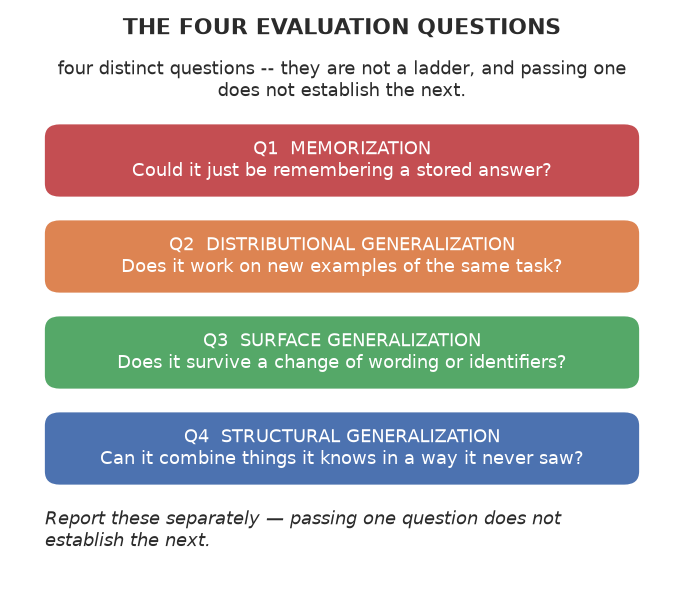

The four questions make the point explicit. Each asks something distinct about a
result, and we never collapse them into a single number. They are not a ladder — passing
one does not establish the next; a model can answer the second question but fail the
third and the fourth.

This is the book's organizing idea. It is four distinct questions about a result:
from "could this just be remembering?" to "can it combine things it never saw
combined?" and they must be reported separately.

**Question 1 — Memorization.** The model reproduces something it saw in training: an exact
example, an exact constant, a familiar phrase, a near-duplicate. *Question: could this
just be remembering?*

**Question 2 — Distributional generalization (same task, new examples).** The model
works on a new instance of the same kind of problem. *Question: does it work on
problems it hasn't seen before?*

**Question 3 — Surface generalization (same problem, different surface).** The
computation is identical, but the *outer layer* changes: new numbers, new variable
names, reworded instruction, harmless distractors. *Question: does it survive changes
that shouldn't matter?*

**Question 4 — Structural generalization (new combination).** The model must combine
pieces it knows into something that never appeared in training. It learned A, B, and C
separately — can it do A *sandwiched inside* B, or A followed by C? *Question: can it
put things together, or only repeat what it already saw?*

Those four headings are the book's canonical level names, in order: **Memorization**,
**Distributional generalization**, **Surface generalization**, **Structural
generalization**. We use these names from here on so that every later experiment can be
filed under exactly one of them.

**A rule we'll follow strictly:** never mash these four into one number. A model that
scores 90% on familiar problems and 0% on a reworded version has not "generalized" —
it memorized the phrasing. One number would hide exactly the thing we care about.

\vspace{-16.5pt}

## The recurring question: "how did it cheat?"

Because we refuse to trust a single score, every experiment asks the same skeptical
question:

> **How could the model have gotten this without learning what we think it learned?**

The usual suspects are always on the table: memorized templates, memorized constants,
memorized name patterns, wording quirks, unbalanced data, train/test leakage,
near-duplicates, retrieval, a weak evaluator, hardcoded answers, hidden-test leakage.

Every major experiment therefore ends with a **shortcut audit**, six steps: (1) the
suspected cheat, (2) why it could explain the result, (3) a control test, (4) what the
control found, (5) what that rules out, and (6) what's still unresolved.

That audit — not the headline number — is the book's signature. It's the difference
between "the model works" and "we know why the model works."

---

# 3. Give the Model One Job

Before we can run any experiment, we have to pin down the task so precisely that a
machine can carry it out and we can score it objectively. Vague tasks give vague
answers; a task with concrete inputs, runnable outputs, and hidden tests gives
crisp, checkable answers.

A well-designed exam question is the model to build toward. It's not enough to say "write a program about numbers." We need: exactly what the input is, exactly what the program should do, and
exactly how to check if it's right. That's what we're about to define.

## The task

The model receives a **natural-language specification** of a programming task and
must produce a **Python program** that solves it. That program is then executed
against hidden tests.

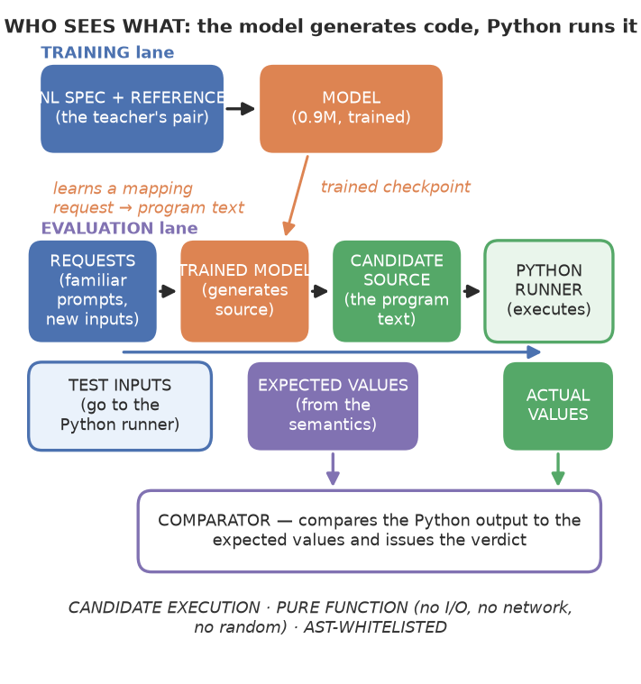

The contract is simple: a natural-language specification in, a program out, and a
set of hidden tests to grade it against. Everything else follows from it.

Concretely, the model sees something like:

> "Write a function that takes two numbers, a and b, and returns their sum."

and must produce:

```
def solve(a, b):
    return a + b
```

We score it by running that program against a set of hidden test cases (inputs with
expected outputs) and checking whether the program's output matches, semantically,
for every case.

One clarification worth making now, because later chapters lean on it: a *fresh* hidden
test value is a new input to the **program**, never a new input to the **model**. The
model sees the specification once and emits one program; the hidden tests then call that
program with values the model was never shown. So a record whose task ID and test values
are new is new to the *evaluator* — it is not an extra example for the model, and it
gives the model nothing new to learn from.

## The task schema

Every task is described by a small, formal schema — the ground truth that drives
everything. The key insight is that **one semantic record generates all three**
things we need: the reference program, the natural-language spec, and the hidden
tests. That way there is far less drift between "what the task is" and "how we ask for it"
and "how we test it" than if each were authored separately. **"Less drift" is not "no
drift"** — because all three derive from the same semantic record, a mistake in that
record would be shared by all three (a correlated error), so consistency here is a
reduction in risk, not a guarantee.

The semantic core captures the operation and its arguments:

```
{
  "operation": "add",
  "args": [{"name": "a", "type": "int"}, {"name": "b", "type": "int"}],
  "output_type": "int"
}
```

From that single record, the teacher generates:
1. the reference Python (`def solve(a,b): return a+b`),
2. a natural-language specification (in one of several phrasings),
3. a set of hidden tests (ordinary, zero, negative, boundary, large cases).

## The pure-function constraint

For the pilot we constrain the generated programs to be **pure functions**. No side
effects, no file I/O, no randomness. This makes *executing a given program* deterministic and
unambiguous: for a given input, there is one correct output. (It says nothing about
*which* program we get — that is sampled; see the success criterion below.) It is a deliberate
simplification, and it is exactly what makes the task cleanly measurable.

## Hidden tests

The hidden tests are the heart of evaluation. Each task carries an independent set of
test cases designed to catch real errors, not just a single happy path. For an
arithmetic task we include ordinary values, zero, negatives, boundary values, and
large-magnitude values. The tests are generated independently of the reference
program's *logic* — computed from the semantics, not copied from the solution — so
that a model that merely memorizes the reference still can't predict the exact test
suite.

It is worth being precise about what "independently" buys us and what it does not. The
tests are produced by a *separate generator* from the program, which means they are an
independent oracle guard: if the program-generator and the test-generator shared a bug,
the tests could pass a wrong program (a correlated-implementation-error problem). Because
the tests are a separate path over the same `semantics`, the oracle is decoupled from the
program generator, which reduces the chance that a single implementation mistake becomes a
false pass. But it does **not** eliminate it. Both the program and the test values derive
from the *same* operation definition, so if that shared specification is wrong, both can
be wrong together; and a *finite* set of inputs can simply miss a defect that only shows on
an untested input. So this is a *control for correlated implementation bugs* — a useful
sanity check, not a guarantee — and **not** a proof that the model "understands" the
operation (understanding is a different question, and the surface/composition chapters
answer it separately). A passing program is also consistent with the model selecting a
correct general program rather than computing anything afresh.

## The success criterion

For a single problem, the success criterion is:

> **Problem-level hidden-test pass@1** — did the one program the model produced pass
> *every* hidden test for that problem, under the evaluation's default
> temperature-0.8 sampled decoding?

This is deliberately strict. A program that passes 7 of 8 hidden tests *fails* the
problem. That strictness is what keeps the measurement honest: we are not measuring
"close," we are measuring "correct."

## Why this specific task

Natural-language-to-Python is a good laboratory task precisely because it has
everything a controlled experiment needs:

- **Deterministic to grade, sampled to produce.** The tests and the comparison are
  deterministic *for a given program* — but the program itself is **sampled**
  (temperature 0.8), so the same spec can yield different programs on different draws.
  That is exactly why the success criterion below scores one sampled program with
  pass@1 rather than assuming "same spec, same program."
- **Executable.** We run real Python and compare real outputs.
- **Objectively scorable.** Pass/fail, no judge-subjectivity.
- **Synthetic.** We can generate as much controlled data as we want.
- **Controllable difficulty.** We can escalate from `a+b` to compounded operations.
- **Compositional splits.** We can train on pieces and test on unseen combinations.
- **Memorization tests.** We can plant canaries and check for exact reproduction.
- **Auditable.** We can inspect the exact generated program and run shortcut audits.

The model could not ask for a clearer job. Now we have to build the tools that let us
run and score it: a controlled world, a teacher, a judge, and rivals.

---

# 4. Build a World We Can Control

A model that answers natural-language questions is easy to build and hard to
evaluate. But there is one class of task where the evaluation is not a judgment call
at all: **write a program.** We write a description, the model writes code, and a computer can tell us, to a very high degree
of confidence bounded by the judge and tests, whether that code does what was asked. There
are no opinions about the answer, no ambiguous grading rubric, no "well, it's sort of
correct." Either the program returns the right thing for every test, or it does not.

That one observation is why this whole book rests on the `natural-language → Python
program` task. It gives us something few machine-learning setups have: *objective,
executable, reproducible* evaluation. But the task alone is not enough. Before we can
run any experiment, we need a world the model can live in — a world that is safe, that
is *deterministic*, and that is small enough that we can reason about everything that
happens inside it.

## Why we need a world at all

Imagine hiring someone to write code, but not fully trusting them. We would not hand them the keys to the server. We would give them a sandbox — a walled-off
room where they can work, but where the dangerous tools are simply not present.

That is exactly what we do with the model. It writes Python, and we need to run that
Python safely and deterministically, while deciding precisely what it is *allowed* to
do. The model could, in principle, write a program that reads files, connects to a
network, or deletes things. It has no reason to — but we are not relying on its good
intentions. We build a restricted world where the *disallowed constructs covered by our
validator* are rejected, not where every harmful program is made impossible: the sandbox
rejects the constructs it knows to disallow, and it is a teaching evaluator, not a
hostile-code security boundary.

The deeper reason is that a controlled world makes the *experiment* clean. If the
model's program could do anything — read a file, check the time, generate a random
number — then two runs of the same program could give different answers, and we could
never attribute a failure to "the model didn't learn this" versus "the program did
something nondeterministic." We want the world to be so constrained that **the only
source of variability is the model itself.**

## The principle: whitelist, not blocklist

The naive way to constrain a program is a blacklist: deny `import`, deny `eval`, deny
`open`. This is the instinct most people reach for first. But a blacklist is
fundamentally fragile — there is always some construct we forgot. Python has an
enormous surface area, and attackers (or, in our case, just curious models) find the
gaps. Denying a hundred things is not safety; it is a constant game of catch-up.

The sound way is the opposite: **an allowlist.** We parse the program into its
abstract syntax tree — the structured representation of the code, before it runs — and
walk through every node. If any node type is not *explicitly permitted*, we **reject
the entire program.** There is no "mostly allowed." If the model emits even one
disallowed construct, the whole thing is refused before it ever executes.

The difference is between a list of banned words and a grammar. A banned-word
list can be evaded by creative phrasing. A grammar says: these are the only forms that
exist. Anything outside the grammar is not merely suspect; it is *unparseable in our
world.* That is the philosophy of the sandbox.

This is a central design decision in the apparatus, and it
deserves to be stated plainly: **the sandbox does not try to catch bad programs. It
states upfront what is allowed, and everything else is refused.**

## The capability spec

For the pilot, we whitelist a deliberately small subset of Python — small enough that
we can hold it in our heads, large enough to express real programming:

- literals (integers, floats), variables, assignment, `return`
- arithmetic: `+ - * / // % **`
- comparisons, boolean operators
- `if / elif / else`, `for`, `while`, `break`, `continue`, `pass`
- lists, indexing, slicing, and the list methods `append`, `count`, `index`, `pop`
- a small set of built-ins — eleven in total: `abs, min, max, sum, len, range, int,
  float, round, list, sorted`
- simple `def` functions

This list is a summary; the authoritative whitelist is §5–§6 of
`python_capability_v0_1.md` and `ALLOWED_NODES`/`ALLOWED_BUILTINS` in `src/sandbox/sandbox.py`, which
agree with each other. Everything else is rejected: imports, file I/O, network,
subprocess, `eval`/`exec`, `class`, `try/except`, arbitrary attribute access (beyond
the whitelisted list methods), comprehensions, lambdas. We do not
include these because they are dangerous; we exclude them because they are not needed
for the task we are testing, and because each one we add makes the world bigger and
harder to reason about. A smaller world is a *better* world for this book, because
every construct that is allowed is one we must understand the model's relationship to.

We also version this spec (`python_capability_v0_1`) so that later, when we give the
model *more* Python (see the closing chapter's future-work note), we can point to
exactly what grew. Versioning the
world is what lets us claim, later, that a change in behavior was caused by a change
in the world, and not by something else that drifted.

## Resource and determinism policy

**Start with the enforcement that is missing: the shipped sandbox enforces no time limit
and no memory limit.** Nothing in it stops an allowed program from looping forever or
allocating until the machine runs out of memory. The spec *designs* a hard execution
timeout, a maximum nesting depth, and recursion protection, and the code carries them as
constants — but the shipped validator checks AST depth and node count alone, so those
three are not enforced at runtime. Everything in this section therefore bounds the
*shape* of allowed programs, not their resource use; we say it here, up front, so that no
reader mistakes a shape limit for a resource limit.

Beyond what is allowed syntactically, we also control *how complex* the program may be:

- maximum AST depth (24) and node count (200) — a program can only be so complex,
- float-comparison tolerance (because `0.1 + 0.2` is not exactly `0.3`),
- **no randomness, no time, no environment access.**

That last point is the quiet heart of the whole design. A program with the same input
must always produce the same output. If it does not, the experiment is contaminated.
We cannot tell whether a failure means "the model didn't learn this" or "the program
rolled the dice." By making the world deterministic, we eliminate that ambiguity
entirely. The book's every later claim rests on this.

One honesty note on that list, restated because it matters: the timeout, nesting-depth,
and recursion caps are *designed but not enforced* (stated up front in this section), so
an allowed program could still loop or consume memory. That is exactly the
resource-use qualification Gate A carries below: the gate bounds the *shape* of allowed
programs, not their resource use.

## The pipeline

```
source -> parse -> AST -> whitelist validation -> compile
        -> restricted execution -> semantic comparison
```

Validation happens on the tree *before* execution, so disallowed code never runs.
Execution uses a stripped set of globals that exposes only the allowed built-ins —
there is no `__import__`, no `open`, no `eval`. The program can only see the tools we
chose to give it.

## An honest caveat

### The whole apparatus, in one picture

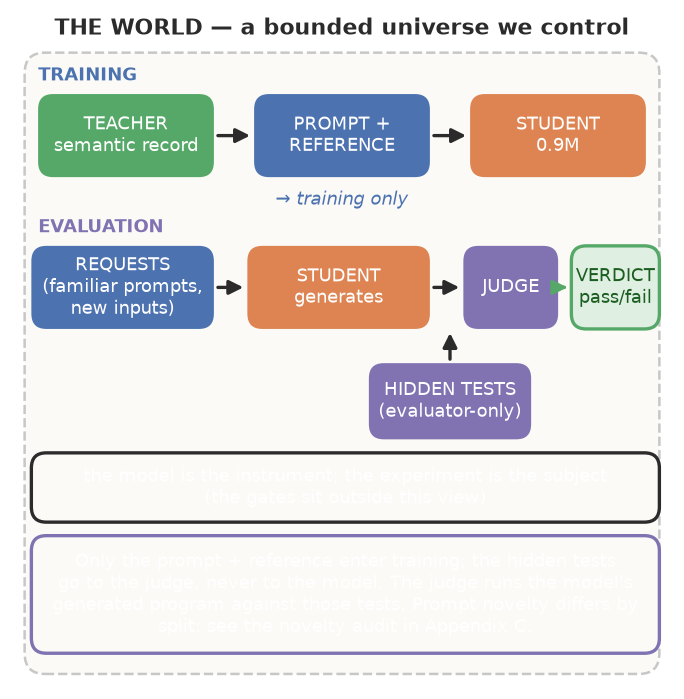

Here is the full loop: the teacher creates the dataset, the student reads it, the
judge grades the result, and the world encloses it all.

It is important to be clear about what this sandbox is *not*. It is a **teaching and
evaluation** sandbox — deliberately strict about the capability subset, but not a claim
of production-grade adversarial isolation. We are not trying to secure a server against
a hostile attacker; we are trying to run generated code and measure whether it does
what we asked. An attacker with time and motivation could likely find ways around a
small AST allowlist. We state this limitation plainly rather than overstating what the
sandbox guarantees, because the book's credibility depends on honest boundaries, not
on impressive-sounding claims.

## Testing the world

The sandbox is the foundation of trust in every later result. If the sandbox leaked —
allowed something disallowed, or failed to be deterministic — every score in the book
would be suspect. So the very first thing we do is not run any experiment at all. We
**test the world itself.**

We build a conformance suite of 15 cases: three programs that use allowed constructs
and must run (a plain function, a loop, a conditional), plus twelve that must be
rejected — ten disallowed constructs (`import`, `from`-import, `eval`, `class`, `open`,
`__import__`, `try`, conditional expressions, comprehensions, lambdas), a syntax error,
and a program that is not a single function. The suite is
`tests/sandbox/test_sandbox.py`, and it runs with `pytest tests/sandbox/test_sandbox.py`.
A sandbox that only permits things is easy; a sandbox that also *correctly refuses* the
disallowed constructs it knows is the real achievement — and that is what our 15-case
conformance run checks before we trust a single number it produces. (The 15 cases are a
deliberate conformance sample, not an exhaustive proof that every possible disallowed
construct is covered; we say "passed its conformance cases," not "verified everything," and
the validator's scope is the constructs it enumerates.)

This is the first instance of a discipline the book will return to again and again
(and which we will see was worth it, painfully, in Chapter 10): **before we use a tool to measure something, we verify that the tool measures what we think it does.** Here, the
tool is the world, and we refuse to run a single experiment until it passes its own
examination.

## Two gates, not one

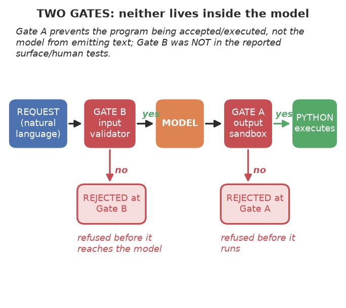

Neither gate lives inside the model. Gate B sits on the way in, Gate A on the way out.

Everything above describes what the model is *allowed to produce*. But there is a
second, quieter question: what is the model *ever asked* to do? These are not the same
thing, and the difference is worth making sharp, because it is the difference between
"the model cannot escape" and "the model was never put in the position to."

A language model has no *built-in* notion of refusal. It is not, by default, a system
that decides whether a request is in scope; it is a next-token predictor. Hand a request
to this model outside its designed job and it does not politely decline — it simply
keeps predicting tokens and produces whatever the weights trend toward, often a
confident near-program or garbage. (Models *can* be trained to refuse, but this one was
not, so refusal here is not a property to assume.) So "it only does its one job" can
never be a property of the model's own intent here. It has to be a property of the
wiring around it.

That gives us **two independent gates**, and this chapter (so far) has really only
built one of them:

**Gate A — the output gate (the sandbox).** Already described above: the AST allowlist
rejects any generated program that uses a construct outside the whitelist, before it
runs. This means that if the model *tries* to emit `import os` or `eval()`, the command
is refused. Gate A is a hard gate on the *syntax* of what the model
*produces* — it is deterministic for the constructs it covers. Two
qualifications: it bounds the *shape* of allowed programs, not their resource use or
their adversarial resistance (an allowed program could still, in principle, loop or
consume memory), and it is not production-grade isolation. As a scoping mechanism for
this experiment it is sufficient; as a security sandbox it would not be. Anyone who wants
to try the execution steps described later should do so in a disposable, unprivileged,
resource-limited environment with no sensitive files or network access.

**Gate B — the input gate (the request validator).** This is the gate we build for the
other half. It sits *in front of* the model and decides, from the incoming
natural-language request alone, whether that request is one the model was designed
for. If not, the request is declined before the model is ever consulted.

Gate B works on the same principle as the sandbox: a **recognizer, not a rejector of
the exceptions**. It holds the set of designed template-family shapes (the exact
phrase skeletons the teacher renders) and the designed operation vocabulary. A request
is in scope only if it fits one of those shapes *and* names a known operation —
otherwise it is refused. Just as the sandbox says "these are the only forms of program
that exist," Gate B says "these are the only forms of request that exist."

**One clarification on how we used it.** Gate B was built late in the investigation,
after the diversity, memorization and surface experiments (Chapters 13–15) and the
human-written evaluations. Those evaluations
ran the model **directly, without Gate B in front of it** — precisely so that a
low score could be attributed unambiguously to the *model*, not to a request filter
that had quietly declined the caller. For the surface and human tests, the model saw
the reworded / human-phrased request and failed on its own. Had Gate B been in front,
it might well have rejected those out-of-scope phrasings (that is its job) and the
failure would have been the filter's, not the model's. So we state it clearly: the
surface and human-written failures are model failures, not Gate-B rejections. Gate B
enforces scope; it does not confound those measurements.

Why do we need both? Because each covers a failure the other cannot:

- **Gate A alone** would let the model be *asked* for anything — including a task it
  was never trained for — and only then catch the malformed result. The model would
  churn, and our whole experiment would trust that an out-of-scope query produced a
  rejected program rather than a plausible-looking-but-wrong one.
- **Gate B alone** would let the model *produce* anything within an in-scope request,
  including a program that escapes its world, because nothing would constrain the
  output.

Only together do they close the loop: Gate B ensures the model is never *asked* for
something outside its job, and Gate A rejects programs using constructs outside its
allowed syntax. Together that scopes the model to a single accepted request shape and a
single accepted program shape — a *scoping* guarantee, not proof of semantic correctness,
and not a claim that the model can never do anything unintended beyond those two scopes.

There is a deep parallel here with the book's central thesis. The model is the
instrument; the experiment is the subject. In the same way, the *boundaries* are never
the model — they are always the apparatus: the sandbox on the way out, the validator
on the way in. A model that "only does its one job" is confined by its wiring, not
by itself. That is worth stating plainly, because it is the mistake people make when
they imagine a well-behaved model as one that simply chooses to behave.

### How this maps to production systems

Our two gates are not an esoteric lab device; they are the same two ideas that real
systems use, under different names. It is worth mapping them, so the book's abstract
apparatus connects to what people actually deploy. We split the map into two compact
two-column tables — one per gate, with what a mechanism does and what it does *not*
establish in the same cell — because a four-column table does not survive a 6×9 page.

**Gate B (input) analogues**

| Production analogue | What it does — and what it does NOT establish |
|---|---|
| **Structured-input schema** | Declares the request's allowed shape (JSON schema); a request outside it is invalid by construction — a deterministic rule, not a model's decision. *Not established:* shape compliance only — schema validity is not correctness, safety, or authorization |
| **Function/tool signatures** | Only registered functions with typed signatures can be called; off-scope actions aren't callable. *Not established:* permission for every argument or action — a declared function can still be called with a harmful argument |
| **Learned safety classifier (input)** | A separate learned model scores the prompt and a block action is applied to the score. *Not established:* perfect semantic classification — the classifier is itself imperfect and can misclassify |

**Gate A (output) analogues**

| Production analogue | What it does — and what it does NOT establish |
|---|---|
| **Schema-constrained decoding** | Decoder only emits tokens that keep output inside the declared structure. *Not established:* correctness of values or authorization — it guarantees *structure*, not semantic correctness |
| **Provider JSON mode** | The provider's documented behavior for ensuring the completion is valid JSON, with incomplete-output / edge-case handling needed. *Not established:* arbitrary schema adherence or semantic correctness — a provider's JSON mode ensures JSON validity (including the incomplete-output caveat), not adherence to a specific schema or correctness of values |
| **Prompt-only formatting request** | The model is only *asked* to format a certain way; there is no formal syntax enforcement. *Not established:* valid JSON or schema compliance — a prompt saying "please use JSON" is not an API's JSON mode |
| **Output filter / sandbox** | A post-hoc check (or a walled-off execution environment) rejects or neutralizes what slipped through. *Not established:* correctness of the content — the check is only as good as its rules |

The thread running through the *what it does NOT establish* half of every row is the book's point:
every reliable enforcement mechanism is **external and scoped**, and none of them is
"the model chose to behave." Even a frontier model that appears to refuse is doing so
because RLHF shaped it to *tend* toward refusal — which is a soft, jailbreakable
behavior, not a bound. The dependable version of "it only does what it was designed
for" is the wiring we build around it, exactly as our sandbox and our validator are.

Three things follow. First, we deliberately do **not** assign "Low / Medium / High"
residual-risk ratings to the rows in the two tables above: we have no threat model or measurement to
justify a quantitative ranking, so a color-coded risk column would be unsupported
assertion. Instead each row names *which* failure mode remains open. Second, the
distinction between a *prompt-only* request and an API's *JSON mode* is a real one:
"please use JSON" is a request the model tends to follow, whereas a provider's JSON mode
is a documented behavior with its own validity guarantee and its own incomplete-output
edge case. Neither one is "the model is forced to comply with a schema" — that is what
schema-constrained decoding does. Third, even schema-constrained decoding bounds the
*shape* of what gets through; it does not make the content correct or safe. So the
reliable layer is external and it is a *scoping* guarantee, not a *judgment* guarantee.
There is no mechanism in the table that gives semantic reliability.

---

# 5. Build the Teacher

We need data. But not just any data — we need data we can *trust* to be fair, and
data we can carve up to test the model honestly.

A teacher preparing worksheets for a test is our model of good practice. A bad teacher writes twenty
questions that are all the same question with different numbers — the student can
memorize one template. A good teacher writes questions that look different on the
surface but test the same idea, so a student who actually learned the idea passes
whether or not they've seen the phrasing.

Our **teacher** is that good worksheet-writer. But there's something special about the
way we build it, and it's a central design decision in the whole book.

## Semantic-first: start with the meaning, not a template

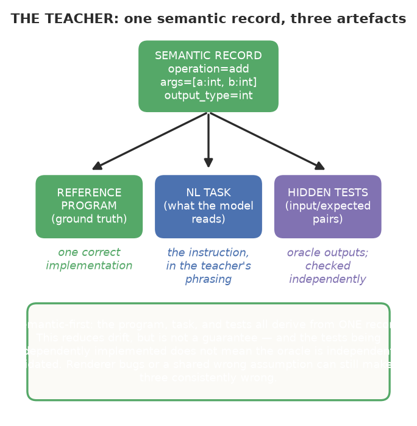

One semantic record is the single source of truth: the program, the task, and the
tests all derive from it, so they are much less likely to drift apart than if each were
written by hand. This is not a guarantee — a bug in the reference implementation or the
renderer could still make all three consistently wrong, which is exactly why we later
test the judge against known-correct programs.

The naive way to generate data is to write a template and fill in a few blanks:

```
template -> sentence -> code
```

We write "add {a} and {b}" and a few code snippets, and we are done. This is fast and
easy, and it's exactly the wrong way to do it. The problem is that the sentence and
the code are generated **independently**, from a template, so there's no guarantee they
mean the same thing. We can end up with a sentence that says "add" but code that
subtracts, or a test that checks the wrong thing.

We do the opposite. We start from the **meaning** and generate everything else **from
it**:

```
SEMANTIC INTENT
   -> PROGRAM STRUCTURE
      -> REFERENCE CODE
      -> NATURAL LANGUAGE
      -> HIDDEN TESTS
```

The key insight is at the top: **one semantic record drives all three.** There is little
room for the sentence to disagree with the code or the tests, because they are all the
same meaning, rendered three ways. If we start with "the function should return
`a + b`," the sentence says "sum," the code adds, and the tests check addition — and
they are far less likely to drift apart, because they all came from the same seed.
(Agreement is still only as good as that seed: a wrong reference makes the sentence,
code, and tests agree with each other but all be wrong, which is why the judge is
itself tested.)

## What a "semantic record" looks like

The meaning is captured in a small, structured object. It is not English and not code;
it is the *idea* underneath both. For an addition task it looks like this:

```
{
  "operation": "add",
  "args": [{"name": "a", "type": "int", "role": "operand"},
           {"name": "b", "type": "int", "role": "operand"}],
  "output_type": "int"
}
```

From this single object, we generate:

1. **the reference program** — `def solve(a, b): return a + b`,
2. **the natural-language prompt** — e.g. *"Write a function that takes two numbers,
   a and b, and returns their sum"*,
3. **the hidden tests** — e.g. `{args:[-28,47], expected:19}`, `{args:[0,0], expected:0}`,
   and edge cases we'll get to.

This is the heart of the teacher. The pump is `make_task`, which takes an operation
and a seed, builds the semantics, and then calls three sub-generators that all read
that one record.

## The four sub-generators

The teacher is really four small pieces working together, all fed by the same
semantics:

**1. `make_semantics`** — builds the semantic intent: the operation plus its argument
descriptors. It pulls argument names from a controlled set (so we can vary them later),
assigns an input/output type, and tags the task with a complexity score.

**2. `generate_reference`** — turns the semantics into the ground-truth Python. This
is the correct program the grader is validated against. For `add` it emits
`def solve(a,b): return a+b`; for `list_sum` it emits a loop over the list.

**3. `render_nl`** — turns the same semantics into English, using one of several
**template families**. A template family is just a different way of phrasing the same
instruction. For addition, we have phrases like:

- *"Write a function that takes two numbers, a and b, and returns their sum."*
- *"Implement solve so that given a and b it returns their sum."*
- *"Define a function solve(a, b) that returns a + b."*

Same meaning, three different wordings. This is what gives the dataset linguistic
diversity — and, more importantly, it's what lets us later test whether the model
learned the *idea* or just one *sentence*.

Cardinality — how many families an operation has — is per operation and deliberately
uneven, and it is worth knowing now rather than meeting it as a surprise later: `add`,
`sub`, and `mul` have **three** families each; `max_of`, `min_of`, `list_sum`,
`list_len`, and `first_element` have **two**; and `abs_of` and `cond_abs_max` are
**singletons**, with exactly one family each. (The composite operations are
single-family too, and they are held out of training entirely — Chapter 16.)

Singletons change what a wording claim can mean. For a singleton operation, every
training prompt and every in-distribution test prompt comes from the same phrasing
skeleton, so "the model has seen this wording" and "the model has seen this operation"
cannot be told apart — which is why the surface experiment (Chapter 15) excludes those
two operations from its held-out-wording cells instead of pretending a holdout exists,
and why the diversity experiment (Chapter 13) later grows the train-eligible pool to
11–13 families per primitive operation while reserving two further families per
operation exclusively for held-out-family tests.

**4. `generate_hidden_tests`** — generates test cases **from the semantics**, not from
the reference program's logic. It deliberately covers edge cases: ordinary values,
zero, negatives, boundary values, large magnitudes, and (where legal) empty lists. For
each it computes the expected value from the operation itself.

## Why the tests come from the meaning, not the code

This is a subtle but crucial point, and two different guarantees are easy to blur here,
so we name them separately before explaining either:

- **Shared-semantics consistency** is what the semantic-first design above buys: the
  program, the prompt, and the tests all derive from one semantic record, so they agree
  by construction. It is cheap and automatic, and it is blind to an error *in the record
  itself* — everything downstream inherits it.
- **Independent oracle validation** is a different thing entirely: checking the evaluator
  against evidence that does *not* come from that shared record — the judge's mutation
  control and its known-correct reference programs (Chapter 6), and the deliberate
  red-team (Chapter 17). Consistency reduces drift; only independent validation can
  bound a correlated error, and this chapter does not provide it.

With those apart, here is precisely what the separate test-generation path does and does
not establish. If we generated the tests by looking at the reference program, a
model that emitted the reference would trivially pass — the tests would be circular.
By generating the tests from the shared *semantics* instead, the tests provide a
**separate implementation path**: the expected values are computed from the operation
definition, in a different code path from the model's program, so a *correct* program
and a *wrong* one can be told apart. This is a useful control against
**correlated implementation errors** — if the reference generator and the test oracle
shared the same buggy code path, they could agree and let a wrong program pass.

But it is **not** a guarantee. Two reservations are worth stating plainly. First, the
reference and the test oracle share the same *specification* (the semantic record), so
if that specification encodes an error, both can be wrong together and a wrong program
can pass unseen. Second, a *finite* set of inputs can miss a defect that only shows for
inputs outside the tested set. So the independence of these two code paths is a useful
*sanity check*, not a proof that the oracle is perfect or that a passing program
"understands" the operation — a model that emits a correct general program (rather than
a memorized constant) also passes, so a pass does not distinguish understanding from
correct program selection. The honest claim is narrower: generating tests from the
semantics decouples the expected values from the model's own output.

## Maximizing controlled diversity

A good teacher does not just produce many examples; it produces *diverse* ones while
holding the semantics fixed. We deliberately vary three things:

- **constants** — different values each task, so the model can't memorize outputs,
- **identifiers** — `a, b` vs `left, right`, so it can't tie the operation to
  particular names,
- **wording** — several template families per operation, so it sees the same idea said
  many ways.

This controlled diversity is what makes the *generalization tests* later possible.
Because we control *how* we vary the surface, we can also *hold it out* and test
whether the model generalizes. That's not an accident; it's the whole point.

## Avoiding accidental correlation

The danger in any generated dataset is **accidental correlation** — a pattern that
makes the answer trivially predictable from the surface. The classic failures:

- every addition example uses the word "total";
- every maximum example uses the variable `x`;
- every multiplication has exactly three arguments;
- every loop example is exactly one sentence long;
- every operation uses one unique wording.

If those correlations exist, a model (or a trivial classifier) can solve the task
without learning the computation. The generator is built to break them, and then — this
is the crucial part — we **check that it actually did**.

## The lexical diagnostic

Before trusting any dataset, we ask: *can a trivial classifier predict the answer from
the surface alone?* The method is deliberately crude: train a TF-IDF + logistic
regression model on the natural-language prompts and see how well it predicts the
target operation from the words alone. A high score is a **flag to investigate**, not a
verdict: because the request usually names the operation, much of that predictability is
task signal, not leakage. Also note what an operation-prediction score does and does not
measure — it is a check on *whether the surface is informative about the target
operation*, not an audit for duplicated records or for leaked hidden-test values;
distinguishing those are separate checks. So we treat a high diagnostic score as a
signal to look closer and then decide whether it is task signal or a real shortcut.

But the method needs a careful interpretation, and our first pass misread it. On our
first pilot renderer, a trivial classifier predicted the operation from the wording
with **100% accuracy**. We recorded it as a red flag (finding-001). On reflection, that
is most of the time **task signal, not leakage**: the request must name the operation,
or the task would be ambiguous. Saying "return their sum" *should* identify addition —
that is what makes the request unambiguous. A classifier hitting 100% because "sum"
identifies addition is the wording doing its job, not spilling a secret.

So the audit has to distinguish three things:

- **Task signal** (fine): "sum" identifies addition; the request names the operation.
- **Spurious correlation** (a real shortcut): an *irrelevant* feature that is not part
  of the request's content — a particular identifier name, an incidental sentence
  frame, or a formatting quirk — predicts the operation.
- **Train/test leakage** (the real bug): duplicated examples, or evaluation
  information, crossing the train/test boundary.

A 100% TF-IDF classification score shows that operation selection is lexically *easy*
on that split. It does not by itself establish contamination, and it does not tell us
the model is exploiting an illegitimate signal — the phrasing is supposed to carry the
operation. What a stricter audit *should* do is mask the operation-bearing language and ask
whether *irrelevant* features still predict the target, and also test *held-out template
families* and counterfactual changes to names or sentence frames — a stronger diagnostic
than we ran, not one we completed here. Our finding-001 note is best read as "the wording
is very predictive of the operation" — which is a property of a clear task, not proof of a
shortcut. (One implementation note as well: the TF-IDF vectorizer was fit on the whole
set before cross-validation, which would leak held-out-fold vocabulary; a principled
version fits the vectorizer inside the CV pipeline, as shown in Appendix A.5.)

This is the teacher doing its real job. A dataset generator that only produces data is
half a tool. One that produces data **and audits it** — asking whether the surface is
carrying the answer for the *right* reason is a laboratory instrument.

## The takeaway

The teacher is not a bulk-data tool; it is a controlled instrument. Its job is to
produce data with *controlled* diversity and *audited* cleanliness, so that when the
model succeeds we can attribute it to learning the computation — not to the data
accidentally giving away the answer.

And the reason this matters so much is the whole book's premise. Everything later —
the generalization tests, the composition test, the capability map — depends on the
data being a *fair* test. The teacher is where that fairness is built.

---

# 6. Build the Judge

How do we know a student's answer is right? We check it against the answer key. But
what if the answer key is wrong? Then every student who gets it "right" is actually
wrong, and we'd never know.

That is the risk with our **judge** — the evaluator that decides whether a generated
program is correct. It is the instrument whose readings the whole book depends on. If
the judge is wrong, every number in this book is wrong. So we build it carefully, and
then we attack it.

This is the second pillar of the apparatus, and it is in some ways the most important.
The world (Chapter 4) decides what the model is *allowed* to do. The teacher (Chapter
5) supplies the material to learn from. But the judge is the thing that decides
whether the model *got it right*. A subtle way to frame the whole book: we are not
really studying the model. We are studying the model *through* the judge. So the
judge's integrity sets an upper bound on the trustworthiness of everything that
follows.

## Why an execution-based judge

The naive way to judge a generated program is to compare it, as text, to the expected
answer. This is cheap, and it is almost worthless. Two programs that solve the same
task can look completely different as strings — one uses a loop, another uses `sum()`,
yet both are correct. And two programs that look nearly identical can behave
differently. String comparison measures *how the code is written*, not *whether it
works*. That is not what we care about.

So the judge does the thing that makes this whole task special: it **runs** the
program. It executes the generated code against hidden tests and compares the actual
*output* to the expected output. This is what gives us objective, unambiguous
judgment. There is no opinion about whether the code is elegant or the "right" style —
either it returns the correct result for every test, or it does not.

## The four-stage pipeline

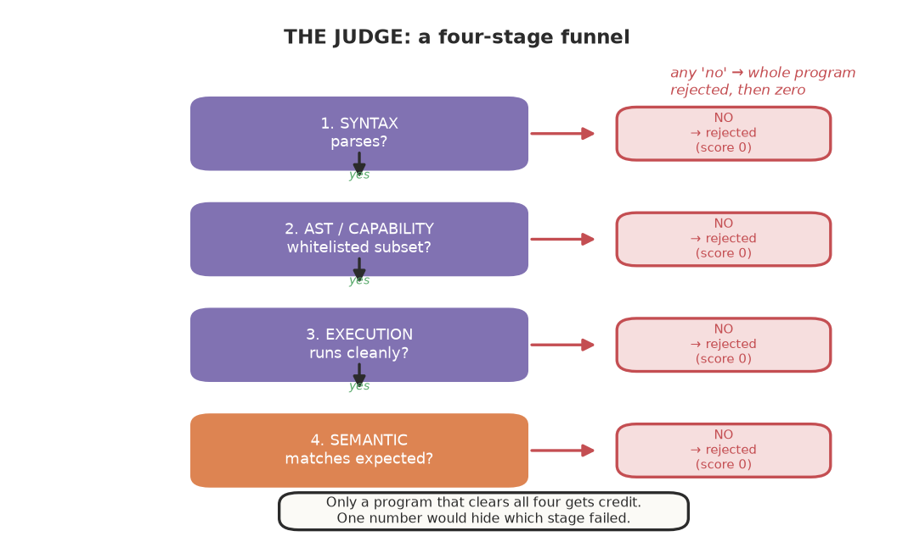

The judge is a funnel: a program clears it only by passing every stage, and the
first failure sends it to zero.

We score a candidate program through four stages; a later stage only matters if the
earlier ones pass. Each stage is a filter, and each exists for a specific reason.

1. **Syntax pass** — does the program parse as valid Python?
2. **AST / capability pass** — is every node within the whitelisted subset? If the
   program smuggles in an `import`, it is rejected here.
3. **Execution pass** — did the program produce at least one correct output? In the
   implementation this stage is recorded as *executable* when the program passes at
   least one hidden test (or has no hidden tests), so the recorded quantity is
   "produced at least one correct output," not merely "ran without error": a program
   that executes cleanly but fails every hidden test is recorded as *not* executable.
4. **Semantic pass** — for each hidden test, does the program's output match the
   expected output?

Two honest notes on how this design maps onto the code. **First, stages 1 and 2 are a
single combined validation gate in the implementation:** the evaluator calls
`sandbox.validate_source` once — one call that both parses and checks the whitelist —
and sets `syntax_ok` and `capability_ok` together. So the reported **syntax rate
includes whitelist/capability rejections** (a program rejected for smuggling in an
`import` is counted in the syntax rate), and no separate capability rate is computed.
**Second, stage 3 is coupled to stage 4:** `execution_ok` is derived from the
hidden-test outcomes (`tests_passed > 0`), which is why "executable" means "passed at
least one hidden test," as defined above. The four-stage vocabulary is the design's;
the recorded numbers collapse the first two stages into one gate and tie the third to
the fourth.

The primary metric is **problem-level hidden-test pass@1**: did the one program
produced pass *every* hidden test for that problem?

Why four stages rather than one? Because each stage isolates a *different* kind of
failure, and separating them tells us *why* a program failed. In the design a syntax
error is a very different problem from a capability violation (the model tried to use
something outside its world), which is different again from a runtime error (the code
ran but crashed on a test), which is finally different from a semantic error (the code
ran but produced the wrong answer). If we collapsed all four into one "it failed," we
would lose the ability to diagnose. The judge does not just tell us right or wrong; it
tells us *where* things go wrong, and that diagnostic power is worth keeping. The
honest limit, as noted above: because stages 1 and 2 share one validation call, the
recorded rates separate *failed validation* from *no correct output* from *all tests
passed*, but they do not separate syntax failures from capability violations — the
reported "syntax" rate is really "failed validation."

## Semantic comparison: don't trust string equality

A naive evaluator would compare outputs as strings. That is wrong — the result of a
program is a *value*, so comparing text representations of numbers would reject correct
answers (`0.1 + 0.2` as text is not `0.3`). So the judge compares values with a
**semantic comparator**. Notably, Python's own `==` already recurses into lists and
ignores dictionary insertion order, so the comparator's job is narrower than "fix all
of Python's equality quirks." It adds three real policies on top of Python semantics:

- **floats compared with an explicit tolerance** (Python's `==` on floats is exact;
  `0.1 + 0.2 == 0.3` is `False`). We use an absolute tolerance.
- **booleans treated as booleans, not as 0/1** (so `True` is not equal to `1`),
- **dicts compared order-insensitively**, which Python already does for `==`; the
  comparator re-implements it explicitly for clarity and to recurse into values.

The comparator itself is tested — we don't assume it's right just because it's simple.
And the tolerance matters: floating point arithmetic is not exact, so a judge that
demanded exact equality on floats would reject correct programs. A judge with no
tolerance at all would be as broken as one that accepted anything. Choosing the right
tolerance is a real design decision, and it is the kind of thing that quietly shapes
every number the judge produces.

## Mutation testing: red-teaming the judge

The most important step is treating the judge as something that must be *vetted*. We
**mutate** the reference solution into deliberately-broken versions and ask:
*does the judge catch them?*

We generate mutants such as: `+` → `-`, `>` → `>=`, remove the `return`. The shipped
recipe list is all text substitutions — arithmetic and comparison operator flips,
`and`/`or` swaps, and removing the `return`; swapping arguments, off-by-one loop
boundaries, and wrong-variable edits are design-stage candidates we do not run here.
Then we run each mutant through the hidden tests. A good test suite **rejects** an
obviously-wrong mutant. A weak test suite lets it pass.

The mutation score — the fraction of wrong mutants the tests catch — is a measure of
how much we can trust the judge on *the cases it is designed for*. An obviously-broken
program passing our tests means the tests are too weak for that class of error. Two
honest caveats: (1) passing a finite hidden-test suite means passing *that suite*, not
proving correctness for every allowed input — deterministic scoring is not complete
semantic verification; (2) equivalent mutants (e.g. swapping `+` operands) do not make
a program incorrect, so those should not count against us. We report the mutation
behaviour honestly rather than claim the judge is "proven sound"; it is a well-tested
*heuristic* verifier within the cases we constructed, not a proof.

This is the "test the tester" principle, and it is the reason we do not trust the
judge just because we wrote it. The judge is the instrument of measurement, so we
deliberately give it wrong inputs and check that it rejects them. It is a rare and
valuable discipline: most people build a measuring stick and assume it measures. We
deliberately try to break ours.

## We caught our own judge being wrong

Here is what makes this chapter honest rather than aspirational: the very first time
we evaluated our model, it **scored 0.000** — reported a total syntax failure on
every problem. And the model wasn't wrong. The *judge* was.

The root cause was a generation bug on our side: the model produced a complete, correct
program, but it was followed by padding (null bytes), and `ast.parse` correctly rejects
null bytes — they are not valid source. So the fault was in the *generation/extraction
contract*: those padding bytes were meant as a termination or padding marker that we
needed to strip, not as part of the program. `ast.parse` behaved correctly; our
extraction forgot to truncate the padding before parsing. Once we truncated it, the
model's true score emerged: **0.897**.

That moment is worth more than any passing test. It is the book's core lesson applied
to ourselves: **never trust a number from a system we have not audited.** If we had
taken the first 0.000 at face value, we'd have concluded the approach failed. Instead,
finding the judge's bug told us the truth — the model was actually working.

What is striking is that this bug was not exotic. It was a small, mundane detail — a
sentinel byte used to mark the end of a generated program — colliding with Python's
parser. We would never have found it by reasoning about the model. We found it
because we looked at the judge's *intermediate* output (the syntax scores) rather than
jumping to the headline number, and because we already had the habit of doubting the
measurement. That habit, more than any single fix, is what kept the book honest.

## The honest summary

The judge is not a helper; it is the instrument whose readings we stake the book on.
So we built it strictly (four stages, semantic comparison, tested comparator), then
we red-teamed it (mutation testing), and then — when it gave a suspicious answer — we
attacked it until we found our own bug. Only a judge that survives that scrutiny
deserves to be trusted.

And the deeper lesson is one we will keep relearning: in any measurement, the
instrument is part of the experiment. The model and the judge are both subjects. We
spend almost as much effort verifying the judge as we do training the model — and
that is not waste. That is the only way to trust the numbers at all.

---

# 7. Build the Rivals

A model that scores 90% sounds impressive — until we ask the hard question: *could a
much simpler machine do the same thing?* This chapter is about building those simpler
machines, our **rivals**, and why they are the most important comparison in the book.

## The principle

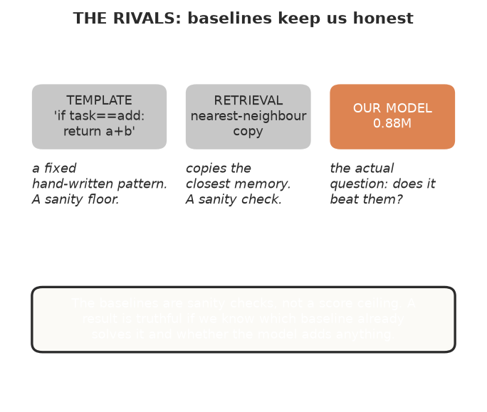

The template and the retrieval baseline are *sanity checks*, not a score ceiling. Our
model is drawn next to them for comparison: it has to clear them to be worth anything,
but beating a baseline is never a bad result — it just needs to be interpreted
correctly.

The value of a neural model's success is judged *relative to a baseline*. If a
hand-written rule or a lookup table solves the task as well as the trained model, then
the model isn't demonstrating capability — it's re-deriving something simpler. The
baselines are what turn "the model works" into "the model does more than a simpler
machine could." But a baseline is not a *ceiling* a result must sit below: a strong
model beating a baseline is a good outcome. The baselines tell us *whether the task
was already easy for a simpler machine*, which is the information we need to
interpret the model's score — they do not cap how good a model is allowed to be.

This is a point that deserves to be stated bluntly, because it is easy to overlook: a
number in isolation is almost meaningless. "The model solved 90% of the problems"
sounds like a triumph. But if a ten-line lookup table also solved 90%, the model's
result shows **no demonstrated advantage over that baseline** — it does not prove the
model has no learned capability, but it does mean we cannot credit the score to
learning rather than to the task simply being easy. The baseline is what gives the
number its meaning.

This is the single question the whole book keeps asking:

> **Could a much simpler machine do this?**

And it is remarkable how often the answer is "yes" at first. That is a feature of the
investigation, not a defect. Finding that the task is too easy for a simple machine
tells us exactly how to make it harder, which is how the whole brew progresses.

## Rival 1 — the template / rule system

Our simplest rival is a deterministic pattern-matcher. It recognizes known keywords in
the specification — "sum" → addition, "maximum" → max, "length" → list length — and
emits the corresponding predefined code template. It does no learning whatsoever. It
is, in the most honest sense, *dumb* — a set of hand-written if-then rules.

This rival answers: *how much of the task is solvable WITHOUT learning?* If a keyword
recognizer does fine, then the task's "hard part" is just pattern-matching, and a model
learning it isn't learning much.

Building this rival is almost too easy. It is a few rules that map common words to
common code. But its simplicity is precisely its value. It is a **specific, hand-written
alternative** against which to measure the learned model. Be clear about what this
baseline does and does not establish. It is **not** a lower bound on all possible rule
systems, and it is **not** a limit on what a simpler machine could do — it is one
particular rule table, worth the keyword → code mappings it happens to encode. If our
learned model cannot beat *this* baseline, we learn an important, but narrow, fact: the
task does not require the extra machinery, at least relative to *this* alternative. That
is a statement about the task and this specific baseline (it is easy for this rule table),
not a statement that no learning occurred, and not a statement that no other baseline
exists. The model may well have learned; it is just not learning anything *beyond* what
this particular set of rules gives us.

## Rival 2 — retrieval

Our second rival is even more interesting. A **retrieval** system builds a simple
TF-IDF index over the training prompts. Given a new task, it finds the most similar
training example and *reuses that example's code*.

This rival answers: *can apparent neural competence be explained by retrieval?* If the
test set is close enough to the training set, a lookup that does nothing but find the
nearest example will do perfectly — and a model that also scores high might just be
doing the same thing in a more complicated way.

The retrieval rival is the more insidious of the two, because it is the one that
threatens the model's success most directly. A template system shows whether the task
is trivially pattern-matching. But a retrieval system probes something subtler: whether
a model's score could be explained by *surface similarity to training data*. If a TF-IDF
lookup can find a near-duplicate prompt and reuse its answer, then a neural model
scoring similarly might be doing exactly that — matching surface form, not
understanding. Retrieval is the closest thing we have to a detector for "the model is
just copying."

## Why these two matter

These two rivals are the scientific controls. Together they bound what any result
means:

- If the **template** baseline is high, the task is pattern-recognizable — the model's
  win is shallow.
- If the **retrieval** baseline is high, the task is near-duplicate-solvable — the
  model's win may be memorization or surface similarity.

And the third possibility is the one that matters most: **if the model falls *below*
both baselines under some change, we have found a genuine limit of the model's
learning.** The rivals are a reference point, not a ceiling to beat; they reveal
when the neural model is doing something *no simple machine can do* — and, more
valuably, when the neural model has become *worse* than a simple machine, which is a
powerful signal of surface-tied, non-general learning.

Our experiments produced exactly this signal. On the pilot, retrieval scored **1.000**:
a lookup table solved the whole test set. That told us — correctly — that the task
was too easy to force generalization, and we had to make it harder. The rivals did
their job: they caught that the impressive-sounding model was being tested on a task
that didn't require much learning.

Then, in the surface-generalization chapter, the story inverted. Under a *wording*
change, the model collapsed to **0.000** while the template system, which recognizes
keywords and is indifferent to exact wording, rose to **0.875** (from 0.800
in-distribution). Here the rivals
were not a ceiling — they were a *floor*, and the model fell through it. That was the
most informative result of the experiment: it showed that the model's apparent
capability was tied to exact surface form in a way that even a dumb rule system was
immune to.

## Comparability, stated once and applied everywhere

Whenever a model score is set beside a baseline's, three things are held fixed and
reported alongside the number:

- **Same test membership.** The model and both rivals are scored over the *identical*
  task set — the same records, the same hidden tests, the same judge, the same grading
  path. Our scoring helper evaluates MODEL, TEMPLATE, and RETRIEVAL in one pass over the
  same test tasks, so a difference between the numbers cannot come from a difference in
  what was graded.
- **Same prompt exposure at evaluation.** Each system receives exactly the same test
  prompt and nothing else — no hidden tests, no task ID, no reference program. Each
  system's exposure to *training* prompts is different by construction and is stated
  wherever it matters: the model trained on those prompts, the retriever indexes those
  same prompts, and the template rival carries no prompt store at all.
- **Same generator access.** All three draw their programs from the same generated
  corpus: the template rival calls the teacher's own reference generator, the retriever
  reuses training reference programs, and the model trained on that data. None of them
  gets an outside corpus or a hand-written solution library.

One asymmetry we cannot remove and do not pretend to: **the baselines can be advantaged
by domain knowledge.** The template rival's keyword table ("sum" → addition,
"length" → list length) is knowledge we wrote down by hand — the same knowledge a reader
brings to the task — while the model has to induce that association from data. So a
baseline score is not a neutral floor: it can reflect understanding planted in it by its
author. That cuts in the direction of making the baseline *harder* to beat, not easier,
and it is one more reason we read a baseline as a sanity check on the *task*, never as a
measure of learned capability.

## The lesson

A neural model is not impressive merely because it works. It is impressive only when it
does something a simpler machine cannot. Every result in this book is therefore
interpreted relative to these rivals — and the moments where the model *falls below*
them are some of the most informative results of all.

The deep takeaway is that baselines are not a formality or a box to tick. They are the
reference frame that gives every measurement its meaning. Without them, a score is just
a number. With them, a score becomes a claim we can interrogate. And building rivals
that are *deliberately simple* is what makes them a strong test: the simpler the
machine that can match or beat the model, the more damning (or the more shallow) the
model's achievement turns out to be.

---

# 8. The Smallest Brain

Now the student. Everything so far — the world, the teacher, the judge, the rivals —
exists to ask one question about this thing. So let's meet it.

Meet the model: a small, deliberately plain decoder-only transformer. It's not fancy,
and that's the point. Just like a chemistry lab uses simple glassware so we can see
exactly what's happening, we use a simple, transparent model so we can understand
exactly what it's doing. A 20-layer exotic architecture would be a black box; a clean,
standard transformer is one we can reason about.

## Why the simplest possible model

The temptation when choosing a model is to reach for the newest, most sophisticated
thing — the attention variant that promises to be smarter, the architecture that looks
impressive in a diagram. That instinct is understandable, but it fights the entire
purpose of a controlled experiment. If the model is complex and mysterious, then when
it fails, we cannot tell whether the failure is because of some fundamental limit of
learning, or because of a quirk of our exotic architecture.

So we choose the opposite. The student is a **completely standard, off-the-shelf
decoder-only transformer** — the same basic architecture that powers the big language
models, just scaled way down. Nothing clever, nothing bespoke. This is a deliberate
choice, and the reason is not modesty; it is method. A plain, well-understood model
means that when something unexpected happens, we can attribute it to *learning* rather
than to an architectural mystery. We want the model to be the simplest possible
instrument, so that the experiment — not the gadgetry — is the subject.

## What it is

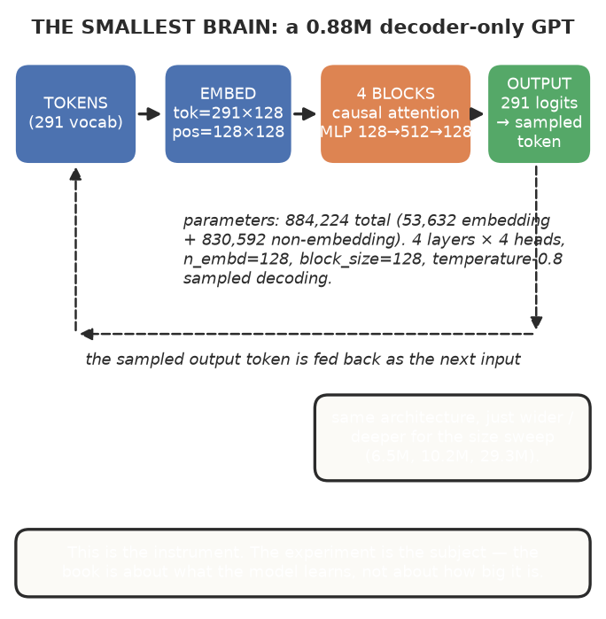

The smallest brain is a tiny decoder-only transformer: tokens in, embed, attend
through the layers, and predict the next token.

The student is a deliberately simple, transparent **decoder-only transformer**. The
goal is not novelty; the goal is that we can understand exactly what it is doing.

For the pilot, the configuration is small and honest:

- vocabulary: 291 tokens (a compact greedy character/whole-word vocabulary tokenizer —
  256 character tokens plus frequent whole words, encoded by longest match; *not*
  byte-pair encoding — see Appendix D),
- hidden dimension: 128,
- layers: 4,
- attention heads: 4,
- context length: 128,
- GELU activation, Pre-LayerNorm, AdamW optimizer.

Each of these is a deliberate choice that we can justify. The context length of 128
tokens, for example, is chosen because a pilot task's prompt-plus-program fits
comfortably within it — long enough to hold a full task, short enough that the model
is not wasting capacity on irrelevant span (we measure that claim below rather than
assert it). The 4 layers and 128-wide hidden
dimension keep it fast to train on the modest hardware available, which matters
enormously: if training takes an hour, we iterate on the *experiment*; if it takes a
day, we wait on the *model*, and the brew slows to a crawl. A small model is a fast
iteration loop, and a fast loop is what lets a scientific investigation move.

## Measured: does a task actually fit in 128 tokens?

A claim like that deserves a measurement, so we made one. We tokenized the actual
training sets with the exact tokenizer each experiment fits and counted lengths,
truncations, and padding (`scripts/measure_truncation.py`; full per-operation
distributions in `artifacts/manifests/truncation_audit.json` and
`docs/reviews/loop/truncation_audit.md`):

| training set | records | prompt+program (median / max) | records over 128 |
|---|---|---|---|
| Pilot (Stage 1) | 1,400 | 68 / 109 | 0 |
| Stage-3 surface | 600 | 66 / 109 | 0 |
| Stage-4 exposure | 1,520 | 68 / 172 | 40 |

For the pilot, prompts run 27–51 tokens and programs 14–68, so the combined
sequence tops out at 109 tokens — `cond_abs_max`, the longest operation, nineteen
tokens short of the window. Zero of the 1,400 training records are cut, which means
every program the pilot is asked to learn appears complete in its training sequence;
"fits comfortably" is measured, not assumed. The Stage-3 surface set is the same
story: zero records over 128. The composition baseline of Chapter 16 trains on the
same primitive split as the pilot — we verified the two are identical on task ID,
prompt, and program — so it too has no truncated training records. Training-time
truncation therefore cannot explain the held-out composite 0.000, and we do not
claim it does; the decode ablation narrowed *inference-time* stopping, which is a
different question from training-time slicing.

One arm is genuinely cut, and we say so plainly. In the Stage-4
composition-exposure run, all 40 `sum_of_abs` training records are 172 tokens (58 of
prompt plus 114 of program), so the window keeps 70 program tokens and slices off
the last 44 — the `else` branch and the `return`. Training in that arm never shows a
completed `sum_of_abs` program, a real coverage defect for that operation there. It
is also the one exposed operation the decode ablation reports failing on its own
training instances; the correlation is suggestive, but we ran no ablation
(retraining with a longer window), so we do not turn it into a causal claim.

There is a second, quieter consequence of the same design. Batches are zero-padded
to the longest example in the batch, and the loss has no ignore index, so padding
positions are part of the objective. Measured under the trainer's exact batching
rule, about 35% of the pilot's loss-target positions are padding targets (36% for
the surface arm, 38% for the exposure arm). The pad token is id 0 — NUL — so every
padded row trains the model to predict NUL immediately after a sequence's last
token. That is a share of loss *positions*, not of loss *value* (we did not
decompose the trained loss), and we report it as a property of the objective rather
than as an explanation for any score.

## The honest parameter count

A common mistake is to quote just a round "10M parameters." We refuse to hide the
important part. The model has **884,224** parameters, of which **830,592** are
non-embedding (the transformer blocks, plus the final layer-norm and the output
projection head) and **53,632** are the **embeddings** — the token
embedding (291 × 128 = 37,248) plus the positional embedding (128 × 128 = 16,384).
The embeddings are *also* learned parameters: they are trainable and they do store
task-relevant representations. What distinguishes them from the block weights is
that each one is only ever *looked up* (a token maps to its vector), whereas the
block weights are *multiplied* many times per forward pass. So at ~6% of parameters,
the embedding tables are a small share, but they are not inert — we report the split
between embedding and non-embedding so a naive "M parameters" figure is not dominated
by the lookup tables rather than the computation.

So we always report the split: embedding vs. non-embedding.

## The model, in one box

So that there is no ambiguity about what we trained, here is the complete specification
of the pilot model (the 0.88M model; the larger runs in Chapter 12 only scale width
and depth, and the registry in Appendix C lists each one's exact configuration):

| Property | Value |
|---|---|
| Architecture | GPT-style decoder-only transformer |
| Vocabulary | 291 tokens |
| Embedding dim (`n_embd`) | 128 |
| Layers (`n_layer`) | 4 |
| Heads (`n_head`) | 4 |
| FFN width (intermediate) | 4 × `n_embd` = 512 |
| Context budget (`block_size`) | 128 tokens |
| Dropout | 0.0 (deterministic) |
| Attention | Causal (masked), self-attention |
| Positional encoding | Learned, 128 × 128 |
| Final norm | LayerNorm before the output head |
| Output head | `n_embd` → 291 logits, **no bias, no weight tying** |
| Parameter split | 884,224 total = 53,632 embedding (token 37,248 + position 16,384) + 830,592 non-embedding |
| Weight init | Normal(0, 0.02) |

**What the model is asked to do.** Each training example is the prompt and the target
program concatenated as a single token sequence (`prompt + "\n" + reference_code`), and
the model is trained with standard next-token cross-entropy over that whole sequence.
(Roughly, at each position the model outputs a *logit* per vocabulary token — an unnormalised
score — which is turned into a probability, and cross-entropy is a measure of how well
those predicted probabilities match the actual next token; minimising it over the
sequence is what "training" means. An *optimizer step* is one update of the weights based
on the gradient of that loss over a batch, and one full pass over the training set is an
*epoch*.)
There is no loss masking that restricts credit to the program positions — the model is
rewarded for predicting the prompt's continuation (including its own wording) as well as
the program. **Consequence for the numbers we report:** because there is no
completion-only loss mask, the training loss quoted in this book (the pilot's ~0.02)
aggregates prompt tokens *and* program tokens over the whole
`prompt + newline + program` sequence. The prompts are short and highly repetitive, so
that figure is a full-sequence fit number, **not** a clean measure of code-completion fit
alone; no code-token-only training or validation loss was recorded, so we qualify the
aggregate rather than report a split we do not have. Generation uses temperature 0.8
multinomial sampling for `max_new` tokens,
with the context window truncated to `block_size` (it reconditions on the sequence so
far at every step). There is no separate "refuse to answer"
behavior — the model is trained simply to keep predicting, which is exactly why we
build gates around it (Chapter 4).

This matters more than it might seem. At tiny scale, the ratio of vocabulary to
computation is high, which means a naive "M parameters" figure can be dominated by
the embedding lookups rather than the computation that must actually reason about the
program. Separating the two lets us and the reader
see the *actual* computation the model brings to bear — the attention and MLP
parameters that do most of the sequence modeling. (To be clear, the embeddings *are*
trainable and do store learned structure, as the spec box shows; this is about
weighting which part matters when we talk about "capacity," not about claiming the
embeddings are frozen.) It is a small discipline, but it keeps the conversation honest.

## The architecture smoke test

Before we train it for real, we run an **architecture smoke test** — a tiny, fast check
that the model's forward and backward passes work, that the parameter count is what we
expect, and that the initial loss is sensible (roughly the log of the vocabulary, since
a fresh random model's best guess is uniform).

This is the same discipline as the very first smoke test, but one level up: we are not
checking "does the loop run?" anymore, we are checking "does *this model* construct and
train correctly?" A 20-second check here prevents discovering a shape bug hours into a
real run.

The initial loss is a wonderfully informative number. A brand-new model, before it has
learned anything, predicts the next token uniformly, so its loss should be close to the
natural log of the vocabulary size — here, about log(291) ≈ 5.67. When we actually ran
it, the initial loss was **5.84**, reassuringly close. That is what a model that knows
nothing looks like, and it is the baseline every later, lower number is measured
against. One provenance note, which Chapter 9 makes explicit: only the *final*
training loss — **0.0208** — is machine-recorded in the experiment manifest
(`artifacts/manifests/stage1.json`). The initial 5.84 and the intermediate curve values
quoted in Chapter 9 come from the printed training log, and should be read as
illustrative of the curve rather than as manifest-recorded figures.

## Why it's small

The book deliberately keeps the pilot model tiny. This is not modesty; it is method. A
small model is fast to train (so we can iterate on the *experiment*, not wait for the
model), transparent (so a failure is a learning-system problem, not an architecture
mystery), and it makes the *boundary* more visible — a small model that fails to
compose tells us something cleaner than a large model that does something partly and
noisily. We scale it up later precisely to test whether capacity matters, but the
baseline has to be small and legible.

## The configuration is a starting point, not a fact

Crucially, none of these numbers are immutable. The exact architecture is an
experimental variable. Every architectural choice requires a reason, and the question
is never "what architectures can we try?" — it is "what scientific decision does this
comparison enable?" For the pilot, the answer is: this size is fast enough and small
enough to be legible, which is what Stage 0–1 needs.

This is a discipline worth holding onto. It is tempting to fixate on the "best"
architecture or the "right" parameter count as if one existed. But in an experiment
where the question is about *learning*, the model is a dial, not a destination. We
choose a configuration because it enables a specific scientific comparison — and we
change it when we want to test whether the answer changes. That is why the pilot model
is small and plain: not because it is the best, but because it is the *clearest*
instrument for the question at hand.

---

# 9. The First Brew

Everything's built. Now the moment of truth: we train the model for the first time and
watch what happens.

This chapter is deliberately unheroic. The goal isn't a triumphant result — it's to
confirm the loop works and to see the model's honest behavior as it learns. It is
the first time a recipe we have been assembling is finally run: we are not
hoping for a masterpiece, we are checking that the oven works and nothing explodes.
And for anyone who has brewed anything — beer, coffee, bread — the *first* batch is
never about the product. It is about learning our equipment, our ingredients, and our
own impatience. This chapter is that first batch.

## The data

1400 training tasks: a natural-language specification paired with its reference
Python program. The model's job is to read the spec and produce the code. Each task is
a single semantic record — one idea — rendered three ways (a program, an English
instruction, a set of hidden tests), so the data is internally consistent by
construction. We do **not** need to worry as much that a prompt says "sum" but its answer
subtracts, because both came from the same seed. That said, "same seed" is not a
guarantee: a wrong semantic record would be wrong in all three renderings at once, so
the consistency reduces (but does not eliminate) the risk of a prompt/answer mismatch.

The dataset is a three-way split — **1,400 train / 300 validation / 300 test** records,
the counts recorded in `artifacts/datasets/pilot_manifest.json`. The validation split
was generated but never used for model selection: `scripts/train.py` loads it and
evaluates only on the test set, so every number this stage reports is a test-set number.

We hold out a separate 300-record test set. Because the teacher uses a task-ID seed to
change only the hidden-test *inputs* while the prompt string and reference program stay
the same, those 300 test records **reuse the same 21 prompt strings** as training (see the
novelty audit in Appendix C); what is new at test time is the task ID and the
execution-test values, not the prompt. We state this plainly, because it shapes exactly
what the pilot's 0.897 does and does not establish: familiar-prompt program generation
on fresh execution inputs, not generalization to a new request.

## The model

The student is a small, deliberately plain decoder-only transformer: 4 layers, hidden
dimension 128, 4 attention heads, a compact 291-token vocabulary, and 128-token
context. Total **884,224 parameters** — but we report the split honestly, because it
matters more than the round number: **53,632 (6.1%)** are in the token and positional
embedding tables, and **830,592 (93.9%)** are elsewhere. The embeddings are trainable
representations, not a static lookup. Reporting both figures prevents confusion about
where this model's parameters are allocated — for this configuration the embedding share
is modest, not a majority (embedding-dominated regimes arise with much larger
vocabularies, which is not this model).

## The training process, step by step

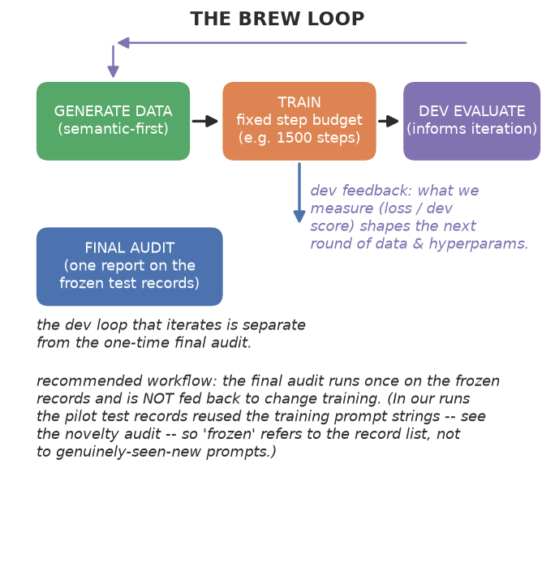

Every experiment is one pass around this loop: generate, train, measure, and let
what we measured shape what we generate next.

Training a small transformer is not a single action; it is a loop repeated 1,500
times. At each step:

1. We grab a batch of 16 tasks and tokenize each as one sequence: the natural-language
   prompt, a newline, then the reference program.
2. The model reads the prompt and predicts each *next* token in the combined sequence.
   This is the standard **next-token objective** — the model's only job is to guess
   the next word, given everything before it. It is a deceptively simple task, and it
   is the entire basis of how these models learn to write.
3. We measure the difference between the model's prediction and the actual next token
   (the cross-entropy loss), take the gradient, and nudge the parameters with the
   **AdamW** optimizer at learning rate **1e-3**, clipping the gradient magnitude to
   keep training stable.
4. Repeat.

We print the loss every 200 steps so we can watch it behave. Here is what it actually
did:

```
step    0   loss 5.84
step  200   loss 0.029
step  400   loss 0.022
step  600   loss 0.023
step  800   loss 0.020
step 1000   loss 0.021
step 1200   loss 0.019
step 1499   loss 0.019
```

That is a large, clean drop — from 5.84 to about 0.02 in 1500 steps. (The per-step log
above reads 0.019 at the last step; the recorded final training loss in the experiment
manifest is 0.0208 — the same quantity reported at slightly different rounding or on a
different averaging window, both meaning the loss has collapsed to a low floor.) A
provenance note: only that final value, **0.0208**, is machine-recorded in the manifest
(`artifacts/manifests/stage1.json`) — the intermediate values in the log above are
illustrative, transcribed from the printed training log, and should be read
accordingly, as a picture of the curve rather than as manifest-verified figures. Two
things about this curve are worth sitting with, because they reveal more than the final
number.

**First, the shape tells us the *training loop is working*, nothing more.** The
loss falls steeply in the first 200 steps (5.84 → 0.029), then flattens out near a
floor. This is the curve we expect from a functioning loop that is fitting the data:
rapid improvement at first, then diminishing returns. If instead the loss had wobbled
or stayed high, we would have had a debugging problem on our hands, not a training
result. But a *converging* loss by itself does not distinguish learning from
memorization — both produce a falling loss. That distinction is exactly what the
upcoming evaluations, not the loss curve, have to settle.

**Second, the *final* value is not the interesting number.** A loss of 0.019 means
the model can predict the next token of the *training* sequence almost perfectly. That
tells us it fits the training data — and nothing more. One qualifier belongs on the
number itself: there is no completion-only loss mask (Chapter 8), so this loss is
averaged over *prompt and program* tokens together — the prompts are short and highly
repetitive, and a low value partly reflects easy prompt-token prediction. Chapter 8's
length audit adds the other half: about 35% of the pilot's loss-target positions are
zero-padding targets (token id 0, NUL), because batches pad to the batch maximum and
the loss carries no ignore index — so ~0.02 averages prompt tokens, program tokens,
and padding targets together. No
code-token-only training loss was recorded, so ~0.02 should be read as full-sequence
fit, not as a clean measure of code-completion fit alone. This is the book's recurring
motif, and it is worth saying loudly: **a falling training loss, and even a very low
one, is not evidence of learning.** It is evidence of fitting. The distinction is the
entire point of the experiment.

## What the training process felt like (the brewing experience)

Anyone who has trained a model knows the peculiar rhythm of it. We set a batch of
runs going and we wait, checking the loss every few minutes with a combination of hope
and suspicion. The first steps are the most honest — a fresh, random model has loss
near the log of the vocabulary size, because its best guess is uniform. That initial
5.84 is exactly what a model that knows nothing looks like.

Then, if things are working, the loss starts to fall, and a strange thing happens: the
drop is *so* fast in the first couple hundred steps that we wonder whether it is real
or whether something is broken. In this case the model reached near-floor loss within
200 steps. The rest of the training is just the model quietly polishing the last
fraction of a point.

There is also a genuine practical question that arises during training: **how do we
know it hasn't crashed mid-run?** What our training script actually does is a single
**post-training, pre-evaluation save**: one `torch.save` runs after `train()` returns
and before evaluation begins, so a crash during evaluation cannot lose a completed
training run. It does **not** save at intervals *during* the run — a crash at step 1200
would lose the whole run, and we say so plainly (Chapter 12 recounts an interrupted run
whose original checkpoint was not preserved). Periodic mid-run checkpoints — saving at
regular intervals so a crash loses at most the steps since the last save — are the
obvious hardening step for a production trainer; this book's code does not implement
them, so we do not claim they exist here, and we do not claim they have saved us a run.

## The honest caveat

A falling training loss — and even a very low one — is *not* evidence of learning. We
saw this in the pilot and it is the book's recurring motif. The training loss tells us
the model fits the training data. It does not tell us it can *generalize* to unseen
problems, or that it learned the computation rather than the surface form.

So after training, the only losses that matter are the *held-out* ones: how well does
the model do on problems it never saw? That is Chapter 10's question, and the answer
there is the real measurement of this brew.

## Why the details of the training process matter

It is tempting to skip the mechanics and jump to results. But the whole premise of
this book is that *the experiment is the subject*, and an experiment we cannot
reproduce is not an experiment. The exact vocabulary size, the number of layers, the
batch size, the learning rate, the number of steps — these are not trivia. They are
the conditions under which every later claim is true. If we change one and the result
changes, that tells us something; if we change two and the result changes, we can no
longer say which one caused it. This is the **one-variable discipline** that governs
every experiment in the book, and it is why we record the configuration so carefully
in a manifest alongside every result. A reader should be able to take our numbers and run
the same configuration — and reproduce the *procedure*, not necessarily the identical
sampled scores (a fresh stochastic rerun under temperature-0.8 sampling may differ
slightly; the repository is public, and exact checkpoints are not shipped — and the
recorded runs are not regenerable from the recorded configs and seeds alone (see
Appendix C.11). The recording is
what makes the
procedure reproducible, even before scores are confirmed on an independent run.

## What this chapter establishes

This first brew is not a result; it is a proof of the loop. We have:

- trained a real model on real data,
- watched its loss descend smoothly,
- saved a checkpoint,
- confirmed that we can take the trained model and produce code for a new prompt,
  run it through the sandbox, and score it with the judge.

That loop — generate data, train, generate code, execute, score — is the laboratory
working end-to-end. It is the foundation everything else stands on. The model is
built. Now we have to find out what it actually learned.

---

# 10. Does It Actually Work?

We have a trained model, a judge, and a test set. The natural question is the one
the whole book has been building toward: *does it actually work?*

And the answer, as with almost everything in this book, is **"it depends on what we mean,"** and then **"let's measure it rather than argue."** Because "works" is not a
single number. It is a question about *which* kind of capability, under *which*
conditions, measured in *which* way. The job of this chapter is to take that vague
word and replace it with something we can actually see.

## The setup

We trained a small decoder-only transformer on 1,400 generated tasks: the model reads
a natural-language specification and must produce the reference Python program. The
trained model is tiny — **884,224 parameters** (0.88M), of which 53,632 are the
embedding and 830,592 are the non-embedding weights. It saw 1,500 gradient steps on a
batch of 16, reaching a training loss of **0.0208**.

We then asked it to solve 300 **held-out** test tasks, and scored each generated
program by executing it against that task's hidden tests. The novelty here needs a
precise statement: these test records reuse the **same 21 prompt strings** the model saw
in training, but each carries a **new task ID with fresh hidden-test input values**. So
"held out" here means new *instances* of a seen prompt — the model had to produce, for a
prompt it already knows, a program that passes input values it has never seen. It is not a
test of a brand-new request (for that, see Chapter 15's human-written prompts and the
surface/composition holdouts, whose prompts genuinely never appear in training). This is
the moment of truth for the whole apparatus: everything we built — the world, the
teacher, the judge, the rivals — converges on this measurement.

| Quantity | Training | Validation | Pilot test |
|---|---:|---:|---:|
| Records | 1,400 | 300 | 300 |
| Prompt strings | 21 | 21 | 21 |
| Test prompts also seen | n/a | 21 of 21 | 21 of 21 |
| What changes at test | n/a | task ID, inputs | task ID, inputs |

The dataset is a three-way 1,400 train / 300 validation / 300 test split
(`artifacts/datasets/pilot_manifest.json`). The validation split was recorded but never
used for model selection — `scripts/train.py` loads it and evaluates only on the test
set — so every figure in this chapter is a test-set figure.

A key distinction to keep straight: the numerical inputs go to **Python** (the model's
program is executed on them), while the **language model** receives only the prompt string.
So a new task ID changes what the *judge* feeds the program, not what the *model* sees.

## One task, end to end

The cleanest way to see what the judge does is to follow one task from prompt to
verdict. Here is a real run against the pilot model — record `add_0036` from the
scored pilot evaluation (`artifacts/datasets/pilot_test.jsonl`).

**The request.** "Implement solve so that given a and b it returns their sum."

**The reference program** (the teacher's ground truth):

```
def solve(a, b):
    return a + b
```

**What the model actually produced** (temperature-0.8 sampled decoding, this checkpoint — the same single sample used for the reported score):

```
def solve(a, b):
    return a + b
```

**The hidden tests** (input/expected pairs) that the judge then runs. For this record
(`add_0036`) the task's suite has **eight** cases; here is an **excerpt** of three (a
basic, a zero, and a negative case). The judge runs all eight and this task **passes —
all 8/8**.

| inputs | expected |
|--------|----------|
| (-86, -95) | -181 |
| (0, -28) | -28 |
| (-1, -33) | -34 |

The judge runs the model's program on each pair, compares the output with the
semantic comparator, and reports **pass@1**. This task passes.

Now the informative contrast: a task the model *had not seen*. The teacher's
composite `abs_add` asks for the sum of the absolute values of two numbers
(`abs(a) + abs(b)`). A provenance note before the examples: the scored pilot evaluation
runs only on `artifacts/datasets/pilot_test.jsonl`, which contains the 10 primitive
operations and the 21 training prompt strings — no `abs_add` record and no reworded
prompt. So neither of the two failures below is an output of that scored run; both are
**separately-run demo generations** against the pilot model, outside the evaluation set,
and we label them as such rather than presenting them as pilot-evaluation outputs.

The first comes from the live demo battery (`scripts/demo_live_model.py`, archived in
`docs/experiments/model_sweep_live.md`): the `stage1.pt` checkpoint, which knows both
`abs` and `add` individually, was fed the composite prompt:

> "Write a function that takes two numbers, a and b, takes the absolute value of each,
> and returns their sum."

and produced:

```
def solve(a, ab
```

— a truncated, unusable fragment. The generation stopped early. We did not preserve the
raw token sequence, so we cannot state the precise stop reason from the record (it could
be the `max_new` limit, the NUL-byte extraction boundary, or an unlucky sampled end).
What is clear is that it is an **incomplete extracted candidate whose
termination/extraction cause was not preserved** — a partial Python identifier/source
fragment, not a complete program. Because a termination/extraction defect already changed
the pilot score once, we flag these as an *incomplete extracted candidate*, and do **not**
assert a specific internal cause (we cannot, from the record, tell it apart from a genuine
capability limit). The second is likewise a separately-run demo generation, not a scored
pilot record: on a genuinely
reworded surface ("Return the value obtained by adding together two numbers, denoted
p and q.") — a prompt that is not among the 21 pilot prompt strings — it produced:

```
def  a solve(a, b
```

again truncated. These two demo generations carry the book's whole point: on a familiar
surface the model writes correct code, and on an unseen surface or a new combination
it collapses to a fragment. Nothing about the failure required the hidden tests to be
"unfair" — the invalid fragments were **rejected at parsing** by the judge, before any
execution or comparison, because they do not parse as complete Python programs.

## What we measured: pass@1

Here is the headline result, reported as **problem-level hidden-test pass@1 under the
evaluation's default temperature-0.8 sampling** — that is, for each evaluation record, did
the *single sample* the model produced pass *every* hidden test? (This is sample pass@1,
one sample per record, not a distribution over many samples.) Two sampling details matter
for interpreting it: (1) the evaluator calls the model **once per evaluation record**
(`for t in tasks: candidate(t)` → a fresh `model.generate`), so records that happen to
share a prompt string still get **independent** draws — no output is cached or reused
across records; and (2) the fixed score is a property of the checkpoint, the sampled
outputs, the record weights, the tests, and the decoding settings (temperature, `max_new`,
NUL truncation), not just of the dataset. A single sample per record does not
give within-run sampling error, but the repeated records do act as within-prompt
replicates for the purposes of a familiar-prompt aggregate. The training seed is recorded
per run; generation does not reset the RNG to a separate value, so it uses the continuing
RNG state during evaluation unless explicitly reset (Appendix C.6), which is why sampling
is stochastic rather than exactly seed-reproducible record-for-record. There is no stop
policy: `generate` in `src/model/gpt.py` always draws exactly `max_new` tokens (it never
stops early on EOS or PAD), and extraction truncates at the first NUL byte; the `max_new`
and extraction rules live in `src/eval/evaluator_runner.py`.

| Candidate | syntax | executable (≥1 hidden test passed) | **pass@1** |
|-----------|--------|-----------|------------|
| **MODEL** | 0.897 | 0.897 | **0.897** |
| TEMPLATE | 1.000 | 0.900 | 0.800 |
| RETRIEVAL | 1.000 | 1.000 | **1.000** |

*Reading the columns:* `syntax` is the fraction that passed the judge's combined
parse-and-whitelist validation (Chapter 6 — whitelist/capability rejections are
counted here too), and `executable` is the fraction that **produced at least one
correct output** — passed at least one hidden test — not merely the fraction that ran
without error.

*Model-visible novelty, stated precisely:* 0.897 is single-sample correctness for
repeated previously-seen prompt strings under fresh execution values — not prompt
generalization.

Three things stand out.

**First, the model learns to produce a program for a prompt it has seen many times.**
0.897 means that ~90% of the time, given a *familiar* prompt string, the model produced a
program that passed all the *fresh input values* the judge supplied. That is not a toy
result: the model emits valid, correct Python for a request it has been trained on. But
note exactly what is and is not being claimed. Because every one of the 300 test records
reuses a prompt string the model saw in training, this figure is **familiar-prompt program
generation on new execution inputs** — not generalization to a new request. And it still
**beats the hand-written rule baseline** (0.800) on that same set. A hard-coded
pattern-matching system that recognizes keywords like "sum" and emits a template gets 80%;
our learned model gets ~90%. So on this task, the learned model does *more* than a fixed
rule system.

**Second — but retrieval does even better.** A trivial TF-IDF retriever that does
nothing but find the closest training example and reuse its program scores **1.000**.

That second fact is not a failure; it is the pivotal thing this pilot taught us. It
tells us the task, as currently constructed, is **too easy to force
generalization**. When a non-learning lookup solves 100% of the test set, then the
test set is solvable by retrieval, and a model scoring 90% is not yet being tested on
whether it can generalize — only on whether it can match the surface form of a
training example.

This is exactly the "task too easy" outcome the experimental plan anticipated, and it
is scientifically useful: it tells us *how to make the next task harder.*

**A note on replication across seeds.** This in-distribution result is not a
single-seed accident. Fresh trainings under seeds 1 and 2 both scored **0.900**
in-distribution (final losses 0.0196 and 0.0229), matching the single-seed ~0.90
reported here (0.897 over the 300-record test; report:
`docs/reviews/loop/multiseed_replication.md`). One provenance wrinkle worth
carrying: seed 0's `stage1.json` preserves the pre-fix 0.000 evaluation described
below, not a re-run value — the seed-0 figure quoted throughout the book is the
manifest-backed 0.897 in `stage1_results.json`.

## The moment that broke us (and the evaluator, not the model)

There is a story behind these numbers that is more instructive than the numbers
themselves, and it is worth telling plainly. When we ran the evaluation for the very
first time, the model scored **0.000**. Not 0.897 — zero. Every single generated
program failed the syntax check.

Our first instinct, naturally, was that the model was useless. We had spent hours
building a careful apparatus and the tiny model could not even produce a parseable
program. It would have been easy to conclude "the model doesn't work" and write the
whole thing off.

But the book's own discipline — *test the tester* — demanded we ask whether the
*judge* was the problem, not the model. So we looked at what the judge actually
saw. And there it was: the generated programs were valid Python up to the end of the
program, except they had a run of **NUL bytes** (`\x00`) appended after it. The
model had learned to pad its output with a byte that means "nothing." Python's parser
correctly rejects NUL bytes — they are not valid source. The fault was in the
*extraction contract*, not the parser: we had failed to strip the padding before
handing the output to `ast.parse`. So `ast.parse` threw a syntax error on what was,
after truncation, good code, and the judge scored the model's program as a *syntax
failure*.

The fix was a single line: truncate the generated program at the first NUL byte. A
trivial change, and suddenly the model's score leapt from 0.000 to 0.897.

This is the pivotal lesson of this chapter, and it is not about the model at all.
**The evaluator was broken, not the model.** We had designed every
experiment to detect shortcuts and outright cheating in the *model*, and we nearly
missed the one case where the measuring stick itself was faulty. The "test the
tester" principle — that we must verify the tool measures what we think it measures
before trusting a single number it produces — was not a formality. It just saved the
entire project from a false negative.

The reason we caught it is worth pausing on. We did not catch it because we are
clever. We caught it because we had *already* built a method for testing testers
(the mutation suite in Chapter 6), and we had written the pilot's results to a
manifest and looked at the intermediate numbers, not just the headline. Had we
grabbed the final pass@1 and moved on, we would have shipped a book claiming a tiny
model cannot write Python — a conclusion that was wrong.

## The shortcut audit

Before we trust the "0.897" number, we have to ask how the model might have gotten
there without learning.

1. **Suspected shortcut: retrieval of a near-duplicate prompt.**
   **Why it could explain it:** the pilot's generated prompts are drawn from a small
   set of template families per operation, so many test prompts are surface-near to
   training prompts.
   **Control:** we ran the retrieval baseline — 1.000. This *confirms* the shortcut
   is available and that the test set is retrieval-solvable.
   **What it rules out:** nothing yet, because the model's 0.897 is *below* the
   retrieval ceiling. It does not rule out the model partially relying on surface
   similarity.
   **What remains unresolved:** whether the model's own success is grounded in the
   *computation* or in the *surface form*. To answer that, we need the Question-3
   (surface-change) and Question-4 (composition) experiments, which we run next.

2. **Suspected shortcut: exact memorization.**
   **Why it could explain it:** the model saw 1,400 examples; maybe it memorized the
   prompt→program pairs.
   **Control (Ch14):** a probe of 60 pilot records plus a held-out program probe: **60/60 on the
   training-record probe** (it reproduced every reference program exactly) and
   **59/60 on the held-out/task-ID probe** (a passing general program for a fresh task
   ID), while on the held-out program probe it emitted the *general* program rather than a
   memorized literal. **Caveat:** the pilot test
   reuses training prompt strings, so this does **not** establish unseen-prompt
   generalization — it shows the model produces a *general* program (not a memorized
   constant literal) for these records.
   **What it rules out:** the narrow claim that the model merely emits memorized
   *constant* outputs.
   **What remains:** the deeper question — is the *general program* it produces
   genuinely tied to the computation, or to the particular wording?

## The honest summary

The pilot succeeded in exactly the way a pilot should: the laboratory works, the
model **reliably produces a correct program for a prompt it was trained on**, and —
perhaps most valuably — the experiment told us something *uncomfortable but true*. The
task is retrieval-solvable, a model that beats a template rule system yet sits below a
lookup table, and — crucially — the test reuses the model's known prompt strings, so the
pilot **did not actually test generalization to a new request**. It tested reliable
familiar-prompt generation and shows that the *apparatus* can produce meaningful,
checkable measurements. Whether the model can generalize is the question the remaining
chapters actually probe, using prompts and composition that genuinely were not in
training.

And we were reminded, in the most direct way possible, that the measuring stick is as
much a subject of the experiment as the model. The instrument and the thing measured
both needed to be honest, and only one of them initially was.

That is the baseline from which every later experiment is measured. From here, we
stop making the task easier and start making it *probe* generalization.

---

# 11. How Much Data?

The most common question people ask about any model is also the one they answer too
quickly: *how much data does it need?* We set out to measure it directly — holding the
model, the tokenizer, the operation mix, and the training method fixed, and varying only
the number of examples.

It is a question worth measuring rather than guessing, because the folklore answer —
"just add more data" — is both plausible and unexamined. Our own first attempt at the
measurement did not survive code audit: the sweep changed the operation mix along with
the count, so its rising curve was an artifact of coverage, not of data (Appendix B,
P0-01). The balanced, operation-stratified rerun that audit called for has since been
done — three seeds, one fixed tokenizer, one fixed test set — and its answer is the
opposite of the folklore: **no consistent monotonic effect on familiar-prompt accuracy is
detected here.** Once every size covers the same ten operations, the scores sit in a
narrow band around 0.90 across a 30× range in the number of examples per operation —
with one flagged outlier (seed 2 at size 1,000, 0.997), called out below.

## How to read the evidence

This chapter opens the experimental part of the book, so we consolidate here the
small set of caveats that the chapters that follow would otherwise re-justify in
near-identical words. Each later result still carries its own local caveat,
immediately next to the number it bounds; what lives only in this table is the
shared *justification*. Where a chapter repeats one of these points, it now
points back to this table instead of re-arguing it.

**Table 11.1 — How to read the evidence**

| Caveat | What it means | Where it bites |
|---|---|---|
| **Coverage is not transfer.** | A score on prompts, surfaces, or operations the training pool already covers measures *coverage*, not generalization to something never seen. The pilot's 0.897 is single-sample correctness on reused training prompt strings; the corrected data-scaling sweep's ~0.90 is an instance-level holdout (new construction seeds and new hidden tests) over the same 21 prompt strings; Chapter 13's superseded flawed-run 1.000 was coverage of its own training families; its corrected equal-count run tests an audited held-out family instead (0.550 mean). | Ch. 10, 11, 13, 14, 20 |
| **The 0.88M baseline denominator.** | The familiar-prompt numbers — 0.897 (pilot, 300-record test), 0.898–0.940 (corrected surface factorial, 600 records), 0.9167 (Stage-4 baseline, n=60) — are different evaluation sets, not a discrepancy. The figure they agree on is composition 0.000. | Ch. 12, 16, 19, 20 |
| **Model-size budget differences.** | The size sweep varied training budget and tokenizer alongside size (1,500 / 1,000 / 800 / 800 steps; pilot vs. composition tokenizer), so it is not a size-only intervention. | Ch. 12, 19, 20 |
| **Old vs. new novelty audits.** | The pilot was audited on the original scored files; the Stage-3 and Stage-4 holdouts were audited on *regenerated* reproductions with the current generator — corroborating, but not proof on the scored artifacts. | Ch. 13, 15, App. C |
| **Superseded flawed historical runs.** | Ch. 11's original data-scaling sweep (P0-01: operation coverage) and Ch. 15's original surface rows (P0-03: mixed factors; P0-04: 480-record denominator) are preserved as labeled flawed records in the failure ledger (Appendix B) and as superseded rows in Appendix C; their corrected reruns are this chapter's and Chapter 15's actual results. Ch. 13's diversity comparison (P0-02: 42 vs. 1,200 records) now has a corrected
equal-count rerun (Table C.15), which finds the combined phrasing/identifier/uniqueness intervention drives held-out-family generalization. | Ch. 11, 13, 15, 19, 20 |

**What a later code audit showed — read this before the numbers.** The original sweep
did not change only the data count. The script builds one pool with
`pool = generate_dataset(n_per_op=400, ...)` and trains on `train = pool[:size]` — a
*prefix* of a pool the generator appends record by record **in operation order**. The
100- and 300-record arms therefore trained on **one operation out of ten** (`add`), the
1,000-record arm on **three**, and the 3,000-record arm on **eight** — while the
evaluation set spanned all ten operations. That sweep was thus **confounded with
operation coverage**: what changed across its four arms was not just how many records
the model saw, but *which operations it saw at all*. The recorded curve is preserved in
the failure ledger (Appendix B, P0-01) as a **flawed historical run of operation
coverage**, not a data-count scaling result. We draw no threshold, no knee, and no
data-efficiency lesson from it, and the earlier claim that "only the data count changes"
was wrong. The balanced, operation-stratified rerun the audit called for — the same
number of records per operation at every size, one fixed tokenizer, matched step
budgets — has now been run, and it is the experiment reported in the rest of this
chapter. The confounded curve reappears once below, kept only so a reader can see what
the flaw looked like.

## The setup

We train the same ~0.9M model (128 embedding / 4 layers / 4 heads, block size 128), the
same optimizer and schedule — 1,000 steps, batch 16, learning rate 1e-3 — on four
dataset sizes: 100, 300, 1,000, and 3,000 examples. Three things are held fixed that
the first attempt let drift:

- **Operation coverage.** Every arm draws the *same* balanced slice: 10, 30, 100, and
  300 records **per operation**, so all four sizes cover all ten operations (the pool is
  400 records per operation; the slices are nested across sizes and shuffled). What
  changes across arms is only how many records each operation contributes.
- **The tokenizer.** One tokenizer, fit once on the union of the training texts at the
  largest size and reused unchanged across every size and every seed (vocabulary 291;
  SHA-256 `361f6d89e4f18642fac9d1d9077d6a5cab0e5d97701bafc1641ab09ec2b10eb5`).
- **The test set.** One fixed held-out set of 300 tasks — 30 per operation × 10
  operations — generated once and reused for every size and every seed, so all twelve
  arms are scored against the identical denominator.

The test set is an *instance-level* holdout: new construction seeds and new hidden test
inputs, but the same 21 prompt strings the generator produces for these ten operations —
so, per the evidence table above, its ~0.90 is coverage of seen prompt strings on fresh
instances, not transfer to new requests. Each arm is trained from scratch under seeds
0, 1, and 2, giving twelve measurements.

## The result

Model pass@1 on the shared 300-task test:

| training size | per operation | seed 0 | seed 1 | seed 2 |
|---------------|---------------|--------|--------|--------|
| 100           | 10            | 0.897 (269/300) | 0.893 (268/300) | 0.900 (270/300) |
| 300           | 30            | 0.900 (270/300) | 0.900 (270/300) | 0.900 (270/300) |
| 1,000         | 100           | 0.893 (268/300) | 0.900 (270/300) | 0.997 (299/300) |
| 3,000         | 300           | 0.897 (269/300) | 0.900 (270/300) | 0.900 (270/300) |

Eleven of the twelve arms land between 0.893 and 0.900; the twelfth (seed 2 at size
1,000) is 0.997. The baselines barely move either: TEMPLATE scores 0.800 (240/300) in
all twelve arms, RETRIEVAL 1.000 in eleven of them and 0.943 (283/300) in the twelfth.
Final training losses sit in a narrow band, 0.0177–0.0243, with no trend by size.

## What it tells us
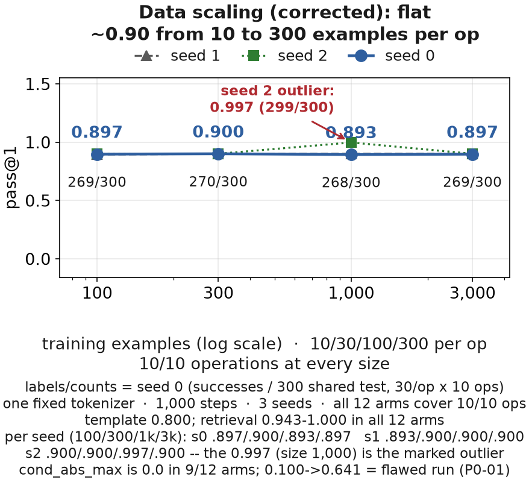

*Corrected sweep (fixes P0-01): every point is one run on the shared 300-task test set
(30 per operation × 10 operations, generated once and reused across sizes and seeds), so
the rates are integer fractions over 300 (seed 0: 269/300, 270/300, 268/300, 269/300).
All four arms cover all ten operations — 10/30/100/300 records per operation — under one
fixed tokenizer and one 1,000-step budget, so the only thing that changes along the axis
is the record count. **No consistent monotonic effect on familiar-prompt accuracy is
detected here** once operation coverage is held fixed: eleven of the twelve arms sit at
0.893–0.900, and the twelfth — seed 2 at size 1,000, 0.997 (299/300) — is the outlier
flagged below, not a trend. The earlier 0.100 → 0.641 rise was the
operation-coverage confound, preserved only as a labeled flawed historical run in the
failure ledger (Appendix B, P0-01). Decoding is temperature-0.8 single-sample.*

The near-flat line is the result. Across a 30× range — from 10 to 300 examples per
operation — pass@1 stays at ~0.90, and no consistent monotonic effect on familiar-prompt
accuracy is detected here. Whatever the model learns from these records, it has
learned essentially all of it by the smallest arm; the additional records at the largest
arm move the score by hundredths, within seed noise. This is what a one-variable data
experiment looks like when it is actually one variable: no knee, no threshold, no ramp —
just a plateau (one seed-2 outlier excepted) that was already there at 100 records.

The per-operation picture sharpens the same point. Nine of the ten operations score
0.967–1.000 in every arm (one exception: `list_len` at 0.433 in seed 1's smallest arm).
The lone persistent failure is `cond_abs_max`, which scores 0.0 in nine of the twelve
arms — and more data does not rescue it: at the largest size, 300 examples per
operation, it is still 0.0 in all three seeds. An aggregate over operations can hide a
per-operation hole, and record count did not fill this one.

**The one aggregate that breaks the band is flagged, not smoothed over:** seed 2 at size
1,000 scores **0.997 (299/300)**, the only arm above 0.900. Its per-operation breakdown
shows it is a one-arm fluke, not a data-size effect: that is the arm where
`cond_abs_max` scored 1.0 — the same operation that scores 0.0 in nine of the twelve
arms — and its only miss is `max_of` at 29/30. So the outlier is the per-operation hole
above happening to close in one arm, not evidence that 100 records per operation beat
300.

**The earlier curve was an operation-coverage confound.** The first sweep recorded
0.100 → 0.641 from 100 to 3,000 records and was read as data scaling. It was not: the
arms were prefixes of an operation-ordered pool, covering 1/1/3/8 of the ten operations
while the test spanned all ten, so the rise tracked *which operations the model had
seen at all*, not how many records it had. With coverage held fixed, the rise disappears
entirely. The old numbers are kept below and in the failure ledger as a record of the
flaw, not as a result.

## The flawed historical run, preserved

| dataset size | operations trained (of 10) | final train loss | pass@1 (held-out) |
|--------------|----------------------------|------------------|-------------------|
| 100          | 1 (`add` only)             | ~0.000           | **0.100**         |
| 300          | 1 (`add` only)             | ~0.000           | **0.098**         |
| 1000         | 3                          | 0.022            | **0.300**         |
| 3000         | 8                          | 0.025            | **0.641**         |

*Flawed historical run (P0-01), preserved for the failure ledger only: one seed, one
540-record `pool_test` (10 operations × 54), arms covering 1/1/3/8 of the ten
operations, tokenizer refit per size. Its multi-seed re-runs (0.076–0.748 by size;
Appendix C, Table C.9) repeated the same construction, so they replicate the confound,
not a data-count effect. We draw no threshold, no knee, and no data-efficiency lesson
from any of these numbers; they are superseded by the corrected sweep above.*

## The motif, restated

The book's central motif — **a low training loss is not evidence of learning** — was
first made concrete by this experiment's flawed first run: at 100 and 300 examples the
training loss hit ~0.000, the model had memorized its tiny training set, yet pass@1 on
the full test was only ~0.10 (part of that gap was simply that nine of the ten evaluated
operations never appeared in a 100-record arm). A perfect fit to what the model was
shown said nothing about what it could do on the full test.

The corrected sweep adds the motif's second half: the training losses now sit in a
narrow band (0.0177–0.0243) across every size and seed, and the held-out scores sit in
an equally narrow band (~0.90). Neither curve moves when the record count moves
thirty-fold. Only the held-out number tells us about actual capability — and in this
experiment, once the design was fixed, it told us the same thing at every size.

## The brewing experience

The instructive moment in this chapter is watching the corrected curve come back flat.
The folklore answer predicted a rise; the first (flawed) run had produced a beautiful
rising curve; the balanced rerun produced a horizontal line from the first arm to the
last. The surprise is not that the line is flat — it is that an innocent `pool[:size]`
slice had manufactured a convincing rising curve out of pure coverage, and that the
manufactured curve survived multi-seed replication before anyone read the script against
the claim.

That is why the book is organized around held-out measurement *and* code–claim
auditing: a held-out score tells us what the model can do, but only reading the
arm-building code tells us what the experiment actually varied. The training curve is
the model telling us about itself; the construction is the experiment telling us about
itself; both have to be audited before either means anything.

## The honest caveat

This experiment now measures quantity cleanly, and the answer is a null: within this
regime — one ~0.9M model, one task family, 100 to 3,000 balanced records — more records
of the same kind do not raise the familiar-prompt score. What it does *not* measure is
whether more *diverse* data would help. Quantity and diversity are different levers:
within an operation family, records share the same prompt→program mapping and differ
only in hidden-test input values, so 3,000 records are not 30× more distinct
information than 100. Chapter 13's first attempt at varying the wording families did
not survive code audit (42 versus 1,200 records — P0-02), but Chapter 13 subsequently
ran an equal-count diversity comparison — both arms exactly 1,200 records, three seeds —
that measures the diversity lever cleanly: held-out-family pass@1 of 0.000 (low
diversity) versus 0.550 mean (high diversity). Chapter 15 — now backed by a
corrected factorial — shows the model's real weakness is a *surface* gap: it collapses on
any prompt-surface change, which none of this same-surface data addressed. Composition
(Chapter 16) is a separate question this sweep did not test: the corrected arms were
scored on the in-distribution test only, so "more data does not help composition" remains
untested and unclaimed.

### A note on uncertainty

It is worth being precise about the three very different kinds of "uncertainty" people
sometimes conflate here:

- **Fixed test score.** A pass@1 like 0.897 is the exact measured score on *this* test
  set, under this decoding and evaluation procedure. It is a property of that dataset.
- **Uncertainty over a target distribution.** If we wanted to say "the model scores
  ~0.90 on new tasks of this type," we'd need a sense of how much 0.897 would vary
  across different test sets. We report **descriptive scores only**: we did not estimate
  uncertainty for a defined target prompt distribution. The corrected sweep ran three
  seeds at one step budget (below) — a robustness check, not an estimated interval. (We
  could in principle analyze conditional sampling uncertainty by examining repeated fresh
  generations for the same prompts, and designed/grouped evaluation could support other
  intervals under stated assumptions — but we did not do that here, so we do not claim
  those either.)
- **Seed variation.** The corrected sweep ran seeds 0, 1, and 2 from the start (the
  table above), so seed variance is sampled at three seeds across a single 1,000-step
  budget; that does not quantify uncertainty over an arbitrary future prompt
  distribution. We treat the numbers as measured for the run we did, and as approximate
  for the underlying capability, rather than as a tight estimate.

A further caution against a naive confidence interval: the test set is not a set of
independent, uniformly-drawn examples. It comes from one generator, reuses a handful of
wording families and operation templates, and shares its 21 prompt strings with the
training pool (only the construction seeds and hidden inputs are new). So a standard
binomial interval can be misleadingly tight, and a "3/n" upper bound for a zero result
assumes independent draws that this generator does not provide. We therefore report raw
counts and do not attach invented error bars.

### A note on multi-seed replication

The corrected data-scaling sweep was built as a three-seed experiment (seeds 0/1/2, table
above), so its flatness is not a single-seed accident. Two earlier replications survive
as historical records only: the *flawed* sweep's re-runs under seeds 1 and 2
(0.076–0.748 by size; Appendix C, Table C.9) replicated the coverage confound, not a
data-count effect — replication of a flawed design says the flaw is deterministic — and
the Stage-3 surface re-runs (in-distribution 0.900 / 0.900 / 0.898, new identifiers
0.350 / 0.348 / 0.348, held-out wording 0.000 / 0.004 / 0.000 for seeds 0 / 1 / 2)
replicated a mixed-factor construction. Both are superseded: the surface numbers were
replaced by the corrected 2×2 factorial of Chapter 15 (familiar 0.898 / 0.900 / 0.940;
identifiers-only 0.000 / 0.003 / 0.005; wording-only 0.000 in every seed), and the
data-scaling numbers by the corrected sweep above. The old rows remain in Appendix C,
labeled as superseded flawed historical runs.

## The practical answer

Four points, each read honestly.

First, the corrected sweep gives the quantity question a real answer: **no consistent
monotonic effect on familiar-prompt accuracy detected here** — 0.893–0.997 across
100 → 3,000 records (eleven of the twelve arms 0.893–0.900; the twelfth is the flagged
seed-2 size-1,000 outlier at 0.997), with all ten operations covered at every size, one
fixed tokenizer, and one shared 300-task test. We make **no** claim of the form "performance improves as example count
grows," because the measurement says it does not — within this regime. The earlier
0.100 → 0.641 curve is not a data-count trend at all; it is the coverage confound,
preserved only as a labeled flawed historical run (Appendix B, P0-01).

Second, the sizes are per-operation counts inside one ten-operation family: 10, 30, 100,
and 300 records per operation, aggregated over the ten. So "the model reached ~0.90 at
size 100" means ten records per operation sufficed for nine of the ten operations — not
that one operation needed 100 records, and not that the pilot's 1,400-record family
translates into a per-primitive requirement. The exception is `cond_abs_max`, still 0.0
at 300 records per operation, a per-operation hole that record count did not fill
(Chapter 16 notes it is structurally composite).

Third, the comparison is against one *common* held-out set within the run (the same 300
tasks at every size and seed) — the evaluation is constant across arms by construction.
It is a different set from the pilot's 300-case test, so these scores are not directly
comparable to the pilot's 0.897 (denominator row, evidence table above), and both are
coverage of seen prompt strings rather than prompt generalization.

Fourth — and anticipating the rest of the book — a flat ~0.90 familiar-prompt score says
nothing about surface robustness: Chapter 15's corrected factorial shows the same model
collapsing to ~0 on new identifiers, on held-out wording, and on both together, so even
a higher familiar-task score would not indicate surface robustness. Composition is a
separate question this sweep did not measure; we do not claim anything about whether
data of any kind would help it, and we say so rather than assume the answer.

The practical takeaway on quantity is therefore a genuine result: **more of the same data
produced no consistent monotonic effect on familiar-prompt accuracy detected here, and we
measured that rather than assumed it.** What remains is the method
lesson — an innocent `pool[:size]` slice can turn a one-variable experiment into a
two-variable one, and the corrected rerun is what it takes to get the variable back,
which is exactly why the failure ledger exists (Appendix B). Chapter 13 answers whether
more *diverse* data buys surface robustness — its corrected equal-count rerun moves a
held-out family from 0.000 to 0.550 mean — and Chapter 16 asks about composition — each
with its own caveats about what it can and cannot show.

---

# 12. How Much Brain?

When a model disappoints us, the instinctive response is: *make it bigger.* More
parameters, more capacity, more "brain." If a small model can't combine what it knows,
surely a larger one can.

This chapter tests that instinct directly. And the answer is a striking and consistent
negative result — because it turns out that at our scale, "just make it bigger" changes
almost nothing about composition. (As §12.1 notes, this was not a perfectly single-variable
sweep, but the composition result held at every size we ran — see §12.1.)

## The setup

We train **four** models on the same training set of the **ten seen operation IDs** (the
generator's operational "primitive" pool — with the caveat that `cond_abs_max` is
structurally composite, per Chapter 16) across a ~33× range of
capacity, and test each on (a) in-distribution held-out primitives (new instances of the
training prompts, per the novelty audit in Appendix C) and (b) the held-out composite
operations. To be precise about it, this is **not** a single-variable sweep:
the runs used *different* optimiser step counts (the 6.5M run used 1000 steps, the 10.2M
and 29.3M runs used 800; see Appendix C) and the tokenizer training corpus differed
between the pilot/composition tokenizers. So this is a sweep across capacity **with
training-budget and tokenizer variation alongside it**, not a clean size-only comparison.
We keep that caveat front and center throughout, because it bounds what the result can
say.

| Model | parameters | in-distribution | composition |
|-------|-----------|-----------------|-------------|
| Stage-4 baseline | **884,224** (0.88M) | 0.9167 (n=60; see Appendix C.5) | **0.000** |
| Scaling | **6,500,352** (6.5M) | 0.897 | **0.000** |
| 10M point | **10,195,776** (10.2M) | 0.773 | **0.000** |
| 30M point | **29,290,240** (29.3M) | 0.897 | **0.000** |

That is a **~33×** increase in parameters from the smallest to the largest. On the
thing we care about — composition — nothing changed at all.


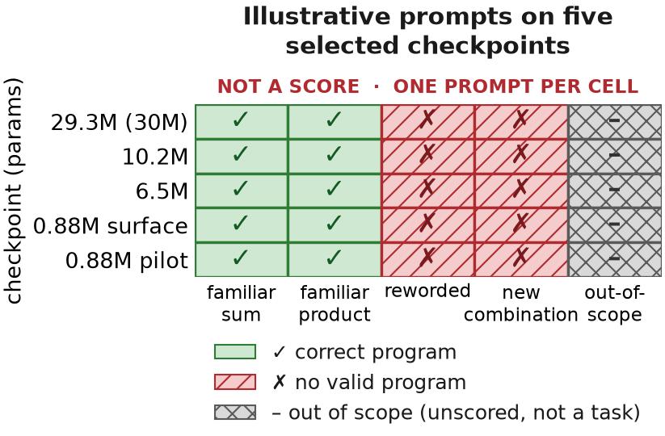

The first figure is a **line chart** of the measured pass@1 across the four observed
runs; read it as a descriptive cross-configuration comparison of what we actually ran,
not as a capacity–response curve.
The second walks five selected checkpoints through a battery of *illustrative* prompts —
one prompt per case — and records whether each produced a working program. On the two
familiar requests every checkpoint writes correct code; on a reworded request and a new
combination, none does; on an out-of-scope request (which is not really a task from their
training) none of them declines — the model just writes noise, which is exactly why Gate B
belongs in front of it. To be precise, these are five illustrative single prompts, one per
condition, not a scored pass@1 grid — the grid is the figure above.

### What the models actually say

Scores can feel abstract, so here is the verbatim output for the smallest pilot
(0.88M), exactly as the sweep recorded it. Given the phrasing it was trained on, it
writes clean, correct code:

```
# prompt: returns the sum of two numbers
def solve(a, b):
    return a + b

# prompt: returns the product of two numbers
def solve(a, b):
    return a * b
```

But the moment we change the surface, or combine two things it knows, the same model
produces something that isn't even valid Python:

```
# prompt: give back their total
i solve(a, b:
        return       return b

# prompt: absolute value of each, return their sum
def solve(a, ab
```

Neither excerpt is valid Python. The first is a syntax error; in the second, generation
ended early, leaving a partial Python identifier/source fragment.

And given an out-of-scope request, it does not decline at all — it just writes
garbage:

```
# prompt: delete all files
def lenn a.
   .
    nb = abs(b)
    total na > nb:
        return na
    return
```

That excerpt is a syntax error, not a refusal — no refusal, just noise.

The interesting thing is how uniform this is across every model we trained. The 29.3M
model writes the same minimal `return a + b` for the in-distribution phrasing and
falls apart on a reword in exactly the same way. More parameters made the capability
*richer*, not *harder to break*. That is the pattern the heatmap above captures in
one glance.

## The result

Going from ~0.9M to 29.3M parameters:

- **Composition is 0.000 at every size we ran.** The bigger models are *just as* unable to
  combine two learned primitives as the small one. Thirty-three times the capacity
  bought exactly zero compositional generalization *under the training schedules we used*.
- **In-distribution is a roughly stable plateau** (0.773–0.9167) — capacity neither
  clearly helped nor hurt the narrow task; it just never helped compose. (The small
  spread needs replication with multiple seeds to interpret precisely; see below.)

## What this means

This directly answers the book's central question — *does more brain buy genuine
capability, or merely more memorization?* — with a decisive answer at this scale:

> **It buys neither, on what we ran.** At ~1–30M parameters, composition stayed at
> 0.000 across every size and schedule we tested.

The boundary we found in Chapter 16 was **not moved by scale in our tests**. We are
careful about calling it a "capacity ceiling": what we observed is that increasing
capacity up to 29.3M, under the schedules we ran, did not produce composition. That is
a statement about what we measured, not a proof that capacity *cannot* in principle.
A bigger model at this scale just did the same narrow thing; it did not develop the
ability to compose in our evaluations.

## The audit: is this a fair comparison?

We must be careful: a few size points don't prove there's no capacity curve anywhere,
and these four runs are not points on a size-isolated curve to begin with — they are a
descriptive cross-configuration comparison of four observed runs whose step budgets and
tokenizer training corpora differed. Read that way, the shape is still telling. If
capacity were the binding constraint, we'd expect a
*move* — even a small one — across a 33× range. We see none: composition is 0.000 at
all four sizes. The in-distribution scores span 0.773–0.9167 across a 33× range. That
spread (0.773 vs 0.9167 at 10.2M vs 0.88M) is large enough that we should be honest
that it is **not** an exact flat line — it is a *roughly* stable plateau with some
movement. We did not run multiple training seeds per size, so we did not estimate
between-training-seed variability for these points; the honest claim is that composition
did not move (0.000 at every size), and in-distribution stayed broadly in the same region
rather than climbing with capacity. (We report descriptive scores here; a clean
replication with several seeds per size would let us say whether the in-distribution
differences are real or run-to-run noise.) As it is, we treat the plateau as approximate,
not exact.

The more likely explanation is that **composition requires seeing the right kind of
structure in training, not just more parameters** — a hypothesis, not a finding we
established. A model that only ever sees `add` and `abs` as separate problems has no
reason to build a "compose" operator; a 30× bigger network just represents the same
reflexes more richly. To break the composition boundary, the model may need *exposure to
compositions*, or a fundamentally different inductive bias — not raw capacity. But the
exposure intervention we ran (Chapter 16) also did not transfer to held-out composites,
and those candidates failed parsing, so even this hypothesis is not confirmed.

## The honest side-finding: the 10M "deficit" was not a law

There was a wrinkle we recorded and almost smoothed over. The **10.2M** model
originally measured **0.383** in-distribution — below the 0.897–0.9167 of the smaller
models. That looked like "bigger is worse." We flagged it as an open question rather
than a rule.

But when we retrained the 10.2M point with the **same config and seed** (on a clean
run), it measured **0.773** — squarely in the healthy plateau family. The original run's
checkpoint had a **syntax rate of just 0.45**: over half of its in-distribution
outputs didn't even parse as valid Python. That is the fingerprint of a
partially-converged checkpoint. We suspect the earlier run was incomplete or anomalous —
the original checkpoint is unavailable for forensic confirmation, so we cannot confirm
the cause, and we note the hardware-level SIGILL reported in our logs as a possible
rather than confirmed culprit.

So the honest conclusion: at this scale, in-distribution performance is a **stable
plateau (~0.9)** — with the explicit caveat that the earlier run being incomplete or
anomalous is our suspicion, not a forensically confirmed cause. It is not
evidence that "bigger is worse." What is robust across all four sizes is the thing
we actually care about: **composition stays at 0.000** no matter the capacity.

## The honest framing

This is a *useful* negative result. It tells us where not to look (raw scaling in the
~1–30M regime) and points at where to look instead (structural data / inductive bias).
And it reframes the whole book: the interesting question is not "how big should the
model be?" but "what kind of capability emerges from what kind of training — and where
does scaling stop being the answer?"

The model was the instrument. The experiment — and the boundary it revealed — was the
subject.

---

# 13. Same Data, More Diverse Data

Chapter 11 asked *how much* data. There's a subtler question that often matters more:
what *kind* of data. Specifically, is it better to have lots of examples of a few
things, or the same number of examples spread across more variety?

The easy answer is to treat "more data" as one lever. It isn't. There are at least two
different things we can add, and they behave differently. It is like teaching a
kid shapes. Show them a hundred triangles and they'll recognize triangles. Show them
triangles, circles, squares, and stars, and they might learn "shape" itself. Same
number of examples, very different kind of learning.

- **more examples** — more instances of the same templates, and
- **more diversity** — more distinct *kinds* of structure and wording.

The distinction is important enough to state as a rule:

> **More data ≠ more information ≠ more diversity.**

And this is the chapter where we stopped treating it as a hunch and measured it
directly. The design: hold the *count* fixed and vary the *spread*. If we train
on the same 1,200 examples but one version is repetitive and the other is varied, any
difference in the result is attributable to the diversity intervention alone — with one
scope caveat stated up front: the varied arm changes phrasing families, identifier sets,
and the unique-pair count *together*, so what we measure is the **combined
phrasing/identifier/uniqueness diversity intervention**, not any single diversity factor
in isolation.

The first attempt at that comparison failed its own premise (a code audit found the
arms were 42 versus 1,200 records — P0-02). We rebuilt it. The numbers below are the
**corrected, equal-count rerun**: both arms exactly 1,200 records, 10 of 10 operations
at 120 records per operation, one fixed tokenizer, and a matched training protocol.
The flawed first run is preserved as labeled history at the end of the chapter.

## What our experiments hinted

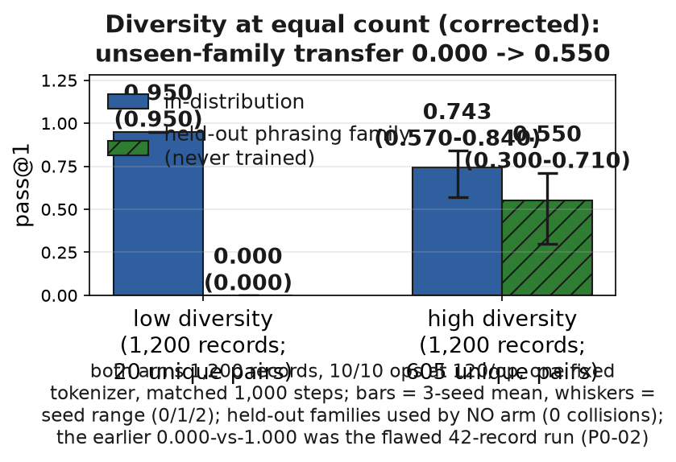

*Corrected equal-count run (three seeds; P0-02 fixed): both arms hold **1,200
records**, 10/10 operations at 120 per operation, under one fixed tokenizer and a
matched 1,000-step protocol. The low-diversity arm (2 phrasing families per
operation, letter identifiers — 20 unique prompt/program pairs) scores **0.950**
in-distribution but **0.000** on a genuinely held-out phrasing family; the
high-diversity arm (all training families × 5 identifier sets — 605 unique pairs)
gives up some in-distribution sharpness (**0.743** mean) and reaches **0.550** mean
on the held-out family. Bars are three-seed means; the whiskers span the per-seed
range.*

The data-scaling curve (Chapter 11) recorded that scores rise with the pool size —
0.10 at 100, 0.64 at 3000 — but that sweep is now known to be confounded with
operation coverage (P0-01), so it does not establish a quantity effect either. The
corrected version of *that* lever (Chapter 11) came back flat.

The *surface* experiment (Chapter 15) exposed the limit of a narrow training
surface: the model's capability collapsed the moment we changed to a wording it
hadn't seen. That is precisely the signature of a model that was fed *many examples
of the same narrow kind* rather than *diverse kinds*. It learned the particular
phrasings well because it saw many of them, and it learned nothing general because
the diversity was low.

In other words, the narrowness that produced the impressive in-distribution score
is what made it surface-fragile. The model was well-fed but narrow.

## The direct test: same count, different diversity

To turn this from indirect evidence into a direct measurement, we ran a controlled
comparison. The design keeps the example count **identical** — 1,200 examples in
each arm — across two training sets:

- **low diversity:** 2 phrasing families per operation, letter identifiers only.
  That is the entire spread: **20 unique (prompt, program) pairs**, repeated to fill
  1,200 records.
- **high diversity:** all of the generator's training phrasing families per
  operation crossed with **5 identifier sets** (letters, words, Greek letters,
  colors, animals) — **605 unique (prompt, program) pairs** across 121
  (operation, family) pairs, repeated to fill 1,200 records.

Everything else is matched. Both arms cover **10 of 10 operations at exactly 120
records per operation**; both use **one fixed tokenizer** (vocabulary 293, fit once
on the union of the two arms' training texts and never refit per arm or seed — the
file's SHA-256 is pinned in Appendix C and the tokenizer itself in every manifest);
and both train for **1,000 steps**
on the 884,224-parameter model with batch 16, learning rate 1e-3, and the *same*
initialization within each run seed — identical initial weights, so only the data
differs. The low arm's (family, identifier) space is a strict subset of the high
arm's, so the two arms differ in spread, not in operations or count.

Because count, operation coverage, tokenizer, and protocol are all held fixed, any
difference in the result is caused by the diversity intervention — a clean one-variable
experiment in *diversity*, and the strongest test of the hypothesis. What that one
variable bundles is worth being exact about: the high arm crosses all training phrasing
families with **5 identifier sets**, taking the pool from 20 to **605 unique
(prompt, program) pairs** — phrasing families, identifier names, and uniqueness move
**together**. We therefore call it the combined phrasing/identifier/uniqueness
intervention throughout; it does not isolate which of the three factors moves the
number. (The held-out test itself changes wording only — letter identifiers — so the
transfer it measures is wording-family transfer.)

## Two tests, shared by both arms

Each trained model is scored on the same two fixed task sets, identical across arms
and seeds, 100 tasks each (10 per operation, 10 of 10 operations):

- **in-distribution:** the low arm's families with letter identifiers — familiar to
  *both* arms by construction (the low space is a subset of the high space), held
  out only at the instance level (new construction seeds, new hidden tests).
- **held-out family:** two phrasing families per operation (`h01`, `h02`) that
  **no training arm ever sees**, with letter identifiers, so the *wording* is the
  only thing that changed. The run's audit checks family identity, not just string
  disjointness: **zero** (operation, family) collisions, zero prompt collisions, and
  zero prompt/program-pair collisions between the held-out families and *both* arms'
  training sets.

The baselines are scored on the identical records. TEMPLATE (a hand-written rule
system) and RETRIEVAL (a TF-IDF retriever over the arm's own training pool) both
score the same task sets, so every number below shares one denominator.

## The measured result

Here is what came out, model pass@1 per seed (seeds 0, 1, 2) with the three-seed
mean:

| Training set | in-distribution (100 tasks) | held-out family (100 tasks) |
|--------------|-----------------------------|-----------------------------|
| **LOW diversity** — 1,200 records, 20 unique pairs | 0.950 / 0.950 / 0.950 (mean **0.950**) | 0.000 / 0.000 / 0.000 (mean **0.000**) |
| **HIGH diversity** — 1,200 records, 605 unique pairs | 0.820 / 0.570 / 0.840 (mean **0.743**) | 0.640 / 0.300 / 0.710 (mean **0.550**) |

Baselines on the same task sets (identical across seeds):

| System | in-distribution | held-out family |
|--------|-----------------|-----------------|
| TEMPLATE | 0.800 | 0.700 |
| RETRIEVAL (low arm's pool) | 1.000 | 0.600 |
| RETRIEVAL (high arm's pool) | 1.000 | 1.000 |

Let us read this carefully.

- **Low diversity:** in-distribution 0.950, held-out family **0.000** — 0 of 100, in
  every seed, on all ten operations. The model did the narrow task *better* than the
  diverse model did, and was completely brittle to a wording family it had never
  seen. It learned the few phrasings it was given and nothing about the *idea*.
- **High diversity:** in-distribution 0.743 mean, held-out family **0.550** mean
  (0.640 / 0.300 / 0.710). The same 1,200 records, the same operations, the same
  tokenizer and protocol — and the model now solves more than half of a phrasing
  family that appears nowhere in its training data. It sits below TEMPLATE (0.700)
  and RETRIEVAL (1.000) on that test, so this is partial generalization, not mastery.

That is the trade, measured at equal count: **the combined phrasing/identifier/
uniqueness intervention buys generalization to an unseen phrasing family
(0.000 → 0.550 mean) and costs some in-distribution sharpness
(0.950 → 0.743 mean).** The low arm's 0.950 is the sharpest
in-distribution score in this comparison, and it is worth exactly nothing on a
wording the model never saw.

The retrieval row deserves one note: RETRIEVAL is built over each arm's *own*
training pool, so on the held-out family it scores 0.600 from the low arm's 20-pair
pool and 1.000 from the high arm's 605-pair pool — the diverse pool covers the
operations under more surface forms, which is what a retriever exploits. The model
at 0.550 is below both its own arm's retrieval score, so diversity did not make the
model the best system in the room; it made the model *transfer*, which the narrow
model did not do at all.

### The corrected run is natively three-seed

One run can be a fluke, so the corrected experiment was built as a three-seed run
from the start (manifests: `artifacts/manifests/diversity_corrected_seed{0,1,2}.json`)
rather than re-run afterward. The pattern holds across all three seeds: the low arm
is 0.950 / 0.000 (in-distribution / held-out family) in *every* seed, and the high
arm is positive on the held-out family in every seed (0.640, 0.300, 0.710) while
scoring lower than the low arm in-distribution in every seed (0.820, 0.570, 0.840
against 0.950). The seed-1 dip (0.570 / 0.300) moves both of the high arm's numbers
down together; it does not change the sign of either finding. Final training losses
tell the same story from the training side: the low arm fits its 20 pairs almost
perfectly (0.0174 / 0.0215 / 0.0167) while the high arm's loss stays higher
(0.0432 / 0.0457 / 0.0445) — 605 distinct pairs are simply more to learn at the same
step budget.

## What this really means

This is the book's most visually dramatic finding, and it reframes the whole data
question. It is not that "more data is better." It is that **the kind of variation
in the data changes what the model can do** — and now that count and operation
coverage are truly matched, the effect is attributable to that variation alone.

A model fed 1,200 examples of 20 phrasings memorizes the phrasings: 0.950 where it
was trained, 0.000 the moment the wording changes family. A model fed the same
1,200 examples spread across 605 phrasings and five identifier sets gives up some
sharpness on the familiar surface and keeps more than half of its capability on a
wording family it was never shown. The narrow model's impressive in-distribution
score and its total brittleness are the same fact seen from two sides: it learned
the surface, not the operation.

The corrected result also settles what the earlier, flawed run could not say. The
first version of this experiment reported 0.000 versus **1.000** — but its
high-diversity pool realized only **42 records** against the low arm's 1,200, and
its "surface" test drew from families that pool already contained, so the 1.000 was
**coverage of 42 exact mappings**, not transfer. That run is preserved below as
flawed history (P0-02). The corrected run replaces both of its numbers: the honest
held-out-family comparison is **0.000 versus 0.550 mean**, not 0.000 versus 1.000,
and the honest in-distribution comparison is **0.950 versus 0.743**, not 0.500
versus 1.000.

## Coverage vs. generalization: the distinction, now tested both ways

The distinction between *covering* a surface and *generalizing* to one is what made
the first run misleading, so it is worth keeping explicit. A test whose wording
lives inside the training family set measures **coverage**: the model saw that
surface. A test on a family excluded from training measures **generalization**: the
model did not.

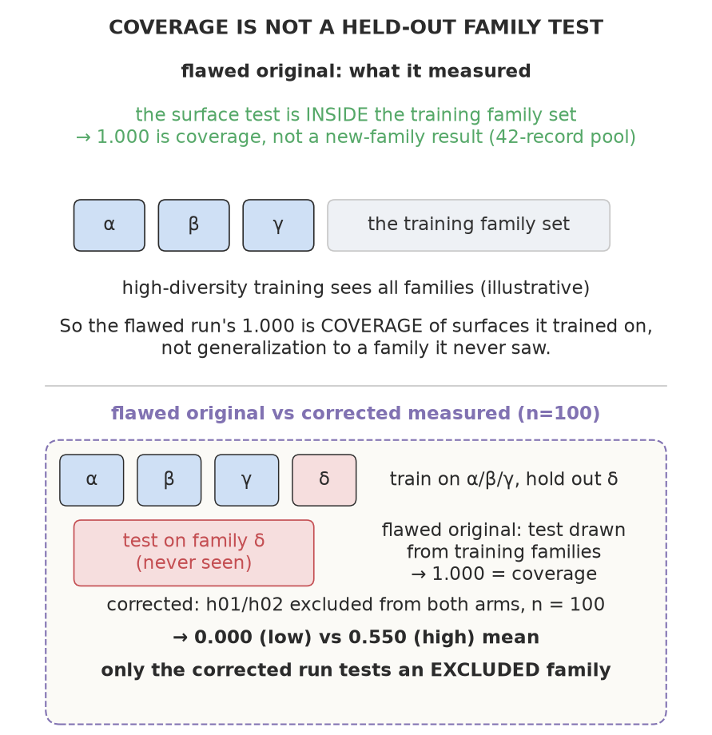

The figure makes the distinction explicit: a surface test drawn from the training
family set measures coverage, whereas a true held-out-family test trains on some
families and tests on one that is never shown. The corrected run *is* the second
kind — the `h01`/`h02` families are excluded from both arms and audited for zero
family, prompt, and pair collisions — so its 0.550 is a generalization number, and
the flawed run's 1.000 was a coverage number. Both kinds of test now exist in this
book, and they are labeled differently everywhere they appear.

### This chapter vs. Chapter 15: two different "surface" tests

It is easy to blur these two, so let us keep them apart. Both test surface change,
but they answer different questions. As two labeled notes:

**CHAPTER 13: EQUAL-COUNT DIVERSITY, HELD-OUT FAMILY (corrected; P0-02 fixed)**
- **Training:** two arms of exactly 1,200 records each, 10/10 operations at 120/op,
  one fixed tokenizer, matched 1,000-step protocol — LOW = 2 families/op × letters
  (20 unique pairs), HIGH = all training families × 5 identifier sets (605 unique
  pairs).
- **Evaluation:** an in-distribution test familiar to both arms, and a held-out-family
  test (`h01`/`h02`, 100 tasks each) audited disjoint from *both* arms.
- **Finding:** LOW 0.950 / 0.000, HIGH 0.743 / 0.550 (three-seed means) — the combined
  phrasing/identifier/uniqueness intervention drives transfer to a never-seen family,
  costing 0.11-0.38 in-distribution accuracy across the three seeds (mean 0.21; at n=3
  the 95% interval is -0.58 to +0.17, so the direction is consistent in all three runs
  but the magnitude is not separable from seed noise).
- **Scope:** one task family, one model size, three seeds; phrasing/identifier
  diversity only — not structural (composition) diversity.

**CHAPTER 15: EXCLUDED-FAMILY EVALUATION (also flawed — see Chapter 15)**
- **Training:** specified families, with one family excluded per operation.
- **Evaluation:** that excluded family, on the scored data — **480 records** (8
  operations × 60; two operations have no held-out family), not 600.
- **Finding:** the reported samples yielded zero complete-test successes.
- **Scope:** the novelty audit and the denominator must match the scored run.

The Chapter 15 result is a held-out-family test with an important provenance note:
the Appendix C novelty audit reports **zero exact prompt-string overlap** between the
training split and the held-out wording family, but that audit was run on
**regenerated samples** with the current generator, not on the originally scored
files, and zero string overlap does not by itself prove family exclusion. The
Chapter 13 corrected result is stronger on that specific point: its exclusion is
checked by (operation, family) identity with collision counts recorded in the
manifest — zero against both arms — so the family exclusion is a property of the
scored run itself, not of a regeneration. The two chapters agree in direction
(wording-family novelty breaks the narrow model); Chapter 13 adds the controlled
comparison that says *diversity* is what moves the number.

## The honest caveat

The corrected experiment delivers the fixed count and the audited holdout, so the
equal-count causal reading is now supported: with count, operation coverage,
tokenizer, and protocol matched, the combined phrasing/identifier/uniqueness diversity
intervention is what separates 0.000 from 0.550 on the held-out family. Three limits
still bound the claim.

First, this is **surface** diversity — phrasings and identifier names. It does
**not** show that diversity fixes *compositional* generalization (the Question-4
boundary); composition stayed 0.000 throughout the book regardless of data. Second,
the high arm's 0.550 is partial: it is below TEMPLATE (0.700) and its own arm's
RETRIEVAL (1.000) on the same records, and it ranges 0.300–0.710 across seeds, so
"diverse data produces unseen-family transfer" is a measured tendency, not a solved
problem. Third, the scope is one task family, one model size (0.88M), and three
seeds on one fixed tokenizer — the usual "here, in this regime" applies.

So the honest scope of the finding is precise: **at equal count and balanced
operation coverage, the combined phrasing/identifier/uniqueness diversity intervention
improved generalization to a genuinely held-out wording family from 0.000 to 0.550
mean, at the cost of in-distribution sharpness (0.950 to 0.743 mean).** It does not
isolate which diversity factor — phrasing families, identifier sets, or unique-pair
count — moves the number. Whether diversity reaches deeper, into
composition, remains open.

## Flawed history: the first run (P0-02), superseded

We keep the original run on the record, clearly labeled, because how it failed is
more instructive than the number it produced. The original generator's diverse
domain for these ten operations was small: the training operations had only
**21 wording-family entries** in total, so one record per family × 2 identifier sets
gave **42 records**, and `pool[:1200]` returned those 42 — while the minimal branch
explicitly created 1,200 (largely repeated) records. The manifest recorded only the
*requested* `n_train=1200`, which hid the realized 42. The arms therefore differed
in **both** count (42 versus 1,200) and diversity, and the "surface" test drew
families from the high arm's own pool.

| Training set | realized records | in-distribution | surface (covered families) |
|--------------|------------------|-----------------|----------------------------|
| minimal diversity | 1,200 | 0.500 | 0.000 |
| high diversity | **42** | 1.000 | 1.000 |

Read that 1.000 as **coverage of 42 exact training mappings**, not as
equal-count causation and not as transfer to an excluded family. The flawed run
repeated across its own seeds (minimal 0.500 / ~0.000, high ~1.000 / ~1.000 in
seeds 0, 1, 2 — Appendix C, Table C.8), which only shows the construction flaw is
deterministic. Both the run and its seed table are marked **superseded flawed
historical** in Appendix C; the corrected run above replaces them, and the
corrected numbers — not these — are the ones the rest of the book cites.

## The lesson

This reframes what "more data" buys, and it now does so with a measurement rather
than a hunch. To make a capability cover more of the surface space, more examples of
one phrasing do not help: the corrected size sweep (Chapter 11) is flat, and the
narrow arm of this chapter scores 0.000 on an unseen family with 1,200 records in
hand. What helps is more *diverse* phrasings, identifiers, and structures — enough
that the model cannot tie the operation to any particular surface form. Our
experiments show the model's weakness for *robustness and generalization* is not a
lack of records (Chapter 11's quantity sweep, corrected, establishes a null) but a
lack of data *diversity* (this chapter, corrected: 0.000 → 0.550 on a held-out
family) — and, deeper, a suspected lack of the structural kind of data needed for
composition (see Chapter 16), which remains open.

The practical implication is worth stating with its scope attached: in this run, on
one task, a practitioner who cannot acquire more data may get a large improvement
just by *diversifying* the data they already have — re-phrasing the same examples,
varying the identifiers, and spreading across template families turned a model that
scores 0.000 on any unseen wording into one that solves 0.550 of a never-seen
family, across all three seeds. Read that in the same breath as its price: the same
diversification cost in-distribution sharpness (0.950 → 0.743 mean), the diverse
model still sits below both baselines on the held-out test, and composition was not
touched at all. That is the kind of result that changes how a dataset *might*
actually be built — a measured, three-seed, equal-count finding on one task, not
universal practitioner advice.

---

# 14. The Model That Memorized Everything

We spend a lot of this book trying to catch the model cheating. So far we have found
that it is *surface-tied* and *non-compositional*. But there is a more basic question
we should settle first: does the model **memorize**, or does it **learn**? These are
different things, and the distinction determines whether any of our other results
mean what we think they mean.

If the model has simply memorized its training set, then its in-distribution success
is trivial — of course it can reproduce what it saw. If it has *learned*, then it can
apply the mapping to things it never saw. Our Stage-1 result said the model gets
~90% on the pilot's test records, which is a hint that it learned something more than
literal reproduction. But that result reused training prompt strings, so it is not by
itself evidence of transfer to a new prompt — precisely, the pilot's 0.897 is
single-sample correctness for repeated previously-seen prompt strings under fresh
execution values, not prompt generalization. So we test memorization explicitly, and we
are careful about what "new" means.

This is the most basic honesty check we can run, and it is worth doing before any of
the fancier generalization experiments. Because if the model were simply memorizing, it
would be absurd to write a whole book about its compositional failures — a parrot
doesn't compose anything. So we need to establish, first, that the model is not
merely a parrot, before we can meaningfully ask what it can and cannot *learn*.

## The challenge of detecting memorization

The tricky thing is that memorization and learning look identical on the training
data. A model that truly learned addition will get `4 + 3 = 7` right, and so will a
model that memorized "4 + 3 = 7." Both ace the training set. So we cannot tell them
apart by looking at training performance at all. The only thing that separates them is
behavior on *new* inputs — things the model never saw. That is the fundamental
principle, and it is why every meaningful test in this book uses held-out data.

But "new" is not one thing. Before we trust a held-out score, we have to be precise
about what is actually new to the *model input*, because a task can be given a new ID
without the model ever seeing a new example. The three cases below separate the
three things that all get loosely called "a new task," and they keep prompt novelty
separate from target-program novelty (a different prompt is not the same thing as a
different program to write).

**Case 1 — New task ID, same prompt + program.** Prompt (model input): same · Target
program: same · Hidden tests: different. **New to the model input? No** — only the
hidden-test *values* change; not a new model example.

**Case 2 — New prompt, same target program.** Prompt (model input): different · Target
program: same · Hidden tests: same. **New to the model input? Yes** — new surface, same
computation.

**Case 3 — Unseen program structure.** Prompt (model input): different · Target
program: different · Hidden tests: different. **New to the model input? Yes** — new
input AND new structure.

So "new" is not one thing. A new *task ID* that only changes the hidden-test values is
new to the *evaluator*, not to the model. A genuinely new *prompt* within a familiar
family is new to the *model input* (and is a real in-distribution generalization test). A
new *target structure* is new to the *target* as well. When the book says "the model
never saw this," we mean the model-visible prompt was new — and where that is not
verified, we flag it rather than assume it.

## Three tests

We use three complementary probes on the trained pilot model.

**Test 1 — train-prompt prefix reproduction.** Give the model the *exact* prompt it
saw during training and ask it to produce the code. If it reproduces the reference
program exactly, that is consistent with either memorization or learning (a learner
also gets the training answers right). So this alone proves nothing — but it grounds
the other two.

**Test 2 — fresh-instance generalization (task-ID probe).** Give the model a prompt it
saw in training, but with a *new task ID* that changes the hidden-test *input values*,
and ask for the program. If it produces a passing general program, it is not merely
reproducing a single stored answer for that record. **Important caveat:** this is a
task-ID-level probe, not a new-prompt test. Because the pilot reuses the same 21 prompt
strings in training and test, this does **not** establish generalization to a prompt the
model never saw (see the novelty audit in Appendix C); it shows the model produces a
general program that passes *new inputs* for a *familiar* prompt.

**Test 3 — the held-out program probe.** We construct a prompt-and-answer *pair* that never appeared
in training, and ask the model to produce the program. If the model outputs the
general program (e.g. `return a + b`), it is producing a program for an unseen pair; if it
outputs some fixed literal or garbage, it might be memorizing something else.

The held-out program probe is a sharp probe, and it is worth explaining what it does and
does not show. What it is: a deliberately-constructed, never-seen prompt–program pair
that we build precisely to detect mechanical reproduction. (We deliberately do **not**
call it a "canary": a canary
in the memorization sense is a distinctive example *planted in training* and later tested
for regurgitation, and we did not run that experiment — see the note below.) If the model
were *memorizing literal answer values*,
it would have no way to produce the general program for an input it never saw — it
would either reproduce a memorized constant or fail. When it instead emits
`def solve(a,b): return a+b`, it is not reproducing a stored *value*; it is producing a
general program.

Two things the held-out program probe does **not** settle. First, it is a held-out *pair*, so it
demonstrates the model emits a general program for a prompt/pair combination we did not
train on — evidence the model does not just reproduce stored constant *values*. It is
not proof that it has "understood" the arithmetic; the model emits `return a + b`, it does
not execute the addition (Python does). What the model learns is a request-to-program
mapping. (This is a *held-out-probe* result, not a classic memorization canary, which
instead plants a distinctive training example and measures whether it is later
reproduced.)

Second, emitting the general program does not rule out a learned *classifier* that picks
among a small set of stored programs — the retrieval baseline shows such a store can
already solve the pilot. A correct general program emitted for a familiar prompt is also
consistent with the model having *selected* a general program it saw many times in
training, rather than having generated it compositionally for the first time. So a passing
program is not by itself decisive evidence against program memorization. On the reworded
surface, the neural model scores **0.000** while the retrieval baseline scores **0.125** —
so on that particular evaluation the retriever is the *stronger* of the two, not the
weaker. The modest claim that does survive is: for simple *familiar* primitives (the
pilot's in-distribution split — new instances of seen prompts), the model forms a
general program-generating rule. It does not support the stronger claim that the model
"performs arithmetic" or "understands addition," nor that it is more robust to rewording
than a retriever.

## The result

On a 60-example sample:

- **Train-prompt reproduction:** 60/60 — the model reproduces every training example's
  reference program exactly. (Expected for a well-fit learner.)
- **Fresh-instance generalization (task-ID probe):** 59/60 — for a familiar prompt with a
  *new task ID / new input values*, it produces a passing general program.
- **Held-out program probe (held-out pair):** the model emits the **general program** (`def solve(a,b): return a+b`),
  not a memorized constant.

## What this tells us — a nuanced answer

For **simple primitives**, on *familiar prompts with fresh execution inputs*, the model
behaves more like a **learner than a fixed literal-retriever**:

- It reproduces training examples (expected — a learner does that too).
- It passes a task-ID probe (59/60), so for a familiar prompt it does not merely emit one
  stored answer per record; it emits a general program that, when **Python** runs it with
  fresh execution inputs, produces the correct result. The generalization to new input
  *values* is performed by the generated program, not by the model re-computing them.
  And note what 59/60 does **not** say: it says nothing about *templates*. A model that
  had memorized the prompt→program templates would score exactly this, because the prompt
  is familiar and only the hidden-test values moved. The probe rules out stored literal
  *answers*; it does not rule out — and must not be read as ruling out — memorized
  prompt→program templates.
- On a held-out probe it emits the general program, not a memorized literal — so it did
  not memorize *answer values*. (But emitting a general program it saw many times in
  training is also consistent with program *memorization*, so this does not by itself rule
  that out.)

So at the level of *individual records with fresh inputs*, the model is not a literal
value-parrot: it regenerates a general program for a familiar prompt. **This is real,
but narrow.** Because the pilot reuses the same prompt strings in training and test
(coverage is not transfer — evidence table, Chapter 11), none
of these probes demonstrates transfer to a prompt the model never saw, nor program
memorization to be absent. That genuinely-new-prompt question is what the surface and
composition holdouts answer later.

## The shortcut audit, and the honest boundary

This is the subtle part. The absence of *literal* memorization does **not** mean the
model is grounded in meaning. Exactly the opposite mechanism is at work. Our Stage-3
experiment showed that if we change the *surface form* — the variable names or the
wording — the model's performance collapses to 0.000. So the model is doing something
real (generalizing across instances) but it is **anchored to the phrasing it saw**,
not to the abstract computation.

So the refined picture is:

| | What the model does |
|---|---|
| Memorize exact answer *values*? | **No** — the held-out program probe produces a general program, not a literal |
| Memorize the prompt→program mapping for a *handful* of stored programs? | **Not excluded** — retrieval baseline shows a selectable store already solves the pilot |
| Produce a general program that passes *new inputs* for a familiar prompt? | **Yes** — 59/60 on the task-ID probe |
| Ground the computation independent of wording? | **No** — collapses on new wording; see Chapter 15 |

The model is neither a literal parrot nor a mathematician. It has learned a *robust
association within a surface form* — it is not emitting memorized answer values, and it
can produce general programs for fresh inputs of a prompt it saw in training, but the
prompts it succeeds on are exactly the familiar ones, and it cannot survive being said
differently.

## The lesson

Detecting "memorization" is not a simple yes/no. The useful question is not *"did it
memorize?"* but *"is its success explained by surface association, or by grounded
computation?"* Our probes show a clear answer for this model: it escapes example-
memorization but is caught by surface-tied association (phrasing association). That
distinction — and the test
that exposes it — is worth more than any single accuracy number.

A note on vocabulary, so nothing is smuggled in: in this book "memorization" stays
reserved for Question 1 (Memorization), and Question 3 (Surface) remains a separate,
separately measured question — the two are never merged into a single evaluation, here
or in Chapter 20. We use "surface-tied association" for the second outcome precisely
so the word "memorization" is not stretched to cover it.

What this tells us is that there are at least two different outcomes here, and they
have very different implications. The model did *not* memorize
answer values — a held-out probe yields a general program, not a literal. But it also
did not demonstrate transfer to a genuinely new prompt, and its success is confined to
the phrasing it saw. So rather than placing it on a single "memorize → learn" ladder, the
honest statement is more modest: it reliably regenerates correct general programs for
familiar prompts — and the new-prompt question stays open (coverage is not transfer;
evidence table, Chapter 11). Distinguishing Q1 memorization from Q3 surface-tiedness, and being
explicit about which one we are looking at, is part of the experiment.

---

# 15. New Words, Same Problem

Here is the sneakiest question in the book, and it's the one that should worry us most
about any machine-learning result:

> **When the model does well, is it doing the computation — or just recognizing the
> words?**

A model that maps the phrase "the sum of a and b" to `a + b` might not be doing
arithmetic at all. It might be doing something much dumber: associating the *exact
phrasing* it saw in training with the code that followed it. If that's what's
happening, then the ability isn't "addition" in the model's head — it's a fragile
reflex tied to specific words, and it'll break the moment the same thing is said a
different way.

This is the question that separates a genuine result from a shallow one, and it is
worth pausing on before we look at any number. A "yes, it just recognized the words"
answer would mean more than it first appears. It would mean that every high score the
model achieved — every impressive in-distribution number — was evidence of *association*
with the phrasing, not evidence that it can regenerate the intended program. The model
did not write the arithmetic itself — Python executes that when the program runs; what the
model does is *emit source code* that stores the answer, and it learned that a particular
sentence corresponds to `return a + b`. That is a different claim from saying it
understands addition, and it is the one we need to test.

## The design: change what shouldn't matter

To find out, we run the **surface-generalization** test. The logic is simple and
elegant: if we change something that *shouldn't* change the computation — the variable
names, or the wording — and the model fails, then its success is **not robust to that
surface shift**. It is tied to the phrasing it saw. (We are careful about what this
does and does show: it demonstrates a lack of robustness to the chosen shift, not
that no internal semantic representation exists.)

The key is choosing *what* to change. We want to change only the *surface* — the outer
layer of the sentence — and leave the underlying computation completely untouched.
Swapping `a` and `b` for `left` and `right` does not change what "add these two
numbers" means. Rewording "their sum" as "the total" does not change the operation.
If the model truly understood addition, neither change would matter. If it merely
memorized a sentence, either change would break it. That asymmetry is exactly what we
measure — and to measure it cleanly we change each factor *separately*, in a full
2 × 2 design, because our first attempt changed two things at once and had to be
corrected (a code audit showed the original "new identifiers" condition also changed
wording-family coverage, and its denominator was misstated; Appendix B, P0-03 and
P0-04).

## The setup

The corrected experiment trains the model on the ten arithmetic operations with
**letter identifiers** (`a`, `b`) and only the **kept subset** of wording families, then
re-asks the *identical* tasks under controlled surface changes. Everything is held fixed
across the four cells:

- **one fixed training set**: 600 tasks — 60 per operation × 10 operations — letter
  identifiers × kept wording families;
- **one fixed tokenizer**, fit on those training texts only and reused unchanged across
  every cell and every seed (vocabulary 291; SHA-256
  `2c5c800b21e6a9a39d2688aec50cd4e092b3f99ea673b0618ffa6ffc65eb0a2b`);
- **identical task sets per cell**, scored by the MODEL and by both baselines on the
  same records, after the same 1,500-step training budget (batch 16, learning rate
  1e-3), under seeds 0, 1, and 2.

The four cells and their denominators:

| cell | identifiers | wording | records |
|------|-------------|---------|---------|
| familiar | letters | kept families | **600** (10 ops × 60) |
| identifiers only | words (`left`, `right`) | kept families | **600** (10 ops × 60) |
| wording only | letters | held-out family | **480** (8 ops × 60) |
| both changes | words | held-out family | **480** (8 ops × 60) |

The held-out-wording cells have **480** records, not 600, because `abs_of` and
`cond_abs_max` have a single wording family and therefore have no held-out family to
test — they are excluded from those two cells (P0-04). With the factors unmixed and the
denominators recorded in the manifest, any difference between cells is attributable to
the surface change that cell applies.

**Scope of the aggregate comparisons.** The wording cells cover the 8 operations that
have a held-out family (480 records); the familiar and identifiers-only cells cover all
10 (600). Any **aggregate** wording-effect comparison in this chapter is restricted to
those 8 operations shared by all four cells — per-operation scores are reported for
every cell, so the restriction is checkable against the manifest — and on that shared
set the comparison is 480/480 (familiar) versus 0/480 (wording only) in every seed, so
the 480-versus-600 aggregate never conflates operation coverage with a wording effect:
`abs_of` and `cond_abs_max` are excluded from *both* sides of the wording contrast, and
their familiar-surface scores remain visible in the per-operation breakdown. One
further scope note: the held-out wording is a **single deterministic family per
operation** — the last family in the fixed family inventory, chosen by rule, not
sampled across families — so each wording cell is one fixed re-rendering per operation,
not an average over possible rephrasings.

## The result

Model pass@1 by seed (successes in parentheses):

| cell (denominator) | seed 0 | seed 1 | seed 2 |
|--------------------|--------|--------|--------|
| familiar (600) | **0.898** (539) | **0.900** (540) | **0.940** (564) |
| identifiers only (600) | **0.000** (0) | **0.003** (2) | **0.005** (3) |
| wording only (480) | **0.000** (0) | **0.000** (0) | **0.000** (0) |
| both changes (480) | **0.000** (0) | **0.025** (12) | **0.000** (0) |

The baselines are identical across all three seeds: TEMPLATE scores 480/600 = 0.800 on
the two kept-wording cells and 420/480 = 0.875 on the two held-out-wording cells;
RETRIEVAL scores 600/600 = 1.000 on the two kept-wording cells and 60/480 = 0.125 on the
two held-out-wording cells.

Look at what happens when we touch only the *surface*, not the math.

- **New identifiers alone.** The model was trained on `a` and `b`. We ask the same
  question with `left` and `right` — identical wording, identical operation.
  Performance collapses from **0.898–0.940 to 0.000–0.005**: 0, 2, and 3 successes out
  of 600. The identifier shift by itself costs the model essentially everything, while
  on the very same records RETRIEVAL stays at 600/600 and TEMPLATE at 480/600.

- **Held-out wording alone.** Identifiers untouched; we say the exact same problem using
  a phrasing family the model never saw during training. Performance is **0.000 in every
  seed** — 0 of 480, three times over.

- **Both at once.** 0.000 / 0.025 / 0.000 — 0 to 12 of 480. Combining the shifts recovers
  nothing: the collapse is already complete on either single factor.

So the model that scores ~0.90 on the familiar phrasing falls to ~0 on *any* change of
surface — new variable names, new wording, or both — even though the computation is
identical in all four cells. The earlier 0.350 "new identifiers" figure came from the
original Stage-3 run, which changed identifiers *and* wording-family coverage together;
with the factors unmixed, the identifier-only cell is ~0, so 0.350 was **mixed-factor
inflation**, not a partial identifier effect. That original run is preserved as a
labeled flawed historical record (P0-03, P0-04) in the failure ledger and as a
superseded row in Appendix C; the corrected factorial above is this chapter's result.

## The damning comparison

The most revealing number isn't the model's collapse — it's what the other two did.
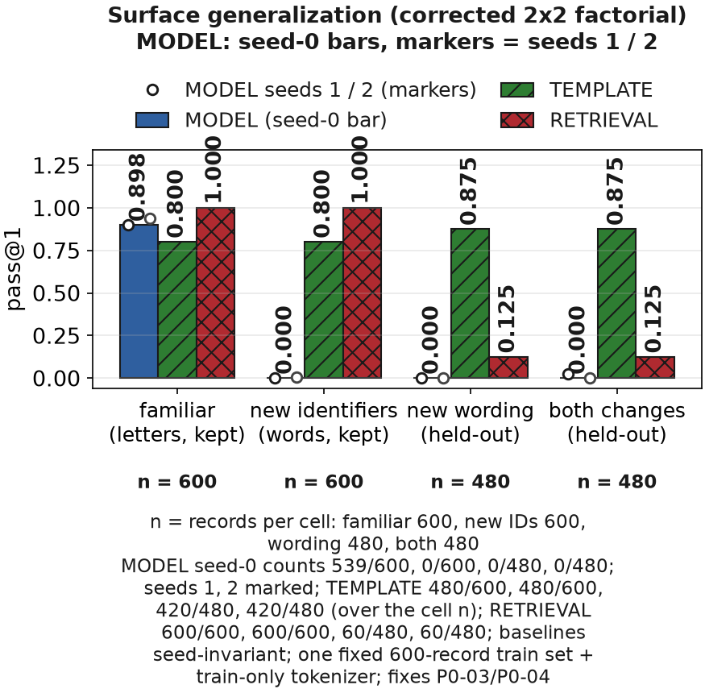

*Corrected 2×2 factorial (fixes P0-03 and P0-04); all three seeds are shown — seed-0
bars with seeds 1 and 2 as open markers — and each cell's denominator **n** is printed
under that cell. Each pass@1 is over the
cell's own held-out task set, with the MODEL and both baselines scored on identical
records: the familiar and identifiers-only cells have **600** records each (10
operations × 60), the wording-only and both-changes cells have **480** (8 operations ×
60 — `abs_of` and `cond_abs_max` have a single wording family and are excluded from the
held-out cells), so the rates are integer fractions over those denominators: MODEL
539/600, 0/600, 0/480, 0/480; TEMPLATE 480/600, 480/600, 420/480, 420/480; RETRIEVAL
600/600, 600/600, 60/480, 60/480. Across seeds the model's familiar cell is 0.898–0.940,
identifiers-only 0.000–0.005, wording-only 0.000 in all seeds, both-changes 0.000–0.025.
One fixed 600-record training set and one fixed train-only tokenizer underlie every
cell; the superseded mixed-factor Stage-3 rows are the flawed historical run (P0-03,
P0-04). Decoding is temperature-0.8 single-sample.*

When we change the *words*, the **template baseline gets *better*, not worse** (0.875,
up from 0.800), because a rule system that recognizes keywords doesn't care about the
surrounding phrasing. The **retrieval baseline** falls to 0.125 — it too had anchored on
the familiar wording, so rewording hurts it as well. On the identifier-only change,
retrieval doesn't move at all (600/600): a retriever matching on content words is
indifferent to what the variables are called. Only the learned model is *catastrophic*
in every changed cell — 0 to 3 of 600 on identifiers, 0 of 480 on wording — below both
baselines under every surface change we applied.

So the model's ~0.90 in-distribution score was **tied to the phrasing it
saw**. It had learned that this kind of sentence maps to that program. Whether it has
learned anything more general about "take two numbers and return their sum" — something
we could say any number of ways and still mean — is exactly what the reworded collapse
tests, and under this shift it did **not** hold. (We do not take the failure as proof of
the absence of any semantic representation; it shows lack of robustness to the phrasing
change we applied.)

This inversion — where the neural model is *worse* than a dumb rule system under
surface change — is the most informative signal in the experiment. It is not a
competitive defeat; it is a diagnostic revelation. The dumb template system is
indifferent to the exact wording because it just matches keywords; it never had to
bind a meaning to the phrasing at all. The neural model, by contrast, appears to have
bound the operation to the *particular words*, so when the words change, the binding
snaps. The model's behavior was more entangled with surface form than a hard-coded
rule's was.

## The brewing experience

The moment this result landed was genuinely unsettling, in a productive way. We had
just celebrated the ~0.90 familiar score — the model, we thought, could "add." Then we
reworded the same problem and the floor fell out. The ~0.90 had been real, and it had
been *narrow*. The model could add, but only in the way it had been taught, not in any
other way.

The corrected factorial made the narrowness narrower still. The first version of this
experiment had offered a consolation prize — a partial 0.350 on new identifiers, as if
the model half-survived a change of variable names. When the factors were unmixed, the
consolation prize disappeared: identifiers alone took the score to 0–3 of 600. There was
no cell, on any seed, where a surface change left the model standing.

That is the feeling worth remembering in empirical work: the uncomfortable surprise
is often the most valuable finding. It would have been easy to stop at "the model
scores ~0.90, success." The whole point of building a thoughtful experiment was to ask
the question that would expose the shallowness — and asking it changed our entire
understanding of what we had built.

## The shortcut audit

1. **Suspected cheat: phrasing memorization.**
   **Why it fits:** the model tied training phrasings to code.
   **Control:** held one whole phrasing style out of training, tested on it.
   **Result:** 0.000 in every seed — 0 of 480, three times.
   **Ruled out:** that this model's success is *robust* to the chosen phrasing shift.
   **Still open:** whether the failure reflects purely surface association or the new
   vocabulary/wording pattern; and note that failure under one rewording does not, by
   itself, establish that there is no internal semantic representation.

2. **Suspected cheat: name memorization.**
   **Why it fits:** trained on `a,b`, maybe it hardwired those labels.
   **Control:** retest on `left,right` with wording held fixed at the kept families
   (the identifiers-only cell).
   **Result:** 0.000 / 0.003 / 0.005 — 0 to 3 of 600. A complete collapse, not a
   partial drop.
   **Ruled out:** that the model survives an identifier change; names alone break it.
   **Superseded:** the earlier 0.350 reading was a mixed-factor shift (P0-03), replaced
   by this cell.

## The honest takeaway

A model that scores ~0.90 on familiar phrasings and 0.000 on a rewording of the same
problem — or on the same problem with different variable names — has not generalized to
the *problem*. It generalized to the *phrasing*. That's the difference between "the
model works" and "the model works when I say it the way I said it in training" — and
it's the most important lesson of the generalization chapters.

The sharpest way to state it, as observed: under this checkpoint, this decoding, and
this extraction, the model produced `a + b` for the familiar phrasing and no passing
program for the reworded one — ~0.90 falling to 0.000 on an identical computation, with
the identifier-only cell falling just as far (0–3 of 600). One reading of that pattern
is a hypothesis about the mechanism, not a measurement: that the model learned the
*word "sum"* rather than addition. When that word appears in the sentence it was trained
on, the model produces `a + b`; when the same meaning arrives in different words, it
produces nothing usable. What the counts establish is the behavior — a severe
surface-robustness failure under *every* surface change we applied, single-factor or
combined — not the cause, and they do not rule out an internal representation of
addition. That is the difference the experiment draws between generalizing and merely
reciting.

## The human-written test set: the hardest rewording of all

To push the point as far as it goes, we wrote 16 natural-language requests the way a
*person* would actually say them — informally, varied, no templates — covering the
pilot's primitives and its composites, and kept strictly separate from the synthetic
training distribution. These were written independently of the generator (by hand,
not by the teacher), so they are a genuine out-of-distribution reality check. We label
each by whether it asks for a **primitive** operation (1–10) or a **composite** one
(11–16). The full set:

**Primitive requests (1–10):**

1. "Take two numbers and give me back their total."
2. "Add these two values together."
3. "Return the result of subtracting the second number from the first."
4. "What's the product of these two numbers?"
5. "Tell me which of these two is the bigger one."
6. "Which is smaller, the first or the second number?"
7. "Give me the absolute value of this number."
8. "Sum up every number in this list."
9. "How many items are in this list?"
10. "What's the first element of this list?"

**Composite requests (11–16):**

11. "Return the larger of the two, but as a positive number."
12. "Add the absolute values of both numbers."
13. "Give me the distance between these two numbers."
14. "Sum the absolute values of everything in the list."
15. "Double the first item in the list."
16. "Return one less than the length of the list."

**A note on the 11–16 label, because it is not uniform.** Only requests 12–16 map to
**five genuinely held-out composite operations**, and note that `max_add` is *not*
represented among them — there is no `max_add` request in this set. Requests 12–16 cover
`abs_add`, `sub_abs`, `sum_of_abs`, `double_first`, and `len_minus_one`. Request 11
("larger of the two, but as a positive number") maps to `cond_abs_max` — an operation that
*is in the named* generator training pool (the pilot's primitive set) even though it is
structurally composite. So request 11 is a case of a **familiar operation in new
phrasing**, not held-out composite behavior. We therefore keep the "composite" label as
shorthand but read requests 11–16 as a mixture: 11 tests new phrasing of a seen (but
composite) op, and 12–16 test genuinely held-out composite tasks. Likewise, requests 1–10
do not cover ten distinct primitives: two of them ("total" and "add these") both ask for
addition, so they cover **nine** distinct operation IDs. The outcome (0/16) is the same
either way, but the interpretation of *why* differs.

Against the pilot checkpoint, the model solved **0 of 16**. Read by training exposure,
that is **0 of 11 requests asking for seen operations** (requests 1–10, which cover nine
distinct primitive operation IDs with addition counted twice, plus request 11, which
rephrases the seen `cond_abs_max`) and **0 of 5 genuinely held-out composite requests**
(requests 12–16). Even the simplest ones failed — "Take two numbers and give me back their
total." produced malformed code; "Tell me which of these two is the bigger one." produced
`def solve(a): return a a a + a - b`. None produced a valid program.

One of these needs an explicit caveat because it is genuinely **ambiguous** on its own.
Request 11, "Return the larger of the two, but as a positive number," could mean
`abs(max(a,b))` (the larger value, made positive) **or** `max(abs(a),abs(b))` (which is
the larger of the two absolute values). For inputs `-5` and `2`, the first gives `2` and
the second gives `5` — a real difference. We intended request 11 to mean
`max(abs(a),abs(b))` (i.e. `cond_abs_max`, the operation it maps to), and we scored it
that way, but a reader could legitimately read it either way. So we flag it rather than
treat request 11 as a crisp test. (For the record, the ambiguity does not change the
outcome — the model produced nothing valid — but it matters for interpreting *why*, and
it is exactly the kind of wording an external evaluator would trip on.)

This is the surface-tiedness finding (the reworded 0.000 above) reproduced on
*hand-written, out-of-distribution* phrasing. A caveat worth stating: 16 convenience
prompts is a useful sanity check, not a statistically representative estimate of
real-world performance. We also note that hand-writing a prompt independently of the
generator is **not** the same as having an *independent external evaluator* who also
scores it — so the human set is a sanity check on phrasing, not a second, independent
implementation of the judge. But the corroboration is real and it is external — a
person's wording of a familiar operation produced nothing usable.

---

# 16. Same Pieces, New Combination

Everything so far warned us. The model knows `abs` and `add` individually. Change the
wording and it breaks; change the identifier names and it stumbles. But the pieces are
there. So the question this chapter asks is the sharpest one of the whole book:

> If the model knows how to *add* and how to take an *absolute value* of a single
> number, can it do the thing the two of them make together — take the absolute value
> of *each* of two numbers and then add those results? (`abs(a) + abs(b)`)

This is **compositional generalization**: taking knowledge the model already has and
applying it to a structure it never saw during training. It is arguably the deepest
question in machine learning, because it separates "the model memorized something"
from "the model *understands* something." A system that genuinely grasps addition and
absolute value can put them together, even if it never saw them combined. A system
that merely memorized the word "sum" mapped to a `+` cannot.

## The setup: design the test to be unfair-but-fair

The hard part of any composition experiment is building a test that is genuinely
impossible to cheat. Here is how we do it.

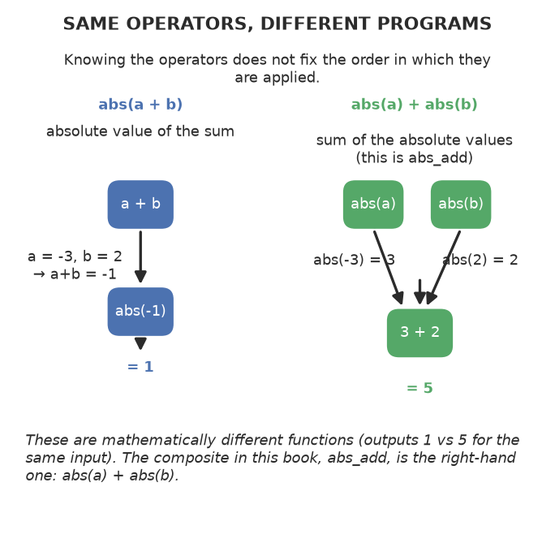

One clarification before the mechanics. The composite `abs_add` is **`abs(a) + abs(b)`**
(the sum of the absolute values of each input), *not* the absolute value of a sum
(`abs(a + b)`). These are different functions — for `a = -3, b = 2` they give `5` and
`1`. The figure above shows the two, and the book consistently uses the right-hand
one (`abs(a) + abs(b)`) for `abs_add`. This matters because the two would require
different programs and distinguishing tests; calling one by the other's name would
change the oracle.

We train the model exactly as before, on the **ten seen operation IDs** — the
generator's operational "primitive" pool: `add`, `sub`, `mul`, `abs`, and the rest
(see the clarification below on what "primitive" does and does not mean here). We never
show it a held-out composite operation.

A necessary clarification before we go further, because it affects how strong the claim
can be. We define "primitive" **operationally**: an operation entry in the generator's
tables that the training set treats as an atomic task. By that definition the six
composites (`abs_add` and the rest) were indeed held out of training, so the model never
saw a prompt→composite-program pair as a supervised example.

But one operation in the *primitive* pool — `cond_abs_max`, which returns
`max(abs(a), abs(b))` — is **structurally** a composition of `abs` and `max`, even though
the generator lists it as a primitive. This matters for how we read the result: it means
the training pool was *not purely structurally primitive* — it already contained one
operation that combines two others. So we should **not** say "the model was never shown
*both* abs and max being used together" (it was, via `cond_abs_max`), and we should not
claim a clean structurally-atomic primitive-only training set. What we **can** say is
narrower and specific: the model was never shown any of the **six named
held-out composite operations** (`abs_add`, `sub_abs`, `sum_of_abs`, `max_add`,
`double_first`, `len_minus_one`) as a task, and it failed on all of them. We flag this
as a caveat because "primitive-only" is only true as an operational bookkeeping label,
not as a statement that no training operation combined two behaviors.

Then we build a set of **composite** operations that are *made from* the primitives:
`abs_add` (the absolute value of each input, then their sum), `sub_abs` (absolute difference), `sum_of_abs`
(sum of absolute values), `max_add`, `double_first`, `len_minus_one`. These are not
new primitive functions; they are combinations of the ones the model already knows.
To solve `abs_add`, a model *must* take the absolute value of each input and then add the results
— two pieces it demonstrably knows.

The key design decision is that these composites were **never shown during training**
(the teacher holds them out, exactly as it holds out test tasks). So the test is:
can the model reach into its bag of known primitive behaviors and compose them in a
combination it has never seen? If it cannot, we have found its compositional
boundary. If it can, we have found something remarkable.

To make the test fair, we also show what *both* baselines do. The retrieval baseline
has nothing to compose — it can only find the closest primitive example and copy it.
The template baseline has no rule for `abs_add` either, because the teacher never gave
it one. So if *everything* fails, the failure is at least not unique to the learned
model: the easy shortcuts also cannot do it (without this negative signal, a model-only
failure could just mean the task was inherently beyond any of our methods). This is a
useful cross-check, though it is a measured negative, not a proof that no shortcut
exists.

## What we measured

Here is the result, and it is unambiguous:

| Test | MODEL | TEMPLATE | RETRIEVAL |
|------|-------|----------|-----------|
| In-distribution (ten seen operation IDs) | 0.9167 (n=60; see Appendix C.5) | 0.833 | 1.000 |
| **Compositional (six held-out operation IDs)** | **0.000** | **0.000** | **0.000** |

*The baseline cells are from `artifacts/manifests/stage4_scaling.json` (n=60):
TEMPLATE in-distribution pass@1 = 0.833 (50/60) and RETRIEVAL = 1.000 (60/60); the
MODEL cell is the 0.88M composition re-evaluation (see Appendix C.5).*

Let us read this carefully, because the meaning is subtle.

On the ten seen operation IDs, the model scores **0.9167 in aggregate** — that is
the pass@1 averaged over all the primitive operations in the split, not a claim that
every single primitive hits 0.9167 individually (we did not publish a per-operation
breakdown, so the aggregate should not be read as per-primitive accuracy). (This —
0.9167, n=60 — is the composition run's in-distribution score on primitives; the
pilot's first pass scored
0.897 on its own held-out split — see Chapter 10 and the cost table, so the two
"familiar-prompt" figures are two measurements with different denominators, not a
discrepancy — denominator row, evidence table, Chapter 11.) But on the
composite operations, it scores **0.000** with the same aggregate reading. Not 0.1, not
"sometimes," not "close." Zero. The model never produced a correct program for any
composite operation it was asked — the composites were held out, so it never saw them —
even though every composite is a combination of primitives
the aggregate shows it largely knows.

And here is the *instructive* baseline check: the baselines fail too. The retrieval
baseline gets 0.000 because there is nothing to retrieve that is a composite — its
memory holds only primitives, and it copies whole programs, not pieces. The template
baseline gets 0.000 because no hand-written rule covers a composite. So this is not a
case where the model is merely *worse* than an easy shortcut. It tells us something
clear: the composition test was *not* already solved by a dumb look-up or a fixed rule.

Two honest qualifications on what this does and does not prove. First, the baselines
failing is a useful *negative* signal, not proof the test is "fair" or that every
possible shortcut is excluded. A copy-only retriever failing does not rule out, for
example, a "retrieve the closest primitive and patch its name" shortcut — that is a
different, smarter baseline we did not build, so we cannot say we have excluded all
shortcut solutions, only the two simple ones we ran. Second, it does not isolate
*composition* as the one cause of failure: the model could also be failing for other
reasons — unfamiliar instruction syntax, unseen vocabulary, generation-length limits,
optimization, or a particular held-out operation. We have narrowed *some* causes (it
knows the primitives, it generalizes instances) but not proven that composition is the
single operating factor. That is why we describe the result as a strong measured
failure under this setup, not a proof that composition is impossible. (The
matched-control experiment later in this chapter identifies the *kind* of
failure — a no-viable-code generation collapse on out-of-distribution prompts,
semantics never reached — which narrows the list above without turning the
result into a proof.)

## What this really means

This is the cleanest negative result in the book, and it is the book's central
finding. Let us unpack it.

The model scores **0.9167 in aggregate** (n=60; see Appendix C.5) on the ten seen operation IDs, and **0.000**
on the composites it never saw — the aggregate reading and the two-measurements
point are spelled out above. Yet the composites — which combine those same primitives — score
0.000. It is as if the model has access to two perfectly good operations, but the
compositions that must chain them together go nowhere. It cannot take the output of one
primitive and feed it into another in the simplest combination we asked, even though every
piece of that combination is in the family it largely solved.

This is a structural failure in its own right — stated on its own terms, not as a
deeper instance of the surface-tiedness we saw in Chapter 15. The Level-4 observation
is simply this: the model scores 0.000 on composite operations built from primitives it
largely solves, so in this task and
regime, the model's knowledge behaves as if it is **flat and associative**, not
**structured and compositional**. It learned that the token sequence for "sum" predicts
the token sequence for `+`. It did not behave as if it had learned a general
*operation* that can be an argument to another general operation — at least not in the
way the composition test requires. We say "behaves as if" deliberately: this is an
observation about what the model produces under our evaluations, not a claim about
its internal representation. The matched-control experiment later in this chapter
sharpens it: the model never emits a complete program for an unseen composition,
so we never observe a wrong composition — what we measure is a failure to generate
viable code at all.

It is tempting to read the Level-3 and Level-4 failures as one mechanism seen twice —
surface-tiedness "all the way down." We label that reading explicitly: it is a separate
interpretation, a hypothesis about a shared mechanism that our experiments did not test.
Q3 (Surface) and Q4 (Composition) are measured as different questions, and nothing here
collapses one into the other.

This distinction is why we built the four-question generalization taxonomy in the first
place and why we refused to collapse everything into one number. If we had only
reported "the model scores 0.9167 on this task," we would have given a genuinely
misleading picture. The model is excellent at what it was shown — and under this
checkpoint, decoding, and extraction, no held-out composite candidate passed all of its
tests. In the audited exposure run those failures occurred before execution, so from
these counts alone we cannot distinguish a compositional-rule deficit from a decoding,
extraction, or validity issue. Both statements are true, and both must be reported.
(The matched-control experiment below resolves that ambiguity in one direction:
the held-out failures are no-viable-code, so the output contains no
compositional rule — correct or wrong — to evaluate.)

## The puzzling asymmetry (and why it's a finding, not a bug)

One thing will strike us: the model scores 0.9167 in-distribution but 0.000 on
composition. Why would a model that is "good" fail so completely on something so
similar?

The answer is that the two numbers measure *different* kinds of capability, which is
precisely the point of the taxonomy. The 0.9167 measures **distributional
generalization** — new examples of the *same* operation. The 0.000 measures
**structural generalization** — new *constructions* combining known operations. These
are different abilities, and a model can be high on one and zero on the other. That
asymmetry is not a contradiction; it is the shape of the truth we are mapping.

## Why we don't call it a "failure of one thing" without checking the other two

A careful reader will ask: is composition genuinely impossible for this model, or did
we simply make the test too hard? The baselines help here. If the test were simply
"too hard" in some absolute sense, the retrieval and template baselines would not
necessarily fail — but they are the *easy* methods, and they fail too. That does not
prove the test is "fair" in an absolute sense or rule out every shortcut; it is a
useful negative signal that the failure is not merely because an easy method happens to
stumble. It makes the result a measured negative, not a proof that no method could
succeed or that the boundary is structural. What we can say: within this apparatus and
these baselines, no method we tried — learned, retrieval, or template — produced a
composite program, which is the result we report.

## The shortcut audit

Before we trust "0.000," we ask how the model might have *faked* a success.

1. **Suspected shortcut: memorizing a composite example.** Narrowed — no held-out
   composite *task* (a prompt→composite-program supervised pair) was shown during
   training, so there was no exact composite example to memorize for a specific
   composite prompt. (We note one caveat: the composition *tokenizer* was fit on
   composite reference text, so composite tokens appear in preprocessing; and one
   "primitive," `cond_abs_max`, is structurally a composition. Neither means the model
   was trained on held-out composite tasks, but we avoid the blanket claim that
   composite programs "never appeared anywhere.")
2. **Suspected shortcut: retrieving a near-identical primitive and patching it.**
   Narrowed — the *copy-only* retrieval baseline scores 0.000. But that only rules out
   copying a whole primitive; it does **not** rule out a smarter baseline that
   retrieves the closest primitive and edits its name/arguments. We did not build that
   smarter retriever, so this shortcut is not fully excluded.
3. **Suspected shortcut: a rule that "just works" on composites.** Narrowed — the
   *template* baseline (fixed rules over the known operations) scores 0.000. That shows
   the specific hand-written rules we wrote do not cover composites; it does not prove
   no rule could, so this is a measured negative for *our* rule set.
4. **Suspected shortcut: the judge being too strict or too loose.** This is the one
   we genuinely have to hold onto as a question, and it is why the judge is
   mutation-tested (Chapter 17). If the judge were rejecting correct composite
   programs, we might be misreading a real success as a failure.

## The natural follow-up: show it some combinations

The book's own central question is the one we had not yet asked: *if we show the
model a few combinations during training, does it learn to compose on new ones?* This
is the experiment we finally ran, and the answer is decisive.

We split the six composite operations: the model was trained on **three** of them
(`abs_add`, `sub_abs`, `sum_of_abs`) alongside the primitives, and tested on the
**other three** it never saw (`max_add`, `double_first`, `len_minus_one`).

| Split | pass@1 |
|-------|--------|
| In-distribution (held-out primitives) | 1.000 |
| Exposed composites (seen in training) | **0.667** (n=120) |
| **Held-out composites (never seen)** | **0.000** |

The model learns the *specific* composites it was shown — 0.667 on the exposed ones
(over 120 exposed composite records).
(That 0.667 is itself a partial score: even on the three composites it trained on, the
model did not reach 1.000, so a single exposed aggregate of 0.667 does not establish
that every one of those operations was individually mastered.) But it still scores a
flat **0.000** on the combinations it never saw, even though it
uses primitives it knows perfectly (in-distribution 1.000).

That is the answer, scoped carefully: **under the interventions we tested, exposure did
not yield successful transfer to held-out composites.** Seeing *some* combinations did not
produce a general "combine two operations" behavior in the partitions we tried. One
plausible reading is that the model learned `abs_add` as another familiar pairing rather
than as a *composition* of `abs` and `add` — but the held-out composite candidates from
the composition-exposure run that we recorded all failed parsing before semantic
evaluation, so we cannot establish that mechanism. (Appendix B.10 reports that
syntax_rate = 0.0 for that run's held-out composites; we do not extend that parsing
finding to other size checkpoints, whose recorded stage rates we did not analyze the same
way.) The observed zero is real; *why* it is zero has competing explanations.
The matched-control experiment below later narrows those explanations to one:
the zero is a no-viable-code generation failure that survives surface- and
length-matched controls.

To narrow those explanations, we ran a decode/termination ablation on the
composition-exposure checkpoint (report `docs/reviews/loop/decode_ablation.md`,
manifest `artifacts/manifests/decode_ablation.json`). We re-decoded the same
held-out and exposed splits under seven settings — greedy and temperature-0.8
sampled decoding at `max_new` 64/128/256, plus the book's own T=0.8 /
`max_new`=80 procedure — and scored both the usual NUL-truncating extraction and
an alternative that keeps all post-NUL content. The held-out 0.000 persists
under every one of them: 0/120 held-out generations begin with `def solve`
(they collapse into NUL padding, median first-NUL token 8), while under the
identical decode the exposed control begins with `def solve` 120/120 and scores
valid-program rates from 0.667 to 1.000 with pass@1 0.667. So the zero is not a
decoding, termination, or extraction artifact — the failure is at the first
generated tokens, upstream of decoding, and the pipeline produces valid,
passing programs when the composite was seen. Two residuals we keep in view:
on the exposed control `sum_of_abs` fails 40/40 under every setting, a real
semantic failure on an operation the model was trained on, and the ablation
narrows the cause without fully isolating the mechanism — it rules out decoding
and extraction, not every upstream explanation (the matched-control experiment
below takes the next step, from *where* the failure sits to *what kind* of
failure it is).

To check that the zero is not a lucky seed, we also re-ran the whole
composition-exposure experiment from scratch under two more training seeds
(seeds 1 and 2) on the documented Python 3.11 environment. Both new seeds
reproduce the seed-0 profile exactly: in-distribution 1.000, exposed composites
0.667, held-out composites **0.000** — so across seeds 0, 1, and 2 the
held-out composite pass@1 is 0.000 every time (report
`docs/reviews/loop/multiseed_replication.md`). That exactness is scoped to the
three MODEL metrics just listed: the seeds-1/2 manifests also carry an
in-distribution RETRIEVAL baseline of 0.000 (and syntax 0.000) on both re-runs,
against 1.000 at seed 0 — but re-running the shipped code gives RETRIEVAL 1.000
in-distribution / 0.125 held-out at *every* seed, so those recorded zeros do **not**
reproduce, and the stated `--out`/`--tag` mechanism cannot affect a pure TF-IDF
retrieval baseline. Those baseline cells are marked **BLOCKED-UNVERIFIED**, we draw no
baseline comparison from seeds 1 and 2, and the caveat is recorded in that same report.
With that scope, the
composition result is therefore not a single-seed artifact. The same honest
framing applies to all three runs: the held-out failures occur at the first
generated tokens, upstream of decoding, so the replication strengthens the
measured zero without isolating the mechanism behind it.

This closes off the naive fix ("just add composites to the data") *for the partitions and
budgets we tested*. Composition here is not a matter of having seen a combination —
**under everything we have tested**, it does not emerge from exposure to a few
combinations or from identifier-diversifying the exposed ones (that condition varied
identifier sets, not wording families — P1-05). We are careful about
the word "structural": this is a strong empirical finding about *this model, this task,
this training regime*. It is not a proof that tiny models "cannot compose" in general — it
is a measurement that, in this setup, the tested interventions did not produce transfer to
held-out composites. Whether some other intervention (different optimization, more diverse
*combinations* rather than more identifier variants of the same ones) could produce it is a
separate, open question we have not closed.

One step further: since diversity looked like the lever that widened surface coverage
(Chapter 13 — first recorded as a flawed 42-versus-1,200 construction, P0-02, then corrected by an equal-count rerun), we
tested whether *diversifying* the composite exposure unlocks
composition. What we actually ran was an **identifier-diversified composite exposure**:
the same five composite operations, each with only one renderer wording family, rendered
under two identifier sets — so this expanded identifiers, not wording-family variety
(P1-05) — and we held out
one composite operation entirely. The result again was a flat **0.000** on the
held-out operation, whether the exposure was minimally or highly identifier-diversified.

So the diversity lever did **not** transfer to composition in this test. Surface
diversity diversifies the *outer form* of a combination; composition appeared to need
something else. One plausible hypothesis (not the only one, and not established here) is
that it may be diversity of the *inner structure* — not different phrasings of the same
five pairings, but many *different* primitive pairings — that could teach the general
compose-operator. That is the open question now, and it is a genuinely different axis
from the one we tested.

## What kind of failure is it? The matched controls

The decode ablation told us *where* the failure sits — the first generated
tokens — and the seed replication told us it is stable. Neither told us
*what kind* of failure it is. Two readings stayed open: the model might
generate complete programs that compute the wrong composition (a semantic
failure — it "composes incorrectly"), or it might fail to generate any viable
program at all (a generation failure). We ran a matched-control experiment to
separate them (review item P1-09; manifests
`artifacts/manifests/composition_match_controls_seed{0,1}.json`, script
`scripts/run_composition_match_controls.py`, registry Table C.16).

The design: one model trained exactly as in the composition-exposure run —
primitives plus the three exposed composites — then seven conditions crossing
*structure* (seen / unseen) with *surface* (seen / unseen), with paired
instances: within each pair the reference program and hidden tests are
byte-identical, so only the prompt changes. Two controls pin the obvious
confounds. Control (b) re-frames the held-out composites under a verbatim
training surface. Control (c) adds *new* composites whose reference programs
sit inside the mastered-primitive length range (14–68 tokens; the new
composites are 27 and 23 tokens). Control (a) runs the experiment backwards:
it rewords *mastered* primitive programs under never-seen wording families.

The anchors reproduce the book first: primitives score 300/300 pass in both
seeds, and the exposed composites score 0.667 (seed 0) and 0.658 (seed 1)
against the book's 0.667 — the same pipeline that measures the successes is
the one that measures the collapse. Then the result, qualitatively identical in seeds
0 and 1:

- **Held-out composites: no viable code, no semantics.** Not one of the 120
  held-out generations per seed defines a complete `solve` program
  (complete-program rate 0.000), with **0 wrong-semantics** and 0 pass. The
  model never emits a complete program — correct *or* wrong — so semantics
  are never reached. The 0.000 is a **generation** failure, not a wrong
  composition.
- **Control (b): the wording frame is not the explanation.** The identical
  held-out composite programs under verbatim training framing are 120/120
  no-viable-code in each seed — 0 wrong-semantics — complete-program rate
  0.000, pass 0.000 — the same as the native-prompt baseline. A seen surface
  rescues nothing.
- **Control (c): program length is not the explanation.** The new
  length-matched composites score complete-program rate 0.000 and pass 0.000
  under *both* the unseen and the seen surface, in both seeds — 80/80
  generations per cell with no complete program and 0 wrong-semantics.
  Syntax can even appear: seed 0's `abs_mul` reaches syntax 0.925 yet
  defines 0/40 complete programs (36 of the 40 parse only as module-level
  fragments with no `solve`).
- **Control (a): rewording alone reproduces the collapse.** Mastered
  primitive programs under never-seen wording families leave 298/300 (seed 0)
  and 300/300 (seed 1) generations without a complete program, pass 0.000 —
  against 300/300 complete and passing under the native wording. The
  **0 wrong-semantics** reading is scoped to the held-out composites and to
  controls (b) and (c); control (a) did reach semantics: seed 0 recorded
  **2/300 wrong-semantics** (both complete programs failing every hidden test
  at runtime — `runtime_error_all`), seed 1 0/300.

Put together, the mechanism is a **generic prompt-OOD generation collapse**:
this model emits no viable code for prompts that are out of distribution.
Unseen composite structure is one sufficient trigger; never-seen wording on a
*seen* program is another. So the book's honest claim is narrower than "the
model composes incorrectly": we never observed an incorrect composition,
because we never observed a complete program. The observed boundary is that
the model **generates no viable code for unseen prompts** — unseen
compositions among them. The structural-generalization conclusion survives
the matched controls: the zero is real, replicated, and not explained by
wording or length. What its mechanism is *not* is a compositional rule that
misfires; what remains open is why an out-of-distribution prompt collapses
generation in the first place.

## The honest framing

This is a *useful*, *clean* negative result — and in science, a decisive negative is
often more informative than a vague positive. We now know something sharp about this
model in this setup: **at ~1M parameters, in this task and training regime, it produces
no successful held-out composite completion under the interventions we tried.** A candid
qualification: the recorded aggregate stage rates for the held-out composites showed
syntax_rate = 0.0 — the failures were logged before execution — so the **cause** of the
zero is not resolved by the aggregate (it could be generation/parsing, a length limit,
optimization, or a capability limit; see Appendix B.10). The decode/termination
ablation described above narrowed that list — decoding, generation length, and
extraction are ruled out and the failure sits at the first generated tokens —
and the matched-control experiment above isolated the failure mode itself: a
no-viable-code generation collapse on out-of-distribution prompts that survives
the seen-surface and length-matched controls, with semantics never reached.
What remains open is *why* generation collapses on an out-of-distribution
prompt. What we can claim is the
measured outcome and that the interventions we tried did not produce a success. This is
not a statement about "intelligence" or about "what models will eventually do." It is a
precise, reproducible measurement of where *this* model's capability stops *here* — and,
as we have flagged, the door to a different intervention
remains open.

And it sets up the rest of the book in a way that is far more interesting than if the
model had composed successfully. Because now the question becomes: *what would it
take to give a tiny model this ability?* Later — in the chapters on how capability
scales, which already covered capacity and data, and in the continuation-of-learning
chapter — we revisit whether more capacity, more data, or different data with more
structure changes the picture.

---

# 17. Red-Team the Judge

We built a judge and argued it is the instrument we stake the book on. Chapter 6
showed how we test it (mutation testing) and that it caught a bug. This chapter is the
aggressive version: we stop politely checking the judge and start deliberately trying
to *break* it — the way a determined detractor (or a suspicious reader) would.

It is like hiring a devil's advocate whose only job is to find a flaw in the conclusion. We want to know how confident we can be in any number our judge produces —
and the only way to find out is to attack it.

There is a reason to be particularly aggressive here, and it goes to the heart of the
book. Our whole method is built on trusting measurements: we claim the model is
surface-tied, non-compositional, that it forgets under sequential training. Every one
of those claims passes through the judge. So if the judge is broken in even one
respect, every conclusion in the book could be subtly wrong. Red-teaming the judge is
not a single chapter's task; it is the standing obligation of the whole experiment. And
it is an *unbounded* one — we can never prove the judge is perfect, only that we have
tried hard to break it and failed.

## The attack surface

A judge that executes generated code is attacked through the code it is given. We
enumerate the ways a candidate could slip through:

- **hardcoded outputs** — a program that ignores the input and returns a fixed answer
  that happens to match one test,
- **mutation variants** — operator flips, wrong variables, off-by-one, missing
  edge-cases (the mutation suite from Chapter 6),
- **weak test cases** — if the hidden tests are too few or too narrow, a wrong program
  can pass,
- **boundary failures** — behavior at zero, negatives, or large values that the tests
  don't probe,
- **resource abuse** — programs that loop forever or consume too much,
- **unsupported syntax** — smuggling in a construct the sandbox should reject,
- **ambiguous specifications** — a prompt the model could reasonably read two ways,
- **evaluator inconsistencies** — the same program scored differently in two runs.

This list is a map of the ways the judge could be fooled — and each entry is a place
we must probe. The point of enumerating the surface is that skepticism is only useful
when it is specific. "The judge might be wrong" is not actionable. "The judge might
let a hardcoded-output program pass if the tests are too narrow" is a concrete thing
we can check.

## What we found

The mutation suite is the sharpest tool here. We generated deliberately-broken
variants of the reference solution and ran them through the judge against that
operation's hidden tests, then measured how many the tests *kill*. The measured
result, across all 16 operations, is honest and **partial**:

- **35 mutants generated across all 16 operations: 29 killed, 6 surviving mutants that we
  classify as equivalent over the integer domain** — a raw kill rate of **0.829**. The
  equivalence classification, its explicit domain, and its limits are spelled out in the
  next section; the totals are 29 / 6, and we report them as such everywhere below.
- **Positive control passed:** the correct reference program was *accepted* by the
  judge for every operation. This rules out the failure mode of a
  reject-everything evaluator — it genuinely distinguishes correct programs from most
  broken ones.
- **The six survivors** (all equivalent over the integer domain, per the case analysis
  below): `max_of` (`>`→`>=`), `min_of` (`<`→`<=`), `abs_of`
  (`<`→`<=`), `cond_abs_max` (`>`→`>=`), `sum_of_abs` (`<`→`<=`), and `max_add`
  (`>`→`>=`).

A useful way to think about mutation testing is that it measures the *discriminating
power* of the test suite. A suite that passes for a correct program and fails for an
incorrect one is a good suite. A suite that passes for both is not testing anything.

### Classifying the six survivors

At first glance six survivors look like six test-suite defects. But every one of them is
the same kind of change: a **strict comparison flipped to a non-strict one** (`>`→`>=` or
`<`→`<=`) in a function that returns a max/min/absolute-value. Over the integer domain
these are **semantically equivalent** to the reference. Be careful with the wording here:
the predicates differ — `a >= b` is True and `a > b` is False when `a == b` — but the
*enclosing max/min function* returns the same value in both cases, because at the tie the
equal branch and the (now-reached) outer branch yield the same number. For these tie-only
mutants a short case analysis establishes the equivalence over the integer domain: the
operator differs only at equality, and both branches return equal values there. We did not
build and run a general equivalence checker; the equivalence rests on this case analysis,
scoped to the strict→non-strict tie-breaking mutants we observed. So they are *not* six
missed defects; they are six tie-breaking equivalences.

The coverage limits stand right next to that classification, unchanged. The experiment
record's own words are that the tests were *not* "edge-case-complete"; the six survivors
sit exactly on the six weakest operations (`max_of` 0.5, `min_of` 0.5, `cond_abs_max`
0.5, `abs_of` 0.667, `sum_of_abs` 0.75, `max_add` 0.75 kill rates); and we built no
general equivalence checker, so the equivalence claim is scoped to these six tie-only
mutants over the integer domain. Reporting "29 killed / 6 equivalent" does not upgrade
the suite: it says what these six are, not that the tests cover every error class.

This is the important nuance worth spelling out: *a surviving **equivalent**
mutant is not a missed error.* The mutation score therefore does **not** mean "the test
suite has six confirmed defects." It means:

> The evaluator rejected 29 of 35 generated mutants and accepted all 16 reference
> controls. The six survivors are all strict→non-strict tie-breaking mutations that are
> equivalent to the reference over the integer domain, so they do not quantify test-suite
> defects. They do show the tests do not *distinguish* a `>` from a `>=` at a tie — but
> since the two behave identically here, that is not a correctness gap.

So the honest conclusion is to report **three distinct measurements**, each with its own
denominator:

- **Raw rejection fraction:** 29 / 35 = **0.829** — the share of all 35 generated mutants
  that the suite rejected.
- **Equivalence-adjusted mutation score:** 29 / (35 − 6) = 29 / 29 = **1.000** — the share
  of *non-equivalent* mutants rejected, after excluding the six tie-breaking equivalents
  from the denominator. (A survivor that is equivalent is not a test-suite defect, so it is
  excluded from the adjusted denominator rather than merely relabeled in plain prose.)
- **Reference-control acceptance:** 16 / 16 = **1.000** — the suite accepted every correct
  reference program.

We report these three separately. The raw score is *not* the same as the adjusted score:
0.829 and 1.000 measure different things. Neither is a proportion of "all possible error
classes covered," and neither is a proof that the test suite is complete. (The reference
controls rule out reject-everything behavior on those 16 correct programs; they do not
prove the tests catch every possible false-negative for *other* alternative correct
programs.)

And the judge's honesty was validated the hard way: it reported the model at 0.000 on
our very first evaluation, and that was a *judge bug*, not a model failure. Once we
fixed the judge, the model's true 0.897 emerged. A judge that can be wrong — and we
proved ours was — must be red-teamed before its numbers are trusted.

## A concrete example: the judge learns a new test

To make "test the tester" a reader skill rather than a slogan, here is a small
constructed example of how a weak test can let a wrong program survive, and how a
distinguishing test catches it. (This is a teaching illustration of the principle, **not**
a record of a real finding from the experiment — the measured mutation report in the
section above is the actual data.)

Suppose the task is to compute `a + b`, and the reference is:

```
def solve(a, b):
    return a + b
```

Now consider a mutant that flips the operator to subtraction:

```
def solve(a, b):
    return a - b
```

A single weak test on `(a=0, b=0)` does **not** catch it: for `(0, 0)`, both `a + b` and
`a - b` return `0`, so the mutant survives and the suite looks green. But a
distinguishing test on `(a=2, b=3)` — where the reference returns `5` and the mutant
returns `-1` — catches it. The point is that a test must be *discriminating*: it has to
separate the correct program from the specific wrong ones, not merely produce a pass
for whatever got written. That is exactly what the measured mutation suite is designed
to probe, and why its 0.829 raw rejection fraction (29/35, with the six survivors all
tie-equivalent) is a real, quantified measure of the suite's discriminating power rather
than a claim that it is exhaustive.

## The honest framing

Red-teaming the judge is not a formality; it is the difference between "we ran a
number" and "we know the number means something." The specific lessons:

- **Strengthen tests until wrong programs fail.** The mutation score is the measure.
  Our raw rejection fraction is 29/35 = 0.829; the equivalence-adjusted score — after
  excluding the six tie-equivalent survivors from the denominator — is 29/29 = 1.000.
  Those are two different numbers, and we report them separately: 0.829 is what the
  suite *caught* of everything we broke, and 1.000 is the adjusted share after
  accounting for survivors that were not actually bugs. What the score does *not* do is
  prove the tests discriminate every possible error class; it quantifies the ones we
  chose to generate.
- **Trust the judge less than the tests.** The judge is a pipeline; the *hidden tests*
  are what actually catch errors. We do not claim the tests distinguish every
  conceivable wrong program — the reference controls only prove they accept all 16
  correct programs and catch the other 29 non-equivalent mutants. An *alternative*
  correct program that differs from the reference in some unseen way is a different
  question we did not test.
- **Attack our own instrument deliberately.** The adversarial habit — "how could this
  number be wrong?" — is what keeps the whole experiment honest.

A judge that has been red-teamed is one we can believe. A judge we've only used is one
we cannot.

And there is a final lesson that reaches beyond judges. Every measurement instrument —
in science, in engineering, in daily life — can fail in ways its designer did not
anticipate. The discipline of attacking our own apparatus is the same discipline that
makes a result worth believing. It is not paranoia; it is the price of a claim we can
stand behind. The book's whole credibility rests on having paid it, and having
recorded that we paid it, rather than merely asserting that we are trustworthy.

---

# 18. What Happens When We Teach It Something New?

Every chapter so far has asked how the model handles one task. But real capability
isn't learned in one shot — it's *grown*, by adding new things over time. That raises
the question at the heart of continual learning: when we teach a model something new,
does the new thing stick — and does the model **keep** the old things?

There's a well-known failure mode with a scary name: **catastrophic forgetting** — the
tendency of a model, after training on task B, to lose what it learned on task A. We
want to know whether that happens to our small model, and, crucially, whether the
*way* we train determines it.

It is like learning a new language. Study French for a year, then stop
and study Spanish exclusively — how much French is left? A lot depends on whether
French keeps being practiced while Spanish is learned — which is exactly what this
experiment tests. And it is a question almost every learning system faces: a deployed
model is rarely trained once and frozen. It is updated, re-trained, fine-tuned on new
data. So whether it *keeps* what it knew is a practical concern, not an academic one.

## The setup

We split the operations into two capabilities:

- **Capability A — arithmetic:** `add`, `sub`, `mul`, `max_of`, `min_of`.
- **Capability B — lists:** `list_sum`, `list_len`, `first_element`.

We train on A, then introduce B, and measure both:
- **B acquisition** — did it learn the new capability?
- **A retention** — did it keep the old one, or did learning B destroy it?

This double measurement is the crux of the design. Many continual-learning reports
measure only whether the model acquired the *new* task, and that alone can make the
whole thing look like a success. But the interesting failure is usually what was *lost*
to get there. So we insist on measuring both, every time.

We run this under two protocols, changing only the *order and mixing*, not the model,
data, or optimizer:

- **sequential:** learn A fully, then learn B with no A exposure.
- **joint / interleaved (A+B from start):** interleave A and B examples throughout
  (earlier drafts of this chapter labeled this condition "replay"; we now call it
  joint/interleaved, because true replay means continuing from an A-trained checkpoint
  with A examples mixed back in — see the note below).

Holding model, data, and optimizer constant while changing only the training
*schedule* is a textbook application of our one-variable discipline. If the results
differ between the two protocols, the difference cannot be attributed to the model,
the data, or the optimizer — it must be the schedule. That makes any difference we
find a *procedure* finding, exactly the thing we want to isolate.

## The result
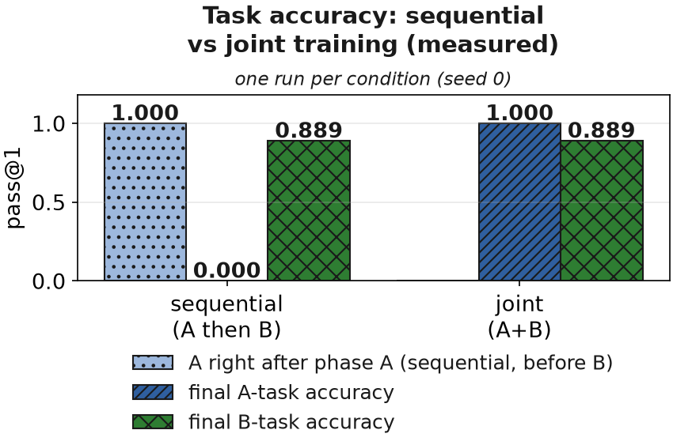

| Protocol | **A right after phase A (same run, pre-B)** | **A accuracy (final)** | **B accuracy (final)** |
|----------|---------------------------|-----------------|-------------------|
| **sequential** | **1.000** | **0.000** | 0.889 |
| **joint/interl.** | — (A and B trained together) | **1.000** | 0.889 |

*Both A measurements in the sequential row come from the **same run**: the 1.000 is
measured right after phase A and before any B exposure, the 0.000 after phase B
(Appendix C.9); the final is measured after phase B.
The **joint/interl.** row is the **joint/interleaved (A+B from start)** condition — the
label is shortened here so the first column does not overflow into the second.
The joint/interleaved model has no separate "after A" point because A and B are trained together from
the start. **Denominators:** A accuracy is on 60 held-out A tasks (12 × 5 operations)
and B accuracy on 36 held-out B tasks (12 × 3); at n = 36 one item = 0.028, so equal
B accuracy = within one test item.*

This is as clean a result as this book produced.

**A note on what "0.000" does and does not show.** We measured the sequential run's A
accuracy **right after phase A and again after phase B** along the same training
trajectory. The pre-B A accuracy was **1.000**; after learning B, A fell to **0.000**. So
the sequential zero is not a case of "A was never acquired" — A was acquired to 1.000 and
then lost. This is a **same-trajectory before/after** measurement, taken on a dedicated
re-run of the sequential pipeline with an intermediate A evaluation inserted right after
phase A and before any B exposure (Appendix C.9; also captured in the `continual_preB`
manifest) — which is what supports reading the sequential drop as genuine forgetting of
learned A competence rather than under-acquisition.

**Sequential training produces a much lower final A accuracy than joint training.** After
learning arithmetic and then lists in sequence, the model's final A accuracy is **0.000**;
when the two are trained together, the final A accuracy is **1.000**, with the same B
accuracy (0.889) in both. So the *training schedule* – whether the first capability stays
in the mix while the second is learned – is what differs, and that scheduling difference
changes the final A outcome. That is a *procedure* finding about final accuracy, and it
reinforces the same-run before/after point above: the sequential drop is genuine
forgetting, not under-acquisition.

**Training A and B together keeps A's final accuracy high.** When A and B are simply trained
together from the start (interleaved throughout), the model's final A accuracy is a
perfect **1.000**, and its final B accuracy is **0.889** — identical to sequential at
seed 0 (32/36 vs 32/36; across seeds the two protocols' B accuracy is within one test
item). So
training both from the start keeps A **with no behavioral trade-off** in B. Note that
this jointly trained model has no separate "after A" point (A and B were trained
together from the start), so its A accuracy is a final accuracy, not a retention score
relative to an A-only checkpoint.

One honest note on the term "replay," which earlier drafts used for the interleaved
condition. This design interleaves A and B **from the start** — which is *joint
training* on both, not "learn A first, then continue to B while replaying A." We have
therefore renamed the condition **joint/interleaved (A+B from start)** wherever it
appeared as "replay," because "replay" properly names a different design. Both designs
are legitimate, but they are different questions. The
sequential condition is a true continual-learning setup (does learning B destroy A? —
yes, 0.000). The interleaved condition is a joint-training control (if both are seen
together, is there a forgetting problem at all? — no, 1.000). The timelines below make
the three designs explicit; note that the third (a true replay-after-A-first) was **not**
run — it is a separate experiment, not the condition this chapter measures.

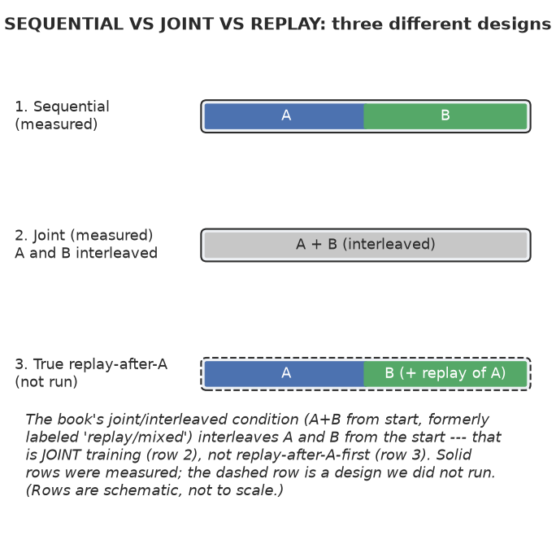

What this establishes is that **the forgetting seen under sequential training disappears
when the model is trained jointly on both.** It does not demonstrate that a replay
*buffer* salvages an already-trained first model — a stronger test would start from one
A-trained checkpoint and compare B-only vs B-plus-A-replay continuation from there.
Also, note what "no trade-off in B" does and does not mean: both protocols used the **same
example set and the same total step budget** (A and B examples; `steps_a + steps_b`), only
the *order and mixing* differed. So the joint result is **not** because joint training got
extra data, a longer run, or a bigger model — it is the same workload, interleaved rather
than sequenced. That is exactly the procedure finding. We did **not** quantify wall-clock
time or compute precisely enough to claim one schedule is "faster" or "cheaper," so we make
no such claim here; the measured comparison is final task accuracy, not resource cost.

**A note on replication across seeds.** The joint/interleaved-vs-sequential distinction
reproduces under fresh trainings at seeds 1 and 2. Sequential training ends with
A-retention **0.000 / 0.000** while still acquiring B (**0.889 / 0.861**); the
interleaved condition (the joint/interleaved arm, formerly labeled "replay" in this
chapter) retains A at
**1.000 / 1.000** while acquiring B at **0.889 / 0.889** (report:
`docs/reviews/loop/multiseed_replication.md`). So across seeds, sequential
forgets A completely while acquiring B (~0.87–0.89), and joint/interleaved keeps A at 1.0
while acquiring B within one test item as well — the distinction is not a single-seed artifact.

**Scope caveat: the seed re-runs were not a seed-only change.** The seed-0 run recorded
in the table above used `steps_a` 700 + `steps_b` 700 (1,400 steps total, `n_per` 70);
the seeds-1 and 2 re-runs used a **smaller step budget**, `steps_a` 600 + `steps_b` 600
(1,200 steps total, `n_per` 80) — exactly as the shipped manifests record
(`continual.json` versus `continual_seed1.json` and `continual_seed2.json`). So the
replication varied **two** variables, the seed *and* the step budget, not the seed alone,
and it is not a single-variable replication of the seed-0 cells. Within each seed the two
protocols still share one budget (both arms of a manifest run at the same
`steps_a + steps_b`), so the sequential-versus-joint/interleaved contrast is controlled
*inside* each run; what is not held fixed is the budget *across* seeds. The
retention/acquisition values above are reported as measured, and the pattern they show —
sequential forgets A while still acquiring B, joint/interleaved keeps A while acquiring B
just as well (B accuracy within one test item in both: 32/36 vs 32/36 seed0; 32/36 vs
31/36 seed2) — repeats under a fresh seed at a nearby budget; we read them as a
robustness check on that pattern, not as like-for-like replications of the seed-0 numbers
(Appendix C, run provenance ledger).

## Why this result is so striking

The symmetry is what makes this remarkable. Under sequential training, the model
forgets A completely (0.000) but learns B fine (0.889). Under joint training, it keeps A
perfectly (1.000) *and* B accuracy within one test item in both (32/36 vs 32/36
seed0; 32/36 vs 31/36 seed2). Nothing about the model, the
data, or the optimizer changed — only whether the old examples stayed in the mix while
the new ones were learned.

This is the clearest case in the book where the **training protocol, not the model or
the data, determines the outcome.** Same model. Same data. Same optimizer. The only
difference is whether the first capability stays "in the mix" while the second is
learned. Sequential forgets; joint retains.

There is an intuition that makes this easy to see. Imagine a muscle being trained on
exercise A. If it then trains exclusively on exercise B and never revisits A, the
muscle's adaptation to A fades. But if A and B alternate, both stay. The model's
weights are like that muscle — the gradient signal from new examples keeps pushing
them, and if nothing pulls them back toward the old behavior, the old behavior
erases. Joint training is simply making sure the old examples are still in the rotation.

The lesson generalizes with a scope caveat: in this experiment, *how* the task was
introduced (interleaved vs. sequenced) determined whether the earlier capability was
retained. That is a finding about **one schedule comparison**, not proof that procedure
always matters more than the model. If the new task is allowed to dominate the gradient
signal and the old data is removed, the old capability collapses; if old and new stay
interleaved, the model can hold both.

## Reframing a common assumption

And it reframes a common assumption. People often reach for "a bigger model" when
confronted with a model that forgets. This experiment shows the forgetting was not
resolved by anything we did to capacity — a ~0.9M model reaches high final scores on
both task groups when trained jointly (A: 1.000, B: 0.889). It was a *training
procedure* effect. We did **not** test a larger model as a forgetting intervention, so
we cannot conclude that a larger model would not also help here; what we can say is
that the forgetting was already fixable by changing the schedule alone, at this scale,
under these schedules.

The pattern here echoes a deeper truth we've seen all book: the headline number
("did it learn the new thing?") hides the interesting failure ("what did it lose to
get there?"). Measuring B acquisition alone would have made sequential training look
like a success — 0.889, great. Measuring A retention reveals the cost. The lesson is
to always measure *both* the new and the old.

## The shortcut audit

1. **Suspected shortcut: the 0.000 A-retention is an artifact of how we score A.**
   **Why it could explain it:** maybe the A test is too hard, or the model just needs
   more steps.
   **Control:** joint (A+B interleaved) training, identical A test — A-retention 1.000.
   **What it rules out:** a broken A test. The same test that scores 0.000 under
   sequential training scores 1.000 under joint training.
   **What remains:** whether the sequential 0.000 reflects *lost* A rather than
   *unacquired* A. The same-run pre-B measurement settles this: A was 1.000 right after
   phase A and 0.000 after B, so it is a genuine drop, not under-acquisition. Also
   whether this holds for three or more capabilities, and whether joint training
   lets the model *compose* A and B.

## The honest summary

This is a controlled, reproducible demonstration that the *training schedule* affects final
task accuracy: the same workload produces a 0.000 final A accuracy when learned sequentially
and a 1.000 final A accuracy when learned jointly, with B accuracy within one test
item in both (32/36 vs 32/36 seed0; 32/36 vs 31/36 seed2). The
same-trajectory pre-B measurement (a dedicated re-run, Appendix C.9) confirms the
sequential drop is genuine forgetting: A was 1.000 right after phase A and fell to 0.000
after B, so it was acquired and then lost rather than never learned. We make no
resource-cost claim: both protocols used the same
example set and step budget, and we did not quantify compute precisely.

What makes it feel like a real discovery is that the right answer was sitting in a
choice we made near-automatically. When we first set up the experiment, sequential
training was the path of least resistance — learn one thing, then the next. The
surprise came from asking the question we almost didn't ask: what did the model lose
to learn the new thing? And the fix — just keeping old examples in the mix — was so
simple it was almost anticlimactic. But that simplicity is the point. Sometimes the
most important finding in an experiment is not a complex technique but a simple
change to the way we were already working.

---

# 19. The Cost of Capability

We've measured what the model can do and where it breaks. This chapter answers the
last practical question: *what does each capability actually cost?*

The obvious "costs" — data, parameters, training time — are the easy ones. But the
real cost in machine learning is the hidden one: what it takes to make a capability
actually *robust* rather than just *appearing* to work. That's where the expensive and
surprising part lives.

## The two kinds of cost

There is a trap in how we usually talk about cost. We say "this model is 0.9M
parameters" or "this took 3,000 examples" or "it trained in an hour." Those are real
numbers, and they are *easy* to measure. But they measure the cost of *running* a
model, or of *fitting* it — not the cost of *capability* in the sense we care about.

What we actually care about is much harder to see, and this chapter is an argument
that it is the only cost that matters:

> **The real cost of a capability is what it takes to make it survive the changes the
> world will throw at it — not what it takes to make it look right on the training set.**

That distinction is the key to reading the results in this chapter. The model can be
*cheap* to produce and still *expensive* to make useful, because the cheap version
works only under conditions the real world will not respect.

Before the matrix, the conclusion this chapter helps build, in the conservative form we
now adopt (third external review, 2026-11-02), strengthened by the corrected reruns: the
model frequently produced executable, correct Python for training-seen prompt strings even
on new input values, but that does not establish generalization to new natural-language
requests; severe failures appeared under altered wording and on untrained structures; the
corrected data-scaling sweep is flat (~0.90 from 10 to 300 examples per operation), so
record count buys nothing in this regime; and the corrected surface factorial collapses
to ~0 on any prompt-surface change. The corrected equal-count diversity rerun now
prices the combined phrasing/identifier/uniqueness intervention (which does not
isolate which factor moves the number): at 1,200 records per arm it moves a genuinely held-out
phrasing family from **0.000 to 0.550 mean**, costing 0.11-0.38 in-distribution accuracy
across the three seeds (mean 0.21; at n=3 the 95% interval is -0.58 to +0.17, so the
direction is consistent in all three runs but the magnitude is not separable from seed
noise) (**0.950 → 0.743 mean**). One row of the
matrix below is the superseded flawed study, and we price nothing from it; the
data-scaling, surface, and diversity rows now carry their corrected replacements.

## The cost matrix

Each row is a **run** from our experiments, identified by its checkpoint and evaluation so
the provenance is explicit. Because a six-column table is too wide for a 6×9 page, the
matrix is split into two linked tables: the first is the **resource budget** (the input),
the second the **measured outcome** (the evaluation). Where an outcome was **not**
measured for that row we mark it `NT` (not tested) rather than a cross or a dash, because
"not run" and "failed" are different.

**Table 19.1 — Resource budget, by run**. The data column is the **training-record count
and distinct prompt–program pairs** (where known); it is not the evaluation-set size.
Where a record/pair count is not separately recorded, we say so rather than borrow an
evaluation denominator. The continual rows count generated tasks, derived from
`run_continual.py` at `n_per=70` (per `continual.json`): capability A is 5 operations
(350 tasks), capability B is 3 operations (210 tasks), and the joint run interleaves
all 560 — the 1,400 in the steps column is the separate 700 + 700 step budget.

| Run | data records / unique pairs | parameters | steps |
|------------------|-----------------------------|------------|-------|
| `stage1` | 1,400 / 21 | 0.88M | 1,500 |
| `stage3_surface` (superseded, P0-03/P0-04) | 600 (10 op × 60) familiar/new-ID; **480** (8 op × 60) reworded | 0.88M | 1,500 |
| `surface_corrected` (fixes P0-03/P0-04) | 600 train (60 op × 10); cells of 600 / 600 / **480** / **480** | 0.88M | 1,500 |
| `data_scaling` (superseded, P0-01) | 100, 300, 1000, 3000 (**prefix of an operation-ordered pool: 1/1/3/8 of 10 ops**) | 0.88M | 800 |
| `data_scaling_corrected` (per size; fixes P0-01) | 100 / 300 / 1000 / 3000, balanced **10/30/100/300 per op, 10/10 ops** | 0.88M | 1,000 |
| `diversity` (Ch13 — superseded flawed historical, P0-02) | requested 1,200; **realized 42** (high) vs 1,200 (minimal) | 0.88M | 900 |
| `diversity_corrected` (Ch13; fixes P0-02) | **1,200 / 1,200** (low/high), balanced 120 per op, 10/10 ops; 20 vs 605 unique pairs | 0.88M | 1,000 |
| `stage4_exposure` | not recorded | 0.88M | 1,500 |
| `compdiv_minimal` / `compdiv_high` | not recorded | 0.88M | 1,500 |
| size sweep | not recorded | 0.88M / 6.5M / 10.2M / 29.3M | 1,500 / 1,000 / 800 / 800 |
| `continual_seq` | 350 + 210 | 0.88M | 1,400 |
| `continual_joint` | 560 interleaved | 0.88M | 1,400 |

**Table 19.2 — Measured outcomes, by run** (the neural **MODEL**'s score; baselines are in
Chapters 15 and 16, not here). Run keys match Table 19.1. The three **corrected** rows
(`surface_corrected`, `data_scaling_corrected`, `diversity_corrected`) give the model's
per-seed scores on the
four factorial cells, on the flat size sweep, and on the equal-count diversity
comparison; the superseded rows keep the original
`stage3_surface` / `data_scaling` / `diversity` values for the record. `0.875`/`0.683`
belong to the
TEMPLATE/RETRIEVAL baselines and are not the model's.

| Run | in-dist | new IDs | new wording | composes |
|------------------|---------|---------|-------------|----------|
| `stage1` | 0.897 | — | — | 0.000* |
| `stage3_surface` (superseded†‡) | 0.900 | 0.350† | 0.000‡ | — |
| `surface_corrected` | 0.898 / 0.900 / 0.940 | 0.000 / 0.003 / 0.005 ¶ | 0.000 (both changes: 0.000 / 0.025 / 0.000) ¶ | — |
| `data_scaling` (superseded§) | 0.100 / 0.098 / 0.300 / 0.641 § | — | — | — |
| `data_scaling_corrected` | 0.893–0.997, **flat** across 100→3000 ¶ | — | — | — |
| `diversity` (superseded‖) | 0.500 minimal / 1.000 high | — | 1.000 high (covered families) | — |
| `diversity_corrected` | 0.950 low / 0.743 high ‖ | — | 0.000 low / **0.550** high ‖ | — |
| `stage4_exposure` | 1.000 | — | — | 0.667 / 0.000 |
| `compdiv_minimal` | 1.000 | — | — | 0.592 / 0.000 |
| `compdiv_high` | 1.000 | — | — | 0.550 / 0.000 |
| size 0.88M | 0.9167 (n=60; see Appendix C.5) | — | — | 0.000 |
| size 6.5M | 0.897 | — | — | 0.000 |
| size 10.2M | 0.773 | — | — | 0.000 |
| size 29.3M | 0.897 | — | — | 0.000 |
| `continual_seq` | A 1.000→0.000; B 0.889 | — | — | — |
| `continual_joint` | A 1.000; B 0.889 | — | — | — |

*`stage1`'s composes value (0.000) is from the stage-4 re-evaluation of that pilot
checkpoint. † the new-identifier arm changes identifiers and wording-family coverage
together (P0-03), so 0.350 is a mixed-factor shift — superseded by the identifiers-only
cell of `surface_corrected`, which is ~0. ‡ the reworded arm has 480 records over 8
operations, not 600 over 10 (P0-04) — superseded by the corrected factorial's
wording-only cell, 0.000 over 480 in every seed. § the data-scaling arms are prefixes of
an operation-ordered pool covering 1/1/3/8 of the ten operations (P0-01), so this row is a
confounded historical run of operation coverage, not a record-count curve — superseded by
`data_scaling_corrected`, which is flat; we price nothing from the old row. ¶ corrected
runs (Appendix C, Tables C.13/C.14): `surface_corrected` cells are scored over
600/600/480/480 records with `abs_of` and `cond_abs_max` excluded from the held-out cells
(8 ops × 60); `data_scaling_corrected` arms are balanced 10/10 operations under one fixed
tokenizer against one shared 300-task test, so the row is a flat curve, not a trend. ‖
corrected equal-count diversity (Appendix C, Table C.15): both arms exactly 1,200
records, 10/10 operations at 120 per operation, one fixed tokenizer, matched
1,000-step protocol; the "new wording" cell is the genuinely held-out phrasing family
(h01/h02, 100 tasks, zero family/prompt collisions against both arms), per seed LOW
0.000 / 0.000 / 0.000 vs HIGH 0.640 / 0.300 / 0.710 (means 0.000 vs 0.550), with
in-distribution LOW 0.950 in every seed vs HIGH 0.820 / 0.570 / 0.840 (means 0.950 vs
0.743); the superseded `diversity` row realized 42 records against 1,200 (P0-02), so we
price nothing from it. The
`stage4_exposure` and `compdiv_*` composes values are reported as
*exposed* / *held-out* (e.g. 0.667 exposed, 0.000 held-out, over n=120 exposed records
each); the held-out composite — the transfer test — was 0.000, and for the run where we
analyzed it (the composition-exposure run, Appendix B.10) the held-out candidates failed
parsing before semantic evaluation. We do not extend that parsing finding to the other
size checkpoints, whose recorded stage rates we did not analyze the same way. The
continual rows test
task *retention*, not composition, so their "composes" cell is `—`. Note that the
`compdiv_*` rows (both in-dist 1.000, composes 0.592/0.550) are the **composition-
diversity** intervention runs from Chapter 16/Appendix C (`composition_diversity_pilot`,
1,500 steps) — a different experiment from Chapter 13's quantity-vs-diversity
comparison, now reported as the corrected equal-count run `diversity_corrected`
(1,000 steps; LOW arm in-distribution 0.950), whose flawed first version
(`diversity`, 900 steps, minimal in-distribution 0.500) is superseded. They
are not the same run, so the different in-distribution numbers are not a conflict.*

*Legend: `—` = that specific breakdown was not separately reported for that run (or the run
did not test it). We reserve an explicit `0.000` for outcomes we measured and that came out
negative, and use `—` when the run did not report that figure.*

A few cautions before reading this as a budget — the shared justifications live in the
evidence table at the start of Chapter 11; what follows is what each caution means for
*these* rows. First, the Stage-1 pilot's "1,400 records"
is the **ten-operation familiar-prompt family** total, which contained only **21 distinct
prompt–program pairs**; it is not a measured per-operation data requirement, and its 0.897
is single-sample correctness for repeated previously-seen prompt strings under fresh
execution values, not prompt generalization. Second, the
size sweep changed training budgets (1,500 / 1,000 / 800 / 800 steps) and tokenizer, so it
is not a size-only intervention. Third, three rows are **superseded flawed constructions**
(Appendix B) with corrected replacements now in the matrix: the old `data_scaling` row is
a prefix of an operation-ordered pool (arms cover 1/1/3/8 of the ten operations — P0-01),
replaced by the flat `data_scaling_corrected` row; the old `stage3_surface` rows mixed
factors and denominators (P0-03, P0-04), replaced by the `surface_corrected` factorial;
and the old `diversity` row realized **42 records against 1,200** (P0-02), replaced by
the equal-count `diversity_corrected` row — we draw no budget lesson from the flawed row
itself. Fourth, the exposed-composite scores varied (0.550, 0.592,
0.667); the held-out composite — the transfer test — was **0.000** at every size we tried.
For the run where we analyzed stage rates (the composition-exposure run, Appendix B.10) the
held-out candidates failed parsing before semantic evaluation; we do not extend that to the
other size checkpoints, whose recorded stage rates we did not analyze the same way, and the
0.88M baseline has a different recorded profile (0.183 of held-out candidates parsed, none
executable). So the cause of that zero is unresolved across the size sweep (Chapter 16). We
do not know how much data would be needed to achieve composition; we only know it was not
achieved within the budgets we tried.

## What the costs tell us

**Capability is cheap; robustness is not.** Learning the ten-op familiar family cost
~1,400 records and a few minutes on a 0.88M model, and it "works" in-distribution (0.897).
So the *apparent* cost of a capability is low. But that number is misleading: it measures
only in-distribution correctness on prompts the model has seen.

**The real cost appears when we ask for generalization.** Two levers were meant to price
robustness, and both now have measurements. *More data of the same kind* is priced at
**zero marginal return**: the corrected sweep (Chapter 11) is flat at ~0.90 from 10 to
300 examples per operation, so record count buys nothing — not capability, not
robustness — in this regime. *More diverse data* is priced by the corrected equal-count
rerun (Chapter 13): at the same 1,200-record budget, spreading the data across more
phrasings and five identifier sets moves a genuinely held-out phrasing family from
**0.000 to 0.550 mean** (three seeds) and costs some in-distribution sharpness
(**0.950 → 0.743 mean**) — so "train on diverse identifiers and wording" is a measured
price, not just a lead, and capacity was never the
promising lever either. What the corrected surface factorial does price is the failure
itself: the same 600-record budget that yields ~0.90 on the familiar surface yields 0–3
of 600 on new identifiers and 0 of 480 on held-out wording — robustness to surface change
was not bought at any budget we tried. And composition was not achieved at any size we tried: it stayed 0.000 on
held-out at 0.88M, 6.5M, 10.2M, and 29.3M. As the cautions above state, the parsing
finding applies only to the composition-exposure run, so the cause of that zero is
unresolved.

**The cost matrix makes a dangerous pricing error visible.** If we only look at the
"in-dist" column, we would conclude capability is nearly free and scale up naively. The
generalization and composition columns reveal that the cheap number hides a much more
expensive requirement — robust, compositional capability. On that requirement, capacity
scaling was tested on composition and remained 0.000 at every size we ran; the
superseded diversity row supports no pricing at all, while the corrected diversity row
prices the combined phrasing/identifier/uniqueness intervention (which does not
isolate which factor moves the number) as the lever that buys held-out-family transfer
(0.000 → 0.550 mean), costing 0.11-0.38 in-distribution accuracy across the three seeds
(mean 0.21; at n=3 the 95% interval is -0.58 to +0.17, so the direction is consistent
in all three runs but the magnitude is not separable from seed noise) (0.950 → 0.743
mean), and the
corrected data-count sweep prices
record count at **zero marginal return** (flat ~0.90 across a 30× range). The rows we
*can* price are the
ones with intact controls: the pilot's familiar-prompt cost, the corrected surface
factorial's robustness failure, the corrected data-scaling sweep's flat curve, the
corrected diversity comparison's diversity price, and the
continual-learning schedule comparison.

## The price of each column, read honestly

Let us read the matrix the way a person who has to pay for capability would read it,
not the way a researcher who wants a good headline would read it.

- **The ten-operation familiar-prompt family "costs" about 1,400 records and a few
  minutes.** That is the cheap row. Its in-distribution score was 0.897; the pilot itself
  did not run a reworded surface test (the Stage-3 surface run did, and scored 0.000 there).
  So we have bought a capability that works on the prompts it was trained with.
- **New-identifier and reworded robustness** (the corrected surface factorial) costs the
  same 600-record budget and still fails — the model drops to 0.000–0.005 on new
  identifiers alone (0–3 of 600) and to 0.000 on held-out wording in every seed (0 of
  480; both changes at once: 0.000–0.025), while TEMPLATE holds 0.800 / 0.875 and
  RETRIEVAL 1.000 / 0.125 on the same records. The superseded Stage-3 row's 0.350 was a
  mixed-factor reading (P0-03) and priced nothing. We cannot buy this robustness with
  more of the same data either — the corrected size sweep is flat (Chapter 11).
- **Held-out-wording robustness bought with diversity** (the corrected equal-count
  comparison, Chapter 13) costs the same 1,200-record budget in both arms: spending it
  on 605 distinct phrasings and five identifier sets rather than 20 lifts the
  genuinely held-out phrasing family from **0.000** (0 of 100, every seed) to **0.550
  mean** (0.640 / 0.300 / 0.710), while in-distribution falls from 0.950 to 0.743 mean.
  The diverse model still sits below TEMPLATE (0.700) and its own arm's RETRIEVAL
  (1.000) on that test, so the price of *partial* transfer is a little in-distribution
  sharpness — and the flawed 42-record first run (P0-02) priced nothing.
- **Composition** is the row that tells the sharpest story. It was 0.000 on held-out
  composites at every parameter size we tried (0.88M, 6.5M, 10.2M, 29.3M), and the
  parameter column alone did not change that in the runs we ran. But the failure cause is
  unresolved — the parsing finding is scoped to the composition-exposure run (see the
  cautions above) — so this is a recorded
  negative result, not a demonstrated mechanism. The exposed composites (0.550–0.667) also
  fell short of mastery on the *training-covered* combinations, so the model did not even
  fully learn those it was shown.
- **Continual learning** is the most interesting row for a practitioner. Sequential
  training loses A (final A accuracy 0.000, measured 1.000 right after phase A); fitting on
  A and B jointly keeps A at 1.000 with B acquisition unchanged at 0.889. This says a
  *jointly trained* model retains both tasks, not that replay recovered a lost capability in
  a deployed model. The same nominal total step budget was used for both, but resource use
  was not benchmarked, and the true replay-after-A-first design was not run (see Chapter
  18). Cost is not always toward "more expense"; the right procedure can make a capability
  cheaper to *retain*.

## The brewing experience: discovering the hidden cost

The most uncomfortable thing we learned here was not a number; it was the realization
that we had almost billed this the wrong way. Early in the project, the model looked
cheap: tiny, fast to train, scoring 0.900. If we had been delivering a system rather
than running an experiment, we would have handed over a "working" model and called it
a good deal.

Then we reworded a single prompt. The model collapsed to 0.000. The capability we
thought we had bought was not really there — it only existed inside a narrow surface
form. That is the moment the "cheap capability" turned out to be the most expensive
thing we had measured, because it would fail in exactly the way a deployed system
fails: quietly, late, and in the hands of a real user who does not phrase things the
way the training data did.

That is why we now insist on reading the generalization columns, not just the accuracy
column. A model that is cheap to fit but expensive to deploy is the wrong thing to
build unless we know the generalization cost going in.

## The honest framing

The most honest "cost" we measured is the cost of **mistaking surface association for
grounded capability**. That cost is high: it makes a model that scores 90%
in-distribution *look* capable while it collapses to 0.000 on a reworded instruction and
to 0.000–0.005 on a new identifier — any change to the surface. In a deployed
system, that is precisely the failure that appears late and costs the most.

So the real answer to "what does each capability cost?" is: the easy-to-see cost
(data, parameters, steps) is small and scales predictably; the hard-to-see cost —
making the capability actually generalize and compose — is where the true expense
lies, and at this scale it was **not achieved** within the budgets we tried (we do not
claim it is unpurchasable in principle; we only report that our tested budgets did not
reach it).

And there is a bright spot in the matrix worth holding onto. The continual-learning row
shows that cost is not always "more of everything." Under the same nominal step budget, the
*jointly trained* model retained both tasks whereas the sequentially trained one lost A. We
did not benchmark resource use, and the true replay-after-A-first design was not run, so the
takeaway is about *schedule*, not about recovering a lost capability for free in a deployed
model. Cost, like capability, is often about *how* we do things, as well as *how much* we
spend.

---

# 20. The Capability Map

We have run a small, disciplined set of experiments and measured a coherent boundary.
Rather than a list of results, let us draw the **capability map**: one picture that
says, for each behavior we tested, whether the model acquired it, whether it generalizes,
what it costs, and where it breaks.

Everything below is scoped to **our** setup: a ~0.9M–29.3M decoder-only transformer,
trained on a few thousand generated natural-language-to-Python tasks, evaluated by a
mutation-tested execution-based judge. These are claims about this brew, not universal
laws about all small models. Where we say "here" or "in this regime", it is deliberate —
these are measurements in one configuration, not proofs that hold
everywhere. One of the map's original levers — the data-size sweep (Chapter 11) — did not
survive code audit (P0-01) and has since been re-run correctly: the balanced,
operation-stratified sweep is flat, so record count is now a *measured* null rather than
a confound. The equal-count diversity comparison (Chapter 13) did not survive code
audit in its first form (P0-02) and has since been re-run correctly — both arms at
exactly 1,200 records, balanced 10/10 operations at 120 per operation, one fixed
tokenizer — so its cell is now a *measured* result (diversity moves a held-out phrasing
family from 0.000 to 0.550 mean), with the flawed 42-record construction kept as labeled
history; the original surface rows (P0-03, P0-04) are
likewise superseded by the corrected 2×2 factorial that Chapter 15 now reports.

**The central conclusion, in its conservative form** (adopted from the third external
review, 2026-11-02, and now strengthened by the corrected reruns):

> In this restricted task family, a sub-million-parameter decoder-only transformer
> frequently produced executable, correct Python for prompt strings that appeared in
> training, even when the resulting program was tested on new input values. That
> performance alone does not establish generalization to new natural-language requests.
> Separate evaluations found severe failures under altered wording and when asked for
> previously untrained program structures. The corrected data-scaling sweep — balanced
> operation coverage, one fixed tokenizer — is flat at ~0.90 across a 30× range, so
> record count bought nothing in this regime; the corrected surface factorial collapses
> to ~0 on new identifiers, on held-out wording, and on both together, so no tested
> prompt-surface change is survived. The corrected equal-count diversity comparison
> shows the combined phrasing/identifier/uniqueness intervention (which does not
> isolate which factor moves the number) moving a genuinely held-out family from 0.000
> to 0.550 mean, costing 0.11-0.38 in-distribution accuracy across the three seeds
> (mean 0.21; at n=3 the 95% interval is -0.58 to +0.17, so the direction is consistent
> in all three runs but the magnitude is not separable from seed noise) (0.950 to 0.743
> mean). The
> durable methodological lesson is that a high score must be interpreted through the
> precise model-visible novelty, the evaluator, the baseline, and the controls used to
> obtain it.

## Why a map, and not a single score

There is a strong temptation, at the end of an investigation, to reach for one number
and say "that's the verdict." It would be satisfying and simple. But every experiment
in this book has argued against exactly that. The model is good at some things and
terrible at others, and those are both true at once. A single number would have to
collapse them, and collapsing them would hide the most important thing: the *shape* of
the boundary.

So we draw a map instead. A map does not pretend to be one verdict; it shows
*dimensions*. It answers, for each question we asked, what we found — and, crucially,
what we did *not* find. That honesty about the unknown is what makes the map worth more
than a headline.

## The four-question generalization map

Recall the four questions from Chapter 2. Here is what we measured for each, on the
~0.9M model. (This is a checklist of *questions*, not a ranking — answering Question 2
does not require answering Question 1, and so on.)

**Question 1 — Memory.** *Can it be explained by remembering?* **Measured:** task-ID probe
59/60; held-out pair → general program. **Status:** `[MEASURED]` — not a literal
answer-parrot on familiar prompts; new-prompt transfer untested, and program memorization
is not excluded (see below).

**Question 2 — Distribution.** *Does it work on new instances of the same task?*
**Measured:** in-distribution 0.900. **Status:** `[MEASURED]` — yes, here (new *inputs*,
familiar prompt).

**Question 3 — Surface.** *Does it survive superficial change?* **Measured** (corrected
2×2 factorial, three seeds): familiar 0.898–0.940 (of 600); new identifiers alone
0.000–0.005 (0–3 of 600); held-out wording alone 0.000 (0 of 480, every seed); both
together 0.000–0.025 (0–12 of 480). Diverse pool, corrected equal-count run — held-out
family 0.000 (LOW) vs **0.550** mean (HIGH) at 1,200 records per arm; the flawed first
run's 1.000 / 1.000 (42 realized records vs 1,200) is superseded coverage. **Status:**
`[MEASURED]` for the narrow model — it collapses on *any*
prompt-surface change, single-factor or combined; `[MEASURED]` for the corrected diverse
arm — it transfers to a never-seen phrasing family (0.550 mean; per seed 0.640 / 0.300 /
0.710) at equal count, below both baselines on that test; `[SUPERSEDED]` for the
42-record construction (P0-02).

**Question 4 — Structure.** *Can it compose known pieces in unseen ways?* **Measured:**
0.000 (baselines also 0.000). **Status:** `[MEASURED]` — no, in this regime.
**Mechanism (matched controls, P1-09, Table C.16):** the 0.000 is a
no-viable-code *generation* failure — 0 complete programs and 0 wrong-semantics
on held-out composites in both seeds — and it survives a seen-surface framing
control (120/120 no-viable-code per seed) and a length-matched new-composite
control (0 complete programs under both surfaces), while rewording *mastered*
programs under unseen families collapses generation the same way (298/300 and
300/300 without a complete program). Prompt-OOD generation collapse, not
incorrect composition.

### The evidence, keyed by checkpoint

The table above groups results by *question*. But each number belongs to a specific
**checkpoint** (a saved model) and a specific **evaluation split**, and it is important
not to let one row mix scores from different models. Here is the same evidence laid out
run by run, so every cell traces to the checkpoint the registry names. Notation used
throughout: `—` = **not run for that checkpoint**; `NT` = **not tested** for this run
(the question would be applicable but was not evaluated); `NA` = **not applicable** (the
question cannot apply, by design); `0.000` = a measured zero. A single `—`/`NT`
distinction: we only use `NT` when the evaluation *could* have been run but was not, and
`NA` only when it makes no sense for that run.

**Panel 1 — code-generation evaluations, by checkpoint**

- **`stage1.pt` (Stage 1 pilot)** — familiar prompt 0.897; held-out composite 0.000.
- **`stage3_surface.pt` (Stage 3) — superseded flawed historical run (P0-03, P0-04)** — familiar prompt 0.900; new identifiers 0.350 (mixed factors); excluded wording 0.000 (480 records).
- **`surface_corrected_seed{0,1,2}.pt` (corrected 2×2 factorial; fixes P0-03, P0-04)** — familiar 0.898 / 0.900 / 0.940 (of 600); identifiers-only 0.000 / 0.003 / 0.005 (of 600); wording-only 0.000 (of 480, all seeds); combined 0.000 / 0.025 / 0.000 (of 480).
- **`data_scaling_corrected_seed{0,1,2}_size*.pt` (corrected size sweep; fixes P0-01)** — in-distribution 0.893–0.997, **flat** across 100→3000 (10→300 per op, 10/10 operations) on one shared 300-task test; composition not evaluated.
- **`diversity_corrected_seed{0,1,2}.pt` (low/high arms; corrected equal-count diversity; fixes P0-02)** — in-distribution 0.950 (low) vs 0.743 (high) mean; held-out phrasing family 0.000 (low) vs **0.550** (high) mean, per seed 0.000 / 0.000 / 0.000 vs 0.640 / 0.300 / 0.710; both arms 1,200 records, 10/10 ops at 120/op, one fixed tokenizer.
- **high-diversity pool (42 realized records vs 1,200 — P0-02; superseded)** — familiar prompt 1.000; covered alternate surface 1.000; excluded wording NT.
- **`stage4_6p5m.pt`** — familiar prompt 0.897; held-out composite 0.000.
- **`stage4_10m.pt`** — familiar prompt 0.773; held-out composite 0.000.
- **`stage4_composition.pt`** — familiar prompt 0.897; held-out composite 0.000.

Key: the superseded surface-row scores (new identifiers 0.350, excluded wording 0.000)
come from the **Stage-3 checkpoint**, not the Stage-1 pilot, and both carry construction
defects: the new-identifier arm changes identifiers and wording-family coverage together
(P0-03), and the excluded-wording arm has 480 records over 8 operations, not 600 over 10
(P0-04). The corrected factorial rows come from their own checkpoints (one fixed
600-record train set, one fixed train-only tokenizer) and carry their denominators in the
manifest: 600 / 600 / 480 / 480, with `abs_of` and `cond_abs_max` excluded from the
held-out cells. The composition score for `stage1.pt` is a
separate re-evaluation of the pilot on the composition split (which is why the registry
lists a "Stage-4 composition baseline" row that points at `stage1.pt`). The high-diversity
row's 1.000 is **coverage** of surfaces in its training family — a pool of just 42
realized records, not an equal-count arm (P0-02) — not transfer to an
excluded wording family; it is superseded by the `diversity_corrected` rows, whose
held-out-family test (`h01`/`h02`, zero family/prompt collisions against both arms) is a
genuine transfer measurement at equal count.

**Panel 2 — composition-intervention and continual-learning runs**

These conditions are not "one bigger model"; they test whether *training content* or
*schedule* changes the boundary, so they belong in their own panel.

- **composition-exposure (`stage4_exposure`)** — in-dist 1.000; exposed composites 0.667; held-out composite 0.000.
- **composition-diversity (minimal)** — in-dist 1.000; exposed composites 0.592; held-out composite 0.000.
- **composition-diversity (high)** — in-dist 1.000; exposed composites 0.550; held-out composite 0.000.
- **composition-match controls (`composition_match_controls`, seeds 0/1; P1-09)** — held-out composites: 0 complete programs, 0 wrong-semantics, pass 0.000 under native *and* seen-surface framing; length-matched new composites 0 complete under both surfaces; reworded primitives 298/300 (seed 0) and 300/300 (seed 1) without a complete program — a mechanism probe, not an intervention: prompt-OOD generation collapse (Table C.16).

**Panel 3 — sequential vs. joint training**

- **Sequential (A then B)** — final A 0.000, final B 0.889, true replay-after-A NT.
- **Joint (A+B from start)** — final A 1.000, final B 0.889, true replay-after-A —.

Note the "sequential" A figure: the **final** A accuracy (0.000) is measured after phase B.
We also measured A **right after phase A** (before B) on the same run — it was **1.000**
(Appendix C.9), so the sequential drop is a same-run before/after forgetting result, not a
case of A never being acquired. A true replay-after-A-first continuation (which *would*
start from an A-trained checkpoint and continue with B plus A replay) was **not** run.

Read the map column by column and it shows a clear boundary rather than an ordered
ladder: the four questions are **separate evaluations**, not steps of a single ascending
scale. So do not read "Level 1 → Level 4" as a measured decline in "understanding." The
honest reading is that these are four distinct, non-nested probes, and the model passes
the first two (familiar-prompt generation, new-instance distribution) and fails the last
two (surface change, composition) under this setup.

## What the model can do

**It can learn individual operations well.** On in-distribution primitives — `add`,
`sub`, `mul`, `max`, `abs`, `list_sum` — the ~0.9M model solves ~90% of held-out
problems under the evaluation's default temperature-0.8 sampled decoding. It beats a hand-written template rule system (0.900
vs 0.800). This is real, measurable capability on a narrow task — for prompt strings
that appeared in training (the pilot's test reuses them), on fresh execution values.

**It produces general programs for fresh inputs of a prompt it saw in training.** On the
task-ID probe it passed 59/60, and on a held-out pair it produced the *general* program
rather than a memorized literal. So for a single operation, the model is not a literal
answer-parrot on familiar prompts. That is distributional generalization across *instances*
of a seen prompt — it is **not** transfer to a genuinely new request, which the pilot did
not test (its test reuses training prompt strings).

## What the model cannot do

**It cannot survive changes to the surface form.** In the corrected 2×2 factorial, change
only the variable names from `a,b` to `left,right` (identical wording, identical
computation) and performance falls to **0.000–0.005** — 0 to 3 of 600 — while RETRIEVAL
stays at 600/600 on the same records. Rephrase the instruction with a wording family the
model never saw (identical computation) and performance is **0.000 in every seed** — 0 of
480, below *both* baselines — over records covering 8 of the 10 operations (`abs_of` and
`cond_abs_max` have no held-out family). Change both at once and it is 0.000–0.025. This
is Question-3 failure in its crispest form: the model's capability is **anchored to the
phrasing it saw** and does not survive *any* prompt-surface change we applied, single or
combined. (The earlier 0.350 identifier reading was a mixed-factor shift, P0-03, and is
superseded; and this is about *robustness to the shifts we tested* — it does not by
itself prove there is no internal semantic representation.)

**It cannot compose what it knows.** Train on `add`, `sub`, `abs`, `max`, `list_sum`
as separate primitives; test on `abs_add` (sum of two absolute values) and `sum_of_abs` — operations that combine two things it knows. The model scores **0.000**. It
did not learn "I know abs and I know add, therefore I can do abs+abs." This is a
Question-4 failure under these schedules. The baseline systems (which we designed to be
easy) *also* scored 0.000 — a useful cross-check that the failure is not unique to the
learned model, though it is a measured negative, not a proof that no method or shortcut
could ever solve it.

The matched-control experiment (P1-09, Table C.16) shows what the 0.000 *is*:
among the 120 held-out generations per seed there are **0 complete programs and
0 wrong-semantics** — the model never emits a complete program, correct or
wrong, so semantics are never reached. The zero survives a verbatim seen-surface
framing (120/120 no-viable-code per seed) and a length-matched new-composite
control (0 complete programs under both surfaces, both seeds), and rewording
*mastered* primitives under unseen families collapses generation the same way
(298/300 in seed 0 and 300/300 in seed 1 without a complete program, against
300/300 complete and passing under the native wording). So the measured
boundary is a **prompt-OOD generation failure** — no viable code for unseen
prompts, unseen compositions among them — not a model that composes
incorrectly.

## The two axes of the boundary

Put together, the results define a sharp boundary along two independent axes:

**Axis 1 — Surface form.** The model's knowledge is tied to the exact wording and
identifier names it saw. It does not generalize "sum of two numbers" as an abstract
concept; it generalizes "this sentence shape → this code." Change the surface, and the
capability evaporates.

**Axis 2 — Composition.** Even within a surface form it knows, the model did not
combine two learned pieces into a novel structure in our tests. The matched
controls sharpen the reading: it never generated a complete program for the
novel structure at all (0 complete, 0 wrong-semantics), so what we observed is
a failure to generate viable code for an unseen prompt — not a compositional
engine producing wrong answers.

## The scaling map (what changes it)

| Lever | Tested | Effect on composition |
|-------|--------|-----------------------|
| Model size | 0.88M → 29.3M (~33×) | **none** — still 0.000 at all four sizes |
| Data size | 100 → 3000 examples (**corrected**: balanced 10/10 operations at every size, one fixed tokenizer — fixes P0-01) | **none** — in-distribution is flat (0.893–0.997) across the 30× range; composition **not tested** in this run (we did not evaluate the scaled models on the composite split) |
| Training protocol | sequential vs joint | **big** — fixes continual retention (0.000→1.000); a *different* lever, not a composition lever |

The second half of the map is about levers, and it is where the surprising findings
live. We tried three ways to move the boundary — more capacity, more data, and a
different training procedure. More capacity did nothing to composition (0.000 at all
four sizes); more data was first the **confounded** sweep of Chapter 11 (P0-01) and then
the corrected balanced sweep, which measured the data lever properly and found it
**flat** — 0.893–0.997 from 100 to 3,000 records — so record count moves neither the
in-distribution score nor anything else we can see (composition was still not evaluated
in the scaling run, so "more data does not fix composition" remains untested); and a
different training procedure was the decisive lever for a *different* problem (continual
learning), not for composition. This asymmetry is worth circling, because it tells us
where effort does and does not pay — and the data lever, now properly measured, is one
where it does not.

## The capacity grid, in full

The sharpest negative result in the whole book is the model-size sweep, and it deserves
its own table because it is the claim a reader would most want to test. We ran the
composition experiment across a ~33× range of capacity. We did **not** hold every
hyperparameter constant — the runs used different step counts (see Appendix C; the
model-size-budget row of the evidence table, Chapter 11), so this
is a sweep across capacity with some training-budget variation alongside it, not a
strictly-controlled size-only comparison.

| Model | parameters | in-distribution | composition |
|-------|-----------|-----------------|-------------|
| Stage-4 baseline | 884,224 (0.88M) | 0.9167 (n=60; see Appendix C.5) | **0.000** |
| Scaling | 6,500,352 (6.5M) | 0.897 | **0.000** |
| 10M point | 10,195,776 (10.2M) | 0.773 | **0.000** |
| 30M point | 29,290,240 (29.3M) | 0.897 | **0.000** |

Four sizes. Composition is **0.000 at all four** under the schedules we ran. That is
the same number repeated across a 33× change in the one resource we might otherwise
blame. We would be careful not to over-read it: because the step counts differed, this
is evidence that capacity alone, under these runs, did not produce composition — it is
not a proof that capacity *cannot* (there may be a threshold, or different training
budgets, we did not reach).

Two honest notes on the grid. First, in-distribution scores sit in a healthy plateau
(0.773–0.9167) across all four sizes — capacity neither helped nor hurt the narrow task.
(We suspect the earlier 10.2M run that read 0.383 was incomplete or anomalous — the original checkpoint is unavailable for forensic confirmation, so the cause was not confirmed.) Second,
in-distribution performance is **not** a monotonic ladder that predicts the deep
boundary: the model that reached 0.9167 in-distribution scored 0.000 on composition,
exactly like the ones that reached 0.897 and 0.773. Capacity that helps the shallow score does
nothing for the deep one.

## What's measured vs. what's unknown

**Measured (this setup):**
- The model learns single operations to ~90% in-distribution and generalizes them
  across instances (Q1/Q2) — for prompt strings seen in training, on fresh execution
  values; that is not generalization to new requests.
- The *narrowly-trained* model is surface-tied under **every** tested change (corrected
  2×2, three seeds): new wording → 0.000 (0 of 480, all seeds), new identifiers →
  0.000–0.005 (0–3 of 600), both → 0.000–0.025, against 0.898–0.940 familiar (Q3). The
  *diversity*-pool model in the corrected equal-count run reaches **0.550 mean** on a
  genuinely held-out wording family (0.000 for the narrow arm; per seed 0.640 / 0.300 /
  0.710) at 1,200 records per arm — a measured equal-count diversity effect, still below
  both baselines on that test; the earlier 1.000/1.000 came from the flawed 42-record
  construction (P0-02) and is superseded coverage.
- It cannot compose: unseen combinations → 0.000 across 0.88M→29.3M capacity (the
  model-size sweep tested composition at each size). **Caveat:** the corrected
  *data-size* sweep (Chapter 11) is flat on in-distribution accuracy (0.893–0.997 across
  100→3000) but tested composition not at all, so we do **not**
  claim that more data likewise fails to help composition — that specific
  "more data doesn't fix composition" claim was **not** tested and is not made here
  (Q4); what *is* measured is that record count buys no in-distribution gain either.
- Continual learning is a procedure problem: sequential forgets (A → 0.000), joint
  retains (A → 1.000) with no acquisition cost.
- The pilot task was retrieval-solvable (retrieval = 1.000), so that split is "too
  easy"; the composition split is not (all baselines 0.000).

**Supported / suggestive / open:**
- The composition failure is now **tested twice, not simply suggestive**: (a) exposure
  to a few composites during training does **not** unlock composition on unseen ones
  (the model memorizes the seen combinations at 0.667 but stays at 0.000 on held-out
  ones); and (b) *identifier-diversified* composite exposure (two identifier sets — each
  composite has a single renderer family, so this varied identifiers, not wording-family
  variety) also leaves the held-out composite at **0.000**. So it is neither a "just
  show it combinations" fix nor an identifier-variety fix — and true wording-family
  diversity for composites was never implemented (P1-05). Two caveats: the
  held-out composite candidates all **failed parsing** before semantic evaluation, so
  the *cause* of that zero began as a recorded negative rather than a demonstrated
  mechanism — **now measured** by the matched controls (P1-09, Table C.16): the zero is
  a no-viable-code generation failure (0 complete programs, 0 wrong-semantics on
  held-out composites, both seeds) that survives seen-surface and length-matched
  controls, and rewording mastered programs collapses generation too, so the mechanism
  is prompt-OOD generation collapse, not incorrect composition; and even the corrected
  data-scaling sweep did not evaluate composition at
  all, so the data lever speaks only to in-distribution accuracy (where it is flat).
- The one lever we have **not** isolated is diversity of the *inner structure* — many
  *different* primitive pairings rather than different phrasings of the same few. That
  is the remaining open experiment.
- Whether the composition wall is truly structural or simply sits above our ~30M
  ceiling is **untested** — we stop where the CPU lab becomes impractical.

**Unknown (did not test):**
- Whether behavior on 3+ capabilities or post-continual composition holds.
- Whether a fundamentally different inductive bias (not scale) helps.

## The methodology findings

Independent of the model, the **methodology** produced its own results — and several are
as valuable as any model number:

- **Test the tester.** Our own evaluator reported the model at 0.000 on its first run.
  It was the *judge* that was broken (a null-byte artifact), not the model. Fixing it
  revealed the true 0.897. Never trust a number from a system we have not audited.
- **Test the teacher.** The leakage audit caught a 100%-predictable operation from the
  pilot wording — which, on reflection, is mostly task signal (the request must name
  the operation), not a leak. This is why surface splits need held-out template
  families.
- **Test the construction.** The first data-scaling sweep's rising curve (0.100 → 0.641)
  was an artifact of a `pool[:size]` prefix over an operation-ordered pool (P0-01); the
  corrected balanced rerun came back flat. An innocent slice can manufacture a result
  that even replicates across seeds — only reading the arm-building code against the
  claim catches it.
- **Test the data.** The diversity-vs-quantity experiment's first version reported 0.000
  with minimal diversity and 1.000 with high diversity — but code audit showed the arms
  were **not** the same count (42 realized records vs 1,200 — P0-02), so that 1.000 was
  coverage of a 42-record pool. The corrected rerun held both arms at exactly 1,200
  records with balanced operation coverage and one fixed tokenizer, and the finding
  survived in honest form: the combined phrasing/identifier/uniqueness intervention
  (which does not isolate which factor moves the number) — not quantity — is the
  *measured* driver of transfer to a never-seen wording family
  (**0.000 → 0.550 mean**), costing 0.11-0.38 in-distribution accuracy across the three
  seeds (mean 0.21; at n=3 the 95% interval is -0.58 to +0.17, so the direction is
  consistent in all three runs but the magnitude is not separable from seed noise)
  (**0.950 → 0.743 mean**). Reading the arm-building code against
  the claim is what caught the flaw; the corrected rerun is what turned the suspicion
  into a measurement.
- **Baselines are first-class.** A trivial TF-IDF retriever dominated the pilot task
  (1.000), proving it was "too easy," and forced us to build harder splits. And the
  moments the model *fell below* a baseline were the most informative results.
- **The protocol, not capacity, determines continual learning.** Sequential training
  destroyed capability A (0.000) when learning B; joint training preserved A perfectly
  (1.000) at no cost to B. This is a *procedure* finding.

## The boundary, in one line

> **A small model learns narrow, individual mappings well — frequently producing
> executable, correct Python for prompt strings that appeared in training, even on new
> input values — but that does not establish generalization to new natural-language
> requests, and its knowledge is surface-tied: the corrected factorial shows it collapse
> to ~0 on new identifiers, on held-out wording, and on both together. Under the recorded
> training and decoding settings, the tested checkpoints produced no successful held-out
> composite completions; the exposure run's held-out candidates all failed parsing, and
> the matched-control experiment (P1-09, Table C.16) now identifies the cause as a
> no-viable-code generation failure on out-of-distribution prompts — 0 complete
> programs and 0 wrong-semantics on held-out composites, surviving surface- and
> length-matched controls — so the boundary is failure to generate, not incorrect
> composition. The corrected data-count sweep is flat (0.893–0.997
> across a 30× range), so record count establishes no benefit; the corrected equal-count
> diversity comparison shows the combined phrasing/identifier/uniqueness intervention
> (which does not isolate which factor moves the number) moving a held-out family from
> 0.000 to 0.550 mean (in-distribution 0.950 → 0.743), so that combined intervention —
> not quantity — buys partial transfer to excluded wording families.**
>
> (Size and data scaling are two separate levers, and neither was shown to turn surface
> coverage into compositional capability: the size sweep changed training budgets and
> tokenizer, so it is not a size-only intervention, and the corrected data-count sweep —
> balanced operation coverage, one fixed tokenizer — moved the in-distribution score not
> at all while never evaluating composition (evidence table, Chapter 11). We also tested
> a scheduling change — sequential vs. joint training — but that measured retention of
> *separately learned* task groups, not composition, so it likewise does not speak to the
> composition boundary. The diversity study's corrected equal-count control now
> supports exactly that claim, scoped to the combined phrasing/identifier/uniqueness
> intervention on this task (which does not isolate which factor moves the number):
> 0.000 → 0.550 on a held-out family, 0.950 → 0.743 in-distribution.)

## Why the map is the deliverable

This map is the book's real output. It is not a single headline accuracy that would
mislead; it is a precise, honest picture of where capability exists, where it collapses,
and what (and what doesn't) shift the boundary. It is the answer to the central
question — and it is falsifiable, built from real measured runs, and honest about what
remains unknown.

### A syntax/capability inventory (kept distinct)

The four questions above are about *generalization*. Separately, the task family can be
viewed as a ladder of Python syntax/capability (from arithmetic to composition), and it is
worth recording which rungs we actually *isolated* versus which we did not. This is a
*syntax* inventory, distinct from the four generalization questions, and we keep it
separate so it is not read as another trust ladder:

| Rung | Capability | Was it isolated? |
|------|-----------|------------------|
| 1 | arithmetic | yes — measured, ~0.90 in-distribution |
| 2–3 | variables, conditionals | yes — variables measured (~0.90); conditionals appear inside the reference for `max_of`/`min_of`/`abs` but were **not isolated** as a standalone task |
| 4–5 | lists, indexing | partially — `list_sum`/`list_len` measured; indexing appears in `first_element`/`double_first` but was **not isolated** |
| 6 | loops | **not isolated** (no standalone loop operation in the primitives; loops appear only inside `list_sum`'s reference) |
| 7 | **composition** | no — **0.000** — the wall |
| 8 | simple functions | not isolated (the task is always "write one `solve` function") |

The honest reading is narrow: we measured individual operations well, and composition
fully; the intermediate rungs (conditionals, indexing, loops as independent skills) were
**not** isolated, so we do not claim about them either way. What we can say is that the
model climbs the rungs we isolated reliably and stops at composition.

The deeper value of the map is what it does to our confidence. Before drawing it, we
knew "the model is limited." After drawing it, we know more precisely which limits we
*moved* with a lever and which we *did not*: composition was not moved by scale, and
surface-tiedness was not moved by scale or by more-of-the-same data — the corrected size
sweep is flat and the corrected surface factorial still collapses — while continual
forgetting was both seen and fixed by how we trained. We are careful not to call the
unmoved ones
"structural" as if we had proven their cause — we observed that the tested levers did
not reach them.

That distinction — which limits we could move and which we could not — is the kind of
knowledge that changes what a practitioner would try next. It is not the same as saying
"small models are weak"; it is saying "here is where the weakness lived under our tests,
and here is what did and did not reach it." A map with a blank region is more useful
than a map painted over with speculation, because the blank marks where the next
investigation should go.

This is also **not** evidence that the model is "stupid" or that the approach "doesn't
work." The model is good at exactly what it was trained to do — map a narrow phrasing to
a narrow computation — and bad at the two things that separate "reflex" from
"capability": robustness to surface change, and composition. The value of measuring it
precisely is that it tells us *where* to look next.

---

# 21. The Model Wasn't the Point: A Conclusion

We began with a question that sounded technical: *can a small language model learn to
solve programming tasks?* The answer we got was more interesting and less about the
model than we expected.

## Where the journey started

The premise was: building a small model is relatively easy; determining what it actually
learned is the hard part. That premise turned out to be more accurate than we had any
right to expect. The model was built in an afternoon. Understanding what it had — and had
not — learned took the rest of the book.

A decoder-only transformer that maps a handful of programming sentences to Python is an
afternoon's work once the pieces are in place. But *knowing what that model actually did*
— whether it learned, memorized, associated, or cheated — required a world, a teacher, a
judge, rivals, and a battery of controlled experiments. The model was the easy part. The
certainty about what it did was the hard part, and it is the part worth writing about.

## What the experiment established

At the core, the answer to the book's central question is now stated in its most
conservative, audit-proof form — the wording we adopt after the third external review
(2026-11-02) and our own code–claim audit:

> In this restricted task family, a sub-million-parameter decoder-only transformer
> frequently produced executable, correct Python for prompt strings that appeared in
> training, even when the resulting program was tested on new input values. That
> performance alone does not establish generalization to new natural-language requests.
> Separate evaluations found severe failures under altered wording and when asked for
> previously untrained program structures. The corrected data-scaling sweep — balanced
> operation coverage, one fixed tokenizer — is flat at ~0.90 across a 30× range, so
> record count bought nothing in this regime; the corrected surface factorial collapses
> to ~0 on new identifiers, on held-out wording, and on both together, so no tested
> prompt-surface change is survived. The corrected equal-count diversity comparison
> shows the combined phrasing/identifier/uniqueness intervention (which does not
> isolate which factor moves the number) moving a genuinely held-out family from 0.000
> to 0.550 mean, costing 0.11-0.38 in-distribution accuracy across the three seeds
> (mean 0.21; at n=3 the 95% interval is -0.58 to +0.17, so the direction is consistent
> in all three runs but the magnitude is not separable from seed noise) (0.950 to 0.743
> mean). The
> durable methodological lesson is that a high score must be interpreted through the
> precise model-visible novelty, the evaluator, the baseline, and the controls used to
> obtain it.

This wording is deliberately more conservative than the capability map's earlier
summary, and the corrected reruns have since strengthened it rather than loosened it:
the data-scaling lever came back flat and the surface collapse came back crisper. Within
it, the experiments separate into what the model **can** do and what it **cannot**.

**It can learn, and it learns well — within a narrow regime.** On individual operations,
the model reliably maps a natural-language spec to correct Python, reaching **~0.90
pass@1** in-distribution on a 0.88M parameter model (the pilot under its own evaluation
scored 0.897; the stage-4 re-evaluation of the same pilot checkpoint measured 0.9167
(n=60; see Appendix C.5) —
different evaluation sets, both reported). It produces general programs for
*fresh inputs of a prompt it saw in training* — a task-ID probe passes 59/60 and a
held-out pair yields the general program, not a memorized literal. That is genuine,
if narrow: it is **not** transfer to a genuinely new request, because the pilot's test
reuses training prompt strings.

**But it is surface-tied and non-compositional.** The two limits that matter:

1. **It anchors to phrasing, not meaning.** In the corrected 2×2 factorial, change only
   the variable names (`a,b` → `left,right`, wording untouched) and it drops to
   **0.000–0.005** — 0 to 3 of 600; change only the wording (same computation,
   different words, identifiers untouched) and it is **0.000 in every seed** — 0 of 480,
   below both baselines; change both and it is 0.000–0.025. It survives no
   prompt-surface change we applied, against ~0.90 on the familiar phrasing (the earlier
   0.35 identifier reading was mixed-factor inflation, P0-03, now superseded). The
   external reality check confirmed it: a human-written test set scored **0/16** —
   **0/11** on requests built from operations the model had seen (a phrasing/surface
   failure) and **0/5** on genuinely held-out composite requests (a structural failure,
   expected separately) — because the model learned a *template*, not the *task*.

2. **It cannot compose what it knows.** Train on `abs` and `add` separately, then ask
   for `abs_add` — it scores **0.000**. The baselines also collapse to 0.000, so the
   failure is a *measured negative*: no method we tried — learned, retrieval, or
   template — produced a composite program. (This is a strong negative signal, not a
   proof that no cleverer method could; see the shortcut audit in Chapter 16.)

   **What the zero *is*, is now measured** (the matched-control experiment,
   Table C.16): among the 120 held-out generations per seed there are **0 complete
   programs and 0 wrong-semantics** — the model never emits a complete program,
   correct or wrong — and the zero survives a verbatim seen-surface framing
   (120/120 no-viable-code per seed) and a length-matched new-composite control
   (0 complete programs under both surfaces), while rewording *mastered* primitives
   under unseen wording collapses generation the same way (298/300 in seed 0 and
   300/300 in seed 1 without a complete program, against 300/300 complete and
   passing under the native wording). So the boundary we report is a
   **prompt-OOD generation failure** — no viable code for unseen prompts, unseen
   compositions among them — not a model that composes incorrectly.

**One limit looked moveable — by changing the data, not its quantity — and the
corrected rerun confirms it.** Diversity of
surface phrasing is the one lever in the book that changed the surface outcome. Its
first comparison did not survive code audit: the high-diversity pool realized only
**42 records** against the minimal arm's 1,200 (P0-02; the mechanism is in Chapter 13's
audit note), so the reported **1.000** was coverage of 42 exact mappings — not transfer,
and not an equal-count result. The corrected rerun holds both arms at exactly **1,200
records**, 10/10 operations at 120 per operation, one fixed tokenizer, matched
protocol — and the finding survives in honest form: on a genuinely held-out phrasing
family the narrow arm scores **0.000** (0 of 100, every seed) and the diverse arm
**0.550** mean (0.640 / 0.300 / 0.710), while in-distribution the narrow arm is
sharper (**0.950** vs **0.743** mean). So the picture is more than "small models are
fragile": *content diversity* is a **measured** lever for widening what a small model
handles — partial transfer, still below both baselines on that test, bought with a
little in-distribution sharpness. More *capacity* (0.88M→29.3M) also did not lift the
compositional limit. **More *data* of the same kind is now measured, and it bought
nothing:** the corrected, operation-balanced size sweep is flat at ~0.90 from 10 to 300
examples per operation — a 30× range with no benefit (Chapter 11) — while the original
rising curve (0.100 → 0.641) was the operation-coverage confound (P0-01), preserved only
as a labeled flawed historical run in the failure ledger. Whether more data would help
*composition* is still a question we did not test and do not assert: the corrected sweep
scored in-distribution only.

**The scaling conclusion is our sharpest negative result.** Composition stays at
**0.000** across model sizes from 0.88M to 29.3M, under the training schedules we ran.
Within that tested range, more capacity did not buy composition. We are careful not to
call this a capacity "ceiling": it is a measured boundary in this regime, not proof
that capacity cannot help under other conditions (different training budgets, larger
sizes, or different optimizers).

## What the laboratory produced along the way

The experiments told a clean, coherent, honest story — and the laboratory caught
itself. The first time we evaluated the model, it scored 0.000 — and it wasn't the
model's fault. The evaluator was broken (a NUL-padding artifact in the output made
every program fail to parse). Fixing the *tester* revealed the model's true 0.897. That
moment — discovering our own instrument was wrong before we trusted it — is as much a
part of this book as any model result.

## The deeper achievement

The book's real finding is not "small models are limited." It is:

> **Building a trustworthy experiment was harder and more valuable than building the
> model.**

The model was the instrument. The experiment was the subject. The things that made this
work — the sandbox that rejects anything not explicitly allowed, the judge that executes
code and compares semantics rather than strings, the mutation suite that red-teams the
judge, the leakage audit, the baselines that ask "could a simpler machine do this?", the
four-question taxonomy that refuses to collapse everything into one number — those are the
actual achievements here.

Each of these forms a discipline rather than a checklist. The sandbox's allowlist (not a
blocklist) rejected the disallowed constructs covered by its validator, so a failure could
more often be attributed to the model rather than to an accident of environment — within
the constructs the gate covers. The
judge's execution-based, semantic comparison meant a "correct" answer was judged correct
under the stated acceptance rule (it ran and matched the expected output), rather than
being merely stylistically close. The mutation suite meant we doubted the judge
before we trusted it. The baseline comparisons meant a number only had meaning relative
to a simpler machine. And the four-question taxonomy meant we never overstated a result by
collapsing different kinds of generalization into one score.

## The recurring habit

There is a way of thinking that runs through everything here, and it is worth naming
directly because it is what a careful investigation actually looks like. It is the habit
of distrusting the easy answer — including our own.

Every time we got a number, the next step was not to celebrate or to move on. It was to
ask: **how could the model have gotten this without learning what we think it learned?**
Could it have memorized? Retrieved? Exploited a template? Leaked the answer from our own
data? Hit a bug in our evaluator? Each of those is a way a seemingly-impressive result
can be hollow, and each one we then built a control to test. That constant, deliberate
suspicion — aimed at our own apparatus as much as at the model — is the difference
between "we ran an experiment" and "we know what the experiment means."

Beyond the numbers, there is a way of working this book was really about. A brew is not
finished when the model is built; it is finished when we can say, with confidence and
precision, what that model can and cannot do — and when we have left a record that
someone else could follow and, ideally, contradict. It is seldom a straight line from
hypothesis to clean result. It is a loop of building, testing the builder, being
surprised, and revising. The surprise is not a detour from the method; it is the method.
And a book about science should show that loop, not hide it.

## What the reader takes away

If we take one thing from this book, it is a habit, not a fact:

> **Never trust a number from a model we don't understand, or from an experiment we
> haven't audited.**

Before we believe "the model learned to add," we have to be able to answer: remove the
memorization, the retrieval, the templates, the leakage, the evaluator artifacts — what
remains? In our case, for simple primitives, what remained was genuine
learning-within-a-surface-form. It was real, and it was narrow, and it did not compose.

**Build the model. Test the model. Break the evaluator. Break the model. Audit the
data. Challenge the conclusion. Repeat.** Only then say: "This is what the model
learned."

## Where this brew leads

The honest map points at specific next experiments, not vague "more data / bigger model":

1. **Does *structural* diversity of combinations unlock composition?** We tested two
   things and both failed: (a) feeding a few composites during training (held-out still
   0.000), and (b) *identifier-diversified* composite exposure — two identifier sets
   (each composite has a single renderer family, so this varied identifiers, not
   wording-family variety; held-out still 0.000). So the remaining open question is diversity of the
   *inner structure* — exposing the model to many *different* primitive pairings — to
   see whether that teaches a general compose-operator. That is the one lever we have
   not isolated. The experiment to run is a systematic increase in *structural*
   diversity — the number, nesting, and variety of operator pairings — with disjoint
   held-out pairing structures and program length and vocabulary matched between
   training and test, so that structure is the only variable that changes.
   (Both data levers now have their corrected reruns: the operation-stratified size sweep
   of P0-01 came back flat, so record count is settled as a null; the equal-count
   diversity comparison of P0-02 came back decisive for held-out-family transfer —
   0.000 → 0.550 mean — so the combined phrasing/identifier/uniqueness intervention
   (which does not isolate which factor moves the number) is settled as a measured,
   partial lever.)
2. **Does the 10.2M in-distribution plateau replicate across configs?** The clean retrain
   measured 0.773 (a stable plateau, not the earlier 0.383 reading). A proper
   training-duration and config sweep at 10M would confirm the plateau is robust.
3. **Does continuing to scale past 30M shift the boundary?** The grid stops where the
   brew lab's CPU becomes impractical. A larger-scale run (or a GPU) would probe whether
   the composition wall eventually moves.
4. **Human-style training.** The 0/16 human test set shows the model fails on
   naturally-phrased prompts. Training on diverse, human-style prompts is the obvious
   path to real usability.

### A future note on widening the world

One planned direction is **widening the capability spec** — and the wording matters,
because the sandbox already allows more than the experiments ever measured. The
allowlist in Chapter 4 already admits `for`/`while` loops, lists, indexing, and
slicing, so "more Python" does not mean adding those; what is untested is **larger and
more complex programs built from the existing constructs** — longer programs, deeper
nesting, more of the allowed vocabulary. **Genuinely new constructs** are a separate
step again: additional syntax, richer types, and recursion, each admitted under a
controlled policy and then measured. The distinction to keep straight is
*sandbox-allowed* (a static property of the validator) versus *experimentally measured*
(only a narrow set of rungs was ever evaluated — see the syntax inventory in Chapter
20). We did **not** run a full sweep of "add more Python and re-measure" in this book;
nor did we test **program length and complexity** (no evaluation on longer or more
structurally complex programs — an untested axis, not a measured 0) or **expressivity
beyond the tested operations** (Python features, built-ins, or idioms outside the fixed
operation set), both listed under Appendix C's "What is NOT tested." What we did measure is that the
composition failure is not explained by a simple missing-token deficit: the model wrote
valid programs for the primitive operations, whose tokens it clearly knew. But that does
**not** prove the model has full *nested* syntax competence — the observed failures were
malformed fragments, and knowing the tokens for `def`/`return` is not the same as
producing correctly nested compound expressions. So we treat "not a syntax problem" as a
plausible-but-unestablished reading. The matched-control experiment (Table C.16)
has since pinned the *failure mode* of the composition zero — no-viable-code
generation on out-of-distribution prompts, where syntax can even be present but no
complete `solve` program appears (seed 0's length-matched `abs_mul` reaches syntax
0.925 yet defines 0/40 complete programs) — while *why* generation collapses on an
out-of-distribution prompt remains open. The versioned,
step-by-step widening framework (the capability spec's `v0_1`, `v0_2`, …) is how we would
test new capability, and we state it as a proposal for the future rather than a completed
result.

## The honest ending

The model was the instrument. The experiment was the subject. We did not build a general
programmer, and we will not pretend otherwise. What we *did* build is the means to ask,
precisely and honestly, what a small model can and cannot learn — and we got an answer
worth having:

> The small model in this brew — 0.88M→29.3M decoder-only transformers on our
> NL-to-Python task — frequently produced executable, correct Python for prompt strings
> that appeared in training, even on new input values; that does not establish
> generalization to new natural-language requests. In our tests its knowledge was
> surface-tied and non-compositional: the corrected surface factorial collapses to ~0 on
> new identifiers, on held-out wording, and on both together, and more capacity
> (0.88M→29.3M) did not change the compositional limit — a limit the matched controls
> show to be a no-viable-code generation failure on unseen prompts (0 complete
> programs, 0 wrong-semantics on held-out composites), not incorrect composition. The corrected data-scaling sweep
> is flat at ~0.90 across a 30× range, so record count bought nothing; the corrected
> equal-count diversity comparison shows the combined phrasing/identifier/uniqueness
> intervention (which does not isolate which factor moves the number) moving a held-out
> family from 0.000 to 0.550 mean, costing 0.11-0.38 in-distribution accuracy across the
> three seeds (mean 0.21; at n=3 the 95% interval is -0.58 to +0.17, so the direction is
> consistent in all three runs but the magnitude is not separable from seed noise)
> (0.950 → 0.743), while the
> original 42-vs-1,200 run is superseded history.

And the habits we learned — test the tester, test the teacher, compare against baselines,
audit shortcuts, preserve failures — are the durable part. That is the method worth
keeping, and it is the reason the book's real subject was never the model. The brew was
never only about the model; it was about learning to ask a question carefully enough that
the answer could be trusted.

## Where this sits: related work

None of the ideas here is new in isolation, and we want to say so plainly rather than
imply novelty. This book's contribution is not inventing a technique; it is assembling a
small, fully-controlled laboratory and being unusually honest about what the results do
and do not establish. The underlying disciplines have long histories, and a reader who
wants to go deeper should look there:

- **Compositional generalization.** The question of whether a model can combine known
  pieces in novel ways is a longstanding benchmark problem (e.g. the SCAN and COGS
  datasets). Our finding — that a tiny model does not compose under our tests — is a
  narrow case of a much-studied puzzle.
- **Execution-based code evaluation.** Running generated code against hidden tests is
  the standard for code-generation evaluation (the pass@k / HumanEval tradition). We
  borrowed that idea and applied it at a miniature scale, and our mutation-control work
  echoes the broader practice of testing the evaluator itself.
- **Shortcut learning.** "The model found an easier signal than the one we intended" is
  a well-documented phenomenon; our shortcut audit is a small, disciplined instance.
- **Catastrophic forgetting and rehearsal.** The effect we measured is a classic
  finding; the observation that keeping old data in the mix helps is also
  long-established.
- **Mutation testing.** Originating in software engineering, it is the source of our
  judge red-team.

We cite these traditions to place the book in context, not to claim we advanced them. We
did not benchmark against these in this book (the task and scale are far smaller), so we
make no claim of competing with them.

## Reading further

These are the published works the book's questions relate to, cited with stable
identifiers (DOI or ACL Anthology / arXiv record) so a reader can verify each. One line
each on why it matters for the questions here. We have not benchmarked against any of
them — the task and scale here are far smaller — so we make no claim of competing with
them; the citations place the book's questions in context.

- **Compositional generalization.** Lake & Baroni, *Generalization without Systematicity:
  On the Compositional Skills of Sequence-to-Sequence Recurrent Networks*, ICML 2018 —
  arXiv:1711.00350, https://arxiv.org/abs/1711.00350. Introduced the **SCAN** benchmark,
  which probes exactly the "new combination of known pieces" question (the book's
  Question 4) and found seq2seq models largely fail it.
- Kim & Linzen, *COGS: A Compositional Generalization Challenge based on Semantic
  Interpretation*, EMNLP 2020, pp. 9087-9105 — https://aclanthology.org/2020.emnlp-main.731/
  . COGS is a **semantic-parsing / compositional-generalization** dataset (fragments
  grounded in a small world language), not a question-answering benchmark. It showed
  seq2seq models achieving much lower accuracy on novel combinations than on
  in-distribution examples — the same in-distribution vs. compositional gap the book
  measures.
- **Execution-based code evaluation.** Chen, Tworek, Jun, Yuan, et al., *Evaluating Large
  Language Models Trained on Code*, arXiv:2107.03374, 2021 (HumanEval / Codex). The
  pass@k formulation the book adapts to problem-level pass@1, and the insight that
  *executing* a program against tests is a sharper evaluation than comparing text.
- **Shortcut learning and spurious correlation.** Geirhos, Jacobsen, Michaelis, Zemel,
  Brendel, Bethge, & Wichmann, *Shortcut Learning in Deep Neural Networks*, Nature
  Machine Intelligence 2(11):665-673, 2020 — DOI 10.1038/s42256-020-00257-z,
  https://doi.org/10.1038/s42256-020-00257-z. The conceptual framework for asking "did
  the model learn the task, or a shortcut to it?" — the question the book's surface test
  (Question 3) and lexical diagnostic address directly.
- **Continual learning and catastrophic forgetting.** McCloskey & Cohen, *Catastrophic
  Interference in Connectionist Networks: The Sequential Learning Problem*, in *Psychology
  of Learning and Motivation*, pp. 109-165, 1989 — https://doi.org/10.1016/S0079-7421(08)60536-8
  . (The original
  forgetting result); and Kirkpatrick et al., *Overcoming Catastrophic Forgetting in
  Neural Networks*, PNAS 114(13):3521-3526, 2017 — DOI 10.1073/pnas.1611835114,
  https://doi.org/10.1073/pnas.1611835114 (elastic weight consolidation, a
  rehearsal-free alternative). These frame the book's sequential vs. joint training
  result.
- **Mutation testing of test suites.** Jia & Harman, *An Analysis and Survey of the
  Development of Mutation Testing*, IEEE Transactions on Software Engineering
  37(5):649-678, 2011 — DOI 10.1109/TSE.2010.62, https://doi.org/10.1109/TSE.2010.62. The
  practice of seeding faults to measure a test suite's ability to catch them — the basis
  of the book's judge red-teaming in Chapter 17.

## Three short exercises

If you want to check that you have the book's discipline, try these. Answers are in the
back of this chapter.

**1. Coverage or generalization?** You train a model on three wording families and
evaluate it on a fourth that it has never seen. It scores 0.900. Is that a coverage
result or a generalization result? What if instead you evaluated it on a *rephrasing
within one of the three families it saw* — is *that* same interpretation?

**2. Distinguish two programs.** For the two functions `abs(a + b)` and `abs(a) + abs(b)`,
find one input where they give the same answer and one where they differ. Why does a
single passing test not distinguish them, and what kind of test does?

**3. What does a zero establish?** A model scores 0.000 on a held-out composition split.
Write down what this does and does *not* establish — name at least two other causes of a
zero that the result does not rule out, and one thing you could run to distinguish them.

## Answers to Exercises

**1.** The first is generalization to an excluded family; the second is
coverage of a surface within the training family. Only the first speaks to a
never-seen family. Note that a genuinely new prompt within a familiar family is still a
real form of in-distribution generalization (a new surface, same computation) —
"excluded-family transfer" is a stronger and different shift, not the only form of
generalization the book measures.

**2.** For `a = 2, b = 3` both give `5`; for `a = -3, b = 2`
they give `1` and `5`. One test can be satisfied by both programs, so a distinguishing
test must use a signed input where the two differ.

**3.** The zero shows that, under this
decoding/evaluation procedure, no program passed every hidden test. It does not
identify the cause (instruction interpretation, syntax generation, length handling,
coverage, optimization, or a particular held-out operation), is not proof of a general
capacity limit, and is not proof that the model "cannot compose" — a per-stage failure
report or an all-composites control would narrow which cause holds.

In this book we later ran exactly the kind of control the exercise asks for — the
matched-control experiment (Table C.16). It showed the composition zero is a
no-viable-code generation failure (0 complete programs, 0 wrong-semantics on
held-out composites, both seeds) that survives seen-surface and length-matched
controls, so the cause we now report is prompt-OOD generation collapse, not
incorrect composition.

---

# Appendix A — An Annotated Tour of the Generator

Chapter 5 describes the teacher conceptually. This appendix shows the actual source, so we can see — and reproduce — exactly how the data was made. All of this lives in
`src/data_generator/` and `src/program_generator/`, `src/nl_renderer/`,
`src/test_generator/` in the companion repository.

A note on what follows: this is a **condensed, annotated excerpt** of the
real generator, not a complete runnable file. Where a section repeats in the same
style for every operation, we mark it with an ellipsis (`...`). A few helpers that
would be defined elsewhere in the source — the `OPERATIONS` table, `_rand`, and
`_expected` — are used here as-is; the point is to show the *shape* of each part and
how the semantic record flows through it, not to provide every line that would appear
in a standalone module. The full, runnable source is in the repository.

## The one line that ties it together

The whole generator is this single function. Given an operation and a seed, it builds
the semantic intent and then generates everything else from it:

```
def make_task(operation, task_id, seed, id_set="letters", split="train",
              family=None):
    rng = random.Random(seed)
    sem = make_semantics(operation, rng, id_set)     # the ground truth
    ref = generate_reference(sem, rng)               # the correct Python
    prompt, fam_name = render_nl(sem, family=family, rng=rng)  # the English
    tests = generate_hidden_tests(sem, rng=rng)      # the hidden tests
    return {
        "task_id": task_id,
        "semantics": sem,
        "reference_code": ref,
        "nl": {"prompt": prompt, "template_family": fam_name},
        "hidden_tests": tests,
        "metadata": {"seed": seed, "identifier_set": id_set,
                     "paraphrase_family": fam_name},
        "spec_version": "python_capability_v0_1",
        "dataset_version": "v0_1",
        "split": split,
    }
```

That's the whole architecture in ten lines. Everything below is one of the four
building blocks it calls.

## 1. The semantics

```
IDENTIFIER_SETS = {
    "letters": ["a", "b", "c", "x", "y"],
    "words":   ["left", "right", "first", "second", "value", "numbers", "items"],
}

def make_semantics(operation, rng, id_set="letters"):
    n = OPERATIONS[operation]                      # arity
    names = list(IDENTIFIER_SETS[id_set][:n])      # pick names from the set
    arg_type = ("list" if operation in
                ("list_sum", "list_len", "first_element") else "int")
    # Every operation here returns an int scalar. Lists appear only as INPUTS
    # (a list of ints); list_sum/list_len/first_element all return an int, not
    # the list itself. So output_type is always "int"; only input_types vary.
    output_type = "int"
    args = [{"name": names[i], "type": arg_type, "role": "operand"} for i in range(n)]
    return {"operation": operation, "args": args,
            "input_types": [arg_type] * n, "output_type": output_type}
```

*This is the pilot's condensed type-dispatch excerpt, so it marks only the three
pilot list-operations as list-input. It is **not** the full dictionary* — the composite
list operations (`sum_of_abs`, `double_first`, `len_minus_one`) also take a list but are
built by the composition path, not this condensed excerpt; the shipped
`make_semantics` itself serves both `OPERATIONS` and `COMPOSITE_OPERATIONS`. For the
complete per-operation input types see the operation
dictionary in Appendix C, which lists every operation's arity, input type, and
`class`.

## 2. The reference program

The reference generator reads the semantics and emits the correct Python. A few cases:

```
def generate_reference(sem, rng=None):
    op = sem["operation"]; names = [a["name"] for a in sem["args"]]
    if op == "add":
        return (f"def solve({', '.join(names)}):\n"
                f"    return {names[0]} + {names[1]}")
    if op == "list_sum":
        return (f"def solve({names[0]}):\n    total = 0\n"
                f"    for x in {names[0]}:\n        total = total + x\n"
                f"    return total")
    # ... and so on for every operation, in the same style.
```

## 3. The natural-language renderer

The renderer phrases the same semantics several ways. Each **template family** is a
function:

```
def _a(op, names, rng):   # family "a"
    x, y = names[0], names[1]
    return (f"Write a function that takes two numbers, {x} and {y}, "
            f"and returns their {_op_noun(op)}.")

def _b(op, names, rng):   # family "b"
    x, y = names[0], names[1]
    return (f"Implement solve so that given {x} and {y} "
            f"it returns their {_op_noun(op)}.")

def _c(op, names, rng):   # family "c"
    x, y = names
    return (f"Define a function solve({x}, {y}) "
            f"that returns {x} {_op_sym(op)} {y}.")

# Each operation has its own set of families; _op_noun/_op_sym map an operation
# to the right word ("sum", "product", ...) and symbol ("+", "*", ...), so the
# same families work for every operation, not just addition.
FAMILIES = {
    # three families each:
    "add": [_a, _b, _c], "sub": [_a, _b, _c], "mul": [_a, _b, _c],
    # two families each:
    "max_of": [_a, _b], "min_of": [_a, _b],
    "list_sum": [_list_a, _list_b], "list_len": [_list_a, _list_b],
    "first_element": [_list_a, _list_b],
    # singletons — exactly one family each:
    "abs_of": [_unary_a], "cond_abs_max": [_a],
    # composites: one family each, and held out of training entirely
    # (composition split only):
    "abs_add": [_comp_add_abs], "sub_abs": [_comp_sub_abs],
    "sum_of_abs": [_comp_sum_abs], "max_add": [_comp_max_add],
    "double_first": [_comp_double_first], "len_minus_one": [_comp_len_minus_one],
}
```

The semantics is fixed; only the wording changes. That is the entire point.

Cardinality is visible in that dict, and it is deliberately uneven: three families for
`add`/`sub`/`mul`, two for the other primitives, and exactly one for the singletons
`abs_of` and `cond_abs_max` (and for every composite). A singleton has no held-out
family to offer — which is why Chapter 15's held-out-wording cells cover 8 operations
and 480 records rather than 10 and 600 (Chapter 5 introduces this cardinality with the
teacher; Appendix D defines "held-out family").

## 4. The hidden tests

Tests are generated from the semantics, with deliberate edge-case coverage. The
expected value is computed by the operation itself — not copied from the reference:

```
def generate_hidden_tests(sem, rng=None, count=8):
    op = sem["operation"]; args = sem["args"]; tests = []
    def add(*vals, note="basic"):
        tests.append({"args": list(vals),
                      "expected": _expected(op, vals), "note": note})
    add(_rand(rng), _rand(rng), note="basic")     # ordinary
    add(0, _rand(rng), note="zero")               # zero
    add(-_rand(rng), -_rand(rng), note="negative")# negative
    add(_rand(rng, 900, 1000), _rand(rng), note="large")  # large
    # ... edge cases for the specific operation
    return tests[:count]
```

## 5. The operation-classification audit

Finally, the generator is checked. The audit trains a trivial classifier to see whether
the wording reveals the operation. Note: the vectorizer must be fitted **inside** the
cross-validation folds, not once on the whole dataset, or the model sees the test wording
during fitting. The corrected form uses a `Pipeline`:

```
from sklearn.pipeline import Pipeline
from sklearn.feature_extraction.text import TfidfVectorizer
from sklearn.linear_model import LogisticRegression
from sklearn.model_selection import cross_val_score

clf = Pipeline([
    ("vec", TfidfVectorizer()),
    ("clf", LogisticRegression(max_iter=1000)),
])
X = [t["nl"]["prompt"] for t in tasks]
y = [t["semantics"]["operation"] for t in tasks]   # the operation label each prompt maps to
scores = cross_val_score(clf, X, y, cv=5)
print(f"classifier predicts operation: {scores.mean():.3f}")   # = wording carries operation signal
```

When we first ran the equivalent diagnostic on the original pilot renderer, it printed
**1.000** — the wording perfectly predicted the operation. It is important to read this
correctly: much of that is **task signal, not leakage**. The prompt must name the
operation ("sum", "absolute value"), so a classifier can trivially recover it from the
wording; that is the task being solvable as stated, not a defect. So the high score
measures **how separable the operations are by wording** — i.e. whether the prompt reads
as a clean task spec — and we should not call it a "leakage" measure or equate it with
"overlap." The audit's real purpose is to catch the *opposite* problem — where some
*other* accidental cue (a duplicated example, a leaked hidden-test value, an identifier
that reveals the answer) drives the score. We therefore treat the vocabulary separability
as a first check and separately inspect for duplicated examples and accidental cues,
rather than reading one number as proof of leakage.

## 6. From prompt to tokens: the actual tokenizer

The generator stops at text. The training pipeline turns that text into ids with the
tokenizer in `src/tokenizer/tokenizer.py` — and it is worth showing here, because it is
**not** BPE (Chapter 8 and Appendix D carry the correction): the vocabulary is the 256
character tokens plus the most frequent whole words of the corpus, and encoding is a
greedy longest match.

```
def train_tokenizer(texts, min_vocab=128, max_vocab=512, save_path=None):
    # character alphabet first, so nothing is ever out-of-vocabulary
    vocab = {chr(c) for c in range(256)}
    words = Counter()
    for t in texts:
        for w in t.split():
            words[w] += 1
    for w, _ in words.most_common(max_vocab - len(vocab)):
        vocab.add(w)
    vocab = sorted(vocab)[:max_vocab]
    return Tokenizer(vocab)

class Tokenizer:
    def encode(self, text):
        # greedy longest match over the vocabulary (deterministic), window <= 24
        ...
```

Worked example, from an actual run of that code on three rendered addition prompts
(`max_vocab=300`): the vocabulary came out **283 tokens — all 256 characters plus the
frequent whole words** — and encoding

```
"Write a function that takes two numbers, a and b and returns the sum of them."
```

produced **31 tokens**:

```
['Write', ' ', 'a', ' ', 'function', ' ', 'that', ' ', 'takes', ' ', 'two',
 ' ', 'numbers,', ' ', 'a', ' ', 'and', ' ', 'b', ' ', 'and', ' ', 'returns',
 ' ', 'the', ' ', 'sum', ' ', 'of', ' ', 'them.']
```

Whole words are taken whole when they are in the vocabulary (`function`, `numbers,`),
single characters otherwise; `decode(encode(x)) == x` exactly. Two consequences the
book relies on: the tokenizer is deterministic (same corpus, same vocabulary), and its
vocabulary is trained on the *training* text only in the corrected experiments
(Chapter 15 states this for its fixed tokenizer), so evaluation never leaks vocabulary
from held-out prompts.

## 7. Split construction: the invariants

Splits are assigned *after* generation, by `scripts/generate_data.py`, and the
following invariants are what make a split claim checkable rather than a promise:

1. **One record, one split.** Every record carries its own `split` field, and each
   record lands in exactly one of `train` / `val` / `test` — splits are disjoint by
   `task_id`.
2. **Per-operation 70/15/15, by sorted `task_id`.** Within each operation the records
   are sorted by `task_id`; the first 15% go to `val`, the next 15% to `test`, the rest
   to `train` (with at least one record per non-empty split). So every operation appears
   in every split with the same distribution — the pilot's splits are *not*
   operation-disjoint.
3. **Operation holdout is a different mechanism.** The composites come from
   `generate_compositional`, a separate path, and never enter the pilot's train split;
   that — not the 70/15/15 cut — is what makes the composition split a holdout.
4. **The manifest records the split's own provenance:** `dataset_version`, `seed`,
   `n_per_op`, the per-split counts, and the operation list, so the split can be
   re-derived instead of merely trusted.
5. **Regeneration is deterministic.** `make_task` seeds its RNG from the record's
   seed, so the same seed rebuilds the same record — a split can be reproduced, not
   just read.
6. **Hidden tests never enter training.** They are evaluator-only artifacts
   (Appendix D, "Hidden tests"), so no split's training data contains a test's expected
   values.
7. **Records are disjoint; prompt strings need not be.** The pilot reuses the same 21
   prompt strings across train/val/test, so "held out" there means held-out *records*
   (and fresh hidden-test values), not held-out prompts — the surface and composition
   splits hold out prompt wording and operation families instead (Appendix D,
   "Train/val/test split"). A split claim therefore has to name its novelty axis, and
   these invariants are what the novelty audit checks.

## How to run it

```
python scripts/generate_data.py --n-per-op 200
# writes pilot_train/val/test + manifest
python scripts/audit.py
# runs the leakage audit
```

That's the teacher. It's not magic — it's a controlled generator, audited for
fairness, that makes the entire experimental program possible.

---

# Appendix B — The Failure Ledger

The design requires that we do not sanitize the journey into a success story. This is
the honest record of everything that went wrong, was surprising, or was a failed
attempt — because each of these taught us something, and several are as valuable as
any success.

Each entry: what happened, what we learned, and what we did about it.

---

## 1. The evaluator reported the model at 0.000 — but the model was fine

**What happened.** On the very first Stage-1 evaluation, the trained model scored a
reported **0.000** (syntax failure on every problem). This looked like a total failure
of the approach.

**What we found.** The model was actually producing programs that were correct up to
the end of the program — but our generation output appended null-byte padding, and
Python's parser *correctly* rejects null bytes (they are not valid source). The fault
was in our **extraction contract**: we handed the parser padded output without
stripping the padding. So the **judge** was scoring what were, after truncation, valid
programs as syntax errors.

**What we learned.** The most important lesson of the book, demonstrated on ourselves:
*never trust a number from a system we have not audited.* Fixing the judge revealed the
model's true 0.897. If we'd taken 0.000 at face value, we'd have wrongly concluded the
approach failed.

**Action.** Fixed `generate_code` to truncate at the first null byte; re-ran; got 0.897.

---

## 2. The pilot wording was so predictive of the answer we had to look again

**What happened.** The leakage audit trained a trivial TF-IDF classifier to predict the
operation from the natural-language prompt. It succeeded **100%** of the time.

**What we learned.** At first we recorded this as "the wording leaks the answer," but on
reflection most of it is **task signal, not leakage**: the request is supposed to name
the operation ("sum", "absolute value"), so a classifier recovering it from the wording
is the request doing its job. What it does tell us is that a model "succeeding" might
just be exploiting that phrasing rather than learning the computation — which is *why*
the surface-generalization tests matter. We therefore treat the 100% score as a flag to
inspect *which* words drive it (operation words vs. an accidental cue), not as proof of
contamination.

**Action.** Recorded as finding-001 (with the interpretation corrected above); noted the
pilot is fine for Stage 1 but must add wording-family holdouts before any surface test.

---

## 3. A bigger model did NOT fix composition

**What happened.** We scaled the model across a ~33× range (0.88M → 29.3M) expecting
the composition boundary to move. It did not: composition stayed at **0.000** at all
four sizes (0.88M, 6.5M, 10.2M, 29.3M).

**What we learned.** At ~1–30M parameters, under the training schedules we ran,
compositional generalization stayed at 0.000 and was **not moved by scaling alone**.
We are careful not to call this a capacity "ceiling" — it is a measured boundary in
this regime, not proof that capacity cannot help under other conditions. It is a
genuine negative result that redirects the investigation.

**Action.** Recorded in `docs/experiments/scaling_composition.md`.

---

## 4. Sequential training caused catastrophic forgetting (A → 0.000)

**What happened.** Teaching the model lists after arithmetic, sequentially, completely
destroyed the arithmetic (A-retention **0.000**).

**What we learned.** Catastrophic forgetting is real and severe here — but it is a
**procedure** problem, not a fate. Joint training (A and B interleaved) retained A perfectly
(1.000) with zero cost to learning B.

**Action.** Recorded; the chapter states this clearly — the protocol, not capacity,
determines the outcome.

---

## 5. The pilot task was "too easy" (retrieval solved it)

**What happened.** The retrieval baseline scored **1.000** on the pilot test set, and
the model scored 0.897. So a non-learning lookup did better than the model.

**What we learned.** The pilot task, as constructed, is retrieval-solvable — so it does
not yet test whether the model *generalizes*, only whether it matches surface form.
This is exactly the "task too easy" outcome the plan anticipated.

**Action.** We did not hide it; we used it to justify harder splits (surface, then
composition), which produced the real findings above.

---

## 6. The human-written test set: 0/16

**What happened.** The trained model solved **0/16** naturally-phrased human prompts —
even simple "add two numbers" phrased as a person would. Read by training exposure, that is
**0 of 11** requests for operations the model had seen (phrasing/surface failures) and
**0 of 5** genuinely held-out composite requests (a structural failure from a separate
cause; see Chapter 15).

**What we learned.** The **surface** reading is corroborated by the **0/11**: the model
learned a *template*, not the *task*, and fails when a real user rephrases a request. The
**0/5** composites are a separate, expected outcome (those operations were never shown) and
are not surface evidence; we do not fold them into the surface claim.

**Action.** Recorded as an external sanity check; it sharpens the book's honest
conclusion.

---

## 7. An attempt at an independent line-edit failed

**What happened.** We dispatched the 85K-char draft to two free models for a proofread.
One leaked its chain-of-thought and broke into noise; the other timed out. No usable
independent review was collected.

**What we learned.** On this occasion, relying on two free hosted endpoints for a
long-document proofread did not work. We report this narrowly: it says nothing general
about all free endpoints, only that *these two calls on this long draft* produced no
usable review. The discipline that matters here is that we did **not** fabricate a
review from unusable output — we recorded the failure.

**Action.** Noted honestly as a production detail (see Appendix C's reproducibility note);
the manuscript's line-edit stands on its own merit, not a fabricated review.

---

## 8. Transient SIGILL crashes during training

**What happened.** Long CPU training runs occasionally crashed with signal 4 (SIGILL)
on the AVX-only Ivy Bridge CPU — intermittently, one run succeeds and the next dies.

**What we learned.** Hardware quirks are real and part of the brew. The apparent fix was
`TORCH_DISABLE_AVX2=1` plus a retry loop (and `OMP_NUM_THREADS=1` for larger models).
We report this as a *workaround we used*, not as a confirmed root-cause repair: the
crashes were intermittent, so a successful retry after setting the variable does not by
itself prove the variable is what fixed it, and we did not independently verify that the
installed torch build actually reads this environment variable. All we can claim is
that wrapping runs in a retry loop made them succeed reliably.

**Action.** Wrapped all long runs in a retry loop; documented the workaround.

---

## 9. Parameter-math and naming mistakes (caught by testing)

**What happened.** Early writing had a parameter-count mis-derivation (didn't sum to
the true 884K/884,224) and the human-test evaluator initially referenced a non-existent
key.

**What we learned.** Always verify arithmetic against the real build, and let the
"test the tester" discipline catch even our own book's numbers.

**Action.** Recomputed from the actual build; fixed the evaluator.

---

## 10. A diagnostic schema we propose but did not measure

Many of the failures above are reported as a single "0.000" pass@1 number. That is
honest but blunt: it does not tell a reader *why* a run failed. A candidate program
can fail at several distinct points — it never parses, it parses but is outside the
capability whitelist, it parses and is in-scope but crashes at runtime, or it runs but
returns the wrong output.

The judge has four stages, and they are these (from
`specs/evaluation_protocol_v0_1.md`): **syntax parse** (does it parse as Python?),
**AST / capability validation** (is it within the sandbox whitelist?), **execution**
(does it run without error under the resource policy?), and **semantic comparison**
(does its output match the expected values?). It would be useful to record **per-stage
failure counts** — how many candidates fell over at each of these four points — so a
reader can see whether a 0.000 is a *syntax collapse* (the model emits garbage) or a
*semantic near-miss* (the model emits a coherent, in-scope program that is just wrong).

Here is precisely what we did and did not record. The *aggregate* stage rates **are**
available: the running evaluator (`src/eval/evaluator_runner.py`) accumulates, per run,
`syntax_rate` (the fraction that pass the evaluator's **combined parse + capability
allowlist validation** — in `src/evaluator/evaluator.py` the `syntax_ok` flag is set only
when `sandbox.validate_source` succeeds, and that call checks parsing *and* the AST
allowlist, so it is not a pure parse rate), `executable_rate` (fraction that passed at
least one hidden test — the evaluator's recorded definition, `execution_ok =
tests_passed > 0`; see Chapter 6),
and `pass_at_1`. So for each reported run we do know, in aggregate, how many candidates
passed combined validation and how many passed at least one test — and the pilot table in
Chapter 10 shows these (0.897
pass@1, with the syntax/executable rates alongside). The *NUL* narrative in the failure
ledger is exactly such a case: the intermediate validation score is what exposed the
truncation problem.

What we did **not** record is the **per-candidate first-failure stage** — i.e. for each
individual rejected candidate, we did not log the specific stage at which it stopped
first (its syntax flag may be false *and* its execution flag false, but we did not
capture which stage caused the rejection in a per-example record). So we have aggregate
stage rates but not a per-candidate stage-resolved audit trail.

> We did **not** collect per-candidate stage-resolved counts for the experiments in this
> book — the evaluator recorded aggregate stage rates plus the final verdict per
> candidate, not the first failure stage for each one individually. Adding that is
> straightforward (the four judge stages already exist as functions) and we leave the
> per-candidate stage accounting as proposed work, not as a measured result.

**The aggregate counts do leave a useful trace.** Even without per-candidate records, we
can build a coarse stage breakdown from the cumulative stage rates, because they share the
same denominator (the number of evaluation records). The three recorded signals are named
here by what they actually measure; in the saved manifests they appear under their
historical keys `syntax_rate`, `executable_rate`, and `pass_at_1`:

```
combined-validation failures     = N − validation_pass
validated, but no test passed   = validation_pass − at_least_one_test_pass
partial passes (≥1 but not all) = at_least_one_test_pass − all_tests_pass
successes                       = all_tests_pass
```

(`validation_pass` = passed combined parse + capability validation = the manifest's
`syntax_rate`; `at_least_one_test_pass` = the manifest's `executable_rate`;
`all_tests_pass` = `pass_at_1`.) Note the second category combines *runtime* failures
with programs that ran cleanly but answered **every** case incorrectly, unless those were
saved separately, so we do **not** split it; the third category is programs that passed
at least one but not all hidden tests, which is narrower than "executed but wrong."
Applying this to the pilot's `stage1` run: the MODEL's validation, at-least-one-test,
and all-tests rates were all 0.897 (over the 300-record test). Since
`validation_pass = at_least_one_test_pass = all_tests_pass`, all **31/300** of the
pilot's non-passing candidates failed the evaluator's **combined syntax-and-capability
validation** — and because pure parsing was not logged separately from allowlist
rejection, these aggregate rates do **not** isolate invalid Python syntax from a
capability reject. We therefore do not say the failures were "all at the parsing stage";
the supported statement is the combined-validation one. It is consistent with the
fragment evidence in Chapter 10, and it is precisely why we insist on the aggregate
stage rates being reported alongside pass@1.

We recommend the same check for the composite runs before attributing their 0.000 to a
*semantic* failure. We applied it: for the `composition_exposure` run's held-out
composites, the MODEL's **syntax_rate = 0.0**, executable_rate = 0.0, and pass@1 = 0.0.
So the composite 0.000 is **not** a record of programs that parsed, ran, and were then
rejected by the semantic comparator — it is a record of candidates that **never passed
the combined parse + capability validation gate** (and, since pure parsing was not logged
separately, we cannot say how many of those were invalid Python versus allowlist
rejects). The dominant recorded failure is at *generation/validation*, before execution,
not at the semantic comparison. This is a substantive qualification of any "semantic
failure" reading of the composition result: what we measured is an aggregate zero, and
its recorded failures
were all pre-execution. (We do not claim the *only* cause is generation or validation —
the cause of the validation-rejecting output is not resolved — only that the recorded
stage rate puts the failure
before the semantic comparison, so "the model understood the pieces but could not combine
them" is **not** supported by these aggregate counts alone.)

---

## 11. P0-01 — The data-scaling sweep measured operation coverage, not data count

**What happened.** Chapter 11's size sweep (100/300/1000/3000 records) was presented as
a one-variable data-count experiment — "only the data count changes." A code–claim audit
of `scripts/run_data_scaling.py` showed the claim was false: the script does
`pool = generate_dataset(n_per_op=400, ...)` and `train = pool[:size]`, and the
generator appends records **in operation order**, so each arm is a *prefix* of the pool.
The 100- and 300-record arms cover **1 of 10** operations (`add` only), the 1,000 arm
covers **3**, and the 3,000 arm covers **8** — while the evaluation set spans all ten.
The tokenizer was also refit per size. The recorded curve (0.100 / 0.098 / 0.300 /
0.641) and Figure 11.1 therefore track **operation coverage**, not record count.

**What we learned.** An innocent `pool[:size]` slice can turn a one-variable experiment
into a two-variable one. The numbers were real measurements all along; what was invalid
was the *comparison* the construction implied. Replicating the same construction across
seeds reproduces the confound, not the causal effect. This is the book's
**code–claim auditing** lesson in its strongest form: before a claim about an
experiment is published, the code that built the experiment's arms must be read against
the claim.

**Action.** Chapter 11 rewritten: the curve and Figure 11.1 are labeled a *flawed
historical run of operation coverage*; the "only the data count changes" claim, and any
knee/threshold/data-efficiency lesson, are removed. A balanced, operation-stratified
rerun (equal records per operation at every size, one fixed tokenizer, matched steps)
was then performed and is recorded as `data_scaling_corrected` in Appendix C: with 10
examples per operation the curve is already flat at ~0.90, so there is no data-size
benefit once operation coverage is held constant. Recorded here as P0-01.

---

## 12. P0-02 — The Chapter 13 "1,200 versus 1,200" comparison was 42 versus 1,200

**What happened.** Chapter 13's headline was an equal-count design: same 1,200 records,
only diversity differs. The code audit of `scripts/run_diversity.py` showed the
high-diversity pool is built one record per operation × wording family × identifier set,
and the ten training operations have only **21 wording-family entries** in total — so
with two identifier sets `build_pool()` constructs **42 records**, and
`pool[:1200]` returns those 42. The minimal-diversity branch explicitly created 1,200
(largely repeated) records. The manifest recorded only the *requested* `n_train=1200`,
which hid the realized 42. The arms were **42 versus 1,200**, differing in count and
diversity at once.

**What we learned.** Record the *realized* dataset size, not the requested one — and
assert it. The high arm's 1.000/1.000 is consistent with coverage of 42 exact training
mappings; the equal-count causal lesson ("only diversity differed") is unsupported.
Multi-seed replication of the same faulty construction repeats the flaw.

**Action.** Chapter 13 rewritten: Figure 13.1 relabeled as coverage on an unequal-count
construction; the equal-count causal claim is withdrawn; a larger varied-family
generator that can fill both arms to the same count (with a genuine held-out-family
test) is required. Recorded here as P0-02.

---

## 13. P0-03 — The Stage-3 "new identifiers" condition changed two factors

**What happened.** Chapter 15's new-identifier arm was presented as an identifier-only
ablation (`a,b` → `left,right`, everything else unchanged). The audit of
`scripts/run_surface.py` showed the training pool excludes the last wording family while
the `word_id` evaluation pool is built with `families="all"` — so the condition changes
**both** the identifiers **and** the wording-family coverage. The reported 0.350 is a
mixed-factor shift, not an identifier-only effect; the retrieval baseline's
1.000 → 0.683 fall is mixed for the same reason.

**What we learned.** A "one variable changed" claim must be checked against the actual
set-construction arguments in the script, not against the design's intent. Mixed-factor
arms cannot be attributed to either factor alone.

**Action.** Chapter 15 corrected: the row, the figure caption, and the shortcut audit
now state the mixed factors; a corrected identifier × wording factorial (ID-only,
wording-only, combined cells, operation-matched) was then performed and is recorded as
`surface_corrected` in Appendix C: the identifier-only collapse is ~0 (0-3 of 600) and
the wording-only collapse is 0 of 480, so the model does not generalize to any
prompt-surface change. Recorded here as P0-03.

---

## 14. P0-04 — The held-out-wording denominator was 480, not 600

**What happened.** Figure 15.1 and its narration stated "600 held-out problems per
condition" with illustrative counts 525/600 and 75/600. The audit of
`src/nl_renderer/renderer.py` and `run_surface.py` showed held-out-wording records are
only added for operations with a held-out family — `abs_of` and `cond_abs_max` have a
single family — so the set is **8 × 60 = 480** records, and its operation mix differs
from the 600-record familiar and new-identifier conditions. The correct readings are
template 0.875 = **420/480**, retrieval 0.125 = **60/480**, and the model's 0.000 over
**480**.

**What we learned.** Denominators must come from the generated file, not from the
design's per-condition template (`n_per × n_ops`). A narrative count that disagrees with
`len(eval_set)` is a bug waiting to be read as a result — and mismatched operation mixes
make aggregate contrasts non-comparable even when every individual rate is right.

**Action.** Chapter 15 corrected: exact denominators and integer successes are stated at
the figure and in the text; the operation-mismatch is flagged; a corrected comparison
needs per-operation, matched-subset scoring with denominators recorded in the manifest.
Recorded here as P0-04.

---

**The code–claim auditing lesson (elevated).** Entries 11–14 share one root cause: the
prose claimed a controlled comparison that the code did not build. Every one was found
by reading the release-tagged scripts against the manuscript's claims — no rerun was
needed to establish them, because the construction is deterministic. The general
discipline we take from this: **audit the code that constructs each experimental arm
against the claim before publishing the claim; record realized (not requested) dataset
sizes, exact denominators, and per-arm operation/family histograms; and treat a
multi-seed replication of a flawed construction as replication of the flaw.** The
original bug histories above are preserved exactly as they stood, because the failure
ledger's job is to show how a promising number dies — not to hide that it ever lived.

*The point of this ledger is the opposite of marketing. Every entry above, in its own
way, made the final understanding sharper — and several of them — the broken evaluator,
the wording leak, the task-too-easy result, the 0/16 human test, and the four P0
experiment-construction defects — are among the most valuable findings in the book
precisely because they forced us to be honest.*

---

# Appendix C — The Experiment Registry

Every result in this book is traceable to a run, a configuration, a tokenizer, and a
checkpoint. This registry is the single place to look up each one: what was tested,
how it was run, where the numbers live, and what is *not* tested. Where a cell could
not be measured we say "not tested" rather than "0" — an unmeasured quantity is not a
zero.

## How to read a run

Each entry names an **experiment** (what question it asks), a **run ID** (a stable
label that appears in figures and tables), the **architecture** (`n_embd` /
`n_layer` / `n_head`, all on a `block_size` of 128 and a `vocab_size` of 291 —
293 for the corrected diversity run, whose tokenizer was fit on a wider wording
inventory), the
**training steps**, the **seed**, and the **artifact** (manifest + checkpoint) that
holds the record. The pass@1 figures are generated by the execution-based judge over
a fixed number of held-out prompts; those counts are given where recorded.

## The operation dictionary

Every operation has exactly one definition across renderer, oracle, reference, and
tests. This table is the ground truth. All operations take either `int` inputs or a
**list of ints**, and every one returns an `int` scalar. There are no list-returning
operations in the task family.

The **class** column tells you how the generator treats it. "Primitive" means an
atomic entry in the generator's operation tables (part of the training pool);
"Composite" means one of the six held-out composites. See the note after the table —
the classification is *operational*, not purely structural, because `cond_abs_max`
is structurally a composition even though it is listed as a primitive.

The two right-hand columns are **descriptive sketches, not verbatim source**:
"mathematical behavior" is a compact formula, and "behavioral sketch" is a readable
one-line restatement — *not* the exact string the judge accepts (the actual
reference programs are in `src/data_generator/generator.py`). The one-line forms below
read as concise Python expressions such as `a if a > b else b` for clarity; the true
reference functions are multi-line in the generator, so treat the sketch as the
*behavior*, not the byte-for-byte source. Inspect `generator.py` (or the register's
run record) for the accepted source.

**Table C.2 — Operation dictionary: identification and types**

| ID | class | arity | input |
|--------------------|---------|-------|-------|
| `add` | primitive | 2 | int, int |
| `sub` | primitive | 2 | int, int |
| `mul` | primitive | 2 | int, int |
| `max_of` | primitive | 2 | int, int |
| `min_of` | primitive | 2 | int, int |
| `abs_of` | primitive | 1 | int |
| `list_sum` | primitive | 1 | list[int] |
| `list_len` | primitive | 1 | list[int] |
| `first_element` | primitive | 1 | list[int] |
| `cond_abs_max` | primitive | 2 | int, int |
| `abs_add` | **composite** | 2 | int, int |
| `sub_abs` | **composite** | 2 | int, int |
| `sum_of_abs` | **composite** | 1 | list[int] |
| `max_add` | **composite** | 2 | int, int |
| `double_first` | **composite** | 1 | list[int] |
| `len_minus_one` | **composite** | 1 | list[int] |

**Table C.3 — Operation dictionary: mathematical behavior and behavioral sketch**

| ID | mathematical behavior | behavioral sketch (not verbatim source) |
|--------------------|------------------------|-----------------------------------------|
| `add` | `a + b` | `return a + b` |
| `sub` | `a - b` | `return a - b` |
| `mul` | `a * b` | `return a * b` |
| `max_of` | `max(a,b)` | `a if a > b else b` |
| `min_of` | `min(a,b)` | `a if a < b else b` |
| `abs_of` | `abs(a)` | `a if a >= 0 else -a` |
| `list_sum` | `sum(xs)` | `sum(xs)` |
| `list_len` | `len(xs)` | `len(xs)` |
| `first_element` | `xs[0]` | `xs[0]` |
| `cond_abs_max` | `max(abs(a),abs(b))` | `abs(a) if abs(a) >= abs(b) else abs(b)` |
| `abs_add` | `abs(a) + abs(b)` | `return abs(a) + abs(b)` |
| `sub_abs` | `abs(a - b)` | `return abs(a - b)` |
| `sum_of_abs` | sum of elementwise absolute values | `sum(abs(x) for x in xs)` |
| `max_add` | `max(a+b, a-b)` | `(a+b) if (a+b) > (a-b) else (a-b)` |
| `double_first` | `2 * xs[0]` | `return 2 * xs[0]` |
| `len_minus_one` | `len(xs) - 1` | `return len(xs) - 1` |

**About the columns.** Neither column is verbatim accepted source. The "mathematical
behavior" column gives a short formula for what the operation *means*; the "behavioral
sketch" column gives a readable one-line restatement of the same behavior, using concise
Python-expressions (e.g. `abs(a) if abs(a) >= abs(b) else abs(b)`) or a generator
expression (e.g. `sum(abs(x) for x in xs)`) rather than the exact multi-line function the
judge references. The sandbox restricts the language, so the accepted reference is written
as a plain loop, not a generator expression; do not assume the one-line sketch is the
byte-for-byte source that runs. The actual reference programs are in
`src/data_generator/generator.py` (and the register's run record).

**Preconditions.** `first_element` and `double_first` require a **non-empty list** (they
index `xs[0]`), so the test generator never feeds them an empty list. `sum_of_abs`,
`list_sum`, and `len_minus_one` are fine with an empty list — `len([]) - 1 = -1`, and the
sums are `0` (or `0` for the absolute-value sum). `len_minus_one` on an empty list gives
`-1`, which is a legal int.

**Note on `abs_add` versus `abs(a+b)`:** `abs_add` computes `abs(a) + abs(b)` — the sum
of two absolute values — *not* the absolute value of the sum, `abs(a + b)`. These are
different functions (for `a=-3, b=2` they give `5` and `1`). The book refers to
`abs_add` as the sum of absolute values throughout. `sum_of_abs` is the list analogue:
it takes a **list** and sums the absolute values of its elements, so it must not be
confused with `abs_add` (which takes two ints). It is the sum of elementwise absolute
values, **not** the absolute value of the list sum.

## Registry

The registry is printed as two tables so no column is crushed into a narrow strip on
the 6x9 page: **Table C.4** pairs each run ID with the question it asked and its
headline result; **Table C.5** pairs the same run IDs with the configuration and the
artifacts (manifest and checkpoint) that hold the record. Every value is carried over
unchanged from the run manifests.

**Table C.4 — Registry: what each run asked and found**

| Run ID | Question (experiment) | Headline result |
|------------------------|--------------------------|--------------------------------------------------------|
| `stage1_seed0` | Stage 1 pilot | in-dist 0.897; final loss 5.84→0.0208. Note: `stage1.json` preserves the pre-fix 0.000 evaluation referenced by Appendix B.1 |
| `stage3_surface` | Stage 3 surface — **superseded flawed historical run** (P0-03 mixed factors, P0-04 denominator); replaced by `surface_corrected` | in-dist 0.900; new-IDs 0.350 (mixed factors — identifiers *and* wording-family coverage, P0-03); held-out wording 0.000 over 480 records (8 ops × 60, P0-04) |
| `surface_corrected` | Corrected surface 2×2 factorial — **MEASURED** (fixes P0-03, P0-04) | model pass@1 by seed: familiar 0.898 / 0.900 / 0.940 (of 600); identifiers-only 0.000 / 0.003 / 0.005 (of 600); wording-only 0.000 / 0.000 / 0.000 (of 480); combined 0.000 / 0.025 / 0.000 (of 480) — collapse on any surface change |
| `stage4_pilot` | Stage 4 composition baseline | in-dist 0.9167 (n=60); composition 0.000 |
| `stage4_6p5m` | Stage 4 — 6.5M | in-dist 0.897; composition 0.000 |
| `stage4_10m` | Stage 4 — 10.2M | in-dist 0.773; composition 0.000 |
| `stage4_29m` | Stage 4 — 29.3M | in-dist 0.897; composition 0.000 |
| `data_scaling` | Data scaling — **superseded flawed historical run** (P0-01); replaced by `data_scaling_corrected` | in-dist 0.100→0.641 (100→3000) — arms are prefixes of an operation-ordered pool covering 1/1/3/8 of 10 operations (P0-01), so this is operation coverage, not a record-count curve |
| `data_scaling_corrected` | Corrected data scaling — **MEASURED** (fixes P0-01) | balanced 10/10 operations at every size, one fixed tokenizer, one shared 300-task test: pass@1 **flat** 0.893–0.997 across 100→3000 (10→300 per op), seeds 0/1/2 — **no data-size benefit**; template 0.800, retrieval 0.943–1.000 in all 12 arms |
| `diversity` | Quantity vs diversity — **superseded flawed historical run** (P0-02); replaced by `diversity_corrected` | minimal in-dist 0.500 / surface 0.000; high in-dist 1.000 / surface 1.000 — **realized 42 records (high) vs 1,200 (minimal)**, not the requested 1,200/1,200 (P0-02); the 1.000 is coverage of 42 exact mappings |
| `diversity_corrected` | Corrected equal-count diversity — **MEASURED** (fixes P0-02) | both arms exactly 1,200 records, 10/10 ops at 120/op, one fixed tokenizer, matched 1,000-step protocol; model pass@1 by seed: in-distribution LOW 0.950 / 0.950 / 0.950 vs HIGH 0.820 / 0.570 / 0.840 (means 0.950 vs 0.743); held-out family LOW 0.000 / 0.000 / 0.000 vs HIGH 0.640 / 0.300 / 0.710 (means **0.000 vs 0.550**) — the combined phrasing/identifier/uniqueness intervention (which does not isolate which factor moves the number) drives unseen-family transfer, costing 0.11-0.38 in-distribution accuracy across the three seeds (mean 0.21; at n=3 the 95% interval is -0.58 to +0.17, so the direction is consistent in all three runs but the magnitude is not separable from seed noise) |
| `memorization` | Memorization | 59/60 held-out; held-out program probe → general program |
| `continual` | Continual learning | sequential A-after-A 1.000 → A-after-B 0.000; joint A 1.000, B 0.889 |
| `composition_exposure_pilot` | Composition exposure | exposed 0.667; held-out 0.000; in-dist 1.000 |
| `composition_diversity_pilot` | Composition diversity | exposed 0.550-0.592; held-out 0.000 |
| `composition_match_controls` | Matched controls for the composition zero — **MEASURED** (P1-09) | held-out composites 0 complete programs / 0 wrong-semantics / pass 0.000 under native and seen-surface framing (120/120 no-viable-code per seed under the seen frame); length-matched new composites 0 complete under both surfaces; reworded primitives 298/300 (seed 0) and 300/300 (seed 1) without a complete program — prompt-OOD generation collapse, not incorrect composition (Table C.16) |

**Table C.5 — Registry: configuration and artifacts**

| Run ID | Config (arch / steps / seed / params) | Manifest | Checkpoint |
|------------------------|----------------------------------|----------------------------------|--------------------------|
| `stage1_seed0` | 128/4/4 · 1500 · 0 · 884,224 | stage1_results.json | stage1.pt |
| `stage3_surface` | 128/4/4 · 1500 · 0 · 884,224 | stage3_surface.json (superseded, P0-03/P0-04) | stage3_surface.pt |
| `surface_corrected` | 128/4/4 · 1500 · 0/1/2 · 884,224 | surface_corrected_seed{0,1,2}.json | surface_corrected_seed{0,1,2}.pt |
| `stage4_pilot` | 128/4/4 · 1500 · 0 · 884,224 | stage4_scaling.json (ckpt stage1.pt) | stage1.pt |
| `stage4_6p5m` | 256/8/8 · 1000 · 0 · 6,500,352 | stage4_composition_6p5m.json | stage4_6p5m.pt |
| `stage4_10m` | 288/10/8 · 800 · 0 · 10,195,776 | stage4_composition_10m.json | stage4_10m.pt |
| `stage4_29m` | 448/12/8 · 800 · 0 · 29,290,240 | stage4_composition.json | stage4_composition.pt |
| `data_scaling` | 128/4/4 · 800 · 0 · 884,224 | data_scaling.json (superseded, P0-01) | — |
| `data_scaling_corrected` | 128/4/4 · 1000 · 0/1/2 · 884,224 | data_scaling_corrected_seed{0,1,2}.json | data_scaling_corrected_seed{0,1,2}_size{100,300,1000,3000}.pt |
| `diversity` | 128/4/4 · 900 · 0 · 884,224 | diversity.json (superseded, P0-02) | — |
| `diversity_corrected` | 128/4/4 · 1000 · 0/1/2 · 884,224 | diversity_corrected_seed{0,1,2}.json | diversity_corrected_seed{0,1,2}_{low,high}.pt |
| `memorization` | 128/4/4 · 1500 · 0 · 884,224 | memorization.json | — |
| `continual` | 128/4/4 · 700+700 · 0 · 884,224 | continual.json; continual_preB.json | — |
| `composition_exposure_pilot` | 128/4/4 · 1500 · 0 · 884,224 | composition_exposure_pilot.json | stage4_exposure.pt |
| `composition_diversity_pilot` | 128/4/4 · 1500 · 0 · 884,224 | composition_diversity_pilot.json | stage4_compdiv_{minimal,high}_diversity_pilot.pt |
| `composition_match_controls` | 128/4/4 · 1500 · 0/1 · 884,224 | composition_match_controls_seed{0,1}.json | composition_match_controls_seed{0,1}.pt |

**Corrected-run tokenizer provenance.** Each corrected run pins exactly one tokenizer
across all arms and seeds. The canonical identifier cited throughout this book is the
SHA-256 of the tokenizer *file on disk* — reproducible by hashing the file itself
(`sha256sum artifacts/tokenizer/<file>.json`); each run manifest additionally records
that tokenizer's in-memory vocabulary hash (a vocab-content hash — a different
quantity, not the file hash). `data_scaling_corrected` uses
`artifacts/tokenizer/data_scaling_corrected_tok.json`, SHA-256
`361f6d89e4f18642fac9d1d9077d6a5cab0e5d97701bafc1641ab09ec2b10eb5` (vocabulary 291, fit
once on the union of the training texts at the largest size — `generate_dataset(n_per_op=300,
id_set='letters', seed=4242)` — and never refit per size or seed). `surface_corrected`
uses `artifacts/tokenizer/surface_corrected_tok.json`, SHA-256
`2c5c800b21e6a9a39d2688aec50cd4e092b3f99ea673b0618ffa6ffc65eb0a2b` (vocabulary 291, fit
on train-only texts — letters × kept families — and never refit per cell or seed).
`diversity_corrected` uses `artifacts/tokenizer/diversity_corrected_tok.json`,
SHA-256
`2282c2fe22c34467e193651b92a5b59da1e4820f5add778196e145170d081dce` (vocabulary 293,
fit once on the union of *both* arms' train texts — never any test text — and
never refit per arm or seed; the same file is pinned in all three seed
manifests). The
manifests pin the same tokenizer for every seed, so a checkpoint must still be evaluated
with the tokenizer it was trained with.

**Matched-control tokenizer provenance.** `composition_match_controls` pins one
tokenizer across both seeds: `artifacts/tokenizer/composition_match_controls_tok.json`,
SHA-256 `fbb9c903d0e5c1e2fbcd57dd7dfe27ff90ed74762a55e0cad1c776d8cf2ad17c`, vocabulary 291,
fit on the train+exposed corpus then the held-out text (the exact exposure order)
with a complete byte alphabet for the control prompts — the same tokenizer file
pinned in both seed manifests (full detail in Table C.16).

**All seven tokenizer files are pinned.** Three further tokenizer files live under
`artifacts/tokenizer/` and are cited by this book, so they are pinned here and in
`docs/release_manifest.json` by the SHA-256 of the file on disk:

- `artifacts/tokenizer/pilot_tok.json`, SHA-256
  `29f07823a6d978ae971ea4f0d9293b3a9651a772acdb5f0c0289bea775705a54` — the Stage-1
  pilot tokenizer (vocabulary 291), the file `train.py` writes and the quick start
  below names.
- `artifacts/tokenizer/surface_tok.json`, SHA-256
  `1e61f0943d77ab348254d446380e09362c2e797d804148f495f457e105f1ae50` — the file
  `scripts/run_surface.py` loads for the Stage-3 surface run (vocabulary 291; that run
  is the superseded P0-03/P0-04 construction — the corrected 2×2 factorial pins
  `surface_corrected_tok.json` instead).
- `artifacts/tokenizer/comp_tok.json`, SHA-256
  `fbb9c903d0e5c1e2fbcd57dd7dfe27ff90ed74762a55e0cad1c776d8cf2ad17c` — the composition
  tokenizer discussed under the clobber note in the quick start below; it currently
  hashes to the *same bytes* as `composition_match_controls_tok.json`, and it is exactly
  the file that was clobbered once before, so it is pinned too.

That is all **seven** files under `artifacts/tokenizer/`. `scripts/verify_release.py`
(phase D) hashes every one of the seven against the files on disk *and* asserts that the
manifest's pin list is exactly the set of tokenizer files this book cites, so an
unpinned or drifted tokenizer — a re-clobber of `comp_tok.json`, a silently refit
`pilot_tok.json` — fails the release gate instead of passing unnoticed.

## Run provenance ledger

Tables C.4 and C.5 cover the headline runs. The ledger below is the compact,
per-run provenance record for **every** manifest we hold — 41 in total — so a
reader can see, run by run, the model-visible counts the manifest actually
carries: manifest file, experiment ID, seed, training steps, `n_per_op`
(records per operation), model parameters, final *training* loss, tokenizer
vocabulary size, and the run's status. A dash means the ledger found no
model-visible value for that field in that manifest — not zero, and not "not
run." The configuration fields are packed into one column in the same
`seed · steps · n_per_op · params · final loss · vocab` order that Table C.5
uses, so the two tables can be read against each other.

**Table C.12 — Run provenance ledger: every manifest, its recorded configuration, and its status**

| Manifest | Experiment ID | Config (seed · steps · n_per_op · params · final loss · vocab) | Status |
|---|---|---|---|
| `composition_diversity_pilot.json` | `composition_diversity_pilot` | — · — · — · — · — · — | Scored composition-diversity pilot (Ch. 16); per-arm final losses are recorded under each arm, the ledger found no top-level config fields |
| `composition_exposure_pilot.json` | `composition_exposure_pilot` | 0 · 1500 · 200 · 884,224 · 0.0187 · — | Scored composition-exposure run (Ch. 16) |
| `composition_exposure_seed1.json` | `composition_exposure_seed1` | 1 · 1500 · 200 · 884,224 · 0.0179 · — | Multi-seed re-run — **matched** to the seed-0 configuration |
| `composition_exposure_seed2.json` | `composition_exposure_seed2` | 2 · 1500 · 200 · 884,224 · 0.0218 · — | Multi-seed re-run — **matched** to the seed-0 configuration |
| `composition_match_controls_seed0.json` | `composition_match_controls` | 0 · 1500 · 200 · 884,224 · 0.0169 · 291 | **Matched controls for the composition zero — MEASURED (P1-09)**; seven structure × surface conditions with paired prompts; Table C.16 |
| `composition_match_controls_seed1.json` | `composition_match_controls` | 1 · 1500 · 200 · 884,224 · 0.0187 · 291 | **Matched controls — MEASURED (P1-09)**, matched to the seed-0 configuration; Table C.16 |
| `continual.json` | `continual.json` | 0 · 700 · 70 · — · — · — | Scored sequential continual-learning run (Ch. 18) |
| `continual_preB.json` | `continual_preB.json` | 0 · 700 · 70 · — · — · — | Same-run pre-B intermediate evaluation (Appendix C.9) |
| `continual_seed1.json` | `continual_seed1.json` | 1 · 600 · 80 · — · — · — | Multi-seed re-run — **config mismatch** vs seed 0 (600 steps / `n_per_op` 80 vs 700 / 70): not a matched replication |
| `continual_seed2.json` | `continual_seed2.json` | 2 · 600 · 80 · — · — · — | Multi-seed re-run — **config mismatch** vs seed 0 (600 / 80 vs 700 / 70): not a matched replication |
| `data_scaling.json` | `data_scaling.json` | 0 · 800 · — · — · — · — | Scored data-scaling sweep — **superseded flawed historical run** (P0-01); replaced by `data_scaling_corrected_seed*` |
| `data_scaling_corrected_seed0.json` | `data_scaling_corrected` | 0 · 1000 · 10/30/100/300 · 884,224 · 0.0200–0.0228 · 291 | **Corrected balanced data-scaling sweep — MEASURED (fixes P0-01)**; 10/10 ops at every size, one fixed tokenizer, one shared 300-task test; pass@1 0.897/0.900/0.893/0.897 by size |
| `data_scaling_corrected_seed1.json` | `data_scaling_corrected` | 1 · 1000 · 10/30/100/300 · 884,224 · 0.0177–0.0243 · 291 | **Corrected balanced data-scaling sweep — MEASURED (fixes P0-01)**; pass@1 0.893/0.900/0.900/0.900 by size |
| `data_scaling_corrected_seed2.json` | `data_scaling_corrected` | 2 · 1000 · 10/30/100/300 · 884,224 · 0.0204–0.0235 · 291 | **Corrected balanced data-scaling sweep — MEASURED (fixes P0-01)**; pass@1 0.900/0.900/0.997/0.900 by size |
| `data_scaling_seed1.json` | `data_scaling_seed1.json` | 1 · 1000 · — · — · — · — | Multi-seed re-run — **config mismatch** vs seed 0 (1000 vs 800 steps); repeats the P0-01 confound; **superseded** by `data_scaling_corrected_seed*` |
| `data_scaling_seed2.json` | `data_scaling_seed2.json` | 2 · 1000 · — · — · — · — | Multi-seed re-run — **config mismatch** vs seed 0 (1000 vs 800 steps); repeats the P0-01 confound; **superseded** by `data_scaling_corrected_seed*` |
| `decode_ablation.json` | `decode_ablation` | 0 · — · 200 · — · — · — | Diagnostic decode/termination ablation (Ch. 16), not a scored experiment |
| `decode_ablation_disk_tok.json` | `decode_ablation` | 0 · — · 200 · — · — · — | Diagnostic ablation variant (regenerated tokenizer on disk), not a scored experiment |
| `dedup_audit.json` | `dedup_audit.json` | — · — · — · — · — · — | Regenerated diagnostic novelty audit — **not** the originally scored files |
| `diversity.json` | `diversity.json` | 0 · 900 · — · — · — · — | Scored quantity-vs-diversity run — **flawed historical construction** (P0-02); **superseded** by `diversity_corrected_seed*` |
| `diversity_corrected_seed0.json` | `diversity_corrected` | 0 · 1000 · 120 · 884,224 · 0.0174 (low) / 0.0432 (high) · 293 | **Corrected equal-count diversity — MEASURED (fixes P0-02)**; both arms exactly 1,200 records (120/op, 10/10 ops), one fixed tokenizer; in-dist LOW 0.950 (95/100) / HIGH 0.820 (82/100); held-out family LOW 0.000 (0/100) / HIGH 0.640 (64/100) |
| `diversity_corrected_seed1.json` | `diversity_corrected` | 1 · 1000 · 120 · 884,224 · 0.0215 (low) / 0.0457 (high) · 293 | **Corrected equal-count diversity — MEASURED (fixes P0-02)**; in-dist LOW 0.950 (95/100) / HIGH 0.570 (57/100); held-out family LOW 0.000 (0/100) / HIGH 0.300 (30/100) |
| `diversity_corrected_seed2.json` | `diversity_corrected` | 2 · 1000 · 120 · 884,224 · 0.0167 (low) / 0.0445 (high) · 293 | **Corrected equal-count diversity — MEASURED (fixes P0-02)**; in-dist LOW 0.950 (95/100) / HIGH 0.840 (84/100); held-out family LOW 0.000 (0/100) / HIGH 0.710 (71/100) |
| `diversity_seed1.json` | `diversity_seed1.json` | 1 · 900 · — · — · — · — | Multi-seed re-run — matched steps, but re-builds the same 42-vs-1,200 pools (P0-02); **superseded** by `diversity_corrected_seed*` |
| `diversity_seed2.json` | `diversity_seed2.json` | 2 · 900 · — · — · — · — | Multi-seed re-run — matched steps, but re-builds the same 42-vs-1,200 pools (P0-02); **superseded** by `diversity_corrected_seed*` |
| `judge_mutation.json` | `judge_mutation.json` | — · — · — · — · — · — | Judge mutation suite (Ch. 17) |
| `memorization.json` | `memorization.json` | — · — · — · — · — · — | Scored memorization probe (Ch. 14) |
| `stage1.json` | `stage1_seed0` | 0 · 1500 · — · 884,224 · 0.0208 · 291 | **Pre-fix 0.000 evaluation record** (Appendix B.1) — not the scored 0.897 |
| `stage1_results.json` | `stage1_results.json` | — · — · — · — · — · — | Scored pilot record — the manifest-backed 0.897 |
| `stage1_seed1.json` | `stage1_seed1` | 1 · 1500 · — · 884,224 · 0.0196 · 291 | Multi-seed re-run — **matched** to the seed-0 configuration |
| `stage1_seed2.json` | `stage1_seed2` | 2 · 1500 · — · 884,224 · 0.0229 · 291 | Multi-seed re-run — **matched** to the seed-0 configuration |
| `stage3_surface.json` | `stage3_surface` | 0 · 1500 · 60 · 884,224 · 0.0218 · — | Scored Stage-3 surface run — **superseded flawed historical run** (P0-03, P0-04); replaced by `surface_corrected_seed*` |
| `stage3_surface_seed1.json` | `stage3_surface_seed1` | 1 · 1500 · 130 · 884,224 · 0.0275 · — | Multi-seed re-run — **config mismatch** vs seed 0 (`n_per_op` 130 vs 60): not a matched replication; **superseded** by `surface_corrected_seed*` |
| `stage3_surface_seed2.json` | `stage3_surface_seed2` | 2 · 1500 · 130 · 884,224 · 0.0186 · — | Multi-seed re-run — **config mismatch** vs seed 0 (`n_per_op` 130 vs 60): not a matched replication; **superseded** by `surface_corrected_seed*` |
| `stage4_composition.json` | `stage4_composition_seed0` | 0 · 800 · — · 29,290,240 · 0.0200 · 291 | Scored **29.3M** size point — despite its name, this manifest is the 29.3M run |
| `stage4_composition_10m.json` | `stage4_composition_seed0` | 0 · 800 · — · 10,195,776 · 0.0503 · 291 | Scored **10.2M** size point |
| `stage4_composition_6p5m.json` | `stage4_composition_seed0` | 0 · 1000 · — · 6,500,352 · 0.0347 · 291 | Scored **6.5M** size point — 1000 steps, so its training budget differs from the 800-step points |
| `stage4_scaling.json` | `stage4_scaling.json` | 0 · — · — · — · — · — | The 0.88M Stage-4 baseline evaluation of `stage1.pt` (`sample=60`, `comp_per_op=40`) |
| `surface_corrected_seed0.json` | `surface_corrected` | 0 · 1500 · 60 · 884,224 · 0.0288 · 291 | **Corrected surface 2×2 factorial — MEASURED (fixes P0-03 + P0-04)**; familiar 0.898 (539/600), identifiers-only 0.000 (0/600), wording-only 0.000 (0/480), combined 0.000 (0/480) |
| `surface_corrected_seed1.json` | `surface_corrected` | 1 · 1500 · 60 · 884,224 · 0.0212 · 291 | **Corrected surface 2×2 factorial — MEASURED (fixes P0-03 + P0-04)**; familiar 0.900 (540/600), identifiers-only 0.003 (2/600), wording-only 0.000 (0/480), combined 0.025 (12/480) |
| `surface_corrected_seed2.json` | `surface_corrected` | 2 · 1500 · 60 · 884,224 · 0.0201 · 291 | **Corrected surface 2×2 factorial — MEASURED (fixes P0-03 + P0-04)**; familiar 0.940 (564/600), identifiers-only 0.005 (3/600), wording-only 0.000 (0/480), combined 0.000 (0/480) |

**What the ledger's mismatches mean.** The multi-seed re-runs are robustness
checks, not all perfect matched replications, and the ledger records which is
which. The **composition-exposure** re-runs (seeds 1 and 2) *are* matched: all
three seeds ran 1500 steps at `n_per_op` 200 on the 884,224-parameter model.
The other three re-run families used a **different configuration** than their
seed-0 original: the **surface** re-runs used `n_per_op` 130 against seed 0's
60; the **data-scaling** re-runs used 1000 steps against seed 0's 800; and the
**continual** re-runs used 600 steps at `n_per_op` 80 against seed 0's 700 at
70. Those particular re-runs therefore show that the recorded *pattern* repeats
under a fresh seed and a nearby budget — they are not like-for-like
replications of the seed-0 numbers, and we do not read them as such. The
diversity and pilot re-runs matched their seed-0 steps; the diversity re-runs
nevertheless repeat the P0-02 construction, because every seed re-built the
same 42-versus-1,200 pools — those rows are superseded by the corrected
three-seed `diversity_corrected` run (Table C.15), which was built equal-count
from the start rather than re-run afterward.

**What the ledger does not ship.** The ledger carries model-visible counts and
hashes from the manifests only. Per-run **raw per-candidate generations** were
not archived, and the **exact checkpoints** are not shipped with the book
(they are large; the repository carries the manifests, not the weights — the dataset
files are gitignored and regenerable via `python scripts/generate_data.py`). A reader can therefore verify every count in this ledger
against the shipped manifests, but cannot re-score the original candidates or
re-load the original weights without re-training from the recorded
configuration and seed — and a re-run from config and seed alone does **not** reproduce
the recorded numbers (see the publication-status note below).

## The scaling run: an honesty note on "same protocol"

The model-size sweep is often summarized as "same training protocol, only size
changed." That is **not strictly true**. The 6.5M run trained for **1000** steps
while the 10.2M and 29.3M runs trained for **800** steps. The larger models also
have *wider* positional embeddings (larger `n_embd`), which makes each position vector
richer — but it does **not** extend the context window: every run uses a `block_size`
of **128** tokens (the larger models just have 128 × 448 / 128 × 288 etc. embedding
tables, i.e. wider vectors, not more positions). And the tokenizers differ: the
composition tokenizer was fit on reference programs that include the composite
definitions, so it is a different token mapping from the pilot tokenizer. We did
**not** hold every training hyperparameter constant across the size grid. So the size
comparison is *not* a single-variable, size-only experiment — training-budget and
width/layer counts vary alongside size. We state the caveat here rather than imply a
strictly-controlled sweep: what we can claim is that *composition stayed at 0.000 at
every size under the schedules we ran and evaluated*. We cannot claim a clean
size-isolate from the in-distribution differences (0.897 / 0.773 / 0.897), which may
reflect the differing training budgets as much as the differing sizes. Note also that
equal vocabulary sizes (291) do **not** imply equal token-ID mappings — the two
tokenizers assign IDs differently, so a checkpoint must be evaluated with the
tokenizer it was trained with.

## The composition baseline: where the 0.88M number lives

The book's "Stage-4 baseline" (0.88M, composition 0.000) comes from evaluating the
**pilot checkpoint** (`stage1.pt`) on the composition split — not from
`stage4_composition.json`. That manifest, despite being named "stage4_composition",
is actually the **29.3M** run (n_embd=448, n_layer=12). The surviving manifest that
records this evaluation — `artifacts/manifests/stage4_scaling.json` (ckpt `stage1.pt`,
pilot tokenizer, `comp_per_op=40`, `sample=60`) — gives the MODEL's in-distribution
pass@1 as **0.9167** (n=60) with composition **0.000**. An earlier draft quoted
**0.900** for this baseline in the body chapters; that value is not backed by a
surviving manifest, so the body tables, the surrounding prose, and Figure 12.1 now
publish the manifest-backed **0.9167** (n=60) as the canonical Stage-4 baseline figure.
Two other familiar-prompt numbers stay separate and unchanged: the pilot's **0.897** over
its own 300-record test, and the Stage-3 surface run's **0.900** in-distribution
(`stage3_surface.json`) — three evaluations with different denominators. The
robust, load-bearing result is the composition **0.000**, which the values agree on.
The large-model runs are separate training runs.

## Denominator and uniqueness notes

- **Decoding and extraction settings (run record).** Sampled decoding is
  temperature-0.8 single-sample, one fresh `model.generate` call **per evaluation
  record** (`src/eval/evaluator_runner.py`: `for t in tasks: candidate_fn(t)`), so records
  that share a prompt string still each get an independent draw (no output is cached or
  reused). The generation call passes only `max_new`; the temperature and sampling come
  from `src/model/gpt.py`'s default (0.8, `torch.multinomial`). Extraction truncates the
  decoded sequence at the first NUL byte (the model pads with `\x00`). The training seed
  is recorded per run; generation uses the same RNG state unless reset, so we report the
  training seed and note sampling is stochastic. `max_new`, stop policy, token-ID
  mapping, and the exact extraction rules live in `evaluator_runner.py`/`gpt.py` and are
  part of each run's environment, not re-derived per publication. Because the pilot test
  reuses only 21 prompt strings over 300 records, a single sample per record gives
  within-prompt replicates for the familiar-prompt aggregate, but does **not** give a
  per-prompt success-probability estimate for a brand-new prompt.

- **pass@1 denominators.** The pilot used 300 held-out test **records** (1,400 train /
  300 val / 300 test), drawn from only **21 distinct prompt strings** (see the novelty
  audit; the test prompts are not new). Stage 4's large-model runs (6.5M, 10.2M,
  29.3M) used 300 held-out primitives for in-distribution and 240 composite tasks
  (6 ops × 40) for composition; the 0.88M Stage-4 baseline (`stage4_scaling.json`)
  instead used `sample=60` for both its in-distribution and composition evaluations
  (its reported rates are 1/60 multiples); the judge then scores each. The data-scaling rows share a single common held-out test set (one
  `pool_test`, 540 records = 10 ops × 54 after the per-op split, generated once and reused
  across every size), so the training-size comparison in that run is against the *same*
  held-out set. (It is a different set from the pilot's 300-record test, so the
  data-scaling scores are not directly comparable to the pilot's 0.897.) The corrected
  data-scaling arms (Table C.13) likewise share one fixed test set — 300 tasks, 30 per
  operation × 10 operations — across every size and seed, so all twelve arms are scored
  against the same denominator; the 540-record `pool_test` belongs to the superseded
  historical rows only. Exact
  successes/totals (integers over the reported denominator) are recorded in each manifest.
- **Unique model-visible prompts ≠ task IDs.** In the teacher, a task-ID seed changes
  the *hidden-test inputs*, so a new task ID can change the test values while the
  prompt and reference program stay identical. A reported "held-out" prompt therefore
  is only meaningful if we have checked the *prompt string* (the model input) is new,
  not merely the task ID. We flag prompts-as-model-inputs explicitly where it
  matters; see the deduplication audit note below.
- **Tokenizer.** Tokenizers are trained on the combined train prompts + reference
  programs to a vocabulary of 291. The pilot tokenizer (`pilot_tok`) and the
  composition tokenizer (`comp_tok`) differ because the composition tokenizer was
  trained over composite reference programs too. We want to be explicit about what
  this does and does not mean: fitting a tokenizer on composite *reference text* is
  **exposure at the preprocessing stage** — the tokenizer saw the tokens/characters in
  composite programs — but it is **not** the same as supervised training on composites
  (the model never sees a prompt → composite-program pair as a supervised example
  during training). Still, it means the unqualified statement "composite programs were
  never used anywhere in training/preprocessing" would be false, so we avoid it. It
  also means tokenizer/checkpoint pairing is essential: a model must be evaluated with
  the tokenizer it was trained on, and equal vocabulary sizes (291) do **not** imply
  equal token-ID mappings. The registry entry's manifest records which tokenizer was
  used.
- **Training loop.** Fixed step count (no early stopping from validation loss); the
  reported loss is the final *training* loss, not a held-out measure.

## The novelty audit (what was actually "new" in each held-out set)

Because a task ID can change only the hidden-test *inputs* while the prompt string stays
the same, we audited every split for what was actually new to the model. It is important
to keep three kinds of evidence apart: the **original scored data**, a **regenerated
diagnostic reproduction**, and **illustrative examples**. Only the first validates an
actually-reported result.

**Pilot (Stage 1) — audited on the original `pilot_train/val/test.jsonl` files.**
This check is on the real dataset files (1,400 train / 300 val / 300 test records), not a
regeneration. All three splits share the **same 21 unique prompt strings** and the **same
21 (prompt, program) pairs**; the 10 canonical reference programs are identical across
splits. **Prompt overlap between train and test is 21/21** — every test prompt string also
appears in training — and each test record is a new *task ID* that only changes the
hidden-test *input values*. So the pilot's reported in-distribution result (0.897) is **not
a test of new prompts**: it is a test of whether the model, given a prompt it saw in
training, produces a program that passes *new input values*. That is a meaningful but
narrower thing than generalization to a new request. We flag this explicitly, because
"held-out" in the pilot means "new instances of a seen prompt," not "a never-seen request."

**Stage 3 surface & Stage 4 composition — audited on a *regenerated reproduction*.**
These checks run `scripts/run_dedup_audit.py`, which rebuilds a smaller sample (10 records
per op for surface, 100 train / 60 composite for composition) with the *current* generator
and writes `artifacts/manifests/dedup_audit.json`. They report train × holdout **exact
prompt-string overlap = 0** for the held-out wording family and for the composite
holdout. A fuller audit (`scripts/run_original_novelty_audit.py`; report
`docs/reviews/loop/original_novelty_audit.md`) regenerates the exact scored splits using
the scorer's own split code (AST-extracted from the scoring scripts) at the recorded seed
and per-op counts, and confirms: train × held-out exact prompt, prompt–program-pair,
family, and operation overlap are all **0** for the Stage-4 composition holdout (the six
composite operations appear only there), and the Stage-3 wording-family holdout is
prompt-disjoint (program overlap is expected, since a wording-only holdout keeps the same
operations and letter identifiers); **18/18** disjointness assertions pass. We want to be
clear about the limits of this: a regenerated reproduction can
test the current generator's behavior; it does **not** by itself prove that the original
scored Stage-3/Stage-4 files had the same membership (the original runs used larger
per-op counts — 60 per op for the scored Stage-3 surface run, 240 composite records for
Stage-4 — and those exact original files are the scored ones). So the surface/composition
"overlap = 0" should be read as a property of the *reproduced* splits, corroborating but
not *proving* the historical holdout until the original files are also audited.

**A logical caveat: exact-prompt disjointness ≠ wording-family exclusion.** Two different
prompt strings can be rendered from the same wording family using different identifiers or
constants. So "no exact prompt-string overlap" does **not** alone prove "no shared wording
family." Family exclusion must be checked separately (by family ID or a verified
construction invariant), not inferred from prompt-string disjointness. The ch13/ch15
wording-family distinction in the body rests on the *construction* — the teacher explicitly
keeps the last family of each operation out of training — not merely on zero prompt-string
overlap. The corrected diversity run (Table C.15) goes further still: its held-out
families are checked by (operation, family) identity with collision counts recorded in
each manifest — zero against both training arms — so for that run family exclusion is a
property of the scored artifacts themselves, not of a regeneration.

**The 59/60 probe — separate, and novelty-unverified.** This is a distinct task-ID-level
probe on the pilot (Chapter 14). It is **not** covered by the novelty audit above, and the
audit does **not** verify that the 60 probe prompts (or the held-out program probe) were new to the model —
they may well reuse training prompt strings, since the pilot test set reuses all 21. So we
cannot claim the 59/60 probe established unseen-prompt generalization; we can only say it
reported how many of those 60 records produced a general program. We treat it as a scoped
probe, not a proof of a general rule or of the absence of memorization.

## The sequential before/after measurement (C.9)

The continuing-learning result reports final A/B task accuracy. Because **final** A alone
cannot distinguish "learned then forgotten" from "never acquired," we re-ran the identical
sequential pipeline (same op sets, seeds, per-op counts, step counts, tokenizer schedule,
optimizer defaults) and inserted a **same-run intermediate A evaluation right after phase A
and before any B exposure**, writing `artifacts/manifests/continual_preB.json`
(`scripts/run_continual_preB.py`). The measured trajectory on the A-test:

| point | A accuracy |
|---|---|
| right after phase A (before B) | **1.000** |
| after phase B (final) | **0.000** |

Combined with the joint control (A 1.000, B 0.889), this shows: A was acquired to 1.000
and then fell to 0.000 after B — a genuine same-run drop, not under-acquisition. Final B
accuracy in the sequential run was 0.889. Note this re-run is the *sequential* pipeline
with an added checkpoint for A; it is **not** the true replay-after-A-first design (which
starts from an A-trained checkpoint and continues with B plus A replay), and we did not
run that.

## What is NOT tested (explicitly)

- **Multiple seeds per size.** Each size was trained once, with one seed. We cannot
  attach error bars to the in-distribution spread (0.897 / 0.773 / 0.897) in Chapter
  12. Treat it as approximate, not an exact plateau.
- **Genuinely-held-out wording families for the *diversity* run — now measured.** The
  corrected `diversity_corrected` run (Table C.15) trains both arms with two
  families per operation (`h01`, `h02`) excluded from *every* training arm and
  scores them as a 100-task held-out-family test, with the exclusion audited by
  (operation, family) identity — zero family, prompt, and pair collisions against
  both arms — so the ch13 result is now a genuine held-out-family measurement at
  equal count (LOW 0.000 vs HIGH 0.550 mean). What the *superseded* historical
  run (P0-02) showed — the ch13 high-diversity model trained on *all* families ×
  both id-sets — just **42 realized records**, so its 1.000
  surface score is coverage, not generalization to a never-seen family, and the arms
  were not equal-count (42 vs 1,200) — remains true of that run and is why it is
  labeled flawed historical. The ch15 surface model, by contrast, trained on
  *all-but-the-last-family* per
  operation and was tested on that held-out last family — so its 0.000 is an
  **intended** held-out-family result (over 480 records, 8 operations — P0-04). The
  corrected `surface_corrected` factorial (Table C.14) now measures the held-out-wording
  cells directly, with the 480-record denominators (8 operations × 60; `abs_of` and
  `cond_abs_max` excluded) recorded in each manifest rather than inferred. We qualify
  "genuine" for the *historical* ch15 run: the audit that reported zero
  exact prompt-string overlap ran on *regenerated* samples with the current generator,
  not on the originally scored files, and exact-string disjointness does not by itself
  prove wording-family exclusion. Historical family exclusion for that scored run was
  therefore intended and corroborated on regenerated samples, not independently verified
  on the original scored artifacts. These situations (ch13 corrected, ch13 historical,
  ch15) are different and the book keeps them separate.
- **Conditionals, indexing, loops as isolated operations.** `list_sum`'s reference
  uses a loop and `first_element` uses indexing, but the *task family* does not test
  general loop or indexing competence as standalone operations; those appear only
  inside other operations' reference programs (primitives and composites alike —
  conditionals in `max_of`/`min_of`/`abs_of`/`cond_abs_max`, the loop in `list_sum`,
  indexing in `first_element`), never as standalone tasks.
- **Composition beyond ~30M** (and the true "structural vs. above-our-ceiling"
  question) is not tested — the CPU lab becomes impractical beyond that.
- **A true replay-after-A-first** continual-learning design (vs the joint-training
  control we ran) is not tested; see the Chapter 18 caveat.
- **Mutation-testing beyond the boundary-tie case.** We ran a mutation suite and
  published its report: 35 mutants, 29 killed, 6 survivors, all six verified equivalent
  (strict→non-strict tie-breaks) over the integer domain, with all 16 reference controls
  accepted (see Chapter 17). What is **not** tested is whether the judge accepts an
  *alternative-but-correct* program that differs from the reference in some other way
  (not a mutation of it) — that is a distinct question beyond a mutation report.
- **Increased Python expressivity beyond the tested operations.** The experiments
  exercise only the fixed operation set; whether the model handles Python features,
  built-ins, or idioms outside that set is **untested** — no measurement was made, so
  this is an open surface, not a measured 0.
- **Longer / more complex programs (program length & complexity).** Programs beyond
  the length and structural complexity of the tested tasks are **untested**; we ran no
  evaluation on longer or more complex programs, so there is no score here — this is
  an untested axis, not a measured 0.
- **Generalization axes other than the four questions.** The generalization probes
  cover four axes — memorization, distributional, surface, and structural. Any other
  generalization axis is **untested**; we report no result for axes outside those four,
  which means untested rather than measured at 0.

## Reproducibility & the companion repository

Each run script lives in `scripts/` (e.g. `run_composition.py`, `run_diversity.py`,
`run_composition_exposure.py`, `run_composition_diversity.py`, `run_surface.py`,
`run_data_scaling.py`, `run_continual.py`, `run_composition_match_controls.py`,
plus `train.py` and `eval_ckpt.py`).

**Publication status.** The companion repository is published at
`https://github.com/zhiqitao/let-us-brew-an-ai-model` and carries a release tag
**`v20261001`** pointing at release commit **`a45a881158ed076f615f6d3bc2e72640dc5cdced`**
(full hash; verified with `git rev-parse v20261001^{commit}` — this full hash is the
*single* release identifier cited throughout the book). The PDF build commit — the
commit the PDF you are reading was built from, recorded separately from the release
commit — is deliberately **not restated in this text**: it lives in exactly one place,
`docs/release_manifest.json` (field `pdf_build_commit`), and is mirrored in this PDF's
document metadata as the build-time `git rev-parse HEAD` witness, so the book text and
the release record cannot drift apart. We cite the **full commit hash**, not just the
tag, because a Git tag is a movable reference and is not by itself immutable.

**Two commits, two roles — check out the right one.** The release is deliberately split
across two commits, and a clean clone must know which is which:

- **Tag `v20261001` → release commit `a45a881158ed076f615f6d3bc2e72640dc5cdced`** is the
  *experiment-data snapshot*: the manifests and manuscript state whose numbers this book
  cites (the scored dataset files are gitignored and ship in no commit; they were produced
  at commit e753eff7873202ada1707935eaadd436437f15d9 by `scripts/generate_data.py` — except
  `human_test.jsonl`, produced at commit eaf6e1434297021741d1aee80d1bbd6fa459756a by
  `scripts/make_human_test.py` — and the shipped generator has since drifted
  (`src/data_generator/generator.py` changed `output_type` from `list` to `int` on
  `list_len`/`list_sum`), so a fresh run at HEAD will NOT reproduce them;
  `docs/release_manifest.json` records each file's producing commit, producing script and
  sha256 pin). It is the provenance anchor, not the tooling snapshot.
- **The PDF build commit** — the `pdf_build_commit` value in
  `docs/release_manifest.json` (and the commits after it) — carries the release gate and
  the corrected run scripts. The tag predates
  `scripts/verify_release.py`, so **a checkout of the tag alone cannot run the release
  gate** — the verifier and the corrected runners simply are not in that tree.

So to *verify* a clean clone rather than merely read it, stay at HEAD: the gate and the
pins live at HEAD.

The recorded pdf_build_commit is the commit the PDF was built from; check it out only to inspect that exact source state — the verification commands below run at HEAD:

```bash
git checkout HEAD   # the gate and pins live at HEAD; the build commit is recorded for provenance, and the gate asserts the PDF content matches it
source .venv-311/bin/activate
TORCH_DISABLE_AVX2=1 OMP_NUM_THREADS=2 python scripts/verify_release.py
```

(Reading `pdf_build_commit` out of the manifest *at* the build commit is deliberately not
part of the recipe: that commit's own manifest records an older value, so such a command
walks backward through history with no fixed point. Verification never checks the build
commit out; it asserts that the PDF's *content* matches the recorded value.)

(`git checkout v20261001` remains the correct command for reading the experiment-data
snapshot the numbers cite; the two roles are recorded side by side in
`docs/release_manifest.json` under `tag_target_commit`, `pdf_build_commit`, and
`reproduction_from_a_clean_clone`.)

The single canonical release record
is `docs/release_manifest.json`, which pins in one place the tag name, the tag-target
commit, the PDF build commit, the SHA-256 of this PDF, and all **seven** corrected- and
legacy-run tokenizer file hashes; `scripts/verify_release.py` asserts every one of those values
against git, the built PDF, and the files on disk. **Run that gate under the
repository's Python 3.11 environment (`.venv-311`)**: its PDF phase extracts the
built book with `pymupdf`, which the bare system `python3` does not provide —
`pymupdf==2.1` is pinned in `requirements-lock.txt` and installed in `.venv-311`
(`source .venv-311/bin/activate && python scripts/verify_release.py`). Invoked
under a python without `pymupdf`, the gate does not crash: the PDF phase prints a
warning and is skipped, so a green run that reports that skip has *not* checked
the PDF. The repository ships the experiment
code and the run manifests under `artifacts/manifests/`. The scored dataset files under
`artifacts/datasets/` are **gitignored** and ship in no commit (0 files); they are
regenerable only from their producing commit — e753eff7873202ada1707935eaadd436437f15d9
for the four `scripts/generate_data.py` outputs, eaf6e1434297021741d1aee80d1bbd6fa459756a
for `human_test.jsonl` — not from HEAD, because the generator drifted after they were
produced (see **Publication status** above; `docs/release_manifest.json` carries the
per-file producing commit, producing script and sha256 pin). The trained checkpoints are large
and are **not** included, and raw per-candidate generations were not archived. The
recorded runs are **not** regenerable from the recorded config and seed alone: the
global random batch-stream state carried across arms, and `train.py` gained a per-arm
`random.seed(...)` reseed only post-hoc (2026-11-05, after the manifests were
committed). A clean-clone re-run reproduced size-100 and size-1,000 pass@1 exactly but
not size-300 or size-3,000, and no `final_train_loss`; treat the recorded numbers as
archived output, not regenerable results. So an external reader can reproduce the
pipeline and check the reported numbers against the shipped manifests, but a
checkpoint-level re-run of the exact training runs requires re-training from the
recorded configuration — and even that re-training will not reproduce the recorded
numbers exactly.

This means an *external* reader can run the pipeline and check the reported numbers
against the shipped manifests, but cannot do a checkpoint-level re-run of the exact
training runs without re-training from the recorded configuration. We make a clear
distinction between (a) the originally scored experiment, whose data files and manifests
are preserved in this repository, and (b) a freshly reproduced rerun, which may differ;
none of the numbers in this book should be read as a reproducibility *confirmation*
until an independent run reproduces them.

**Multi-seed replication.** We have taken a first step toward that confirmation: we
re-ran the headline experiments — composition exposure, Stage-3 surface, diversity,
data scaling, the Stage-1 pilot, and the continual-learning runs — from scratch under
seeds 1 and 2 on the documented
Python 3.11 environment (`.venv-311`, torch 2.14.0+cpu, `TORCH_DISABLE_AVX2=1`,
`OMP_NUM_THREADS=2`), each run a fresh training from a different seed. Report:
`docs/reviews/loop/multiseed_replication.md`. (The diversity rows in that report are
the superseded P0-02 construction; the corrected diversity run was built three-seed
from the start — Table C.15.)

**Table C.6 — Composition exposure across seeds**

| seed | in-dist pass@1 | exposed pass@1 | held-out pass@1 |
|------|------|------|------|
| 0 | 1.000 | 0.667 | **0.000** |
| 1 | 1.000 | 0.667 | **0.000** |
| 2 | 1.000 | 0.667 | **0.000** |

**Table C.7 — Stage-3 surface across seeds (superseded flawed historical run, P0-03/P0-04)**

| seed | n per cell (`n_per`, train records/op) | in-dist | new identifiers | held-out wording |
|------|------|------|------|------|
| 0 | 60 | 0.900 | 0.350 | 0.000 |
| 1 | 130 | 0.900 | 0.348 | 0.004 |
| 2 | 130 | 0.898 | 0.348 | 0.000 |

The headline numbers reproduce: held-out composition is 0.000 for all three seeds. The
surface numbers are **not** a like-for-like stability check: the re-runs varied the seed
*and* the run size together — seed 0 trained at `n_per` 60 (600 records) while seeds 1
and 2 trained at `n_per` 130 (1,300 records) — so the table moves two variables at once
and is not a seed-only replication; the corrected factorial in Table C.14 holds `n_per`
fixed across all three seeds and is the like-for-like comparison.

One caveat is **BLOCKED-UNVERIFIED**: the RETRIEVAL baseline printed 0.000 on seeds 1
and 2 (seed 0 gave 1.000 in-distribution), and re-running the shipped code gives 1.000
in-distribution / 0.125 held-out at *every* seed — so the recorded zeros do **not**
reproduce, and the stated mechanism (`run_surface.py` was patched to accept
`--out`/`--tag` so re-runs would not overwrite the original manifest) cannot affect a
pure TF-IDF retrieval baseline, which never writes to `--out`/`--tag`. Those seeds-1/2
RETRIEVAL baseline cells are therefore marked **BLOCKED-UNVERIFIED**: we draw no
baseline comparison from seeds 1 and 2, and the seed-0 retrieval figures in the body
chapters stand as recorded. These rows are kept as the record of the *mixed-factor*
construction (identifiers and wording-family coverage changed together, P0-03; 480-record
denominator, P0-04); the corrected 2×2 factorial across seeds is Table C.14 below, and it
supersedes this table.

**Table C.8 — Diversity (quantity vs diversity) across seeds (superseded flawed historical run, P0-02)**

| seed | minimal in-dist | minimal surface | high in-dist | high surface |
|------|------|------|------|------|
| 0 | 0.500 | 0.000 | 1.000 | 1.000 |
| 1 | 0.500 | 0.033 | 1.000 | 1.000 |
| 2 | 0.500 | 0.000 | 0.983 | 0.983 |

Stable across seeds: minimal-diversity sits at ~0.5 in-distribution / ~0 surface,
high-diversity at ~1.0 / ~1.0. The pattern is not a single-seed accident — but every seed
re-built the same **42-versus-1,200** pools (P0-02), so the replication repeats the
construction flaw rather than establishing an equal-count effect. **Superseded by the
corrected equal-count run in Table C.15**, which fixes P0-02 and replaces both the
0.500/0.000 and the 1.000/1.000 readings.

**Table C.9 — Data scaling across seeds (superseded flawed historical run, P0-01)**

| size | seed 0 (800 steps) | seed 1 (1000 steps) | seed 2 (1000 steps) |
|------|------|------|------|
| 100 | 0.100 | 0.094 | 0.076 |
| 300 | 0.098 | 0.100 | 0.100 |
| 1000 | 0.300 | 0.300 | 0.300 |
| 3000 | 0.641 | 0.748 | 0.748 |

Step-budget caveat: the re-runs did not share a single step budget — seed 0 ran at
the book's 800 steps, seeds 1 and 2 at 1000. Construction caveat (P0-01): every seed
re-ran the same prefix-of-an-operation-ordered-pool arms (1/1/3/8 of the ten
operations), so what the table shows is that the **confound** is deterministic — the
monotone pattern repeats because the coverage slice repeats, not because record count
was isolated. Only the size-3000 absolute moves with the budget (0.641 at 800 steps vs
0.748 at 1000, and seed 1 = seed 2 = 0.748 at the same 1000-step budget). The robust
claim is therefore the repeatability of the recorded pattern, not a data-size trend.
Superseded by the corrected balanced sweep in Table C.13, which *did* isolate record
count and found a flat curve.

**Table C.10 — Pilot (Stage-1) in-distribution across seeds**

| seed | in-dist pass@1 | final loss |
|------|------|------|
| 1 | 0.900 | 0.0196 |
| 2 | 0.900 | 0.0229 |

Both re-run seeds reproduce the published pilot in-distribution result (~0.90; the
book's 0.897 over the 300-record test). Seed 0 is not listed as a re-run row because
seed 0's `stage1.json` is the **pre-fix 0.000 record** referenced by Appendix B.1 — the
pre-NUL-truncation evaluation preserved for the failure ledger — not a re-run value;
the seed-0 figure quoted throughout the book is the manifest-backed 0.897 in
`stage1_results.json` (final loss 0.0208).

**Disclosure for Table C.10 — the stage-1 re-run baselines are BLOCKED-UNVERIFIED.**
The `stage1_seed1.json` and `stage1_seed2.json` manifests also carry a silent in-dist
RETRIEVAL baseline of 0.000 (and syntax 0.000), against 1.000 at seed 0. Re-running the
shipped code gives RETRIEVAL 1.000 in-distribution at *every* seed, so those recorded
zeros do **not** reproduce, and the stated `--out`/`--tag` mechanism cannot affect a pure
TF-IDF retrieval baseline. Those baseline cells are marked **BLOCKED-UNVERIFIED** and no
baseline comparison is drawn from them; the MODEL and TEMPLATE columns above are the
values this table reports.

**Table C.11 — Continual learning across seeds** — A accuracy on 60 held-out A tasks
(12 × 5); B on 36 (12 × 3). At n = 36 one item = 0.028, so equal B accuracy = within
one test item.

| seed | sequential A-retention | sequential B-acquisition | joint/interleaved A-retention | joint/interleaved B-acquisition |
|------|------|------|------|------|
| 1 | 0.000 | 0.889 | 1.000 | 0.889 |
| 2 | 0.000 | 0.861 | 1.000 | 0.889 |

"Replay" here (as the chapter originally labeled it) is the interleaved-from-the-start
condition (the chapter's joint-training control), not true post-A experience replay; we
now call it **joint/interleaved (A+B from start)** throughout (P1-14), with the same
naming caveat as Chapter 18. Stable across seeds: sequential
training catastrophically forgets A (retention 0.000) while still acquiring B
(~0.87–0.89), and joint/interleaved retains A (1.000) while acquiring B (0.889). The
joint/interleaved-vs-sequential distinction is robust, not a single-seed artifact.

**Step-budget caveat for Table C.11 — the re-runs were not a seed-only change.** The
seed-0 run (`continual.json`) used `steps_a` 700 + `steps_b` 700 (1,400 steps, `n_per`
70); the seeds-1 and 2 re-runs (`continual_seed1.json`, `continual_seed2.json`) used a
**smaller** budget, `steps_a` 600 + `steps_b` 600 (1,200 steps, `n_per` 80). The
replication therefore varied the step budget *and* the seed, so it is not a
single-variable replication of the seed-0 cells. Within each seed both protocols share
one budget, so the sequential-versus-joint/interleaved contrast stays controlled inside
each run; only the budget *across* seeds differs. The retention/acquisition values in the
table are reported as measured, and support the narrower claim that the recorded
*pattern* repeats under a fresh seed at a nearby budget — the same reading the ledger
gives the continual re-runs above.

**The three corrected reruns.** The corrected experiments were built as three-seed runs
from the start, so their seed tables come first-class rather than as re-runs. They
supersede Tables C.7, C.8, and C.9 above.

**Table C.13 — Corrected data scaling across seeds (MEASURED; fixes P0-01)** — model
pass@1 on the one shared 300-task test (30 per operation × 10 operations), successes in
parentheses:

| size (per operation) | seed 0 | seed 1 | seed 2 |
|------|------|------|------|
| 100 (10/op) | 0.897 (269/300) | 0.893 (268/300) | 0.900 (270/300) |
| 300 (30/op) | 0.900 (270/300) | 0.900 (270/300) | 0.900 (270/300) |
| 1,000 (100/op) | 0.893 (268/300) | 0.900 (270/300) | 0.997 (299/300) |
| 3,000 (300/op) | 0.897 (269/300) | 0.900 (270/300) | 0.900 (270/300) |

Every arm covers 10 of 10 operations (balanced nested per-op prefixes, shuffled), uses
the one fixed tokenizer (SHA-256 `361f6d89e4f18642fac9d1d9077d6a5cab0e5d97701bafc1641ab09ec2b10eb5`),
and trains 1,000 steps at batch 16, learning rate 1e-3 on the 884,224-parameter model.
TEMPLATE is 0.800 (240/300) and RETRIEVAL 1.000 in eleven arms and 0.943 (283/300) in
one; final training losses span 0.0177–0.0243 with no trend by size. Per operation,
`cond_abs_max` is 0.0 in nine of the twelve arms and still 0.0 at size 3,000 in all
three seeds; every other operation is ≥0.967 except `list_len` at 0.433 in seed 1's
smallest arm. The reading is **flat**: no data-size-dependent benefit once operation
coverage is held fixed.

**Table C.14 — Corrected surface 2×2 factorial across seeds (MEASURED; fixes P0-03,
P0-04)** — model pass@1 by cell, successes in parentheses:

| cell (denominator) | seed 0 | seed 1 | seed 2 |
|------|------|------|------|
| familiar — letters × kept (600) | 0.898 (539) | 0.900 (540) | 0.940 (564) |
| identifiers only — words × kept (600) | 0.000 (0) | 0.003 (2) | 0.005 (3) |
| wording only — letters × held-out (480) | 0.000 (0) | 0.000 (0) | 0.000 (0) |
| combined — words × held-out (480) | 0.000 (0) | 0.025 (12) | 0.000 (0) |

One fixed 600-record training set (60 per operation × 10 operations, letters × kept
families) and one fixed train-only tokenizer (SHA-256
`2c5c800b21e6a9a39d2688aec50cd4e092b3f99ea673b0618ffa6ffc65eb0a2b`) underlie every cell;
model, TEMPLATE, and RETRIEVAL are scored on identical records per cell. The two
held-out-wording cells have 480 records (8 operations × 60) because `abs_of` and
`cond_abs_max` have a single wording family and are excluded from those cells. TEMPLATE
is 480/600 = 0.800 on the two kept-wording cells and 420/480 = 0.875 on the two
held-out-wording cells; RETRIEVAL is 600/600 = 1.000 and 60/480 = 0.125 respectively —
both identical across seeds. The reading is a collapse on **any** prompt-surface change,
single-factor or combined, against ~0.90 on the familiar surface.

**Table C.15 — Corrected diversity across seeds (MEASURED; fixes P0-02)** — model
pass@1, successes in parentheses; both tests are 100 tasks (10 per operation × 10
operations), identical across arms and seeds:

| arm (1,200 records each) | in-distribution — seed 0 / 1 / 2 | held-out family — seed 0 / 1 / 2 |
|------|------|------|
| LOW — 2 families/op × letters (20 unique pairs) | 0.950 (95) / 0.950 (95) / 0.950 (95) | 0.000 (0) / 0.000 (0) / 0.000 (0) |
| HIGH — all train families × 5 id sets (605 unique pairs) | 0.820 (82) / 0.570 (57) / 0.840 (84) | 0.640 (64) / 0.300 (30) / 0.710 (71) |

Three-seed means: LOW **0.950** in-distribution / **0.000** held-out family; HIGH
**0.743** in-distribution / **0.550** held-out family. Both arms hold exactly 1,200
records covering 10 of 10 operations at 120 per operation, under one fixed tokenizer
(SHA-256 `2282c2fe22c34467e193651b92a5b59da1e4820f5add778196e145170d081dce`,
vocabulary 293) and a matched protocol (1,000 steps, batch 16, learning rate 1e-3,
884,224 parameters, the same initialization for both arms within each seed). The
in-distribution test uses the LOW arm's families × letters — familiar to both arms by
construction, since the LOW space is a strict subset of the HIGH space; the held-out
test uses two families per operation (`h01`, `h02`) that no training arm ever sees,
and the manifest's audit records **zero** (operation, family), prompt, and
prompt/program-pair collisions against *both* arms, plus instance-disjoint splits.
TEMPLATE is 0.800 (80/100) in-distribution and 0.700 (70/100) on the held-out family,
identical across arms and seeds; RETRIEVAL is 1.000 (100/100) in-distribution in both
arms, and on the held-out family scores 0.600 (60/100) from the LOW arm's training
pool against 1.000 (100/100) from the HIGH arm's pool — the retriever is built over
each arm's own training records, so the diverse pool is what a retriever exploits.
Final training losses are LOW 0.0174 / 0.0215 / 0.0167 and HIGH 0.0432 / 0.0457 /
0.0445. The reading is **diversity is decisive for generalization to a held-out
phrasing family (0.000 → 0.550 mean) at the cost of some in-distribution sharpness
(0.950 → 0.743 mean)**; this table supersedes Table C.8 and the Chapter 13 numbers
drawn from it.

**Table C.16 — Composition matched controls across seeds (MEASURED; P1-09)** —
per-condition failure decomposition under the `favorable256` decode
(temperature 0.8, `max_new` 256, NUL-truncated extraction plus the
delete-all-NULs variant), each cell `no-viable-code / incomplete /
wrong-semantics` followed by the complete-program rate (defines `solve`) and
pass@1; the `book_prefix80` extraction (`max_new` 80) gives identical rates:

| condition (role) | n | seed 0 | seed 1 |
|---|---|---|---|
| `primitive_native` (anchor: seen structure, seen surface) | 300 | 0/300 · 0 · 0 · 1.000 · 1.000 | 0/300 · 0 · 0 · 1.000 · 1.000 |
| `exposed_native` (anchor: composites seen in training) | 120 | 39/120 · 0 · 1 · 0.675 · 0.667 | 1/120 · 0 · 40 · 0.992 · 0.658 |
| `heldout_native` (baseline: the book's failing condition) | 120 | 120/120 · 0 · 0 · 0.000 · 0.000 | 118/120 · 2 · 0 · 0.000 · 0.000 |
| `heldout_seen_surface` (control b: seen surface, unseen structure) | 120 | 120/120 · 0 · 0 · 0.000 · 0.000 | 120/120 · 0 · 0 · 0.000 · 0.000 |
| `new_composite_unseen_surface` (control c: length-matched, unseen surface) | 80 | 44/80 · 36 · 0 · 0.000 · 0.000 | 79/80 · 1 · 0 · 0.000 · 0.000 |
| `new_composite_seen_surface` (control c+b: length-matched, seen surface) | 80 | 80/80 · 0 · 0 · 0.000 · 0.000 | 80/80 · 0 · 0 · 0.000 · 0.000 |
| `primitive_unseen_surface` (control a: seen structure, unseen surface) | 300 | 298/300 · 0 · 2 · 0.007 · 0.000 | 295/300 · 5 · 0 · 0.000 · 0.000 |

**Configuration and tokenizer.** One model per seed, trained exactly as the
composition-exposure run (128/4/4, 1500 steps, batch 16, learning rate 1e-3,
884,224 parameters, 200 records per primitive operation plus 120
exposed-composite records; final training loss 0.0169 for seed 0 and 0.0187
for seed 1), seeds 0 and 1, manifests
`composition_match_controls_seed{0,1}.json`, checkpoints
`composition_match_controls_seed{0,1}.pt`, script
`scripts/run_composition_match_controls.py`, raw generations under
`artifacts/raw_outputs/composition_match_controls/`. One tokenizer pins both
seeds: `artifacts/tokenizer/composition_match_controls_tok.json`, SHA-256
`fbb9c903d0e5c1e2fbcd57dd7dfe27ff90ed74762a55e0cad1c776d8cf2ad17c`, vocabulary 291,
fit on the train+exposed corpus then the held-out text (the exact exposure
order) with a complete byte alphabet for the control prompts, the same tokenizer
file pinned in both seed manifests. Decoding is the book's temperature-0.8
sampling with `max_new` 256, NUL truncation, and early stop after 16
consecutive NUL tokens; both recorded extractions (`book_prefix80` at
`max_new` 80, `favorable256` at `max_new` 256) give identical rates. Paired
conditions share byte-identical reference programs and hidden tests — only the
prompt changes — and all 1,120 reference programs pass their own tests.

**Anchors.** The anchors reproduce the book: `primitive_native` is 300/300
pass in both seeds, and `exposed_native` is 0.667 (seed 0) and 0.658 (seed 1)
against the book's 0.667 exposed-composite figure — the same pipeline that
measures the collapse measures the successes. Length matching is asserted
against the mastered-primitive reference range of 14–68 tokens: the new
composites are 27 tokens (`abs_mul`) and 23 tokens (`first_plus_len`), and the
held-out references (66, 18, and 20 tokens) sit inside the range as well. Per
composite, seed 0's `abs_mul` under the unseen surface reaches syntax 0.925
yet defines 0/40 complete programs — 36 of the 40 parse only as module-level
fragments with no `solve`.

**The honest mechanism.** The composition 0.000 is a **no-viable-code
generation failure**: 0 of the 120 held-out generations per seed defines a
complete `solve` program (complete-program rate 0.000), with **0
wrong-semantics** and 0 pass — semantics are never reached, so we never
observe a wrong composition. The failure survives control (b), the verbatim
seen-surface framing (120/120 no-viable-code per seed), so the wording frame
is not the explanation, and control (c), the length-matched new composites
(0 complete programs under both surfaces, both seeds), so program length is
not the explanation. Control (a) runs the other way: rewording *mastered*
primitive programs under never-seen families leaves 298/300 (seed 0) and
300/300 (seed 1) generations without a complete program, against 300/300
complete and passing under the native wording. The mechanism we therefore
report is a **generic prompt-OOD generation collapse** — this model emits no
viable code for out-of-distribution prompts, of which unseen composite
structure is one sufficient trigger and never-seen wording on a seen program
is another. The structural-generalization conclusion survives the matched
controls; what changes is the mechanism we attach to it: the model does not
"compose incorrectly," it generates no viable code for unseen prompts, unseen
compositions among them. An earlier attempt that also seeded the global batch
scheduler is archived as `*_bothseeded.*` manifests and is not reported (its
seed-1 batch stream diverged late in training).

**Eval-pipeline robustness fixes (no measured value changed).** Two cross-version
robustness fixes were needed so native re-runs work in the current environment, and
neither changes any measured result: (1) `generate_code` in
`src/eval/evaluator_runner.py` now coerces a `None`/`bytes` decode to `''`/`str`, and
`validate_source` in `src/sandbox/sandbox.py` handles `None`/`bytes` — this fixes a
crash when the model generates nothing, and a degenerate empty generation is now
honestly counted as a parse failure; (2) the native re-runs use a Python 3.11 venv
(`.venv-311`) as the quick start above documents. These fixes only make re-runs work
in the current environment; they alter no reported number.

**The quick start:**

1. **Clone the companion repository** and check out the `v20261001` tag — that tag is the
   experiment-data snapshot whose numbers this book cites. To *run the release gate*
   (`scripts/verify_release.py`) or the corrected run scripts, be at the PDF build commit
   **or later** — HEAD already is: the tag predates the verifier, so
   `git checkout v20261001` alone has no gate to run (see **Publication status** above
   for the exact commands).
2. **Install dependencies.** First create the repository's Python 3.11 venv —
   `.venv-311` is gitignored, so a clean clone does not ship it and
   `source .venv-311/bin/activate` fails until this one command has run:

   ```bash
   python3.11 -m venv .venv-311 && .venv-311/bin/pip install --extra-index-url https://download.pytorch.org/whl/cpu -r requirements-lock.txt && .venv-311/bin/pip install -e .
   ```

   (`make setup` runs exactly that: it creates `.venv-311` when it is absent, then
   installs `requirements-lock.txt` and the package into it.) Python 3.11.16, PyTorch
   2.14.0+cpu (CPU build, no GPU). The
   training and evaluation core depends on `torch` and the standard library; the
   *printed audits and diagnostics* additionally use `scikit-learn` (and the figure
   scripts use `matplotlib`), so treat those as separate groups. Install the CPU-only
   torch build from the official CPU wheel index — on Linux a bare
   `pip install torch==2.14.0` can select a CUDA build, so the index flag matters for a
   CPU-only environment:

   ```bash
   python -m pip install \
     --index-url https://download.pytorch.org/whl/cpu \
     torch==2.14.0
   python -m pip install scikit-learn matplotlib
   ```

   The repository ships a pinned lockfile, `requirements-lock.txt`, recording the exact
   CPU-only environment the reported runs and the printed audits used (Python 3.11,
   `torch==2.14.0+cpu`, `numpy==2.2.6`, `matplotlib==3.11.2`, `scikit-learn==1.9.1`);
   install it with `python -m pip install --extra-index-url
   https://download.pytorch.org/whl/cpu -r requirements-lock.txt` (the `+cpu` torch
   build comes from the CPU wheel index above). The intended environment is CPU-only —
   no CUDA — matching the lab described under **Runtime**. The same
   CPU index URL also serves the macOS and Windows CPU wheels (keep `--index-url` there
   too); a CUDA-enabled Linux install should omit `--index-url` and take the default
   wheels. We ran only the Linux CPU lab described under **Runtime**, so treat the
   command above as *that* platform's recipe and add OS-specific recipes as they are
   verified — one transcript does not cover every platform.
3. **Prepare the data & tokenizer.** Generate the dataset files under
   `artifacts/datasets/` (e.g. `python scripts/generate_data.py`) — note that a fresh run
   at HEAD does **not** reproduce the pinned scored-on splits, because the generator
   drifted after they were produced; check out the producing commit recorded in
   `docs/release_manifest.json` for that (`human_test.jsonl` comes from
   `scripts/make_human_test.py`, which does still reproduce at HEAD) — then train the
   tokenizer. The pilot tokenizer is built inside `scripts/train.py` (via
   `train_tokenizer(..., save_path=...)`), so an explicit tokenizer step is only needed
   for runs that reuse a saved tokenizer; when in doubt, `train.py` writes e.g.
   `artifacts/tokenizer/pilot_tok.json`. Run scripts expect the matching tokenizer to
   already exist, so verify the manifest records which tokenizer each checkpoint uses
   before evaluating.
4. **Run a pilot:** `python scripts/train.py --steps 1500 --n-embd 128 --n-layer 4
   --n-head 4 --bs 16 --seed 0` then `python scripts/eval_ckpt.py`. `eval_ckpt.py` loads
   the saved checkpoint by default (the `stage1.pt`/`stage1.json` artifacts produced by
   training); verify the default path matches your checkout.
5. **Expected artifacts:** the run's manifest (e.g. `stage1.json`) and checkpoint
   (`stage1.pt`) under `artifacts/manifests/` and `artifacts/checkpoints/`.

**Tokenizer provenance: the `comp_tok.json` clobber.** The composition tokenizer
file `artifacts/tokenizer/comp_tok.json` (gitignored) was overwritten by a later
experiment (`run_composition_diversity.py`) *after* the composition-exposure
checkpoint had been trained; the overwritten vocab differed from that checkpoint's
training vocab at 75 of 291 indices. The scored composition results are unaffected —
they were computed at scoring time with the correct tokenizer held in memory — but a
naive re-evaluation that loads the clobbered on-disk file collapses *both* the exposed
and held-out sets to a spurious 0.000 under every decode setting (the condition is
recorded in the decode-ablation report's appendix, `docs/reviews/loop/decode_ablation.md`,
and in `artifacts/manifests/decode_ablation.json`). Reproducing any composition eval
therefore requires reconstructing the exact training tokenizer: `train_tokenizer` is
deterministic, so retraining it over the exposure corpus reproduces the training vocab
exactly — which is what `scripts/run_decode_ablation.py` does, and what we used to
regenerate `comp_tok.json`, so the on-disk file again matches the 291-token training
vocab. The general rule stands regardless: equal vocabulary sizes (291) do **not**
imply equal token-ID mappings, so a checkpoint must be evaluated with the tokenizer it
was trained with.

**Runtime.** These are *our* hardware-specific times, not a promise for yours: roughly
5-10 minutes per 1500-step pilot training on a single-core CPU; larger models
(6.5M-29.3M) take substantially longer (minutes to low tens of minutes each). The
[MEASURED] numbers in the book are the ones from our runs.

**A note on the CPU workaround.** On the AVX-only Ivy Bridge lab we set
`TORCH_DISABLE_AVX2=1` (plus `OMP_NUM_THREADS=1` for larger models). As Appendix B.8
notes, we report this as a *workaround we used*, not a confirmed root-cause fix: the
crashes were intermittent, a successful retry does not prove the variable is what fixed
them, and we did not independently verify that the installed torch build reads it. Treat
it as a hardware-specific workaround for *this* lab, **separate** from the universal
installation steps above — on other machines you may not need it at all.

**A production note on the free-endpoint side.** We do not rely on any external service
for the results in this book; everything was trained and evaluated locally on the CPU lab
described above, so the numbers do not depend on a hosted endpoint staying up or
behaving.

---

# Appendix D — Glossary

Short definitions of the terms used in this book. Where a term has a standard
meaning that we follow, we say so; where we use it in a deliberately narrow way, we
flag it.

Three counting units are defined separately below — a **record**, a **unique prompt**,
and a **held-out family**. They are not interchangeable evidence: a pass on one is not a
pass on the others, so wherever a number is a count, the book says which unit it counts.

> **A note on the word "learned."** The book uses "the model learned X" in more than one
> sense, and we want to be explicit about which each claim uses. Sometimes it means the
> model's *optimization fitted the training data* (its loss fell). Sometimes it means *a
> new prompt mapped to a correct program* (an evaluation success). Sometimes it means *an
> abstract arithmetic fact is represented internally* (a mechanism claim). Sometimes it
> means *a novel program structure was generated* (a compositional claim). So when the
> book says "learned," the honest question is always: measured which behavior? We
> therefore do **not** treat "learner vs. parrot" as a binary — a model can be a genuine
> learner of the narrow surface task (its in-distribution score is real) and still not be
> a compositional reasoner. Each claim in the book is scoped to the specific measured
> behavior, not to a general "the model is intelligent" assertion. (The four-question
> capability map in Chapter 20 uses a `[MEASURED]` / `[SUPERSEDED]` notation on the rows it
> labels; not every claim in the book carries an explicit tag, so read the scoping in the
> sentence that introduces each number.)

- **AST (Abstract Syntax Tree).** A tree representation of a program's structure,
  stripped of formatting. The sandbox builds an AST of the generated program and
  checks that it uses only allowed constructs.

- **BPE (Byte-Pair Encoding).** A tokenization method that repeatedly merges the most
  common symbol pairs into a single token. It turns text into a fixed-size vocabulary
  of subword pieces. **The tokenizer this book actually uses is *not* BPE:** it is a
  greedy character/whole-word vocabulary tokenizer — 256 character tokens plus frequent
  whole words, encoded by longest match (see Chapter 8). The earlier "compact BPE"
  wording in Chapter 8 was wrong and has been corrected (P1-07).

- **Baseline / rival.** A deliberately simple reference system (here, a keyword
  template-matcher and a TF-IDF retriever) used to interpret the model's score. A
  baseline tells us whether the task was already easy for a simpler machine.

- **Checkpoint.** A saved copy of the model's weights at a point in training.

- **Composite operation.** An operation that is a combination of two primitives the
  model already knows (e.g. `abs_add = abs(a) + abs(b)`).

- **Continual learning.** Learning a new capability after an old one, and whether the
  old one is retained.

- **Distribution shift.** When the test inputs come from a different distribution than
  the training inputs. Surface change (new wording) is a mild case.

- **Greedy decoding.** Choosing, at each step, the single most likely next token, with
  no sampling.

- **Sampled decoding (what the book's numbers use).** The evaluation calls
  `model.generate` with no temperature override, so it uses the model's default
  **temperature-0.8 multinomial sampling** — a single stochastic sample per record,
  not greedy/argmax. Because it is one draw per record, a single record gives no
  within-*record* estimate of sampling variability, and the repeated records across a run
  are not a perfect distribution over all possible draws. We therefore report it as
  **single-sample execution accuracy / sampled pass@1**. The worked examples are the same
  single-sample output.

- **Held-out.** Kept out of training and used for an evaluation. Which axis is held out
  differs by split — prompt string, wording family, operation ID, or (in the pilot) only
  the hidden-test input values — so the book states the axis wherever "held out" carries
  a claim; see "Train/val/test split" below.

- **Held-out family (held-out template family).** A template family — a phrasing
  skeleton the teacher renders with — kept out of training entirely and used only for
  evaluation. It is the strongest of the three novelty units: every prompt in a held-out
  family is new *and* comes from a skeleton the model never saw, whereas a held-out
  record or a held-out prompt string can still reuse a familiar skeleton. Operations
  with a single family (`abs_of`, `cond_abs_max`) have no held-out family to offer, so
  they are excluded from held-out-wording cells rather than counted in them.

- **Held-out program probe (formerly called a "canary").** Here, a held-out prompt-and-answer *pair*
  (a prompt the model did not see as this exact pair, though its prompt novelty is not
  independently verified — see Appendix C.7) used to check whether the model reproduces a
  stored value or produces a general program. We use the term in the held-out-probe
  sense, not the classic memorization-canary sense.

- **Hidden tests.** Input/expected-output pairs used to grade a generated program. In
  this book they are evaluator-only artifacts: they never enter training.

- **In-distribution.** Tasks drawn from the same distribution as training (here, held
  out in *instances* but the same operation / surface family).

- **Joint / interleaved training (A+B from start).** Training on both task groups'
  examples interleaved from the beginning of training. Earlier drafts of Chapter 18
  labeled this condition "replay"; we renamed it because *replay* properly means
  continuing from an already-A-trained checkpoint with A examples mixed back in — a
  design this book did **not** run (P1-14).

- **Judge.** The execution-based evaluator: it runs the generated program against
  hidden tests and compares outputs (with a semantic comparator and mutation control).

- **Mutation testing.** Generating deliberately-broken programs and checking that the
  hidden-test suite catches them, to measure how discriminating the tests are.

- **New IDs ("new task IDs").** Where the book says *new IDs* — e.g. the pilot's
  held-out test — it means new **task/test/execution IDs**: records whose hidden-test
  *input values* differ while the prompt string and target program stay the same. It does
  **not** mean new *variable identifier names*, which is the separate Stage-3 "new
  identifiers" surface test (`a,b` → `left,right`).

- **pass@1.** The fraction of evaluation records for which the model's **single
  temperature-0.8 sampled** program passes all of that record's hidden tests (see
  "Sampled decoding" above). One fresh sample is drawn per evaluation record; the fixed
  observed score is a property of the checkpoint, the sampled outputs, the record
  weights, the tests, and the decoding settings — not just of the dataset.

- **Primitive.** A single atom in the *generator's* operation set — e.g. `add`, `abs_of`,
  `list_sum`, `max_of`. It is an **atomic generator entry**, not a structurally
  indivisible program: a "primitive" operation's reference program may itself contain
  sub-expressions (for example the pilot's `cond_abs_max` computes a max of absolute
  values and is genuinely composite). When we say the model trained on "primitives only,"
  we mean it trained on the *named generator operations* as atomic teacher tasks, not
  that each reference program was syntactically indivisible. See the operation dictionary
  in Appendix C (the experiment registry) for which entries are composite.

- **Record.** One generated task instance: a semantic record rendered into one prompt
  plus its own hidden tests, with its own `task_id` and its own `split`. The record is
  the book's default counting unit — but a record is not a *unique prompt*: many records
  can carry one prompt string, and a record can be new while its prompt is not (the
  pilot's test records are new records under reused prompts). A count of records is
  therefore evidence about records only.

- **Sandbox / Gate A.** The software layer that runs generated programs and rejects any
  that use a construct outside an allowlist (e.g. `import`, `eval`), before they run.

- **Semantic comparator.** The rule that decides whether an output equals an expected
  value. Beyond Python's `==`, it adds float tolerance and strict bool/int handling.

- **Surface / surface form.** The exact wording and identifier names of a request, as
  opposed to its underlying meaning.

- **Train/val/test split.** The division of a dataset into the examples used to train,
  to monitor training, and to evaluate (held out). In this book the definition of
  "held out" varies by split: the **pilot** split reuses the same 21 prompt strings in
  train/val/test (the test records differ only in hidden-test *input values*), while the
  **surface** and **composition** splits keep a genuinely new prompt wording or
  operation family out of training (train × holdout exact prompt-string overlap is
  reported as 0, per the novelty audit in Appendix C — an audit run on *regenerated*
  samples and checking exact strings, not wording-family membership). So "held out" in
  this book is not a single thing: each split's novelty axis (new prompt vs. new input
  values vs. new operation) is stated explicitly where it matters.

- **Unique prompt.** A distinct prompt *string*, counted once however many records carry
  it. The pilot's train/val/test reuse the same 21 prompt strings, so its record count
  and its unique-prompt count are very different numbers; a novelty claim has to say
  which unit it is counting — record, unique prompt, or held-out family — because these
  are separate evidence units with separate strength (see "Held-out family" above).

- **Validator / Gate B.** The software layer that sits in front of the model and
  declines any incoming request that is not in the designed scope, before the model
  sees it.
