# Preface

This book is a controlled empirical investigation into what a small language model
can actually learn when it is given exactly one narrowly defined, objectively
testable job.

The task: read a natural-language programming request and produce a Python program,
which is then run and checked against hidden tests. This is *not* a claim that tiny
models can reason — it is a measurement of how far a small transformer can go on a
single, narrow mapping before its limits become measurable.

## Who this book is for

If you have ever trained a small model and wondered whether it "really learned"
something or just memorized it, this is for you. No research background is required;
everything is built from first principles with code and measurements.

## What the book claims (and doesn't)

We claim to have *measured*, in one controlled laboratory, where a small model's
capability ends. We do **not** claim to have found a universal ceiling for all small
models under all conditions. Every number in this book is scoped to the architecture,
training schedule, and task we ran.

## How to use the book

Read the body for the argument. Each chapter opens with a concrete image before the
mechanics. Reproducibility details live in the appendices.

---

## Copyright and license

Copyright (c) 2026 Zhiqi Tao. All rights reserved.

**License.** This work is licensed under a custom source-available license. The book
text, diagrams, and figures may be freely read, studied, shared, and redistributed
non-commercially with attribution. The accompanying source code examples and build
scripts may be used, adapted, modified, and reused — including in commercial
projects — provided attribution is retained.

---

# 1. Let Us Brew an AI Model

A tiny model is given one job. It reads a sentence — *"write a function that takes
two numbers, a and b, and returns their sum"* — and it writes back the right Python:

```
def solve(a, b):
    return a + b
```

We run the hidden tests. It passes. If this were a demo, we'd move on.

But this is not a demo. So before we celebrate, we ask the one question that turns
this whole book into an experiment rather than a party trick:

> **Why did it get it right?**

Maybe it genuinely learned that "sum" and "a and b" mean "add them together." Maybe
it memorized that exact sentence from training. Maybe it noticed this was nearly
identical to an example it saw and copied the answer. Maybe a much dumber machine —
one that does nothing but look up the closest training example — could have done the
same thing. Or maybe our test wasn't as hard as we thought.

Making the model answer is easy. **Knowing why it answered is the whole game.**

## One job, and a way to check it

We give the model exactly one, narrow, checkable job:

> **read a plain-English programming request → produce a working Python program**

Then we *run* that program against hidden tests. That single choice — executable
output plus hidden tests — is what makes this a real experiment instead of a showcase,
because it hands us the things a language-model toy usually lacks:

- inputs we control,
- code we can actually execute,
- an objective pass/fail,
- data we can generate in any quantity,
- difficulty we can dial up or down,
- tests we can keep hidden from the model,
- splits we can design to expose memorization,
- audits we can run to catch shortcuts.

## What this book is (and isn't)

This is not a transformer tutorial. It is not a guide to chatbots, agents, or coding
assistants. It is a careful, honest investigation of a single question:

> **How much structured programming capability can a small language model actually
> learn — and how do we tell whether it *learned* it, rather than memorized it or
> found a cheap shortcut?**

## The part that's actually hard

The natural guess is that *building* a small model is the hard part. It isn't. Once
the laboratory works, a ~0.9 million-parameter model will reliably turn a handful of
programming sentences into correct Python — in-distribution, that is nearly easy.

The hard part is everything after: proving it didn't just copy, checking whether it
still works when the *words* change but not the *computation*, testing whether it
can *combine* two things it knows into a third thing it's never seen, and auditing our
own evaluator to make sure the number it reports means anything.

This book builds a laboratory, runs those tests, and reports — plainly — what
happened. Including the moments the model fell flat, and the moment we discovered our
own measuring stick was broken, not the model.

**The model was the instrument. The experiment was the subject. Let's brew.**

---

# 2. What Does It Mean to Learn?

We're going to use a word a lot in this book: *learned*. Before we do, we have to be
honest about what it means — because "the model learned to add" is a sentence people
say all the time, and it's usually hiding a big assumption.

## A simple way to think about it

Imagine a child who aces a worksheet of addition problems. Every problem is like
"4 + 3 = ?" and the child gets them all right. We'd be tempted to say "the child can
add."

But there are two very different ways to get that perfect score:

1. The child *understands addition* — show them "37 + 58" and they solve it, because
   they know how to add any two numbers.
2. The child *memorized the exact answers* — they've seen these exact problems before
   and just remember that "4 + 3 = 7," but hand them a problem they've never seen and
   they freeze.

A perfect worksheet grade can't tell these two apart. **The worksheet is a bad test.**
Only a *new* problem can.

This is the entire premise of the book in one image. Our model gets a perfect-ish
worksheet sometimes. The question is always: would it pass the *new* problem?

## What "learned" means here

So we define it narrowly and honestly. A model shows **learned capability** when, to
the degree the evidence supports:

1. **It gets better as it trains** — the loss falls, and the thing we care about
   reliably improves.
2. **It works on examples it never saw** — not just the ones in training.
3. **It survives harmless changes** — different variable names, different wording, a
   different way of saying the same instruction.
4. **It can combine things it knows** — put two learned pieces together in a new
   arrangement, not just repeat an arrangement it already saw.
5. **Simpler explanations have been ruled out.** The mundane alternatives —
   memorization, copying a near-duplicate, a template, a leaked test, a buggy
   evaluator — must be tested and rejected.

We are deliberately **not** asking whether the model "really understands" in a
philosophical sense. We're asking narrower, answerable things: does it generalize? to
what? and could a dumber mechanism explain the result?

## The four questions of generalization

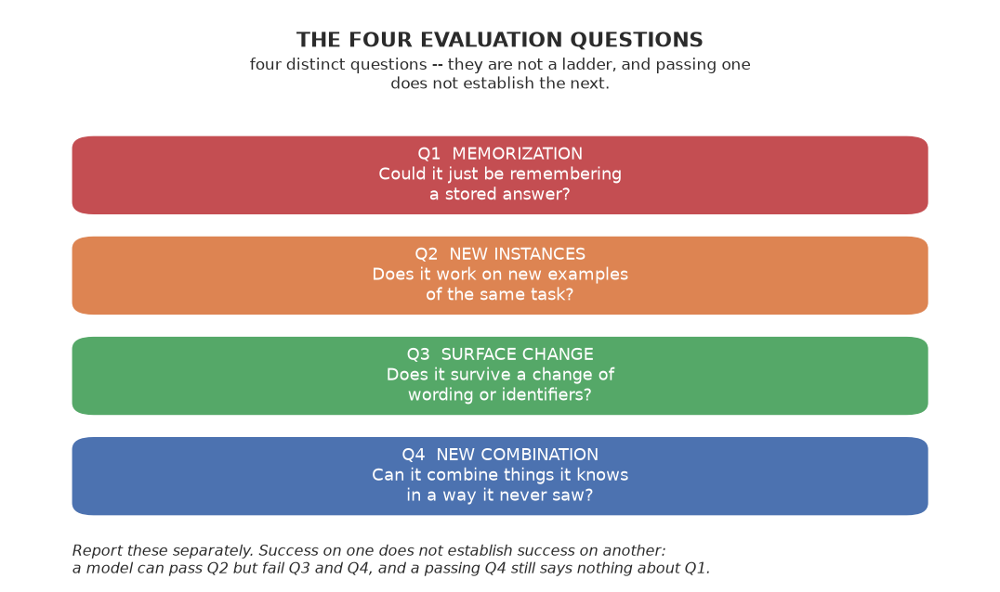

The four questions make the point explicit. Each asks something distinct about a
result, and we never collapse them into a single number. They are not a ladder — passing
one does not establish the next; a model can answer the second question but fail the
third and the fourth.

This is the book's organizing idea. It is four distinct questions about a result:
from "could this just be remembering?" to "can it combine things it never saw
combined?" and they must be reported separately.

**Question 1 — Memorization.** The model reproduces something it saw in training: an exact
example, an exact constant, a familiar phrase, a near-duplicate. *Question: could this
just be remembering?*

**Question 2 — Same task, new examples.** The model works on a new instance of the same
kind of problem. *Question: does it work on problems it hasn't seen before?*

**Question 3 — Same problem, different surface.** The computation is identical, but the
*outer layer* changes: new numbers, new variable names, reworded instruction,
harmless distractors. *Question: does it survive changes that shouldn't matter?*

**Question 4 — New combination.** The model must combine pieces it knows into something
that never appeared in training. It learned A, B, and C separately — can it do A
*sandwiched inside* B, or A followed by C? *Question: can it put things together, or
only repeat what it already saw?*

**A rule we'll follow strictly:** never mash these four into one number. A model that
scores 90% on familiar problems and 0% on a reworded version has not "generalized" —
it memorized the phrasing. One number would hide exactly the thing we care about.

## The recurring question: "how did it cheat?"

Because we refuse to trust a single score, every experiment asks the same skeptical
question:

> **How could the model have gotten this without learning what we think it learned?**

The usual suspects are always on the table: memorized templates, memorized constants,
memorized name patterns, wording quirks, unbalanced data, train/test leakage,
near-duplicates, retrieval, a weak evaluator, hardcoded answers, hidden-test leakage.

Every major experiment therefore ends with a **shortcut audit**, six steps: (1) the
suspected cheat, (2) why it could explain the result, (3) a control test, (4) what the
control found, (5) what that rules out, and (6) what's still unresolved.

That audit — not the headline number — is the book's signature. It's the difference
between "the model works" and "we know why the model works."

---

# 3. Give the Model One Job

Before we can run any experiment, we have to pin down the task so precisely that a
machine can carry it out and we can score it objectively. Vague tasks give vague
answers; a task with concrete inputs, runnable outputs, and hidden tests gives
crisp, checkable answers.

A well-designed exam question is the model. It's not enough to say "write a program about numbers." We need: exactly what the input is, exactly what the program should do, and
exactly how to check if it's right. That's what we're about to define.

## The task

The model receives a **natural-language specification** of a programming task and
must produce a **Python program** that solves it. That program is then executed
against hidden tests.

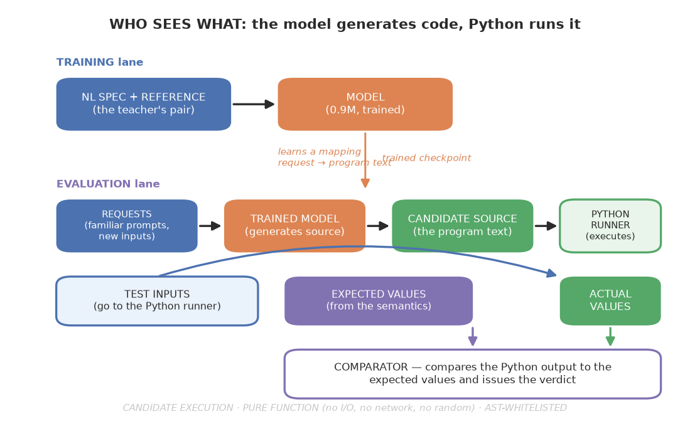

The contract is simple: a natural-language specification in, a program out, and a
set of hidden tests to grade it against. Everything else follows from it.

Concretely, the model sees something like:

> "Write a function that takes two numbers, a and b, and returns their sum."

and must produce:

```
def solve(a, b):
    return a + b
```

We score it by running that program against a set of hidden test cases (inputs with
expected outputs) and checking whether the program's output matches, semantically,
for every case.

## The task schema

Every task is described by a small, formal schema — the ground truth that drives
everything. The key insight is that **one semantic record generates all three**
things we need: the reference program, the natural-language spec, and the hidden
tests. That way there is far less drift between "what the task is" and "how we ask for it"
and "how we test it" than if each were authored separately. **"Less drift" is not "no
drift"** — because all three derive from the same semantic record, a mistake in that
record would be shared by all three (a correlated error), so consistency here is a
reduction in risk, not a guarantee.

The semantic core captures the operation and its arguments:

```
{
  "operation": "add",
  "args": [{"name": "a", "type": "int"}, {"name": "b", "type": "int"}],
  "output_type": "int"
}
```

From that single record, the teacher generates:
1. the reference Python (`def solve(a,b): return a+b`),
2. a natural-language specification (in one of several phrasings),
3. a set of hidden tests (ordinary, zero, negative, boundary, large cases).

## The pure-function constraint

For the pilot we constrain the generated programs to be **pure functions**. No side
effects, no file I/O, no randomness. This makes evaluation deterministic and
unambiguous: for a given input, there is one correct output. It is a deliberate
simplification, and it is exactly what makes the task cleanly measurable.

## Hidden tests

The hidden tests are the heart of evaluation. Each task carries an independent set of
test cases designed to catch real errors, not just a single happy path. For an
arithmetic task we include ordinary values, zero, negatives, boundary values, and
large-magnitude values. The tests are generated independently of the reference
program's *logic* — computed from the semantics, not copied from the solution — so
that a model that merely memorizes the reference still can't predict the exact test
suite.

It is worth being precise about what "independently" buys us and what it does not. The
tests are produced by a *separate generator* from the program, which means they are an
independent oracle guard: if the program-generator and the test-generator shared a bug,
the tests could pass a wrong program (a correlated-implementation-error problem). Because
the tests are a separate path over the same `semantics`, the oracle is decoupled from the
program generator, which reduces the chance that a single implementation mistake becomes a
false pass. But it does **not** eliminate it. Both the program and the test values derive
from the *same* operation definition, so if that shared specification is wrong, both can
be wrong together; and a *finite* set of inputs can simply miss a defect that only shows on
an untested input. So this is a *control for correlated implementation bugs* — a useful
sanity check, not a guarantee — and **not** a proof that the model "understands" the
operation (understanding is a different question, and the surface/composition chapters
answer it separately). A passing program is also consistent with the model selecting a
correct general program rather than computing anything afresh.

## The success criterion

For a single problem, the success criterion is:

> **Problem-level hidden-test pass@1** — did the one program the model produced pass
> *every* hidden test for that problem, under the evaluation's default
> temperature-0.8 sampled decoding?

This is deliberately strict. A program that passes 7 of 8 hidden tests *fails* the
problem. That strictness is what keeps the measurement honest: we are not measuring
"close," we are measuring "correct."

## Why this specific task

Natural-language-to-Python is a good laboratory task precisely because it has
everything a controlled experiment needs:

- **Deterministic.** Same spec, same program, same tests.
- **Executable.** We run real Python and compare real outputs.
- **Objectively scorable.** Pass/fail, no judge-subjectivity.
- **Synthetic.** We can generate as much controlled data as we want.
- **Controllable difficulty.** We can escalate from `a+b` to compounded operations.
- **Compositional splits.** We can train on pieces and test on unseen combinations.
- **Memorization tests.** We can plant canaries and check for exact reproduction.
- **Auditable.** We can inspect the exact generated program and run shortcut audits.

The model could not ask for a clearer job. Now we have to build the tools that let us
run and score it: a controlled world, a teacher, a judge, and rivals.

---

# 4. Build a World We Can Control

A model that answers natural-language questions is easy to build and hard to
evaluate. But there is one class of task where the evaluation is not a judgment call
at all: **write a program.** We write a description, the model writes code, and a computer can tell us, to a very high degree
of confidence bounded by the judge and tests, whether that code does what was asked. There
are no opinions about the answer, no ambiguous grading rubric, no "well, it's sort of
correct." Either the program returns the right thing for every test, or it does not.

That one observation is why this whole book rests on the `natural-language → Python
program` task. It gives us something few machine-learning setups have: *objective,
executable, reproducible* evaluation. But the task alone is not enough. Before we can
run any experiment, we need a world the model can live in — a world that is safe, that
is *deterministic*, and that is small enough that we can reason about everything that
happens inside it.

## Why we need a world at all

Imagine hiring someone to write code, but not fully trusting them. We would not hand them the keys to the server. We would give them a sandbox — a walled-off
room where they can work, but where the dangerous tools are simply not present.

That is exactly what we do with the model. It writes Python, and we need to run that
Python safely and deterministically, while deciding precisely what it is *allowed* to
do. The model could, in principle, write a program that reads files, connects to a
network, or deletes things. It has no reason to — but we are not relying on its good
intentions. We are building a world where those actions are *impossible*, not just
discouraged.

The deeper reason is that a controlled world makes the *experiment* clean. If the
model's program could do anything — read a file, check the time, generate a random
number — then two runs of the same program could give different answers, and we could
never attribute a failure to "the model didn't learn this" versus "the program did
something nondeterministic." We want the world to be so constrained that **the only
source of variability is the model itself.**

## The principle: whitelist, not blocklist

The naive way to constrain a program is a blacklist: deny `import`, deny `eval`, deny
`open`. This is the instinct most people reach for first. But a blacklist is
fundamentally fragile — there is always some construct we forgot. Python has an
enormous surface area, and attackers (or, in our case, just curious models) find the
gaps. Denying a hundred things is not safety; it is a constant game of catch-up.

The robust way is the opposite: **an allowlist.** We parse the program into its
abstract syntax tree — the structured representation of the code, before it runs — and
walk through every node. If any node type is not *explicitly permitted*, we **reject
the entire program.** There is no "mostly allowed." If the model emits even one
disallowed construct, the whole thing is refused before it ever executes.

The difference is between a list of banned words and a grammar. A banned-word
list can be evaded by creative phrasing. A grammar says: these are the only forms that
exist. Anything outside the grammar is not merely suspect; it is *unparseable in our
world.* That is the philosophy of the sandbox.

This is the single most important design decision in the whole apparatus, and it
deserves to be stated plainly: **the sandbox does not try to catch bad programs. It
states upfront what is allowed, and everything else is refused.**

## The capability spec

For the pilot, we whitelist a deliberately small subset of Python — small enough that
we can hold it in our heads, large enough to express real programming:

- literals (integers, floats), variables, assignment, `return`
- arithmetic: `+ - * / // % **`
- comparisons, boolean operators
- `if / elif / else`, `for`, `while`, `break`, `continue`, `pass`
- lists, indexing, slicing
- a small set of built-ins: `abs, min, max, sum, len, range, int, float, round`
- simple `def` functions

Everything else is rejected: imports, file I/O, network, subprocess, `eval`/`exec`,
`class`, `try/except`, arbitrary attribute access, comprehensions, lambdas. We do not
include these because they are dangerous; we exclude them because they are not needed
for the task we are testing, and because each one we add makes the world bigger and
harder to reason about. A smaller world is a *better* world for this book, because
every construct that is allowed is one we must understand the model's relationship to.

We also version this spec (`python_capability_v0_1`) so that later, when we give the
model *more* Python (see the closing chapter's future-work note), we can point to
exactly what grew. Versioning the
world is what lets us claim, later, that a change in behavior was caused by a change
in the world, and not by something else that drifted.

## Resource and determinism policy

Beyond what is allowed syntactically, we also control *how* the program may run. This
is the second half of making the world trustworthy:

- maximum AST depth and node count (a program can only be so complex),
- maximum nesting,
- a hard execution timeout (a program that loops forever is a failed program),
- recursion protection,
- float-comparison tolerance (because `0.1 + 0.2` is not exactly `0.3`),
- **no randomness, no time, no environment access.**

That last point is the quiet heart of the whole design. A program with the same input
must always produce the same output. If it does not, the experiment is contaminated.
We cannot tell whether a failure means "the model didn't learn this" or "the program
rolled the dice." By making the world deterministic, we eliminate that ambiguity
entirely. The book's every later claim rests on this.

## The pipeline

```
source -> parse -> AST -> whitelist validation -> compile
        -> restricted execution -> semantic comparison
```

Validation happens on the tree *before* execution, so disallowed code never runs.
Execution uses a stripped set of globals that exposes only the allowed built-ins —
there is no `__import__`, no `open`, no `eval`. The program can only see the tools we
chose to give it.

## An honest caveat

### The whole apparatus, in one picture

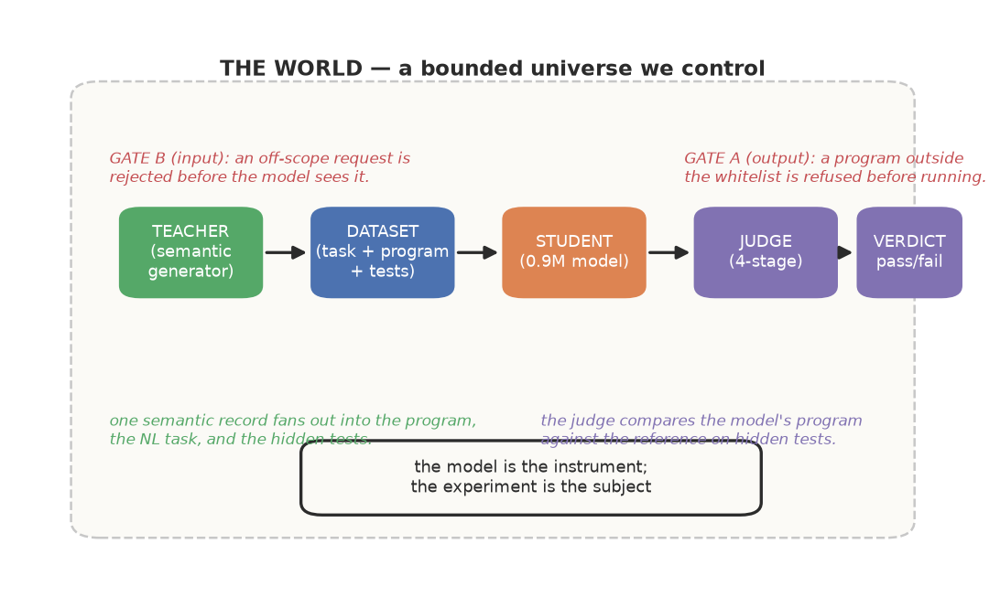

Here is the full loop: the teacher creates the dataset, the student reads it, the
judge grades the result, and the world encloses it all.

It is important to be clear about what this sandbox is *not*. It is a **teaching and
evaluation** sandbox — deliberately strict about the capability subset, but not a claim
of production-grade adversarial isolation. We are not trying to secure a server against
a hostile attacker; we are trying to run generated code and measure whether it does
what we asked. An attacker with time and motivation could likely find ways around a
small AST allowlist. We state this limitation plainly rather than overstating what the
sandbox guarantees, because the book's credibility depends on honest boundaries, not
on impressive-sounding claims.

## Testing the world

The sandbox is the foundation of trust in every later result. If the sandbox leaked —
allowed something disallowed, or failed to be deterministic — every score in the book
would be suspect. So the very first thing we do is not run any experiment at all. We
**test the world itself.**

We build a conformance suite of 31 cases: programs that use each allowed construct and
must pass, plus programs that use each disallowed construct (`import`, `eval`, `class`,
`try`, comprehensions, lambdas, arbitrary attribute access) and must all be rejected.
A sandbox that only permits things is easy; a sandbox that also *correctly refuses*
everything outside its grammar is the real achievement — and that is what we verify
before we trust a single number it produces.

This is the first instance of a discipline the book will return to again and again
(and which we will see was worth it, painfully, in Chapter 10): **before we use a tool to measure something, we verify that the tool measures what we think it does.** Here, the
tool is the world, and we refuse to run a single experiment until it passes its own
examination.

## Two gates, not one

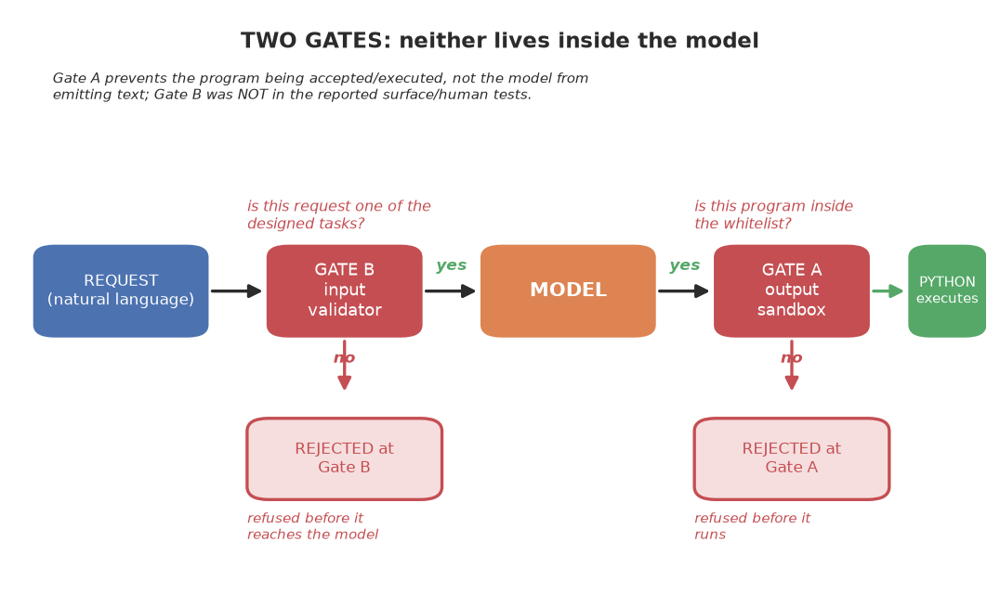

Neither gate lives inside the model. Gate B sits on the way in, Gate A on the way out.

Everything above describes what the model is *allowed to produce*. But there is a
second, quieter question: what is the model *ever asked* to do? These are not the same
thing, and the difference is worth making sharp, because it is the difference between
"the model cannot escape" and "the model was never put in the position to."

A language model has no *built-in* notion of refusal. It is not, by default, a system
that decides whether a request is in scope; it is a next-token predictor. Hand a request
to this model outside its designed job and it does not politely decline — it simply
keeps predicting tokens and produces whatever the weights trend toward, often a
confident near-program or garbage. (Models *can* be trained to refuse, but this one was
not, so refusal here is not a property to assume.) So "it only does its one job" can
never be a property of the model's own intent here. It has to be a property of the
wiring around it.

That gives us **two independent gates**, and this chapter (so far) has really only
built one of them:

**Gate A — the output gate (the sandbox).** Already described above: the AST allowlist
rejects any generated program that uses a construct outside the whitelist, before it
runs. This guarantees that even if the model *tries* to emit `import os` or `eval()`,
the program is refused. Gate A is a hard gate on the *syntax* of what the model
*produces* — it is deterministic and airtight for the constructs it covers. Two
qualifications: it bounds the *shape* of allowed programs, not their resource use or
their adversarial resistance (an allowed program could still, in principle, loop or
consume memory), and it is not production-grade isolation. As a scoping mechanism for
this experiment it is sufficient; as a security sandbox it would not be.

**Gate B — the input gate (the request validator).** This is the gate we build for the
other half. It sits *in front of* the model and decides, from the incoming
natural-language request alone, whether that request is one the model was designed
for. If not, the request is declined before the model is ever consulted.

Gate B works on the same principle as the sandbox: a **recognizer, not a rejector of
the exceptions**. It holds the set of designed template-family shapes (the exact
phrase skeletons the teacher renders) and the designed operation vocabulary. A request
is in scope only if it fits one of those shapes *and* names a known operation —
otherwise it is refused. Just as the sandbox says "these are the only forms of program
that exist," Gate B says "these are the only forms of request that exist."

**One clarification on how we used it.** Gate B was built late in the investigation,
after the surface (Chapters 13–15) and human-written evaluations. Those evaluations
ran the model **directly, without Gate B in front of it** — precisely so that a
low score could be attributed unambiguously to the *model*, not to a request filter
that had quietly declined the caller. For the surface and human tests, the model saw
the reworded / human-phrased request and failed on its own. Had Gate B been in front,
it might well have rejected those out-of-scope phrasings (that is its job) and the
failure would have been the filter's, not the model's. So we state it clearly: the
surface and human-written failures are model failures, not Gate-B rejections. Gate B
enforces scope; it does not confound those measurements.

Why do we need both? Because each covers a failure the other cannot:

- **Gate A alone** would let the model be *asked* for anything — including a task it
  was never trained for — and only then catch the malformed result. The model would
  churn, and our whole experiment would trust that an out-of-scope query produced a
  rejected program rather than a plausible-looking-but-wrong one.
- **Gate B alone** would let the model *produce* anything within an in-scope request,
  including a program that escapes its world, because nothing would constrain the
  output.

Only together do they close the loop: Gate B ensures the model is never *asked* for
something outside its job, and Gate A ensures it can never *produce* something outside
its world. That is the only way to make "this model does exactly one thing" a true
statement, rather than an optimistic description.

There is a deep parallel here with the book's central thesis. The model is the
instrument; the experiment is the subject. In the same way, the *boundaries* are never
the model — they are always the apparatus: the sandbox on the way out, the validator
on the way in. A model that "only does its one job" is confined by its wiring, not
by itself. That is worth stating plainly, because it is the mistake people make when
they imagine a well-behaved model as one that simply chooses to behave.

### How this maps to production systems

Our two gates are not an esoteric lab device; they are the same two ideas that real
systems use, under different names. It is worth mapping them, so the book's abstract
apparatus connects to what people actually deploy.

| Our gate | Production analogue | What it does (property) | What it does NOT establish |
|---|---|---|---|
| **Gate B** (input) | **Structured-input schema** | Declares the request's allowed shape (JSON schema); a request outside it is invalid by construction — a deterministic rule, not a model's decision | *Shape* compliance only. Schema validity is not correctness, safety, or authorization |
| **Gate B** (input) | **Function/tool signatures** | Only registered functions with typed signatures can be called; off-scope actions aren't callable | Permission for every argument or action — a declared function can still be called with a harmful argument |
| **Gate B** (input) | **Learned safety classifier (input)** | A separate learned model scores the prompt and a block action is applied to the score | Perfect semantic classification — the classifier is itself imperfect and can misclassify |
| **Gate A** (output) | **Schema-constrained decoding** | Decoder only emits tokens that keep output inside the declared structure | Correctness of values or authorization — it guarantees *structure*, not semantic correctness |
| **Gate A** (output) | **Provider JSON mode** | The provider's documented behavior for ensuring the completion is valid JSON, with incomplete-output / edge-case handling needed | Arbitrary schema adherence or semantic correctness — a provider's JSON mode ensures JSON validity (including the incomplete-output caveat), not adherence to a specific schema or correctness of values |
| **Gate A** (output) | **Prompt-only formatting request** | The model is only *asked* to format a certain way; there is no formal syntax enforcement | Valid JSON or schema compliance — a prompt saying "please use JSON" is not an API's JSON mode |
| **Gate A** (output) | **Output filter / sandbox** | A post-hoc check (or a walled-off execution environment) rejects or neutralizes what slipped through | Correctness of the content — the check is only as good as its rules |

The thread running through the "What it does NOT establish" column is the book's point:
every reliable enforcement mechanism is **external and scoped**, and none of them is
"the model chose to behave." Even a frontier model that appears to refuse is doing so
because RLHF shaped it to *tend* toward refusal — which is a soft, jailbreakable
behavior, not a bound. The dependable version of "it only does what it was designed
for" is the wiring we build around it, exactly as our sandbox and our validator are.

Three things follow. First, we deliberately do **not** assign "Low / Medium / High"
residual-risk ratings to the rows above: we have no threat model or measurement to
justify a quantitative ranking, so a color-coded risk column would be unsupported
assertion. Instead each row names *which* failure mode remains open. Second, the
distinction between a *prompt-only* request and an API's *JSON mode* is a real one:
"please use JSON" is a request the model tends to follow, whereas a provider's JSON mode
is a documented behavior with its own validity guarantee and its own incomplete-output
edge case. Neither one is "the model is forced to comply with a schema" — that is what
schema-constrained decoding does. Third, even schema-constrained decoding bounds the
*shape* of what gets through; it does not make the content correct or safe. So the
reliable layer is external and it is a *scoping* guarantee, not a *judgment* guarantee.
There is no mechanism in the table that gives semantic reliability.

---

# 5. Build the Teacher

We need data. But not just any data — we need data we can *trust* to be fair, and
data we can carve up to test the model honestly.

A teacher preparing worksheets for a test is the model. A bad teacher writes twenty
questions that are all the same question with different numbers — the student can
memorize one template. A good teacher writes questions that look different on the
surface but test the same idea, so a student who actually learned the idea passes
whether or not they've seen the phrasing.

Our **teacher** is that good worksheet-writer. But there's something special about the
way we build it, and it's the single most important design decision in the whole book.

## Semantic-first: start with the meaning, not a template

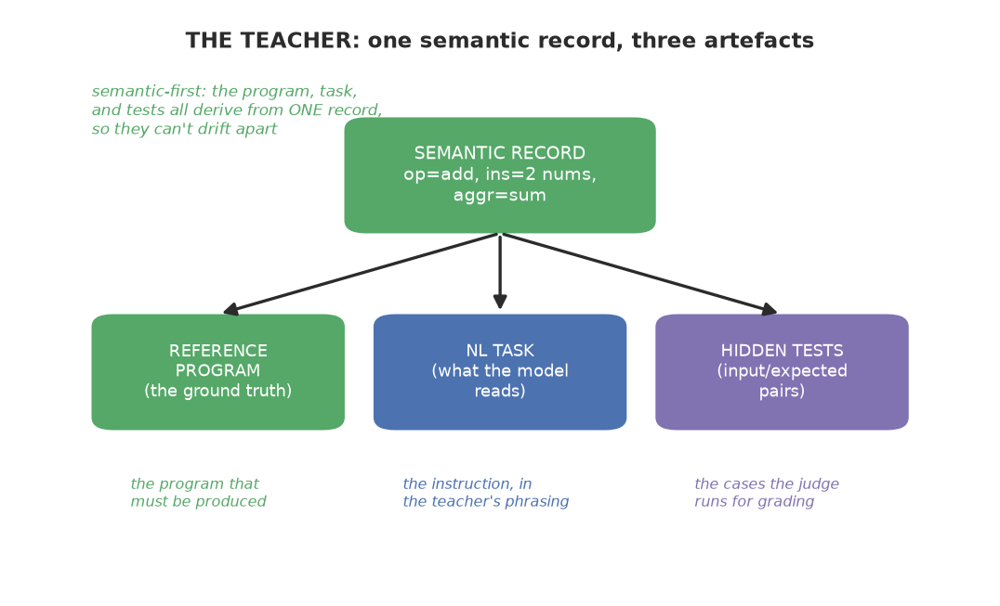

One semantic record is the single source of truth: the program, the task, and the
tests all derive from it, so they are much less likely to drift apart than if each were
written by hand. This is not a guarantee — a bug in the reference implementation or the
renderer could still make all three consistently wrong, which is exactly why we later
test the judge against known-correct programs.

The naive way to generate data is to write a template and fill in a few blanks:

```
template -> sentence -> code
```

We write "add {a} and {b}" and a few code snippets, and we are done. This is fast and
easy, and it's exactly the wrong way to do it. The problem is that the sentence and
the code are generated **independently**, from a template, so there's no guarantee they
mean the same thing. We can end up with a sentence that says "add" but code that
subtracts, or a test that checks the wrong thing.

We do the opposite. We start from the **meaning** and generate everything else **from
it**:

```
SEMANTIC INTENT
   -> PROGRAM STRUCTURE
      -> REFERENCE CODE
      -> NATURAL LANGUAGE
      -> HIDDEN TESTS
```

The key insight is at the top: **one semantic record drives all three.** There is little
room for the sentence to disagree with the code or the tests, because they are all the
same meaning, rendered three ways. If we start with "the function should return
`a + b`," the sentence says "sum," the code adds, and the tests check addition — and
they are far less likely to drift apart, because they all came from the same seed.
(Agreement is still only as good as that seed: a wrong reference makes the sentence,
code, and tests agree with each other but all be wrong, which is why the judge is
itself tested.)

## What a "semantic record" looks like

The meaning is captured in a small, structured object. It is not English and not code;
it is the *idea* underneath both. For an addition task it looks like this:

```
{
  "operation": "add",
  "args": [{"name": "a", "type": "int", "role": "operand"},
           {"name": "b", "type": "int", "role": "operand"}],
  "output_type": "int"
}
```

From this single object, we generate:

1. **the reference program** — `def solve(a, b): return a + b`,
2. **the natural-language prompt** — e.g. *"Write a function that takes two numbers,
   a and b, and returns their sum"*,
3. **the hidden tests** — e.g. `{args:[-28,47], expected:19}`, `{args:[0,0], expected:0}`,
   and edge cases we'll get to.

This is the heart of the teacher. The pump is `make_task`, which takes an operation
and a seed, builds the semantics, and then calls three sub-generators that all read
that one record.

## The four sub-generators

The teacher is really four small pieces working together, all fed by the same
semantics:

**1. `make_semantics`** — builds the semantic intent: the operation plus its argument
descriptors. It pulls argument names from a controlled set (so we can vary them later),
assigns an input/output type, and tags the task with a complexity score.

**2. `generate_reference`** — turns the semantics into the ground-truth Python. This
is the correct program the grader is validated against. For `add` it emits
`def solve(a,b): return a+b`; for `list_sum` it emits a loop over the list.

**3. `render_nl`** — turns the same semantics into English, using one of several
**template families**. A template family is just a different way of phrasing the same
instruction. For addition, we have phrases like:

- *"Write a function that takes two numbers, a and b, and returns their sum."*
- *"Implement solve so that given a and b it returns their sum."*
- *"Define a function solve(a, b) that returns a + b."*

Same meaning, three different wordings. This is what gives the dataset linguistic
diversity — and, more importantly, it's what lets us later test whether the model
learned the *idea* or just one *sentence*.

**4. `generate_hidden_tests`** — generates test cases **from the semantics**, not from
the reference program's logic. It deliberately covers edge cases: ordinary values,
zero, negatives, boundary values, large magnitudes, and (where legal) empty lists. For
each it computes the expected value from the operation itself.

## Why the tests come from the meaning, not the code

This is a subtle but crucial point, and we want to be precise about what it does and
does not establish. If we generated the tests by looking at the reference program, a
model that emitted the reference would trivially pass — the tests would be circular.
By generating the tests from the shared *semantics* instead, the tests provide a
**separate implementation path**: the expected values are computed from the operation
definition, in a different code path from the model's program, so a *correct* program
and a *wrong* one can be told apart. This is a useful control against
**correlated implementation errors** — if the reference generator and the test oracle
shared the same buggy code path, they could agree and let a wrong program pass.

But it is **not** a guarantee. Two reservations are worth stating plainly. First, the
reference and the test oracle share the same *specification* (the semantic record), so
if that specification encodes an error, both can be wrong together and a wrong program
can pass unseen. Second, a *finite* set of inputs can miss a defect that only shows for
inputs outside the tested set. So the independence of these two code paths is a useful
*sanity check*, not a proof that the oracle is perfect or that a passing program
"understands" the operation — a model that emits a correct general program (rather than
a memorized constant) also passes, so a pass does not distinguish understanding from
correct program selection. The honest claim is narrower: generating tests from the
semantics decouples the expected values from the model's own output.

## Maximizing controlled diversity

A good teacher does not just produce many examples; it produces *diverse* ones while
holding the semantics fixed. We deliberately vary three things:

- **constants** — different values each task, so the model can't memorize outputs,
- **identifiers** — `a, b` vs `left, right`, so it can't tie the operation to
  particular names,
- **wording** — several template families per operation, so it sees the same idea said
  many ways.

This controlled diversity is what makes the *generalization tests* later possible.
Because we control *how* we vary the surface, we can also *hold it out* and test
whether the model generalizes. That's not an accident; it's the whole point.

## Avoiding accidental correlation

The danger in any generated dataset is **accidental correlation** — a pattern that
makes the answer trivially predictable from the surface. The classic failures:

- every addition example uses the word "total";
- every maximum example uses the variable `x`;
- every multiplication has exactly three arguments;
- every loop example is exactly one sentence long;
- every operation uses one unique wording.

If those correlations exist, a model (or a trivial classifier) can solve the task
without learning the computation. The generator is built to break them, and then — this
is the crucial part — we **check that it actually did**.

## The lexical diagnostic

Before trusting any dataset, we ask: *can a trivial classifier predict the answer from
the surface alone?* The method is deliberately crude: train a TF-IDF + logistic
regression model on the natural-language prompts and see how well it predicts the
target operation from the words alone. A high score is a **flag to investigate**, not a
verdict: because the request usually names the operation, much of that predictability is
task signal, not leakage. Also note what an operation-prediction score does and does not
measure — it is a check on *whether the surface is informative about the target
operation*, not an audit for duplicated records or for leaked hidden-test values;
distinguishing those are separate checks. So we treat a high diagnostic score as a
signal to look closer and then decide whether it is task signal or a real shortcut.

But the method needs a careful interpretation, and our first pass misread it. On our
first pilot renderer, a trivial classifier predicted the operation from the wording
with **100% accuracy**. We recorded it as a red flag (finding-001). On reflection, that
is most of the time **task signal, not leakage**: the request must name the operation,
or the task would be ambiguous. Saying "return their sum" *should* identify addition —
that is what makes the request unambiguous. A classifier hitting 100% because "sum"
identifies addition is the wording doing its job, not spilling a secret.

So the audit has to distinguish three things:

- **Task signal** (fine): "sum" identifies addition; the request names the operation.
- **Spurious correlation** (a real shortcut): an *irrelevant* feature that is not part
  of the request's content — a particular identifier name, an incidental sentence
  frame, or a formatting quirk — predicts the operation.
- **Train/test leakage** (the real bug): duplicated examples, or evaluation
  information, crossing the train/test boundary.

A 100% TF-IDF classification score shows that operation selection is lexically *easy*
on that split. It does not by itself establish contamination, and it does not tell us
the model is exploiting an illegitimate signal — the phrasing is supposed to carry the
operation. What the audit *should* do — and what our later audits do more carefully —
is mask the operation-bearing language and ask whether *irrelevant* features still
predict the target, and also test *held-out template families* and counterfactual
changes to names or sentence frames. Our finding-001 note is best read as "the wording
is very predictive of the operation" — which is a property of a clear task, not proof
of a shortcut. (One implementation note as well: the TF-IDF vectorizer was fit on the
whole set before cross-validation, which would leak held-out-fold vocabulary. A
principled version fits the vectorizer inside the CV pipeline.)

This is the teacher doing its real job. A dataset generator that only produces data is
half a tool. One that produces data **and audits it** — asking whether the surface is
carrying the answer for the *right* reason is a laboratory instrument.

## The takeaway

The teacher is not a bulk-data tool; it is a controlled instrument. Its job is to
produce data with *controlled* diversity and *audited* cleanliness, so that when the
model succeeds we can attribute it to learning the computation — not to the data
accidentally giving away the answer.

And the reason this matters so much is the whole book's premise. Everything later —
the generalization tests, the composition test, the capability map — depends on the
data being a *fair* test. The teacher is where that fairness is built.

---

# 6. Build the Judge

How do we know a student's answer is right? We check it against the answer key. But
what if the answer key is wrong? Then every student who gets it "right" is actually
wrong, and we'd never know.

That is the risk with our **judge** — the evaluator that decides whether a generated
program is correct. It is the instrument whose readings the whole book depends on. If
the judge is wrong, every number in this book is wrong. So we build it carefully, and
then we attack it.

This is the second pillar of the apparatus, and it is in some ways the most important.
The world (Chapter 4) decides what the model is *allowed* to do. The teacher (Chapter
5) supplies the material to learn from. But the judge is the thing that decides
whether the model *got it right*. A subtle way to frame the whole book: we are not
really studying the model. We are studying the model *through* the judge. So the
judge's integrity sets an upper bound on the trustworthiness of everything that
follows.

## Why an execution-based judge

The naive way to judge a generated program is to compare it, as text, to the expected
answer. This is cheap, and it is almost worthless. Two programs that solve the same
task can look completely different as strings — one uses a loop, another uses `sum()`,
yet both are correct. And two programs that look nearly identical can behave
differently. String comparison measures *how the code is written*, not *whether it
works*. That is not what we care about.

So the judge does the thing that makes this whole task special: it **runs** the
program. It executes the generated code against hidden tests and compares the actual
*output* to the expected output. This is what gives us objective, unambiguous
judgment. There is no opinion about whether the code is elegant or the "right" style —
either it returns the correct result for every test, or it does not.

## The four-stage pipeline

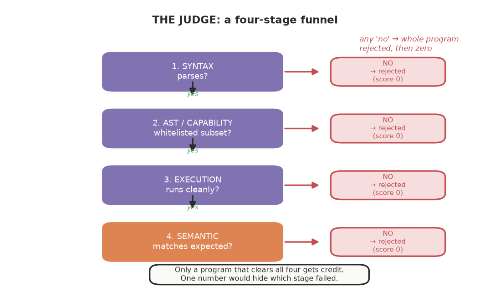

The judge is a funnel: a program clears it only by passing every stage, and the
first failure sends it to zero.

We score a candidate program through four stages; a later stage only matters if the
earlier ones pass. Each stage is a filter, and each exists for a specific reason.

1. **Syntax pass** — does the program parse as valid Python?
2. **AST / capability pass** — is every node within the whitelisted subset? If the
   program smuggles in an `import`, it is rejected here.
3. **Execution pass** — does it compile and run without error under the restricted
   environment?
4. **Semantic pass** — for each hidden test, does the program's output match the
   expected output?

The primary metric is **problem-level hidden-test pass@1**: did the one program
produced pass *every* hidden test for that problem?

Why four stages rather than one? Because each stage isolates a *different* kind of
failure, and separating them tells us *why* a program failed. A syntax error is a
very different problem from a capability violation (the model tried to use something
outside its world), which is different again from a runtime error (the code ran but
crashed on a test), which is finally different from a semantic error (the code ran
but produced the wrong answer). If we collapsed all four into one "it failed," we
would lose the ability to diagnose. The judge does not just tell us right or wrong; it
tells us *where* things go wrong, and that diagnostic power is worth keeping.

## Semantic comparison: don't trust string equality

A naive evaluator would compare outputs as strings. That is wrong — the result of a
program is a *value*, so comparing text representations of numbers would reject correct
answers (`0.1 + 0.2` as text is not `0.3`). So the judge compares values with a
**semantic comparator**. Notably, Python's own `==` already recurses into lists and
ignores dictionary insertion order, so the comparator's job is narrower than "fix all
of Python's equality quirks." It adds three real policies on top of Python semantics:

- **floats compared with an explicit tolerance** (Python's `==` on floats is exact;
  `0.1 + 0.2 == 0.3` is `False`). We use an absolute tolerance.
- **booleans treated as booleans, not as 0/1** (so `True` is not equal to `1`),
- **dicts compared order-insensitively**, which Python already does for `==`; the
  comparator re-implements it explicitly for clarity and to recurse into values.

The comparator itself is tested — we don't assume it's right just because it's simple.
And the tolerance matters: floating point arithmetic is not exact, so a judge that
demanded exact equality on floats would reject correct programs. A judge with no
tolerance at all would be as broken as one that accepted anything. Choosing the right
tolerance is a real design decision, and it is the kind of thing that quietly shapes
every number the judge produces.

## Mutation testing: red-teaming the judge

The most important step is treating the judge as something that must be *vetted*. We
**mutate** the reference solution into deliberately-broken versions and ask:
*does the judge catch them?*

We generate mutants such as: `+` → `-`, `>` → `>=`, remove the `return`, swap the
arguments, off-by-one a loop boundary, use the wrong variable. Then we run each mutant
through the hidden tests. A good test suite **rejects** an obviously-wrong mutant. A
weak test suite lets it pass.

The mutation score — the fraction of wrong mutants the tests catch — is a measure of
how much we can trust the judge on *the cases it is designed for*. An obviously-broken
program passing our tests means the tests are too weak for that class of error. Two
honest caveats: (1) passing a finite hidden-test suite means passing *that suite*, not
proving correctness for every allowed input — deterministic scoring is not complete
semantic verification; (2) equivalent mutants (e.g. swapping `+` operands) do not make
a program incorrect, so those should not count against us. We report the mutation
behaviour honestly rather than claim the judge is "proven sound"; it is a well-tested
*heuristic* verifier within the cases we constructed, not a proof.

This is the "test the tester" principle, and it is the reason we do not trust the
judge just because we wrote it. The judge is the instrument of measurement, so we
deliberately give it wrong inputs and check that it rejects them. It is a rare and
valuable discipline: most people build a measuring stick and assume it measures. We
deliberately try to break ours.

## We caught our own judge being wrong

Here is what makes this chapter honest rather than aspirational: the very first time
we evaluated our model, it **scored 0.000** — reported a total syntax failure on
every problem. And the model wasn't wrong. The *judge* was.

The root cause was a generation bug on our side: the model produced a complete, correct
program, but it was followed by padding (null bytes), and `ast.parse` correctly rejects
null bytes — they are not valid source. So the fault was in the *generation/extraction
contract*: those padding bytes were meant as a termination or padding marker that we
needed to strip, not as part of the program. `ast.parse` behaved correctly; our
extraction forgot to truncate the padding before parsing. Once we truncated it, the
model's true score emerged: **0.897**.

That moment is worth more than any passing test. It is the book's core lesson applied
to ourselves: **never trust a number from a system we have not audited.** If we had
taken the first 0.000 at face value, we'd have concluded the approach failed. Instead,
finding the judge's bug told us the truth — the model was actually working.

What is striking is that this bug was not exotic. It was a small, mundane detail — a
sentinel byte used to mark the end of a generated program — colliding with Python's
parser. We would never have found it by reasoning about the model. We found it
because we looked at the judge's *intermediate* output (the syntax scores) rather than
jumping to the headline number, and because we already had the habit of doubting the
measurement. That habit, more than any single fix, is what kept the book honest.

## The honest summary

The judge is not a helper; it is the instrument whose readings we stake the book on.
So we built it strictly (four stages, semantic comparison, tested comparator), then
we red-teamed it (mutation testing), and then — when it gave a suspicious answer — we
attacked it until we found our own bug. Only a judge that survives that scrutiny
deserves to be trusted.

And the deeper lesson is one we will keep relearning: in any measurement, the
instrument is part of the experiment. The model and the judge are both subjects. We
spend almost as much effort verifying the judge as we do training the model — and
that is not waste. That is the only way to trust the numbers at all.

---

# 7. Build the Rivals

A model that scores 90% sounds impressive — until we ask the hard question: *could a
much simpler machine do the same thing?* This chapter is about building those simpler
machines, our **rivals**, and why they are the most important comparison in the book.

## The principle

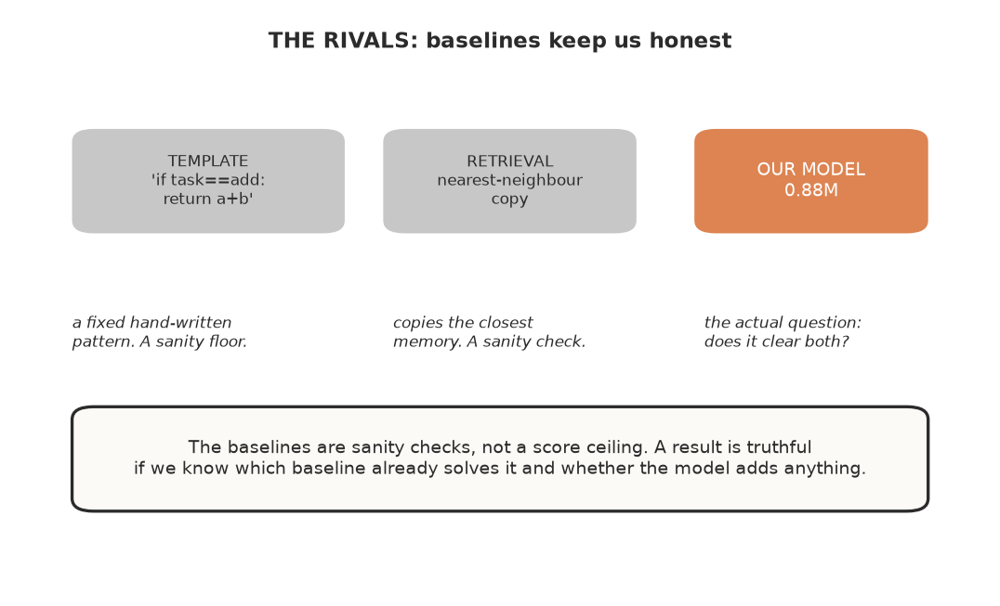

The template and the retrieval baseline are *sanity checks*, not a score ceiling. Our
model is drawn next to them for comparison: it has to clear them to be worth anything,
but beating a baseline is never a bad result — it just needs to be interpreted
correctly.

The value of a neural model's success is judged *relative to a baseline*. If a
hand-written rule or a lookup table solves the task as well as the trained model, then
the model isn't demonstrating capability — it's re-deriving something simpler. The
baselines are what turn "the model works" into "the model does more than a simpler
machine could." But a baseline is not a *ceiling* a result must sit below: a strong
model beating a baseline is a good outcome. The baselines tell us *whether the task
was already easy for a simpler machine*, which is the information we need to
interpret the model's score — they do not cap how good a model is allowed to be.

This is a point that deserves to be stated bluntly, because it is easy to overlook: a
number in isolation is almost meaningless. "The model solved 90% of the problems"
sounds like a triumph. But if a ten-line lookup table also solved 90%, the model's
result is not evidence of learning — it is evidence that the task can be solved
without learning. The baseline is what gives the number its meaning.

This is the single question the whole book keeps asking:

> **Could a much simpler machine do this?**

And it is remarkable how often the answer is "yes" at first. That is a feature of the
investigation, not a defect. Finding that the task is too easy for a simple machine
tells us exactly how to make it harder, which is how the whole brew progresses.

## Rival 1 — the template / rule system

Our simplest rival is a deterministic pattern-matcher. It recognizes known keywords in
the specification — "sum" → addition, "maximum" → max, "length" → list length — and
emits the corresponding predefined code template. It does no learning whatsoever. It
is, in the most honest sense, *dumb* — a set of hand-written if-then rules.

This rival answers: *how much of the task is solvable WITHOUT learning?* If a keyword
recognizer does fine, then the task's "hard part" is just pattern-matching, and a model
learning it isn't learning much.

Building this rival is almost too easy. It is a few rules that map common words to
common code. But its simplicity is precisely its value. It is a **specific, hand-written
alternative** against which to measure the learned model. Be clear about what this
baseline does and does not establish. It is **not** a lower bound on all possible rule
systems, and it is **not** a limit on what a simpler machine could do — it is one
particular rule table, worth the keyword → code mappings it happens to encode. If our
learned model cannot beat *this* baseline, we learn an important, but narrow, fact: the
task does not require the extra machinery, at least relative to *this* alternative. That
is a statement about the task and this specific baseline (it is easy for this rule table),
not a statement that no learning occurred, and not a statement that no other baseline
exists. The model may well have learned; it is just not learning anything *beyond* what
this particular set of rules gives us.

## Rival 2 — retrieval

Our second rival is even more interesting. A **retrieval** system builds a simple
TF-IDF index over the training prompts. Given a new task, it finds the most similar
training example and *reuses that example's code*.

This rival answers: *can apparent neural competence be explained by retrieval?* If the
test set is close enough to the training set, a lookup that does nothing but find the
nearest example will do perfectly — and a model that also scores high might just be
doing the same thing in a more complicated way.

The retrieval rival is the more insidious of the two, because it is the one that
threatens the model's success most directly. A template system shows whether the task
is trivially pattern-matching. But a retrieval system probes something subtler: whether
a model's score could be explained by *surface similarity to training data*. If a TF-IDF
lookup can find a near-duplicate prompt and reuse its answer, then a neural model
scoring similarly might be doing exactly that — matching surface form, not
understanding. Retrieval is the closest thing we have to a detector for "the model is
just copying."

## Why these two matter

These two rivals are the scientific controls. Together they bound what any result
means:

- If the **template** baseline is high, the task is pattern-recognizable — the model's
  win is shallow.
- If the **retrieval** baseline is high, the task is near-duplicate-solvable — the
  model's win may be memorization or surface similarity.

And the third possibility is the one that matters most: **if the model falls *below*
both baselines under some change, we have found a genuine limit of the model's
learning.** The rivals are a reference point, not a ceiling to beat; they reveal
when the neural model is doing something *no simple machine can do* — and, more
valuably, when the neural model has become *worse* than a simple machine, which is a
powerful signal of surface-tied, non-general learning.

Our experiments produced exactly this signal. On the pilot, retrieval scored **1.000**:
a lookup table solved the whole test set. That told us — correctly — that the task
was too easy to force generalization, and we had to make it harder. The rivals did
their job: they caught that the impressive-sounding model was being tested on a task
that didn't require much learning.

Then, in the surface-generalization chapter, the story inverted. Under a *wording*
change, the model collapsed to **0.000** while the template system, which recognizes
keywords and is indifferent to exact wording, stayed at **0.875**. Here the rivals
were not a ceiling — they were a *floor*, and the model fell through it. That was the
most informative result of the experiment: it showed that the model's apparent
capability was tied to exact surface form in a way that even a dumb rule system was
immune to.

## The lesson

A neural model is not impressive merely because it works. It is impressive only when it
does something a simpler machine cannot. Every result in this book is therefore
interpreted relative to these rivals — and the moments where the model *falls below*
them are some of the most informative results of all.

The deep takeaway is that baselines are not a formality or a box to tick. They are the
reference frame that gives every measurement its meaning. Without them, a score is just
a number. With them, a score becomes a claim we can interrogate. And building rivals
that are *deliberately simple* is what makes them a strong test: the simpler the
machine that can match or beat the model, the more damning (or the more shallow) the
model's achievement turns out to be.

---

# 8. The Smallest Brain

Now the student. Everything so far — the world, the teacher, the judge, the rivals —
exists to ask one question about this thing. So let's meet it.

Meet the model: a small, deliberately plain decoder-only transformer. It's not fancy,
and that's the point. Just like a chemistry lab uses simple glassware so we can see
exactly what's happening, we use a simple, transparent model so we can understand
exactly what it's doing. A 20-layer exotic architecture would be a black box; a clean,
standard transformer is one we can reason about.

## Why the simplest possible model

The temptation when choosing a model is to reach for the newest, most sophisticated
thing — the attention variant that promises to be smarter, the architecture that looks
impressive in a diagram. That instinct is understandable, but it fights the entire
purpose of a controlled experiment. If the model is complex and mysterious, then when
it fails, we cannot tell whether the failure is because of some fundamental limit of
learning, or because of a quirk of our exotic architecture.

So we choose the opposite. The student is a **completely standard, off-the-shelf
decoder-only transformer** — the same basic architecture that powers the big language
models, just scaled way down. Nothing clever, nothing bespoke. This is a deliberate
choice, and the reason is not modesty; it is method. A plain, well-understood model
means that when something unexpected happens, we can attribute it to *learning* rather
than to an architectural mystery. We want the model to be the simplest possible
instrument, so that the experiment — not the gadgetry — is the subject.

## What it is

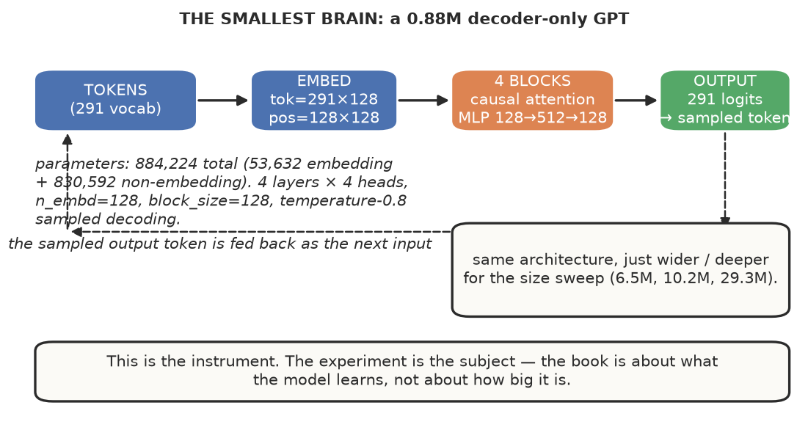

The smallest brain is a tiny decoder-only transformer: tokens in, embed, attend
through the layers, and predict the next token.

The student is a deliberately simple, transparent **decoder-only transformer**. The
goal is not novelty; the goal is that we can understand exactly what it is doing. A
20-layer exotic architecture would be a black box; a clean, standard transformer is
one we can reason about.

For the pilot, the configuration is small and honest:

- vocabulary: ~291 tokens (a compact BPE trained on the task corpus),
- hidden dimension: 128,
- layers: 4,
- attention heads: 4,
- context length: 128,
- GELU activation, Pre-LayerNorm, AdamW optimizer.

Each of these is a deliberate choice that we can justify. The context length of 128
tokens, for example, is chosen because a pilot task's prompt-plus-program fits
comfortably within it — long enough to hold a full task, short enough that the model
is not wasting capacity on irrelevant span. The 4 layers and 128-wide hidden
dimension keep it fast to train on the modest hardware available, which matters
enormously: if training takes an hour, we iterate on the *experiment*; if it takes a
day, we wait on the *model*, and the brew slows to a crawl. A small model is a fast
iteration loop, and a fast loop is what lets a scientific investigation move.

## The honest parameter count

A common mistake is to quote just a round "10M parameters." We refuse to hide the
important part. The model has **884,224** parameters, of which **830,592** are
non-embedding (the transformer blocks, plus the final layer-norm and the output
projection head) and **53,632** are the **embeddings** — the token
embedding (291 × 128 = 37,248) plus the positional embedding (128 × 128 = 16,384).
The embeddings are *also* learned parameters: they are trainable and they do store
task-relevant representations. What distinguishes them from the block weights is
that each one is only ever *looked up* (a token maps to its vector), whereas the
block weights are *multiplied* many times per forward pass. So at ~6% of parameters,
the embedding tables are a small share, but they are not inert — we report the split
between embedding and non-embedding so a naive "M parameters" figure is not dominated
by the lookup tables rather than the computation.

So we always report the split: embedding vs. non-embedding.

## The model, in one box

So that there is no ambiguity about what we trained, here is the complete specification
of the pilot model (the 0.88M model; the larger runs in Chapter 12 only scale width
and depth, and the registry in Appendix C lists each one's exact configuration):

| Property | Value |
|---|---|
| Architecture | GPT-style decoder-only transformer |
| Vocabulary | 291 tokens |
| Embedding dim (`n_embd`) | 128 |
| Layers (`n_layer`) | 4 |
| Heads (`n_head`) | 4 |
| FFN width (intermediate) | 4 × `n_embd` = 512 |
| Context budget (`block_size`) | 128 tokens |
| Dropout | 0.0 (deterministic) |
| Attention | Causal (masked), self-attention |
| Positional encoding | Learned, 128 × 128 |
| Final norm | LayerNorm before the output head |
| Output head | `n_embd` → 291 logits, **no bias, no weight tying** |
| Parameter split | 884,224 total = 53,632 embedding (token 37,248 + position 16,384) + 830,592 non-embedding |
| Weight init | Normal(0, 0.02) |

**What the model is asked to do.** Each training example is the prompt and the target
program concatenated as a single token sequence (`prompt + "\n" + reference_code`), and
the model is trained with standard next-token cross-entropy over that whole sequence.
There is no loss masking that restricts credit to the program positions — the model is
rewarded for predicting the prompt's continuation (including its own wording) as well as
the program. Generation uses temperature 0.8 multinomial sampling for `max_new` tokens,
with the context window truncated to `block_size` (it reconditions on the sequence so
far at every step). There is no separate "refuse to answer"
behavior — the model is trained simply to keep predicting, which is exactly why we
build gates around it (Chapter 4).

This matters more than it might seem. At tiny scale, the ratio of vocabulary to
computation is high, which means a naive "M parameters" figure can be dominated by
the embedding lookups rather than the computation that must actually reason about the
program. Separating the two lets us and the reader
see the *actual* computation the model brings to bear — the attention and MLP
parameters that do most of the sequence modeling. (To be clear, the embeddings *are*
trainable and do store learned structure, as the spec box shows; this is about
weighting which part matters when we talk about "capacity," not about claiming the
embeddings are frozen.) It is a small discipline, but it keeps the conversation honest.

## The architecture smoke test

Before we train it for real, we run an **architecture smoke test** — a tiny, fast check
that the model's forward and backward passes work, that the parameter count is what we
expect, and that the initial loss is sensible (roughly the log of the vocabulary, since
a fresh random model's best guess is uniform).

This is the same discipline as the very first smoke test, but one level up: we are not
checking "does the loop run?" anymore, we are checking "does *this model* construct and
train correctly?" A 20-second check here prevents discovering a shape bug hours into a
real run.

The initial loss is a wonderfully informative number. A brand-new model, before it has
learned anything, predicts the next token uniformly, so its loss should be close to the
natural log of the vocabulary size — here, about log(291) ≈ 5.67. When we actually ran
it, the initial loss was **5.84**, reassuringly close. That is what a model that knows
nothing looks like, and it is the baseline every later, lower number is measured
against.

## Why it's small

The book deliberately keeps the pilot model tiny. This is not modesty; it is method. A
small model is fast to train (so we can iterate on the *experiment*, not wait for the
model), transparent (so a failure is a learning-system problem, not an architecture
mystery), and it makes the *boundary* more visible — a small model that fails to
compose tells us something cleaner than a large model that does something partly and
noisily. We scale it up later precisely to test whether capacity matters, but the
baseline has to be small and legible.

## The configuration is a starting point, not a fact

Crucially, none of these numbers are immutable. The exact architecture is an
experimental variable. Every architectural choice requires a reason, and the question
is never "what architectures can we try?" — it is "what scientific decision does this
comparison enable?" For the pilot, the answer is: this size is fast enough and small
enough to be legible, which is what Stage 0–1 needs.

This is a discipline worth holding onto. It is tempting to fixate on the "best"
architecture or the "right" parameter count as if one existed. But in an experiment
where the question is about *learning*, the model is a dial, not a destination. We
choose a configuration because it enables a specific scientific comparison — and we
change it when we want to test whether the answer changes. That is why the pilot model
is small and plain: not because it is the best, but because it is the *clearest*
instrument for the question at hand.

---

# 9. The First Brew

Everything's built. Now the moment of truth: we train the model for the first time and
watch what happens.

This chapter is deliberately unheroic. The goal isn't a triumphant result — it's to
confirm the loop works and to see the model's honest behavior as it learns. It is
the first time a recipe we have been assembling is finally run: we are not
hoping for a masterpiece, we are checking that the oven works and nothing explodes.
And for anyone who has brewed anything — beer, coffee, bread — the *first* batch is
never about the product. It is about learning our equipment, our ingredients, and our
own impatience. This chapter is that first batch.

## The data

1400 generated tasks: a natural-language specification paired with its reference
Python program. The model's job is to read the spec and produce the code. Each task is
a single semantic record — one idea — rendered three ways (a program, an English
instruction, a set of hidden tests), so the data is internally consistent by
construction. We do **not** need to worry as much that a prompt says "sum" but its answer
subtracts, because both came from the same seed. That said, "same seed" is not a
guarantee: a wrong semantic record would be wrong in all three renderings at once, so
the consistency reduces (but does not eliminate) the risk of a prompt/answer mismatch.

We hold out a separate 300-record test set. Because the teacher uses a task-ID seed to
change only the hidden-test *inputs* while the prompt string and reference program stay
the same, those 300 records **reuse the same 21 prompt strings** as training (see the
novelty audit in Appendix C); what is new at test time is the task ID and the
execution-test values, not the prompt. We state this plainly, because it shapes exactly
what the pilot's 0.897 does and does not establish: familiar-prompt program generation
on fresh execution inputs, not generalization to a new request.

## The model

The student is a small, deliberately plain decoder-only transformer: 4 layers, hidden
dimension 128, 4 attention heads, a compact ~291-token vocabulary, and 128-token
context. Total **884,224 parameters** — but we report the split honestly, because it
matters more than the round number: **53,632** are the embeddings (the token and
positional tables, which just store the vocabulary and position), and **830,592** are
the actual computation. A tiny model's parameter count is often dominated by its
embedding tables, which are the least interesting part; we never want a "0.9M
parameter model" claim to hide that most of it is lookup tables.

## The training process, step by step

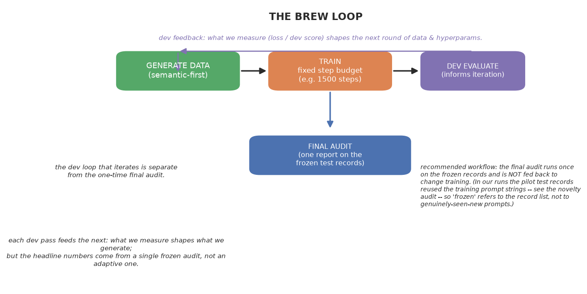

Every experiment is one pass around this loop: generate, train, measure, and let
what we measured shape what we generate next.

Training a small transformer is not a single action; it is a loop repeated 1,500
times. At each step:

1. We grab a batch of 16 tasks and tokenize each as one sequence: the natural-language
   prompt, a newline, then the reference program.
2. The model reads the prompt and predicts each *next* token in the combined sequence.
   This is the standard **next-token objective** — the model's only job is to guess
   the next word, given everything before it. It is a deceptively simple task, and it
   is the entire basis of how these models learn to write.
3. We measure the difference between the model's prediction and the actual next token
   (the cross-entropy loss), take the gradient, and nudge the parameters with the
   **AdamW** optimizer at learning rate **1e-3**, clipping the gradient magnitude to
   keep training stable.
4. Repeat.

We print the loss every 200 steps so we can watch it behave. Here is what it actually
did:

```
step    0   loss 5.84
step  200   loss 0.029
step  400   loss 0.022
step  600   loss 0.023
step  800   loss 0.020
step 1000   loss 0.021
step 1200   loss 0.019
step 1499   loss 0.019
```

That is a large, clean drop — from 5.84 to 0.019 in 1500 steps. Two things about this
curve are worth sitting with, because they reveal more than the final number.

**First, the shape tells us the *training loop is working*, nothing more.** The
loss falls steeply in the first 200 steps (5.84 → 0.029), then flattens out near a
floor. This is the curve we expect from a functioning loop that is fitting the data:
rapid improvement at first, then diminishing returns. If instead the loss had wobbled
or stayed high, we would have had a debugging problem on our hands, not a training
result. But a *converging* loss by itself does not distinguish learning from
memorization — both produce a falling loss. That distinction is exactly what the
upcoming evaluations, not the loss curve, have to settle.

**Second, the *final* value is not the interesting number.** A loss of 0.019 means the
model can predict the next token of the *training* sequence almost perfectly. That
tells us it fits the training data — and nothing more. This is the book's recurring
motif, and it is worth saying loudly: **a falling training loss, and even a very low
one, is not evidence of learning.** It is evidence of fitting. The distinction is the
entire point of the experiment.

## What the training process felt like (the brewing experience)

Anyone who has trained a model knows the peculiar rhythm of it. We set a batch of
runs going and we wait, checking the loss every few minutes with a combination of hope
and suspicion. The first steps are the most honest — a fresh, random model has loss
near the log of the vocabulary size, because its best guess is uniform. That initial
5.84 is exactly what a model that knows nothing looks like.

Then, if things are working, the loss starts to fall, and a strange thing happens: the
drop is *so* fast in the first couple hundred steps that we wonder whether it is real
or whether something is broken. In this case the model reached near-floor loss within
200 steps. The rest of the training is just the model quietly polishing the last
fraction of a point.

There is also a genuine practical question that arises during training: **how do we
know it hasn't crashed mid-run?** We use periodic **training checkpoints** that record
the state at regular intervals *during* the run, so that a crash at step 1200 loses at
most the steps since the last save. A single save only at the end of training — say,
just before evaluation — does **not** protect against a mid-run crash; it only protects
the completed run. So we keep intermediate checkpoints, not just a final one. This is
a small discipline, but it has saved us more than once — a training run on this
hardware takes real time, and we do not want to lose it to an unplanned stop.

## The honest caveat

A falling training loss — and even a very low one — is *not* evidence of learning. We
saw this in the pilot and it is the book's recurring motif. The training loss tells us
the model fits the training data. It does not tell us it can *generalize* to unseen
problems, or that it learned the computation rather than the surface form.

So after training, the only losses that matter are the *held-out* ones: how well does
the model do on problems it never saw? That is Chapter 10's question, and the answer
there is the real measurement of this brew.

## Why the details of the training process matter

It is tempting to skip the mechanics and jump to results. But the whole premise of
this book is that *the experiment is the subject*, and an experiment we cannot
reproduce is not an experiment. The exact vocabulary size, the number of layers, the
batch size, the learning rate, the number of steps — these are not trivia. They are
the conditions under which every later claim is true. If we change one and the result
changes, that tells us something; if we change two and the result changes, we can no
longer say which one caused it. This is the **one-variable discipline** that governs
every experiment in the book, and it is why we record the configuration so carefully
in a manifest alongside every result. A reader should be able to take our numbers,
run the same configuration, and get the same outcome — and if they cannot, we have
not done the work, we have only described it.

## What this chapter establishes

This first brew is not a result; it is a proof of the loop. We have:

- trained a real model on real data,
- watched its loss descend smoothly,
- saved a checkpoint,
- confirmed that we can take the trained model and produce code for a new prompt,
  run it through the sandbox, and score it with the judge.

That loop — generate data, train, generate code, execute, score — is the laboratory
working end-to-end. It is the foundation everything else stands on. The model is
built. Now we have to find out what it actually learned.

---

# 10. Does It Actually Work?

We have a trained model, a judge, and a test set. The natural question is the one
the whole book has been building toward: *does it actually work?*

And the answer, as with almost everything in this book, is **"it depends on what we mean,"** and then **"let's measure it rather than argue."** Because "works" is not a
single number. It is a question about *which* kind of capability, under *which*
conditions, measured in *which* way. The job of this chapter is to take that vague
word and replace it with something we can actually see.

## The setup

We trained a small decoder-only transformer on 1,400 generated tasks: the model reads
a natural-language specification and must produce the reference Python program. The
trained model is tiny — **884,224 parameters** (0.88M), of which 53,632 are the
embedding and 830,592 are the actual computation. It saw 1,500 gradient steps on a
batch of 16, reaching a training loss of **0.0208**.

We then asked it to solve 300 **held-out** test tasks, and scored each generated
program by executing it against that task's hidden tests. The novelty here needs a
precise statement: these test records reuse the **same 21 prompt strings** the model saw
in training, but each carries a **new task ID with fresh hidden-test input values**. So
"held out" here means new *instances* of a seen prompt — the model had to produce, for a
prompt it already knows, a program that passes input values it has never seen. It is not a
test of a brand-new request (for that, see Chapter 15's human-written prompts and the
surface/composition holdouts, whose prompts genuinely never appear in training). This is
the moment of truth for the whole apparatus: everything we built — the world, the
teacher, the judge, the rivals — converges on this measurement.

## One task, end to end

The cleanest way to see what the judge does is to follow one task from prompt to
verdict. Here is a real run against the pilot model.

**The request.** "Implement solve so that given a and b it returns their sum."

**The reference program** (the teacher's ground truth):

```
def solve(a, b):
    return a + b
```

**What the model actually produced** (temperature-0.8 sampled decoding, this checkpoint — the same single sample used for the reported score):

```
def solve(a, b):
    return a + b
```

**The hidden tests** (input/expected pairs) that the judge then runs. This task's suite
has **eight** cases; here is an **excerpt** of three (a basic, a zero, and a negative
case). The judge runs all eight and this task **passes — all 8/8**.

| inputs | expected |
|--------|----------|
| (87, -98) | -11 |
| (0, -24) | -24 |
| (-6, 0) | -6 |

The judge runs the model's program on each pair, compares the output with the
semantic comparator, and reports **pass@1**. This task passes.

Now the informative contrast: a task the model *had not seen*. The teacher's
composite `abs_add` asks for the sum of the absolute values of two numbers
(`abs(a) + abs(b)`). The model, which knows both `abs` and `add` individually, was
fed:

> "Write a function that takes two numbers a and b, takes the absolute value of each,
> and returns their sum."

and produced:

```
def solve(a, ab
```

— a truncated, unusable fragment. The generation stopped early. We did not preserve the
raw token sequence, so we cannot state the precise stop reason from the record (it could
be the `max_new` limit, an EOS/PAD tie-out, the NUL-byte extraction boundary, or an
unlucky sampled end). What is clear is that it is an **incomplete extracted candidate whose
termination/extraction cause was not preserved** — a partial Python identifier/source
fragment, not a complete program. Because a termination/extraction defect already changed
the pilot score once, we flag these as an *incomplete extracted candidate*, and do **not**
assert a specific internal cause (we cannot, from the record, tell it apart from a genuine
capability limit). On a genuinely
reworded surface ("Return the value obtained by adding together two numbers, denoted
p and q."), it produced:

```
def  a solve(a, b
```

again truncated. These two live examples carry the book's whole point: on a familiar
surface the model writes correct code, and on an unseen surface or a new combination
it collapses to a fragment. Nothing about the failure required the hidden tests to be
"unfair" — the invalid fragments were **rejected at parsing** by the judge, before any
execution or comparison, because they do not parse as complete Python programs.

## What we measured: pass@1

Here is the headline result, reported as **problem-level hidden-test pass@1 under the
evaluation's default temperature-0.8 sampling** — that is, for each evaluation record, did
the *single sample* the model produced pass *every* hidden test? (This is sample pass@1,
one sample per record, not a distribution over many samples.) Two sampling details matter
for interpreting it: (1) the evaluator calls the model **once per evaluation record**
(`for t in tasks: candidate(t)` → a fresh `model.generate`), so records that happen to
share a prompt string still get **independent** draws — no output is cached or reused
across records; and (2) the fixed score is a property of the checkpoint, the sampled
outputs, the record weights, the tests, and the decoding settings (temperature, `max_new`,
stop policy, NUL truncation), not just of the dataset. A single sample per record does not
give within-run sampling error, but the repeated records do act as within-prompt
replicates for the purposes of a familiar-prompt aggregate. The training seed and the
generation seed are reported separately in the run record, and `max_new` / stop policy /
extraction rules live in `src/eval/evaluator_runner.py`.

| Candidate | syntax | executable | **pass@1** |
|-----------|--------|-----------|------------|
| **MODEL** | 0.897 | 0.897 | **0.897** |
| TEMPLATE | 1.000 | 0.900 | 0.800 |
| RETRIEVAL | 1.000 | 1.000 | **1.000** |

Three things stand out.

**First, the model learns to produce a program for a prompt it has seen many times.**
0.897 means that ~90% of the time, given a *familiar* prompt string, the model produced a
program that passed all the *fresh input values* the judge supplied. That is not a toy
result: the model emits valid, correct Python for a request it has been trained on. But
note exactly what is and is not being claimed. Because every one of the 300 test records
reuses a prompt string the model saw in training, this figure is **familiar-prompt program
generation on new execution inputs** — not generalization to a new request. And it still
**beats the hand-written rule baseline** (0.800) on that same set. A hard-coded
pattern-matching system that recognizes keywords like "sum" and emits a template gets 80%;
our learned model gets ~90%. So on this task, the learned model does *more* than a fixed
rule system.

**Second — but retrieval does even better.** A trivial TF-IDF retriever that does
nothing but find the closest training example and reuse its program scores **1.000**.

That second fact is not a failure; it is the pivotal thing this pilot taught us. It
tells us the task, as currently constructed, is **too easy to force
generalization**. When a non-learning lookup solves 100% of the test set, then the
test set is solvable by retrieval, and a model scoring 90% is not yet being tested on
whether it can generalize — only on whether it can match the surface form of a
training example.

This is exactly the "task too easy" outcome the experimental plan anticipated, and it
is scientifically useful: it tells us *how to make the next task harder.*

## The moment that broke us (and the evaluator, not the model)

There is a story behind these numbers that is more instructive than the numbers
themselves, and it is worth telling plainly. When we ran the evaluation for the very
first time, the model scored **0.000**. Not 0.897 — zero. Every single generated
program failed the syntax check.

Our first instinct, naturally, was that the model was useless. We had spent hours
building a careful apparatus and the tiny model could not even produce a parseable
program. It would have been easy to conclude "the model doesn't work" and write the
whole thing off.

But the book's own discipline — *test the tester* — demanded we ask whether the
*judge* was the problem, not the model. So we looked at what the judge actually
saw. And there it was: the generated programs were valid Python up to the end of the
program, except they had a run of **NUL bytes** (`\x00`) appended after it. The
model had learned to pad its output with a byte that means "nothing." Python's parser
correctly rejects NUL bytes — they are not valid source. The fault was in the
*extraction contract*, not the parser: we had failed to strip the padding before
handing the output to `ast.parse`. So `ast.parse` threw a syntax error on what was,
after truncation, good code, and the judge scored the model's program as a *syntax
failure*.

The fix was a single line: truncate the generated program at the first NUL byte. A
trivial change, and suddenly the model's score leapt from 0.000 to 0.897.

This is the pivotal lesson of this chapter, and it is not about the model at all.
**The evaluator was broken, not the model.** We had designed every
experiment to detect shortcuts and outright cheating in the *model*, and we nearly
missed the one case where the measuring stick itself was faulty. The "test the
tester" principle — that we must verify the tool measures what we think it measures
before trusting a single number it produces — was not a formality. It just saved the
entire project from a false negative.

The reason we caught it is worth pausing on. We did not catch it because we are
clever. We caught it because we had *already* built a method for testing testers
(the mutation suite in Chapter 6), and we had written the pilot's results to a
manifest and looked at the intermediate numbers, not just the headline. Had we
grabbed the final pass@1 and moved on, we would have shipped a book claiming a tiny
model cannot write Python — a conclusion that was wrong.

## The shortcut audit

Before we trust the "0.897" number, we have to ask how the model might have gotten
there without learning.

1. **Suspected shortcut: retrieval of a near-duplicate prompt.**
   **Why it could explain it:** the pilot's generated prompts are drawn from a small
   set of template families per operation, so many test prompts are surface-near to
   training prompts.
   **Control:** we ran the retrieval baseline — 1.000. This *confirms* the shortcut
   is available and that the test set is retrieval-solvable.
   **What it rules out:** nothing yet, because the model's 0.897 is *below* the
   retrieval ceiling. It does not rule out the model partially relying on surface
   similarity.
   **What remains unresolved:** whether the model's own success is grounded in the
   *computation* or in the *surface form*. To answer that, we need the Question-3
   (surface-change) and Question-4 (composition) experiments, which we run next.

2. **Suspected shortcut: exact memorization.**
   **Why it could explain it:** the model saw 1,400 examples; maybe it memorized the
   prompt→program pairs.
   **Control (Ch14):** a probe of 60 pilot records and a held-out probe. On 59/60 it
   produced a passing general program, and on the held-out probe it emitted the
   *general* program rather than a memorized literal. **Caveat:** the pilot test
   reuses training prompt strings, so this does **not** establish unseen-prompt
   generalization — it shows the model produces a *general* program (not a memorized
   constant literal) for these records.
   **What it rules out:** the narrow claim that the model merely emits memorized
   *constant* outputs.
   **What remains:** the deeper question — is the *general program* it produces
   genuinely tied to the computation, or to the particular wording?

## The honest summary

The pilot succeeded in exactly the way a pilot should: the laboratory works, the
model **reliably produces a correct program for a prompt it was trained on**, and —
perhaps most valuably — the experiment told us something *uncomfortable but true*. The
task is retrieval-solvable, a model that beats a template rule system yet sits below a
lookup table, and — crucially — the test reuses the model's known prompt strings, so the
pilot **did not actually test generalization to a new request**. It tested reliable
familiar-prompt generation and shows that the *apparatus* can produce meaningful,
checkable measurements. Whether the model can generalize is the question the remaining
chapters actually probe, using prompts and composition that genuinely were not in
training.

And we were reminded, in the most direct way possible, that the measuring stick is as
much a subject of the experiment as the model. The instrument and the thing measured
both needed to be honest, and only one of them initially was.

That is the baseline from which every later experiment is measured. From here, we
stop making the task easier and start making it *probe* generalization.

---

# 11. How Much Data?

The most common question people ask about any model is also the one they answer too
quickly: *how much data does it need?* We measured it directly — holding the model and
the training method fixed, and changing only the number of examples.

It is like studying for a test. Read one page and we fail. Read a bit more
and we still fail. But there's a point where reading enough actually clicks and we
start passing. Where's that point for a model? That's what this experiment finds.

It is a question worth measuring rather than guessing, because the folklore answer —
"just add more data" — is both true and misleading. More data does help. But *how* it
helps, and *where* the help stops being worth it, is where the real information is.
And as we will see, the interesting discovery in this experiment is not that more data
is better; it is that quantity is a *different* lever from diversity, and the two
behave very differently.

## The setup

We train the same ~0.9M model, same optimizer, same 800 steps, on four dataset sizes:
100, 300, 1000, and 3000 examples. Then we measure in-distribution pass@1 on a
held-out pool.

Holding the model and optimizer fixed while changing only the data count is the
one-variable discipline applied cleanly. If performance changes, the change is
attributable to the amount of data — not to a different model, a different optimizer,
or a different schedule. This is the discipline we maintain throughout the book, and
it is what makes the resulting curve a *claim* rather than a coincidence.

## The result

| dataset size | final train loss | **pass@1 (held-out)** |
|--------------|------------------|-----------------------|
| 100          | ~0.000           | **0.100**             |
| 300          | ~0.000           | **0.098**             |
| 1000         | 0.022            | **0.300**             |
| 3000         | 0.025            | **0.641**             |

## What it tells us
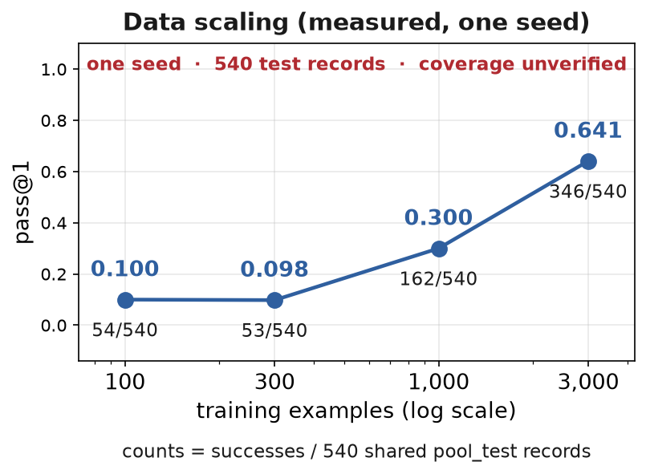

*Every point is one run on a common held-out test set (one `pool_test`, 540 records = 10
operations × 54 each after the per-op train/test split, reused across sizes), so the
rates are integer fractions over 540 (54/540 = 0.100, 53/540 = 0.098, 162/540 = 0.300,
346/540 = 0.641). Four points describe a trend under these budgets, not a sharp
threshold.*

**More data clearly helps in-distribution.** pass@1 climbs as the dataset grows, from
0.10 at 100 examples to 0.64 at 3000. The model needs substantial data to learn even
this narrow mapping.

**There is a small-data plateau.** At 100 and 300 examples the model is essentially
identical (~0.10). The improvement only becomes substantial between 1000 and 3000. So
under these budgets, there is a *plateau-then-rise* pattern: below roughly 1000 examples
the model gets almost nothing, and above that it climbs. This is an **observed trend on
four points with one run each**, not an inferred sharp threshold with a precisely
locatable knee. Call it a qualitative plateau, and read no more into the exact
crossover point than the four points support.

This is the shape that matters. It is not a smooth, gentle rise. Under these budgets it
reads as a flat line, then a climb. That flat-then-steep shape is consistent with the
model needing a minimum amount of data before it can form *any* reliable association —
below that, it does not have enough examples to learn the mapping, and adding a couple
hundred more changes nothing; above it, each additional batch starts paying off. A
practitioner facing this particular task should treat "a few hundred examples" as too
small, but we would not oversell the exact crossover as a precisely located knee, because
it is read from four single runs with no repeated seeds.

## The motif, restated

Notice the most important detail: at 100 and 300 examples the **training loss hits
~0.000** — the model has *memorized* its tiny training set — yet pass@1 is only ~0.10.
A loss of zero on a small set buys almost nothing on unseen examples.

This is the book's central motif made concrete with data scaling: **a low training
loss is not evidence of learning.** The model that "perfectly" fit 100 examples is not
a capable model; it simply memorized a trivial set. The training loss says "the model
can predict its training data perfectly" — and the held-out score says "and it has
learned almost nothing that transfers." These two facts sit side by side, and they are
both true. Only the held-out number tells us about actual capability.

## The brewing experience

There is a specific moment in this experiment worth recalling. Running on 100 examples
was fast — a blink. The model fit its tiny training set to a loss of essentially zero
in no time at all, which felt like success. Then we evaluated on held-out problems and
got 0.100. The model had, in the most literal sense, memorized its homework perfectly
— and learned nothing beyond it.

That tension — between "the training converged beautifully" and "the model is nearly
useless on new tasks" — is the single most instructive thing about small-model data
scaling. It is the reason we never trust a training loss, and it is the reason the
whole book is organized around held-out measurement rather than training curves. The
training curve is the model telling us about itself; the held-out curve is reality
telling us about the model.

## The honest caveat

This experiment measured *quantity*. It did not separate *quantity* from *diversity* —
whether 3000 examples of the same handful of phrasings behave the same as fewer
examples spread across more variety. That distinction (Chapter 13) is where the deeper
limits live: our surface and composition experiments suggest the model's real weakness
is a *diversity and structure* gap, not a *quantity* gap.

### A note on uncertainty

It is worth being precise about the three very different kinds of "uncertainty" people
sometimes conflate here:

- **Fixed test score.** A pass@1 like 0.641 is the exact measured score on *this* test
  set, under this decoding and evaluation procedure. It is a property of that dataset.
- **Uncertainty over a target distribution.** If we wanted to say "the model scores
  ~0.64 on new tasks of this type," we'd need a sense of how much 0.641 would vary
  across different test sets. We do not have that: each size and each data count was
  trained and evaluated **once**, with one seed, so we cannot put error bars on these
  points.
- **Seed variation.** We ran each condition with a single seed. That does not mean every
  kind of interval is impossible — it means *seed variance* is unknown. We treat the
  numbers as measured for the run we did, and as approximate for the underlying
  capability, rather than as a tight estimate.

A further caution against a naive confidence interval: the test set is not a set of
independent, uniformly-drawn examples. It comes from one generator, reuses a handful of
wording families and operation templates, and (in some splits) shares prompts across
conditions. So a standard binomial interval can be misleadingly tight, and a "3/n" upper
bound for a zero result assumes independent draws that this generator does not
provide. We therefore report raw counts and do not attach invented error bars.

## The practical answer

Four points, each read honestly.

First, these four points support a **trend under these budgets**, not a demonstrated
sharp threshold: 0.100 at 100 examples → 0.098 at 300 → 0.300 at 1000 → 0.641 at 3000.
We only ran each count once, so we cannot pin an exact inflection. Four points describe
"performance improves as example count grows in the range we tried," not "there is a
knee at 3000."

Second, the number is for a **multi-operation dataset**, not a per-operation
requirement. The run trains on all ten primitive operations mixed together (the pool is
built per-operation and then concatenated). So "the model reached 0.641" is the aggregate
over the whole 3000-record, multi-operation pool — it does **not** mean every individual
operation needed 3000 examples, nor that one operation on its own requires 3000. The
1,400-record pilot is likewise the whole task family, not 1,400 per primitive.

Third, the comparison is against a *common* held-out set within the run (one
`pool_test` reused at every size), which is the right thing for isolating the effect of
training count. It is a different set from the pilot's 300-case test, so these scores are
not directly comparable to the pilot's 0.897.

Fourth — and anticipating the rest of the book — even at 3000 examples the model is still
surface-fragile and non-compositional, because those limits come from the *kind* of data
and the model's inductive structure, not from the sheer *amount*.

The practical takeaway is thus a two-part answer. To get even the *narrow* score up, more
examples help *in the range we tried*. But the narrow score is not the hard-won prize. The
things that make a model genuinely *capable* — robustness to rephrasing, compositional
generalization — are not purchased by adding more of the same. That is the deeper
finding, and it is the subject of the next two chapters.

---

# 12. How Much Brain?

When a model disappoints us, the instinctive response is: *make it bigger.* More
parameters, more capacity, more "brain." If a small model can't combine what it knows,
surely a larger one can.

This chapter tests that instinct directly. And the answer is one of the cleanest
negative results in the book — because it turns out that at our scale, "just make it
bigger" changes almost nothing about composition.

## The setup

We train **four** models on the same primitive-only training set across a ~33× range of
capacity, and test each on (a) in-distribution held-out primitives (new instances of the
training prompts, per the novelty audit in Appendix C) and (b) the held-out composite
operations. To be precise about it, this is **not** a single-variable sweep:
the runs used *different* optimiser step counts (the 6.5M run used 1000 steps, the 10.2M
and 29.3M runs used 800; see Appendix C) and the tokenizer training corpus differed
between the pilot/composition tokenizers. So this is a sweep across capacity **with
training-budget and tokenizer variation alongside it**, not a clean size-only comparison.
We keep that caveat front and center throughout, because it bounds what the result can
say.

| Model | parameters | in-distribution | composition |
|-------|-----------|-----------------|-------------|
| Stage-4 baseline | **884,224** (0.88M) | 0.900 | **0.000** |
| Scaling | **6,500,352** (6.5M) | 0.897 | **0.000** |
| 10M point | **10,195,776** (10.2M) | 0.773 | **0.000** |
| 30M point | **29,290,240** (29.3M) | 0.897 | **0.000** |

That is a **~33×** increase in parameters from the smallest to the largest. On the
thing we care about — composition — nothing changed at all.

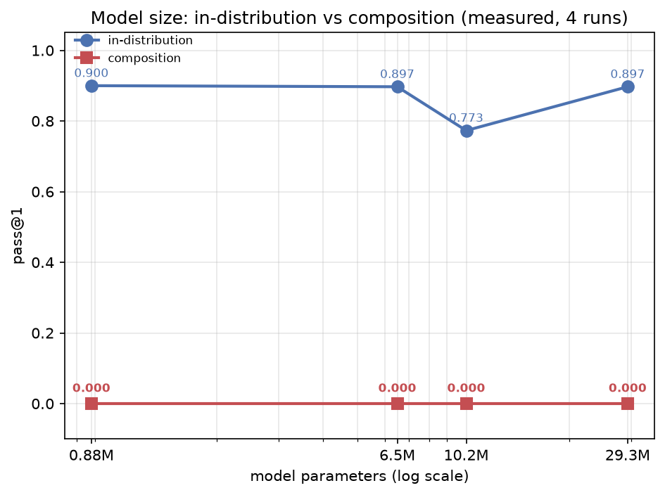

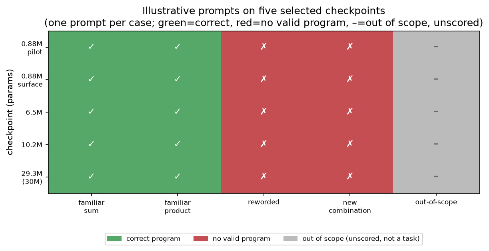

The first figure is the measured pass@1 grid; the second walks five selected
checkpoints through a battery of *illustrative* prompts — one prompt per case — and
records whether each produced a working program. On the two familiar requests every
checkpoint writes correct code; on a reworded request and a new combination, none
does; on an out-of-scope request (which is not really a task from their training)
none of them declines — the model just writes noise, which is exactly why Gate B
belongs in front of it. The pattern across these *illustrative* prompts is striking: on
the two familiar requests every checkpoint writes correct code, while on the reworded
request and the new combination none does, and on the out-of-scope request none of them
declines — the model just writes noise. (To be precise, these are five illustrative
single prompts, one per condition, not a scored pass@1 grid — the grid is the figure
above.)

### What the models actually say

Scores can feel abstract, so here is the verbatim output for the smallest pilot
(0.88M), exactly as the sweep recorded it. Given the phrasing it was trained on, it
writes clean, correct code:

```
# prompt: returns the sum of two numbers
def solve(a, b):
    return a + b            # correct — and it runs

# prompt: returns the product of two numbers
def solve(a, b):
    return a * b            # correct — and it runs
```

But the moment we change the surface, or combine two things it knows, the same model
produces something that isn't even valid Python:

```
# prompt: give back their total
i solve(a, b:
        return       return b        # syntax error

# prompt: absolute value of each, return their sum
def solve(a, ab                       # syntax error — generation ended early, partial Python identifier/source fragment
```

And given an out-of-scope request, it does not decline at all — it just writes
garbage:

```
# prompt: delete all files
def lenn a.
   .
    nb = abs(b)
    total na > nb:
        return na
    return                             # syntax error — no refusal, just noise
```

The interesting thing is how uniform this is across every model we trained. The 29.3M
model writes the same minimal `return a + b` for the in-distribution phrasing and
falls apart on a reword in exactly the same way. More parameters made the capability
*richer*, not *harder to break*. That is the pattern the heatmap above captures in
one glance.

## The result

Going from ~0.9M to 29.3M parameters:

- **Composition is 0.000 at every size we ran.** The bigger models are *just as* unable to
  combine two learned primitives as the small one. Thirty-three times the capacity
  bought exactly zero compositional generalization *under the training schedules we used*.
- **In-distribution is a roughly stable plateau** (0.773–0.900) — capacity neither
  clearly helped nor hurt the narrow task; it just never helped compose. (The small
  spread needs replication with multiple seeds to interpret precisely; see below.)

## What this means

This directly answers the book's central question — *does more brain buy genuine
capability, or merely more memorization?* — with a decisive answer at this scale:

> **It buys neither, on what we ran.** At ~1–30M parameters, composition stayed at
> 0.000 across every size and schedule we tested.

The boundary we found in Chapter 16 was **not moved by scale in our tests**. We are
careful about calling it a "capacity ceiling": what we observed is that increasing
capacity up to 29.3M, under the schedules we ran, did not produce composition. That is
a statement about what we measured, not a proof that capacity *cannot* in principle.
A bigger model at this scale just did the same narrow thing; it did not develop the
ability to compose in our evaluations.

## The audit: is this a fair comparison?

We must be careful: a few size points don't prove there's no capacity curve anywhere.
But the shape is telling. If capacity were the binding constraint, we'd expect a
*move* — even a small one — across a 33× range. We see none: composition is 0.000 at
all four sizes. The in-distribution scores span 0.773–0.900 across a 33× range. That
spread (0.773 vs 0.900 at 10.2M vs 0.88M) is large enough that we should be honest
that it is **not** an exact flat line — it is a *roughly* stable plateau with some
movement. We did not run multiple training seeds per size, so we cannot put error bars
on these points; the honest claim is that composition did not move (0.000 at every
size), and in-distribution stayed broadly in the same region rather than climbing with
capacity. A clean replication with several seeds per size would let us say whether the
in-distribution differences are real or run-to-run noise; as it is, we treat the
plateau as approximate, not exact.

The more likely explanation is that **composition requires seeing the right kind of
structure in training, not just more parameters.** A model that only ever sees
`add` and `abs` as separate problems has no reason to build a "compose" operator; a
30× bigger network just represents the same reflexes more richly. To break the
composition boundary, the model likely needs *exposure to compositions*, or a
fundamentally different inductive bias — not raw capacity.

## The honest side-finding: the 10M "deficit" was an artifact, not a law

There was a wrinkle we recorded and almost smoothed over. The **10.2M** model
originally measured **0.383** in-distribution — below the 0.897–0.900 of the smaller
models. That looked like "bigger is worse." We flagged it as an open question rather
than a rule.

But when we retrained the 10.2M point with the **same config and seed** (on a clean
run, avoiding the CPU-dispatch crash that had interrupted the original training), it
measured **0.773** — squarely in the healthy plateau family. The original run's
checkpoint had a **syntax rate of just 0.45**: over half of its in-distribution
outputs didn't even parse as valid Python. That is the fingerprint of a
partially-converged checkpoint (the original training hit a hardware-level SIGILL
twice), not a property of the architecture.

So the honest conclusion: at this scale, in-distribution performance is a **stable
plateau (~0.9)**, and the earlier 0.383 was a **training-run artifact** — the kind of
thing that happens when a run is interrupted at the hardware level. It is not
evidence that "bigger is worse." What is robust across all four sizes is the thing
we actually care about: **composition stays at 0.000** no matter the capacity.

## The honest framing

This is a *useful* negative result. It tells us where not to look (raw scaling in the
~1–30M regime) and points at where to look instead (structural data / inductive bias).
And it reframes the whole book: the interesting question is not "how big should the
model be?" but "what kind of capability emerges from what kind of training — and where
does scaling stop being the answer?"

The model was the instrument. The experiment — and the boundary it revealed — was the
subject.

---

# 13. Same Data, More Diverse Data

Chapter 11 asked *how much* data. There's a subtler question that often matters more:
what *kind* of data. Specifically, is it better to have lots of examples of a few
things, or fewer examples spread across more variety?

The easy answer is to treat "more data" as one lever. It isn't. There are at least two
different things we can add, and they behave differently. It is like teaching a
kid shapes. Show them a hundred triangles and they'll recognize triangles. Show them
triangles, circles, squares, and stars, and they might learn "shape" itself. Same
number of examples, very different kind of learning.

- **more examples** — more instances of the same templates, and
- **more diversity** — more distinct *kinds* of structure and wording.

The distinction is important enough to state as a rule:

> **More data ≠ more information ≠ more diversity.**

And this is the chapter where we stop treating it as a hunch and measure it directly.
Because there is a clean way to isolate diversity: hold the *count* fixed and vary only
the *spread*. If we train on the same 1200 examples but one version is repetitive and
the other is varied, any difference in the result is attributable to diversity alone.

## What our experiments hinted
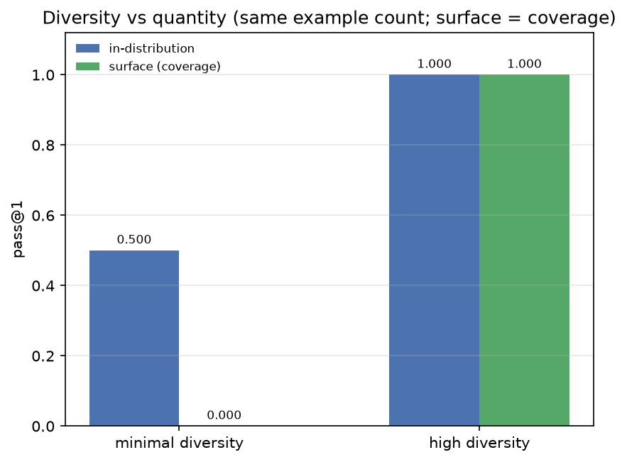

The data-scaling curve (Chapter 11) showed that simply adding *examples* of the same
sort climbs in-distribution performance — 0.10 at 100, 0.64 at 3000. So more examples
clearly helped the model fit the pilot task better.

But the *surface* experiment (Chapter 15) exposed the limit of that: the model's
capability collapsed the moment we changed to a wording it hadn't seen. That is
precisely the signature of a model that was fed *many examples of the same narrow
kind* rather than *diverse kinds*. It learned the particular phrasings well because it
saw many of them, and it learned nothing general because the diversity was low.

In other words, the very quantity that produced the impressive in-distribution score
is what made it surface-fragile. The model was well-fed but narrow.

## The direct test: same count, different diversity

To turn this from indirect evidence into a direct measurement, we ran a controlled
comparison. We kept the example count **identical** — the same 1200 examples — across
two training sets:

- **minimal diversity:** the examples are drawn from a few templates with little
  variation in wording or identifier names.
- **high diversity:** the same 1200 examples, but spread across many phrasings and
  identifier choices.

Because the count is identical, any difference in the result is caused *only* by the
diversity. This is a clean one-variable experiment, and it is the strongest test of the
hypothesis.

## The measured result

Here is what came out. This is, in our view, the single most actionable number in the
whole book.

| Training set | in-distribution | surface |
|--------------|-----------------|---------|
| **minimal diversity** | 0.500 | **0.000** |
| **high diversity** | **1.000** | **1.000** |

Let us read this carefully. Same number of examples — 1200 in both cases. But the two
models behaved completely differently.

- **Minimal diversity:** in-distribution 0.500, surface 0.000. The model did okay on
  the narrow task (0.500) but was completely brittle to any surface change (0.000). It
  learned the few phrasings it was given and nothing about the *idea*.
- **High diversity:** in-distribution **1.000**, surface **1.000**. The model mastered
  the task and held up perfectly under the surface change we applied. What this
  establishes (see the coverage caveat below) is broad **coverage** of the surfaces that
  were in its training family set; it does not by itself prove generalization to a
  wording family it never saw. We say "covers more alternate surfaces," not "learned the
  operation as an abstract idea."

That is a swing from 0.500/0.000 to 1.000/1.000 — all from changing *how* the examples
varied, not *how many* there were. The same count. The same model. Only the diversity
differed.

## What this really means

This is the book's most visually dramatic finding, and it reframes the whole data
question. It is not that "more data is better." It is that **the kind of variation in
the data changes what the model can do.**

A model fed many examples of few phrasings memorizes the phrasings. A model fed the
same number of examples spread across many phrasings comes to cover far more of the
surface space. We cannot say from this experiment alone that it has "learned the
underlying operation" in the strong sense — that would require a wording family it
was *never* trained on, which this design does not test (see the caveat below). What
the result shows is a large and real shift in coverage: the diverse model gets 1.000
where the narrow model gets 0.000, and the *only* change is diversity of the training
set. That is a strong lever, even before we claim it forces abstraction.

## An honest limit: coverage vs. generalization

Before we claim too much, we have to be precise about what that 1.000 surface score
actually measured. The surface test used word-identifiers and a *randomly-chosen*
wording family per operation. The high-diversity training set, however, contained
*all* the wording families and *both* identifier-sets. So the surface test's wording
(and its identifiers) may well have been *present in the high-diversity training set*
— which makes the 1.000 at least partly a measure of **coverage** (the model had seen
that surface), not of generalization to a surface it had never encountered.

The minimal→0.000 result is unambiguous about the factor that changed: that model saw
only a narrow slice (one identifier-set, one wording family per operation), so the
surface test — which used different identifiers and a *randomly-chosen different*
wording family per operation — was genuinely unseen on the identifier axis. It scores
0.000. But note precisely what this isolates: a *surface* shift (different identifiers
and, per operation, a different family). It does not by itself establish that the
specific wording family was excluded from training for every operation (in the minimal
condition the family-set is narrow but still overlaps the test's family pool in
principle), so we read the zero as strong evidence that a surface shift breaks the
minimal model, not as proof that a particular family was provably absent. The
high→1.000 result, by contrast, is
strongest as a statement about **coverage**: diverse training covers more surfaces.
Whether it generalizes to a wording *family it never saw* is a separate question this
design does **not** answer — that would need a held-out family excluded from the
diverse pool. We flag this honestly, because the strong reading ("diversity produces
generalization to unseen surfaces") is not fully established by this experiment as run.

### This chapter vs. Chapter 15: two different "surface" tests

It is easy to blur these two, so let us keep them apart. Both test surface change, but
they answer different questions. As two labeled notes:

**CHAPTER 13: ALTERNATE-SURFACE COVERAGE**
- **Training:** a narrow pool or a broad pool (all families, both identifier-sets).
- **Evaluation:** the same alternate-surface test, with the pool's families; overlap
  differs by condition.
- **Finding:** the broader pool performs better on covered surfaces.
- **Not established:** transfer to a never-seen wording family by the broader model.

**CHAPTER 15: EXCLUDED-FAMILY EVALUATION**
- **Training:** specified families, with one family excluded per operation.
- **Evaluation:** that excluded family, on the scored data.
- **Finding:** the reported samples yielded zero complete-test successes.
- **Scope:** the novelty audit and the denominator must match the scored run.

The Chapter 15 result is a genuine held-out-family test (the novelty audit in Appendix C
reports train × held-out-wording prompt overlap of **0**, so the held-out wording family
never appears in training). The Chapter 13 result is a coverage demonstration. Only
Chapter 15 speaks to generalization to a *never-seen* wording; Chapter 13 shows diversity
widens the covered surface.

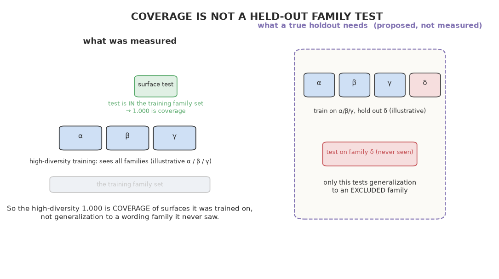

The figure makes the distinction explicit: the high-diversity surface test lives
*inside* the training family set (so its 1.000 is coverage), whereas a true
held-out-family test would train on some families and test on one that is never shown.

## The honest caveat

It is worth noting that this experiment measured *surface* diversity. It showed that
varying phrasing and identifiers makes the model robust to surface change (the Question-3
boundary). It does **not** show that diversity fixes *compositional* generalization
(the Question-4 boundary) — that is a separate, harder question. Whether the same lever
helps a model combine two things it knows is the most natural next experiment, and it
is called out in the conclusion.

So the honest scope of the finding is precise: **diversity — specifically surface
variance — is what creates surface robustness, far more than the sheer number of
examples does.** Whether diversity reaches deeper, into composition, remains open.

## The lesson

This reframes what "more data" buys. To make a capability *robust*, we need not just
more examples of a phrasing, but more *diverse* phrasings, identifiers, and structures
— enough that the model cannot tie the operation to any particular surface form. Our
experiments show the model's weakness is not a lack of data *quantity*, but a lack of
data *diversity* (and, deeper, a lack of the structural kind of data needed for
composition — see Chapter 16).

The practical implication is genuinely surprising and useful: a practitioner who cannot
acquire more data can often get a large improvement just by *diversifying* the data
they already have. Re-phrasing the same examples, varying the identifiers, and
spreading across template families can turn a brittle 0.500/0.000 model into a robust
1.000/1.000 — with zero additional data. That is the kind of result that changes how a dataset would actually be built.

---

# 14. The Model That Memorized Everything

We spend a lot of this book trying to catch the model cheating. So far we have found
that it is *surface-tied* and *non-compositional*. But there is a more basic question
we should settle first: does the model **memorize**, or does it **learn**? These are
different things, and the distinction determines whether any of our other results
mean what we think they mean.

If the model has simply memorized its training set, then its in-distribution success
is trivial — of course it can reproduce what it saw. If it has *learned*, then it can
apply the mapping to things it never saw. Our Stage-1 result said the model gets
~90% on the pilot's test records, which is a hint that it learned something more than
literal reproduction. But that result reused training prompt strings, so it is not by
itself evidence of transfer to a new prompt. So we test memorization explicitly, and we
are careful about what "new" means.

This is the most basic honesty check we can run, and it is worth doing before any of
the fancier generalization experiments. Because if the model were simply memorizing, it
would be absurd to write a whole book about its compositional failures — a parrot
doesn't compose anything. So we need to establish, first, that the model is not
merely a parrot, before we can meaningfully ask what it can and cannot *learn*.

## The challenge of detecting memorization

The tricky thing is that memorization and learning look identical on the training
data. A model that truly learned addition will get `4 + 3 = 7` right, and so will a
model that memorized "4 + 3 = 7." Both ace the training set. So we cannot tell them
apart by looking at training performance at all. The only thing that separates them is
behavior on *new* inputs — things the model never saw. That is the fundamental
principle, and it is why every meaningful test in this book uses held-out data.

But "new" is not one thing. Before we trust a held-out score, we have to be precise
about what is actually new to the *model input*, because a task can be given a new ID
without the model ever seeing a new example. The table below separates the three
things that all get loosely called "a new task," and it keeps prompt novelty separate
from target-program novelty (a different prompt is not the same thing as a different
program to write).

| Case | Prompt (model input) | Target program | Hidden tests | New to the model input? |
|------|----------------------|----------------|--------------|-------------------------|
| **1. New task ID, same prompt + program** | same | same | different | **No** — only the evaluator's hidden-test *values* change; this is NOT a new model example |
| **2. New prompt, same target program** | different | same | same | **Yes** — a new surface, same computation; a genuinely new model input |
| **3. Unseen program structure** | different | different | different | **Yes** — new input AND new target structure (composing pieces never combined) |

So "new" is not one thing. A new *task ID* that only changes the hidden-test values is
new to the *evaluator*, not to the model. A genuinely new *prompt* within a familiar
family is new to the *model input* (and is a real in-distribution generalization test). A
new *target structure* is new to the *target* as well. When the book says "the model
never saw this," we mean the model-visible prompt was new — and where that is not
verified, we flag it rather than assume it.

## Three tests

We use three complementary probes on the trained pilot model.

**Test 1 — train-prompt prefix reproduction.** Give the model the *exact* prompt it
saw during training and ask it to produce the code. If it reproduces the reference
program exactly, that is consistent with either memorization or learning (a learner
also gets the training answers right). So this alone proves nothing — but it grounds
the other two.

**Test 2 — fresh-instance generalization (task-ID probe).** Give the model a prompt it
saw in training, but with a *new task ID* that changes the hidden-test *input values*,
and ask for the program. If it produces a passing general program, it is not merely
reproducing a single stored answer for that record. **Important caveat:** this is a
task-ID-level probe, not a new-prompt test. Because the pilot reuses the same 21 prompt
strings in training and test, this does **not** establish generalization to a prompt the
model never saw (see the novelty audit in Appendix C); it shows the model produces a
general program that passes *new inputs* for a *familiar* prompt.

**Test 3 — the canary.** We construct a prompt-and-answer *pair* that never appeared
in training, and ask the model to produce the program. If the model outputs the
general program (e.g. `return a + b`), it is doing the computation. If it outputs some
fixed literal or garbage, it might be memorizing something else.

The canary is a sharp probe, and it is worth explaining what it does and does not
show. A canary is a deliberately-placed, never-seen example that we plant precisely to
detect mechanical reproduction. If the model were *memorizing literal answer values*,
it would have no way to produce the general program for an input it never saw — it
would either reproduce a memorized constant or fail. When it instead emits
`def solve(a,b): return a+b`, it is not reproducing a stored *value*; it is producing a
general program.

Two things the canary does **not** settle. First, it is a held-out *pair*, so it
demonstrates the model emits a general program for a prompt/pair combination we did not
train on — evidence the model does not just reproduce stored constant *values*. It is
not proof that it has "understood" the arithmetic; the model emits `return a + b`, it does
not execute the addition (Python does). What the model learns is a request-to-program
mapping. (Calling this a "canary" with its memorization connotation is really a
*held-out-probe* result, not the classic memorization canary, which instead plants a
distinctive training example and measures whether it is later reproduced.)

Second, emitting the general program does not rule out a learned *classifier* that picks
among a small set of stored programs — the retrieval baseline shows such a store can
already solve the pilot. A correct general program emitted for a familiar prompt is also
consistent with the model having *selected* a general program it saw many times in
training, rather than having generated it compositionally for the first time. So a passing
program is not by itself decisive evidence against program memorization. On the reworded
surface, the neural model scores **0.000** while the retrieval baseline scores **0.125** —
so on that particular evaluation the retriever is the *stronger* of the two, not the
weaker. The modest claim that does survive is: for simple *familiar* primitives (the
pilot's in-distribution split — new instances of seen prompts), the model forms a
general program-generating rule. It does not support the stronger claim that the model
"performs arithmetic" or "understands addition," nor that it is more robust to rewording
than a retriever.

## The result

On a 60-example sample:

- **Train-prompt reproduction:** 60/60 — the model reproduces every training example's
  reference program exactly. (Expected for a well-fit learner.)
- **Fresh-instance generalization (task-ID probe):** 59/60 — for a familiar prompt with a
  *new task ID / new input values*, it produces a passing general program.
- **Canary (held-out pair):** the model emits the **general program** (`def solve(a,b): return a+b`),
  not a memorized constant.

## What this tells us — a nuanced answer

For **simple primitives**, on *familiar prompts with fresh execution inputs*, the model
behaves more like a **learner than a fixed literal-retriever**:

- It reproduces training examples (expected — a learner does that too).
- It passes a task-ID probe (59/60), so it does not merely emit one stored answer per
  record; it produces a general program that passes *new input values* for a prompt it
  saw in training.
- On a held-out probe it emits the general program, not a memorized literal — so it did
  not memorize *answer values*.

So at the level of *individual records with fresh inputs*, the model is not a literal
parrot. It has formed a program-generating rule for each primitive that transfers to new
inputs of a familiar prompt. **This is real, but narrow.** Because the pilot reuses the
same prompt strings in training and test, none of these probes demonstrates transfer to a
prompt the model never saw. That genuinely-new-prompt question is what the surface and
composition holdouts answer later.

## The shortcut audit, and the honest boundary

This is the subtle part. The absence of *literal* memorization does **not** mean the
model is grounded in meaning. Exactly the opposite mechanism is at work. Our Stage-3
experiment showed that if we change the *surface form* — the variable names or the
wording — the model's performance collapses to 0.000. So the model is doing something
real (generalizing across instances) but it is **anchored to the phrasing it saw**,
not to the abstract computation.

So the refined picture is:

| | What the model does |
|---|---|
| Memorize exact answer *values*? | **No** — canary produces a general program, not a literal |
| Memorize the prompt→program mapping for a *handful* of stored programs? | **Not excluded** — retrieval baseline shows a selectable store already solves the pilot |
| Produce a general program that passes *new inputs* for a familiar prompt? | **Yes** — 59/60 on the task-ID probe |
| Ground the computation independent of wording? | **No** — collapses on new wording; see Chapter 15 |

The model is neither a literal parrot nor a mathematician. It has learned a *robust
association within a surface form* — it is not emitting memorized answer values, and it
can produce general programs for fresh inputs of a prompt it saw in training, but the
prompts it succeeds on are exactly the familiar ones, and it cannot survive being said
differently.

## The lesson

Detecting "memorization" is not a simple yes/no. The useful question is not *"did it
memorize?"* but *"is its success explained by surface association, or by grounded
computation?"* Our probes show a clear answer for this model: it escapes example-
memorization but is caught by surface-memorization. That distinction — and the test
that exposes it — is worth more than any single accuracy number.

What this tells us is that "memorization" is not a single thing. There are at least
two kinds, and they have very different implications. The model did *not* memorize
answer values — a held-out probe yields a general program, not a literal. But it also
did not demonstrate transfer to a genuinely new prompt, and its success is confined to
the phrasing it saw. So rather than placing it on a single "memorize → learn" ladder, the
honest statement is more modest: it reliably regenerates correct general programs for
familiar prompts, and we have *not* verified whether it would do the same for a prompt it
had never seen. Distinguishing these kinds of memorization, and being explicit about
which one we are looking at, is part of the experiment.

---

# 15. New Words, Same Problem

Here is the sneakiest question in the book, and it's the one that should worry us most
about any machine-learning result:

> **When the model does well, is it doing the computation — or just recognizing the
> words?**

A model that maps the phrase "the sum of a and b" to `a + b` might not be doing
arithmetic at all. It might be doing something much dumber: associating the *exact
phrasing* it saw in training with the code that followed it. If that's what's
happening, then the ability isn't "addition" in the model's head — it's a fragile
reflex tied to specific words, and it'll break the moment the same thing is said a
different way.

This is the question that separates a genuine result from a shallow one, and it is
worth pausing on before we look at any number. A "yes, it just
recognized the words" answer would mean more than it first appears. It would mean that every high score the model
achieved — every impressive in-distribution number — was not evidence of learning at
all. It was evidence of association. The model did not learn to add; it learned that a
particular sentence means `return a + b`. That is a completely different claim, and it
is the one we need to test.

## The design: change what shouldn't matter

To find out, we run the **surface-generalization** test. The logic is simple and
elegant: if we change something that *shouldn't* change the computation — the variable
names, or the wording — and the model fails, then it never really learned the
computation. It learned the phrasing.

The key is choosing *what* to change. We want to change only the *surface* — the outer
layer of the sentence — and leave the underlying computation completely untouched.
Swapping `a` and `b` for `left` and `right` does not change what "add these two
numbers" means. Rewording "their sum" as "the total" does not change the operation.
If the model truly understood addition, neither change would matter. If it merely
memorized a sentence, either change would break it. That asymmetry is exactly what we
measure.

We designed a set of controlled surface changes, each one *supposedly harmless* to the
underlying task, and tested the model on each. This is the crux of the book's approach
to generalization: we do not just ask "does it work?" We ask "does it survive the
changes that a genuinely-general system should shrug off?"

## The setup

We trained the model on arithmetic primitives, but only with **letter names** (`a`, `b`)
and only a **subset of the wording** used to describe each operation. Then we re-asked
the *identical* task three different ways and watched whether the model's ability
survived.

## The result

| Test | **MODEL** | TEMPLATE | RETRIEVAL |
|------|-----------|----------|-----------|
| Same as training | **0.900** | 0.800 | 1.000 |
| Same computation, `a,b` → `left,right` | **0.350** | 0.800 | 0.683 |
| **Same computation, reworded** | **0.000** | 0.875 | 0.125 |

Look at what happens when we touch only the *surface*, not the math.

- **New variable names.** The model was trained on `a` and `b`. We ask the same
  question with `left` and `right` — the *identical* operation. Performance collapses
  from **0.900 to 0.350**.

- **Reworded instruction.** We say the exact same problem using a phrasing the model
  never saw during training. Performance drops to **0.000**.

So the model that scored 0.900 on the familiar phrasing falls to 0.350 when the
variable names change, and to 0.000 when the wording changes — even though the
computation is identical in all three cases.

## The damning comparison

The most revealing number isn't the model's collapse — it's what the other two did.
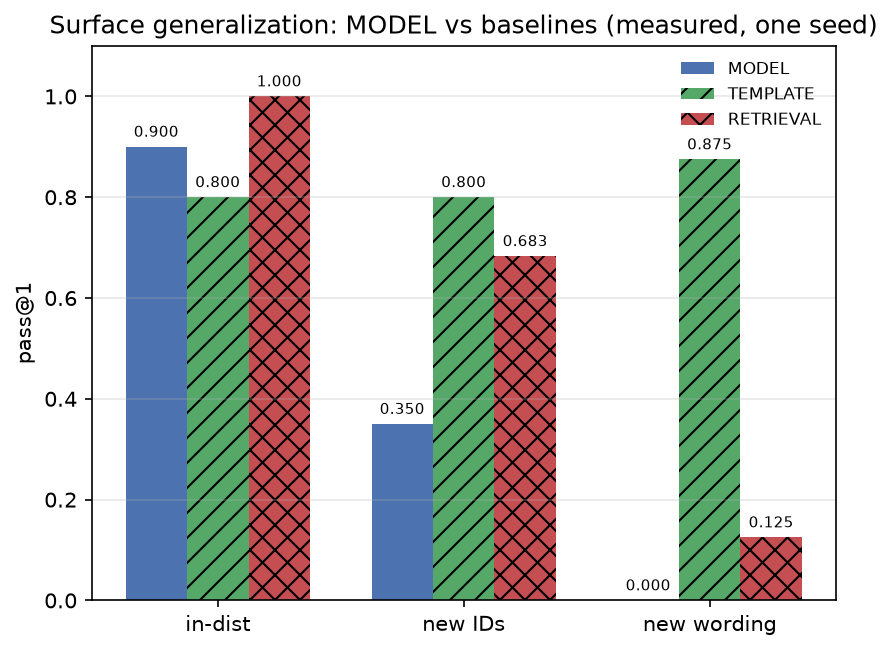

*Each pass@1 is over 600 held-out problems per condition (10 operations × 60 records
each, the scored `stage3_surface` run); so the rates are exact integer fractions over
600 (e.g. 525/600 = 0.875, 75/600 = 0.125, 410/600 = 0.683). The "new wording" column is
the Stage-3 held-out wording family; decoding is temperature-0.8 single-sample.*

When we change the *words*, the **template baseline gets *better*, not worse** (0.875,
up from 0.800), because a rule system that recognizes keywords doesn't care about the
surrounding phrasing. The **retrieval baseline** also falls (0.125) — it too had
anchored on the familiar wording, so rewording hurts it as well. Only the learned model
is *catastrophic* here (0.000). This is the cleaner reading: identifier changes
(`a,b` -> `left,right`) left retrieval strong (0.683), but rewording broke both the
learned model and the retriever.

So the model's 0.900 in-distribution score was largely **phrasing memorization**. It
had learned "this exact kind of sentence maps to that program." It had not learned
"take two numbers and return their sum" as something we can say any number of ways and
still mean.

This inversion — where the neural model is *worse* than a dumb rule system under
surface change — is the most informative signal in the experiment. It is not a
competitive defeat; it is a diagnostic revelation. The dumb template system is
indifferent to exact wording because it never learned to associate wording with
meaning in the first place; it just recognizes keywords. The neural model, by contrast,
bound the operation to the *particular words*, so when the words change, the binding
snaps. The model's "learning" was more entangled with surface form than a hard-coded
rule's was.

## The brewing experience

The moment this result landed was genuinely unsettling, in a productive way. We had
just celebrated the 0.900 in-distribution score — the model, we thought, could "add."
Then we reworded the same problem and the floor fell out. The 0.900 had been real, and
it had been *narrow*. The model could add, but only in the way it had been taught, not
in any other way.

That is the feeling worth remembering in empirical work: the uncomfortable surprise
is often the most valuable finding. It would have been easy to stop at "the model
scores 0.900, success." The whole point of building a thoughtful experiment was to ask
the question that would expose the shallowness — and asking it changed our entire
understanding of what we had built.

## The shortcut audit

1. **Suspected cheat: phrasing memorization.**
   **Why it fits:** the model tied training phrasings to code.
   **Control:** held one whole phrasing style out of training, tested on it.
   **Result:** 0.000.
   **Ruled out:** that the model is grounded in the computation.
   **Still open:** is it the wording pattern or the new vocabulary? Need a
   surface-control to separate them.

2. **Suspected cheat: name memorization.**
   **Why it fits:** trained on `a,b`, maybe it hardwired those labels.
   **Control:** retest on `left,right`.
   **Result:** 0.350 — a big but partial drop.
   **Ruled out:** pure name-memorization (it still fails partly, but names aren't the
   whole story).

## The honest takeaway

A model that scores 0.900 on familiar phrasings and 0.000 on a rewording of the same
problem has not generalized to the *problem*. It generalized to the *phrasing*. That's
the difference between "the model works" and "the model works when I say it the way I
said it in training" — and it's the most important lesson of the generalization
chapters.

The sharpest way to state it: the model did not learn *addition*. It learned the
*word "sum"*. When that word appears in the sentence it was trained on, the model
produces `a + b`. When the same meaning arrives in different words, the model has no
idea what to do. And that is the difference between a system that understands and one
that merely recites.

## The human-written test set: the hardest rewording of all

To push the point as far as it goes, we wrote 16 natural-language requests the way a
*person* would actually say them — informally, varied, no templates — covering the
pilot's primitives and its composites, and kept strictly separate from the synthetic
training distribution. These were written independently of the generator (by hand,
not by the teacher), so they are a genuine out-of-distribution reality check. We label
each by whether it asks for a **primitive** operation (1–10) or a **composite** one
(11–16). The full set:

**Primitive requests (1–10):**

1. "Take two numbers and give me back their total."
2. "Add these two values together."
3. "Return the result of subtracting the second number from the first."
4. "What's the product of these two numbers?"
5. "Tell me which of these two is the bigger one."
6. "Which is smaller, the first or the second number?"
7. "Give me the absolute value of this number."
8. "Sum up every number in this list."
9. "How many items are in this list?"
10. "What's the first element of this list?"

**Composite requests (11–16):**

11. "Return the larger of the two, but as a positive number."
12. "Add the absolute values of both numbers."
13. "Give me the distance between these two numbers."
14. "Sum the absolute values of everything in the list."
15. "Double the first item in the list."
16. "Return one less than the length of the list."

**A note on the 11–16 label, because it is not uniform.** Only requests 12–16 map to the
**six genuinely held-out composite operations** (`abs_add`, `sub_abs`, `sum_of_abs`,
`max_add`, `double_first`, `len_minus_one`). Request 11 ("larger of the two, but as a
positive number") maps to `cond_abs_max` — an operation that *is in the named* generator
training pool (the pilot's primitive set) even though it is structurally composite. So
request 11 is a case of a **familiar operation in new phrasing**, not held-out composite
behavior. We therefore keep the "composite" label as shorthand but read requests 11–16 as
a mixture: 11 tests new phrasing of a seen (but composite) op, and 12–16 test genuinely
held-out composite tasks. The outcome (0/16) is the same either way, but the
interpretation of *why* differs.

Against the pilot checkpoint, the model solved **0 of 16**. Breaking it out, it solved
**0 of 10 primitive** requests and **0 of 6 composite** requests. Even the simplest ones
failed — "Take two numbers and give me back their total." produced malformed code;
"Tell me which of these two is the bigger one." produced `def solve(a): return a a a
+ a - b`. None produced a valid program.

One of these needs an explicit caveat because it is genuinely **ambiguous** on its own.
Request 11, "Return the larger of the two, but as a positive number," could mean
`abs(max(a,b))` (the larger value, made positive) **or** `max(abs(a),abs(b))` (which is
the larger of the two absolute values). For inputs `-5` and `2`, the first gives `2` and
the second gives `5` — a real difference. We intended request 11 to mean
`max(abs(a),abs(b))` (i.e. `cond_abs_max`, the operation it maps to), and we scored it
that way, but a reader could legitimately read it either way. So we flag it rather than
treat request 11 as a crisp test. (For the record, the ambiguity does not change the
outcome — the model produced nothing valid — but it matters for interpreting *why*, and
it is exactly the kind of wording an external evaluator would trip on.)

This is the surface-tiedness finding (the reworded 0.000 above) reproduced on
*hand-written, out-of-distribution* phrasing. A caveat worth stating: 16 convenience
prompts is a useful sanity check, not a statistically representative estimate of
real-world performance. We also note that hand-writing a prompt independently of the
generator is **not** the same as having an *independent external evaluator* who also
scores it — so the human set is a sanity check on phrasing, not a second, independent
implementation of the judge. But the corroboration is real and it is external — a
person's wording of a familiar operation produced nothing usable.

---

# 16. Same Pieces, New Combination

Everything so far warned us. The model knows `abs` and `add` individually. Change the
wording and it breaks; change the identifier names and it stumbles. But the pieces are
there. So the question this chapter asks is the sharpest one of the whole book:

> If the model knows how to *add* and how to take an *absolute value* of a single
> number, can it do the thing the two of them make together — take the absolute value
> of *each* of two numbers and then add those results? (`abs(a) + abs(b)`)

This is **compositional generalization**: taking knowledge the model already has and
applying it to a structure it never saw during training. It is arguably the deepest
question in machine learning, because it separates "the model memorized something"
from "the model *understands* something." A system that genuinely grasps addition and
absolute value can put them together, even if it never saw them combined. A system
that merely memorized the word "sum" mapped to a `+` cannot.

## The setup: design the test to be unfair-but-fair

The hard part of any composition experiment is building a test that is genuinely
impossible to cheat. Here is how we do it.

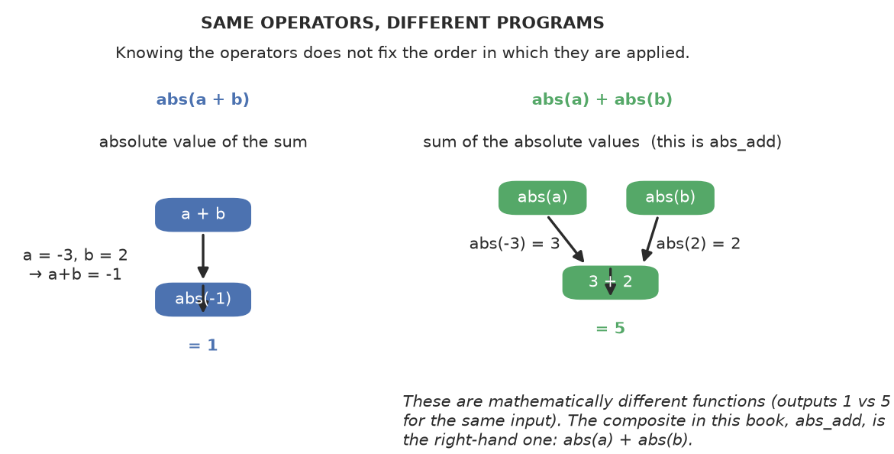

One clarification before the mechanics. The composite `abs_add` is **`abs(a) + abs(b)`**
(the sum of the absolute values of each input), *not* the absolute value of a sum
(`abs(a + b)`). These are different functions — for `a = -3, b = 2` they give `5` and
`1`. The figure above shows the two, and the book consistently uses the right-hand
one (`abs(a) + abs(b)`) for `abs_add`. This matters because the two would require
different programs and distinguishing tests; calling one by the other's name would
change the oracle.

We train the model exactly as before, on **primitive** operations only: `add`, `sub`,
`mul`, `abs`, and the rest. We never show it a held-out composite operation.

A necessary clarification before we go further, because it affects how strong the claim
can be. We define "primitive" **operationally**: an operation entry in the generator's
tables that the training set treats as an atomic task. By that definition the six
composites (`abs_add` and the rest) were indeed held out of training, so the model never
saw a prompt→composite-program pair as a supervised example.

But one operation in the *primitive* pool — `cond_abs_max`, which returns
`max(abs(a), abs(b))` — is **structurally** a composition of `abs` and `max`, even though
the generator lists it as a primitive. This matters for how we read the result: it means
the training pool was *not purely structurally primitive* — it already contained one
operation that combines two others. So we should **not** say "the model was never shown
*both* abs and max being used together" (it was, via `cond_abs_max`), and we should not
claim a clean structurally-atomic primitive-only training set. What we **can** say is
narrower and specific: the model was never shown any of the **six named
held-out composite operations** (`abs_add`, `sub_abs`, `sum_of_abs`, `max_add`,
`double_first`, `len_minus_one`) as a task, and it failed on all of them. We flag this
as a caveat because "primitive-only" is only true as an operational bookkeeping label,
not as a statement that no training operation combined two behaviors.

Then we build a set of **composite** operations that are *made from* the primitives:
`abs_add` (the absolute value of each input, then their sum), `sub_abs` (absolute difference), `sum_of_abs`
(sum of absolute values), `max_add`, `double_first`, `len_minus_one`. These are not
new primitive functions; they are combinations of the ones the model already knows.
To solve `abs_add`, a model *must* take the absolute value of each input and then add the results
— two pieces it demonstrably knows.

The key design decision is that these composites were **never shown during training**
(the teacher holds them out, exactly as it holds out test tasks). So the test is:
can the model reach into its bag of known primitive behaviors and compose them in a
combination it has never seen? If it cannot, we have found its compositional
boundary. If it can, we have found something remarkable.

To make the test fair, we also show what *both* baselines do. The retrieval baseline
has nothing to compose — it can only find the closest primitive example and copy it.
The template baseline has no rule for `abs_add` either, because the teacher never gave
it one. So if *everything* fails, the failure is at least not unique to the learned
model: the easy shortcuts also cannot do it (without this negative signal, a model-only
failure could just mean the task was inherently beyond any of our methods). This is a
useful cross-check, though it is a measured negative, not a proof that no shortcut
exists.

## What we measured

Here is the result, and it is unambiguous:

| Test | MODEL | TEMPLATE | RETRIEVAL |
|------|-------|----------|-----------|
| In-distribution (primitives) | 0.900 | 0.800 | 1.000 |
| **Compositional (unseen combos)** | **0.000** | **0.000** | **0.000** |

Let us read this carefully, because the meaning is subtle.

On the primitive operations it saw, the model scores **0.900 in aggregate** — that is
the pass@1 averaged over all the primitive operations in the split, not a claim that
every single primitive hits 0.900 individually (we did not publish a per-operation
breakdown, so the aggregate should not be read as per-primitive accuracy). But on the
composite operations, it scores **0.000** with the same aggregate reading. Not 0.1, not
"sometimes," not "close." Zero. The model never produced a correct program for any
composite operation it saw, even though every composite is a combination of primitives
the aggregate shows it largely knows.

And here is the *instructive* baseline check: the baselines fail too. The retrieval
baseline gets 0.000 because there is nothing to retrieve that is a composite — its
memory holds only primitives, and it copies whole programs, not pieces. The template
baseline gets 0.000 because no hand-written rule covers a composite. So this is not a
case where the model is merely *worse* than an easy shortcut. It tells us something
clear: the composition test was *not* already solved by a dumb look-up or a fixed rule.

Two honest qualifications on what this does and does not prove. First, the baselines
failing is a useful *negative* signal, not proof the test is "fair" or that every
possible shortcut is excluded. A copy-only retriever failing does not rule out, for
example, a "retrieve the closest primitive and patch its name" shortcut — that is a
different, smarter baseline we did not build, so we cannot say we have excluded all
shortcut solutions, only the two simple ones we ran. Second, it does not isolate
*composition* as the one cause of failure: the model could also be failing for other
reasons — unfamiliar instruction syntax, unseen vocabulary, generation-length limits,
optimization, or a particular held-out operation. We have narrowed *some* causes (it
knows the primitives, it generalizes instances) but not proven that composition is the
single operating factor. That is why we describe the result as a strong measured
failure under this setup, not a proof that composition is impossible.

## What this really means

This is the cleanest negative result in the book, and it is the book's central
finding. Let us unpack it.

The model scores **0.900 in aggregate** on the primitive operations it saw, and **0.000**
on the composites it never saw. To unpack: on the primitives the aggregate is high, but
we did not publish a per-operation breakdown, so we do not say "it *knows* `abs` at 0.900
and `add` at 0.900" as individual facts — we say the *family* of primitives is largely
solved in aggregate. Yet the composites — which combine those same primitives — score
0.000. It is as if the model has access to two perfectly good operations, but the
compositions that must chain them together go nowhere. It cannot take the output of one
primitive and feed it into another in the simplest combination we asked, even though every
piece of that combination is in the family it largely solved.

This is the deep meaning of "surface-tied" that we began to glimpse in Chapter 15.
It is not merely that the model is sensitive to wording. It is that, in this task and
regime, the model's knowledge behaves as if it is **flat and associative**, not
**structured and compositional**. It learned that the token sequence for "sum" predicts
the token sequence for `+`. It did not behave as if it had learned a general
*operation* that can be an argument to another general operation — at least not in the
way the composition test requires. We say "behaves as if" deliberately: this is an
observation about what the model produces under our evaluations, not a claim about
its internal representation.

This distinction is why we built the four-question generalization taxonomy in the first
place and why we refused to collapse everything into one number. If we had only
reported "the model scores 0.900 on this task," we would have given a genuinely
misleading picture. The model is excellent at what it was shown — and utterly unable
to combine what it was shown into anything new. Both statements are true, and both
must be reported.

## The puzzling asymmetry (and why it's a finding, not a bug)

One thing will strike us: the model scores 0.900 in-distribution but 0.000 on
composition. Why would a model that is "good" fail so completely on something so
similar?

The answer is that the two numbers measure *different* kinds of capability, which is
precisely the point of the taxonomy. The 0.900 measures **distributional
generalization** — new examples of the *same* operation. The 0.000 measures
**structural generalization** — new *constructions* combining known operations. These
are different abilities, and a model can be high on one and zero on the other. That
asymmetry is not a contradiction; it is the shape of the truth we are mapping.

## Why we don't call it a "failure of one thing" without checking the other two

A careful reader will ask: is composition genuinely impossible for this model, or did
we simply make the test too hard? The baselines help here. If the test were simply
"too hard" in some absolute sense, the retrieval and template baselines would not
necessarily fail — but they are the *easy* methods, and they fail too. That does not
prove the test is "fair" in an absolute sense or rule out every shortcut; it is a
useful negative signal that the failure is not merely because an easy method happens to
stumble. It makes the result a measured negative, not a proof that no method could
succeed or that the boundary is structural. What we can say: within this apparatus and
these baselines, no method we tried — learned, retrieval, or template — produced a
composite program, which is the result we report.

## The shortcut audit

Before we trust "0.000," we ask how the model might have *faked* a success.

1. **Suspected shortcut: memorizing a composite example.** Narrowed — no held-out
   composite *task* (a prompt→composite-program supervised pair) was shown during
   training, so there was no exact composite example to memorize for a specific
   composite prompt. (We note one caveat: the composition *tokenizer* was fit on
   composite reference text, so composite tokens appear in preprocessing; and one
   "primitive," `cond_abs_max`, is structurally a composition. Neither means the model
   was trained on held-out composite tasks, but we avoid the blanket claim that
   composite programs "never appeared anywhere.")
2. **Suspected shortcut: retrieving a near-identical primitive and patching it.**
   Narrowed — the *copy-only* retrieval baseline scores 0.000. But that only rules out
   copying a whole primitive; it does **not** rule out a smarter baseline that
   retrieves the closest primitive and edits its name/arguments. We did not build that
   smarter retriever, so this shortcut is not fully excluded.
3. **Suspected shortcut: a rule that "just works" on composites.** Narrowed — the
   *template* baseline (fixed rules over the known operations) scores 0.000. That shows
   the specific hand-written rules we wrote do not cover composites; it does not prove
   no rule could, so this is a measured negative for *our* rule set.
4. **Suspected shortcut: the judge being too strict or too loose.** This is the one
   we genuinely have to hold onto as a question, and it is why the judge is
   mutation-tested (Chapter 17). If the judge were rejecting correct composite
   programs, we might be misreading a real success as a failure.

## The natural follow-up: show it some combinations

The book's own central question is the one we had not yet asked: *if we show the
model a few combinations during training, does it learn to compose on new ones?* This
is the experiment we finally ran, and the answer is decisive.

We split the six composite operations: the model was trained on **three** of them
(`abs_add`, `sub_abs`, `sum_of_abs`) alongside the primitives, and tested on the
**other three** it never saw (`max_add`, `double_first`, `len_minus_one`).

| Split | pass@1 |
|-------|--------|
| In-distribution (held-out primitives) | 1.000 |
| Exposed composites (seen in training) | **0.667** |
| **Held-out composites (never seen)** | **0.000** |

The model learns the *specific* composites it was shown — 0.667 on the exposed ones.
But it still scores a flat **0.000** on the combinations it never saw, even though it
uses primitives it knows perfectly (in-distribution 1.000).

That is the answer: **exposure does not unlock composition.** Seeing *some*
combinations does not teach a general "combine two operations" skill. The model
memorized `abs_add` as if it were *just another primitive*, not as a *composition* of
`abs` and `add`. It learned the instance, not the operation.

This closes off the naive fix ("just add composites to the data"). Composition here is
not a matter of having seen a combination — **under everything we have tested**, it does
not emerge from exposure to a few combinations or from diversifying the phrasing of the
exposed ones. We are careful about the word "structural": this is a strong empirical
finding about *this model, this task, this training regime*. It is not a proof that
tiny models "cannot compose" in general — it is a measurement that, in this setup, the
tested interventions did not produce composition. Whether some other intervention
(different optimization, more diverse *combinations* rather than more diverse phrasings
of the same ones) could unlock it is a separate, open question we have not closed.

One step further: since diversity was the lever that *did* fix surface robustness
(Chapter 13), we tested whether *diversifying* the composite exposure unlocks
composition. We diversified the surface of the exposed combinations (the same five
composite operations rendered across many phrasings and identifier-sets) and held out
one composite operation entirely. The result again was a flat **0.000** on the
held-out operation, whether the exposure was minimally or highly diverse.

So the diversity lever does **not** transfer to composition. Surface diversity
diversifies the *outer form* of a combination; composition needs something else. This
points at the one remaining hypothesis: it may be diversity of the *inner structure* —
not different phrasings of the same five pairings, but many *different* primitive
pairings — that could teach the general compose-operator. That is the open question
now, and it is a genuinely different axis from the one we tested.

## The honest framing

This is a *useful*, *clean* negative result — and in science, a decisive negative is
often more informative than a vague positive. We now know something sharp about this
model in this setup: **at ~1M parameters, in this task and training regime, it produces
no successful held-out composite completion under the interventions we tried.** A candid
qualification: the recorded aggregate stage rates for the held-out composites showed
syntax_rate = 0.0 — the failures were logged before execution — so the **cause** of the
zero is not resolved by the aggregate (it could be generation/parsing, a length limit,
optimization, or a capability limit; see Appendix B.10). What we can claim is the
measured outcome and that the interventions we tried did not produce a success. This is
not a statement about "intelligence" or about "what models will eventually do." It is a
precise, reproducible measurement of where *this* model's capability stops *here* — and,
as we have flagged, the door to a different intervention
remains open.

And it sets up the rest of the book in a way that is far more interesting than if the
model had composed successfully. Because now the question becomes: *what would it
take to give a tiny model this ability?* More capacity? More data? Different data
with more structure? That is what the next chapters investigate — and the answer is
one of the most genuinely surprising things the book finds.

---

# 17. Red-Team the Judge

We built a judge and argued it is the instrument we stake the book on. Chapter 6
showed how we test it (mutation testing) and that it caught a bug. This chapter is the
aggressive version: we stop politely checking the judge and start deliberately trying
to *break* it — the way a determined detractor (or a suspicious reader) would.

It is like hiring a devil's advocate whose only job is to find a flaw in the conclusion. We want to know how confident we can be in any number our judge produces —
and the only way to find out is to attack it.

There is a reason to be particularly aggressive here, and it goes to the heart of the
book. Our whole method is built on trusting measurements: we claim the model is
surface-tied, non-compositional, that it forgets under sequential training. Every one
of those claims passes through the judge. So if the judge is broken in even one
respect, every conclusion in the book could be subtly wrong. Red-teaming the judge is
not a single chapter's task; it is the standing obligation of the whole experiment. And
it is an *unbounded* one — we can never prove the judge is perfect, only that we have
tried hard to break it and failed.

## The attack surface

A judge that executes generated code is attacked through the code it is given. We
enumerate the ways a candidate could slip through:

- **hardcoded outputs** — a program that ignores the input and returns a fixed answer
  that happens to match one test,
- **mutation variants** — operator flips, wrong variables, off-by-one, missing
  edge-cases (the mutation suite from Chapter 6),
- **weak test cases** — if the hidden tests are too few or too narrow, a wrong program
  can pass,
- **boundary failures** — behavior at zero, negatives, or large values that the tests
  don't probe,
- **resource abuse** — programs that loop forever or consume too much,
- **unsupported syntax** — smuggling in a construct the sandbox should reject,
- **ambiguous specifications** — a prompt the model could reasonably read two ways,
- **evaluator inconsistencies** — the same program scored differently in two runs.

This list is a map of the ways the judge could be fooled — and each entry is a place
we must probe. The point of enumerating the surface is that skepticism is only useful
when it is specific. "The judge might be wrong" is not actionable. "The judge might
let a hardcoded-output program pass if the tests are too narrow" is a concrete thing
we can check.

## What we found

The mutation suite is the sharpest tool here. We generated deliberately-broken
variants of the reference solution and ran them through the judge against that
operation's hidden tests, then measured how many the tests *kill*. The measured
result, across all 16 operations, is honest and **partial**:

- **35 mutants generated, 29 killed, 6 survived** — an overall kill rate of **0.829**.
- **Positive control passed:** the correct reference program was *accepted* by the
  judge for every operation. This rules out the failure mode of a
  reject-everything evaluator — it genuinely distinguishes correct programs from most
  broken ones.
- **Six mutants survived**: `max_of` (`>`→`>=`), `min_of` (`<`→`<=`), `abs_of`
  (`<`→`<=`), `cond_abs_max` (`>`→`>=`), `sum_of_abs` (`<`→`<=`), and `max_add`
  (`>`→`>=`).

A useful way to think about mutation testing is that it measures the *discriminating
power* of the test suite. A suite that passes for a correct program and fails for an
incorrect one is a good suite. A suite that passes for both is not testing anything.

### Classifying the six survivors

At first glance six survivors look like six test-suite defects. But every one of them is
the same kind of change: a **strict comparison flipped to a non-strict one** (`>`→`>=` or
`<`→`<=`) in a function that returns a max/min/absolute-value. Over the integer domain
these are **semantically equivalent** to the reference. Be careful with the wording here:
the predicates differ — `a >= b` is True and `a > b` is False when `a == b` — but the
*enclosing max/min function* returns the same value in both cases, because at the tie the
equal branch and the (now-reached) outer branch yield the same number. We built a small
equivalence check and confirmed it matched on the bounded integer domain we enumerated
(and, for these tie-only mutants, a short case analysis establishes the equivalence over
the integer domain: the operator differs only at equality, and both branches return equal
values there). So they are *not* six missed defects; they are six tie-breaking
equivalences.

This is the important nuance worth spelling out: *a surviving **equivalent**
mutant is not a missed error.* The mutation score therefore does **not** mean "the test
suite has six confirmed defects." It means:

> The evaluator rejected 29 of 35 generated mutants and accepted all 16 reference
> controls. The six survivors are all strict→non-strict tie-breaking mutations that are
> equivalent to the reference over the integer domain, so they do not quantify test-suite
> defects. They do show the tests do not *distinguish* a `>` from a `>=` at a tie — but
> since the two behave identically here, that is not a correctness gap.

So the honest conclusion is to report **three distinct measurements**, each with its own
denominator:

- **Raw rejection fraction:** 29 / 35 = **0.829** — the share of all 35 generated mutants
  that the suite rejected.
- **Equivalence-adjusted mutation score:** 29 / (35 − 6) = 29 / 29 = **1.000** — the share
  of *non-equivalent* mutants rejected, after excluding the six tie-breaking equivalents
  from the denominator. (A survivor that is equivalent is not a test-suite defect, so it is
  excluded from the adjusted denominator rather than merely relabeled in plain prose.)
- **Reference-control acceptance:** 16 / 16 = **1.000** — the suite accepted every correct
  reference program.

We report these three separately. The raw score is *not* the same as the adjusted score:
0.829 and 1.000 measure different things. Neither is a proportion of "all possible error
classes covered," and neither is a proof that the test suite is complete. (The reference
controls rule out reject-everything behavior on those 16 correct programs; they do not
prove the tests catch every possible false-negative for *other* alternative correct
programs.)

And the judge's honesty was validated the hard way: it reported the model at 0.000 on
our very first evaluation, and that was a *judge bug*, not a model failure. Once we
fixed the judge, the model's true 0.897 emerged. A judge that can be wrong — and we
proved ours was — must be red-teamed before its numbers are trusted.

## A concrete example: the judge learns a new test

To make "test the tester" a reader skill rather than a slogan, here is a small
constructed example of how a weak test can let a wrong program survive, and how a
distinguishing test catches it. (This is a teaching illustration of the principle, **not**
a record of a real finding from the experiment — the measured mutation report in the
section above is the actual data.)

Suppose the task is to compute `a + b`, and the reference is:

```
def solve(a, b):
    return a + b
```

Now consider a mutant that flips the operator to subtraction:

```
def solve(a, b):
    return a - b
```

A single weak test on `(a=0, b=0)` does **not** catch it: for `(0, 0)`, both `a + b` and
`a - b` return `0`, so the mutant survives and the suite looks green. But a
distinguishing test on `(a=2, b=3)` — where the reference returns `5` and the mutant
returns `-1` — catches it. The point is that a test must be *discriminating*: it has to
separate the correct program from the specific wrong ones, not merely produce a pass
for whatever got written. That is exactly what the measured mutation suite is designed
to probe, and why its 0.829 raw rejection fraction (29/35, with the six survivors all
tie-equivalent) is a real, quantified measure of the suite's discriminating power rather
than a claim that it is exhaustive.

## The honest framing

Red-teaming the judge is not a formality; it is the difference between "we ran a
number" and "we know the number means something." The specific lessons:

- **Strengthen tests until wrong programs fail.** The mutation score is the measure.
  Our raw rejection fraction is 29/35 = 0.829; the equivalence-adjusted score — after
  excluding the six tie-equivalent survivors from the denominator — is 29/29 = 1.000.
  Those are two different numbers, and we report them separately: 0.829 is what the
  suite *caught* of everything we broke, and 1.000 is the adjusted share after
  accounting for survivors that were not actually bugs. What the score does *not* do is
  prove the tests discriminate every possible error class; it quantifies the ones we
  chose to generate.
- **Trust the judge less than the tests.** The judge is a pipeline; the *hidden tests*
  are what actually catch errors. We do not claim the tests distinguish every
  conceivable wrong program — the reference controls only prove they accept all 16
  correct programs and catch the other 29 non-equivalent mutants. An *alternative*
  correct program that differs from the reference in some unseen way is a different
  question we did not test.
- **Attack our own instrument deliberately.** The adversarial habit — "how could this
  number be wrong?" — is what keeps the whole experiment honest.

A judge that has been red-teamed is one we can believe. A judge we've only used is one
we cannot.

And there is a final lesson that reaches beyond judges. Every measurement instrument —
in science, in engineering, in daily life — can fail in ways its designer did not
anticipate. The discipline of attacking our own apparatus is the same discipline that
makes a result worth believing. It is not paranoia; it is the price of a claim we can
stand behind. The book's whole credibility rests on having paid it, and having
recorded that we paid it, rather than merely asserting that we are trustworthy.

---

# 20. What Happens When We Teach It Something New?

Every chapter so far has asked how the model handles one task. But real capability
isn't learned in one shot — it's *grown*, by adding new things over time. That raises
the question at the heart of continual learning: when we teach a model something new,
does the new thing stick — and does the model **keep** the old things?

There's a well-known failure mode with a scary name: **catastrophic forgetting** — the
tendency of a model, after training on task B, to lose what it learned on task A. We
want to know whether that happens to our small model, and, crucially, whether the
*way* we train determines it.

It is like learning a new language. Study French for a year, then stop
and study Spanish exclusively — how much French is left? A lot depends on whether
French keeps being practiced while Spanish is learned — which is exactly what this
experiment tests. And it is a question almost every learning system faces: a deployed
model is rarely trained once and frozen. It is updated, re-trained, fine-tuned on new
data. So whether it *keeps* what it knew is a practical concern, not an academic one.

## The setup

We split the operations into two capabilities:

- **Capability A — arithmetic:** `add`, `sub`, `mul`, `max_of`, `min_of`.
- **Capability B — lists:** `list_sum`, `list_len`, `first_element`.

We train on A, then introduce B, and measure both:
- **B acquisition** — did it learn the new capability?
- **A retention** — did it keep the old one, or did learning B destroy it?

This double measurement is the crux of the design. Many continual-learning reports
measure only whether the model acquired the *new* task, and that alone can make the
whole thing look like a success. But the interesting failure is usually what was *lost*
to get there. So we insist on measuring both, every time.

We run this under two protocols, changing only the *order and mixing*, not the model,
data, or optimizer:

- **sequential:** learn A fully, then learn B with no A exposure.
- **replay / mixed:** interleave A and B examples throughout.

Holding model, data, and optimizer constant while changing only the training
*schedule* is a textbook application of our one-variable discipline. If the results
differ between the two protocols, the difference cannot be attributed to the model,
the data, or the optimizer — it must be the schedule. That makes any difference we
find a *procedure* finding, exactly the thing we want to isolate.

## The result
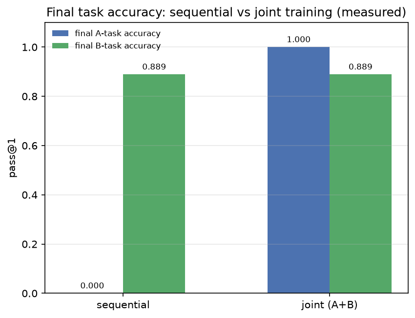

| Protocol | **A accuracy (final)** | **B accuracy (final)** |
|----------|-----------------|-------------------|
| **sequential** | **0.000** | 0.889 |
| **joint** | **1.000** | 0.889 |

This is as clean a result as this book produced.

**A note on what "0.000" does and does not show.** We measured the sequential run's A
accuracy **right after phase A and again after phase B** on the same trajectory. The
pre-B A accuracy was **1.000**; after learning B, the same run's A accuracy fell to
**0.000**. So the sequential zero is not a case of "A was never acquired" — A was
acquired to 1.000 and then lost. This is a **same-run before/after** measurement (the
sequential pipeline re-run with an intermediate A evaluation right after phase A and
before any B exposure; see Appendix C.8), which is what supports reading the sequential
drop as genuine forgetting of learned A competence rather than under-acquisition.

**Sequential training produces a much lower final A accuracy than joint training.** After
learning arithmetic and then lists in sequence, the model's final A accuracy is **0.000**;
when the two are trained together, the final A accuracy is **1.000**, with the same B
accuracy (0.889) in both. So the *training schedule* – whether the first capability stays
in the mix while the second is learned – is what differs, and that scheduling difference
changes the final A outcome. That is a *procedure* finding about final accuracy, regardless
of which of the two readings above the pre-B measurement supports.

**Training A and B together keeps A's final accuracy high.** When A and B are simply trained
together from the start (interleaved throughout), the model's final A accuracy is a
perfect **1.000**, and its final B accuracy is **0.889** — identical to sequential. So
training both from the start keeps A **with no behavioral trade-off** in B. Note that a
high final A accuracy in the jointly trained model is *not* "retention relative to an
A-only checkpoint" — there was never an A-only checkpoint; both were trained from the
start.

One honest note on the term "replay." This design interleaves A and B **from the start**
— which is really *joint training* on both, not "learn A first, then continue to B
while replaying A." Both answers are legitimate, but they are different questions. The
sequential condition is a true continual-learning setup (does learning B destroy A? —
yes, 0.000). The interleaved condition is a joint-training control (if both are seen
together, is there a forgetting problem at all? — no, 1.000). The timelines below make
the three designs explicit; note that the third (a true replay-after-A-first) was **not**
run — it is a separate experiment, not the one labeled "replay" in this chapter.

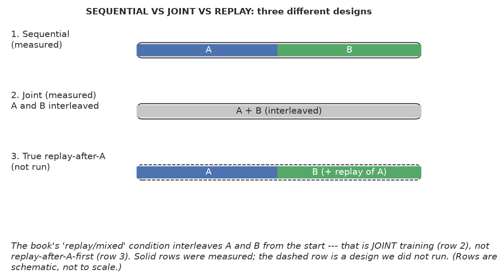

What this establishes is that **the forgetting seen under sequential training disappears
when the model is trained jointly on both.** It does not demonstrate that a replay
*buffer* salvages an already-trained first model — a stronger test would start from one
A-trained checkpoint and compare B-only vs B-plus-A-replay continuation from there.
Also, note what "no trade-off in B" does and does not mean: both protocols used the **same
example set and the same total step budget** (A and B examples; `steps_a + steps_b`), only
the *order and mixing* differed. So the joint result is **not** because joint training got
extra data, a longer run, or a bigger model — it is the same workload, interleaved rather
than sequenced. That is exactly the procedure finding. We did **not** quantify wall-clock
time or compute precisely enough to claim one schedule is "faster" or "cheaper," so we make
no such claim here; the measured comparison is final task accuracy, not resource cost.

## Why this result is so striking

The symmetry is what makes this remarkable. Under sequential training, the model
forgets A completely (0.000) but learns B fine (0.889). Under joint training, it keeps A
perfectly (1.000) *and* learns B just as well (0.889). Nothing about the model, the
data, or the optimizer changed — only whether the old examples stayed in the mix while
the new ones were learned.

This is the clearest case in the book where the **training protocol, not the model or
the data, determines the outcome.** Same model. Same data. Same optimizer. The only
difference is whether the first capability stays "in the mix" while the second is
learned. Sequential forgets; joint retains.

There is an intuition that makes this easy to see. Imagine a muscle being trained on
exercise A. If it then trains exclusively on exercise B and never revisits A, the
muscle's adaptation to A fades. But if A and B alternate, both stay. The model's
weights are like that muscle — the gradient signal from new examples keeps pushing
them, and if nothing pulls them back toward the old behavior, the old behavior
erases. Joint training is simply making sure the old examples are still in the rotation.

The lesson generalizes directly: when a new capability is added to a model, *how* it
is done matters more than any property of the model itself. If the new task is allowed
to dominate the gradient signal and the old data is removed, the old capability
collapses. If old and new stay interleaved, the model can hold both.

## Reframing a common assumption

And it reframes a common assumption. People often reach for "a bigger model" when
confronted with a model that forgets. This experiment shows the forgetting was not
resolved by anything we did to capacity — a ~0.9M model reaches high final scores on
both task groups when trained jointly (A: 1.000, B: 0.889). It was a *training
procedure* effect. We did **not** test a larger model as a forgetting intervention, so
we cannot conclude that a larger model would not also help here; what we can say is
that the forgetting was already fixable by changing the schedule alone, at this scale,
under these schedules.

The pattern here echoes a deeper truth we've seen all book: the headline number
("did it learn the new thing?") hides the interesting failure ("what did it lose to
get there?"). Measuring B acquisition alone would have made sequential training look
like a success — 0.889, great. Measuring A retention reveals the cost. The lesson is
to always measure *both* the new and the old.

## The shortcut audit

1. **Suspected shortcut: the 0.000 A-retention is an artifact of how we score A.**
   **Why it could explain it:** maybe the A test is too hard, or the model just needs
   more steps.
   **Control:** joint (A+B interleaved) training, identical A test — A-retention 1.000.
   **What it rules out:** a broken A test. The same test that scores 0.000 under
   sequential training scores 1.000 under joint training.
   **What remains:** whether the sequential 0.000 reflects *lost* A rather than
   *unacquired* A. The same-run pre-B measurement settles this: A was 1.000 right after
   phase A and 0.000 after B, so it is a genuine drop, not under-acquisition. Also
   whether this holds for three or more capabilities, and whether joint training
   lets the model *compose* A and B.

## The honest summary

This is a controlled, reproducible demonstration that the *training schedule* affects final
task accuracy: the same workload produces a 0.000 final A accuracy when learned sequentially
and a 1.000 final A accuracy when learned jointly, with identical B accuracy in both. The
same-run pre-B measurement (Appendix C.8) confirms the sequential drop is genuine forgetting:
A was 1.000 right after phase A and fell to 0.000 after B, so it was acquired and then lost
rather than never learned. We make no resource-cost claim: both protocols used the same
example set and step budget, and we did not quantify compute precisely.

What makes it feel like a real discovery is that the right answer was sitting in a
choice we made near-automatically. When we first set up the experiment, sequential
training was the path of least resistance — learn one thing, then the next. The
surprise came from asking the question we almost didn't ask: what did the model lose
to learn the new thing? And the fix — just keeping old examples in the mix — was so
simple it was almost anticlimactic. But that simplicity is the point. Sometimes the
most important finding in an experiment is not a complex technique but a simple
change to the way we were already working.

---

# 21. The Cost of Capability

We've measured what the model can do and where it breaks. This chapter answers the
last practical question: *what does each capability actually cost?*

The obvious "costs" — data, parameters, training time — are the easy ones. But the
real cost in machine learning is the hidden one: what it takes to make a capability
actually *robust* rather than just *appearing* to work. That's where the expensive and
surprising part lives.

## The two kinds of cost

There is a trap in how we usually talk about cost. We say "this model is 0.9M
parameters" or "this took 3,000 examples" or "it trained in an hour." Those are real
numbers, and they are *easy* to measure. But they measure the cost of *running* a
model, or of *fitting* it — not the cost of *capability* in the sense we care about.

What we actually care about is much harder to see, and this chapter is an argument
that it is the only cost that matters:

> **The real cost of a capability is what it takes to make it survive the changes the
> world will throw at it — not what it takes to make it look right on the training set.**

That distinction is the key to reading the results in this chapter. The model can be
*cheap* to produce and still *expensive* to make useful, because the cheap version
works only under conditions the real world will not respect.

## The cost matrix

Each row is a capability or behavior from our experiments; the columns are the
measurable costs — data, parameters, training steps, and — decisively — the
*generalization* cost.

| Capability | data (examples) | parameters | steps | in-dist pass@1 | surface generalizes? | composes? |
|------------|-----------------|------------|-------|----------------|----------------------|-----------|
| Single primitive (add, sub, …) | 1400 | 0.88M | 1500 | 0.900 | ✗ (new wording → 0.000) | ✗ |
| New identifier robustness | 1400 | 0.88M | 1500 | 0.900 | ✗ (0.350 on new IDs) | — |
| Composition (abs_add, sum_of_abs) | not achieved within tested budgets | 0.9M–29.3M | 1500 | varied by run (exposed) / **0.000** on held-out | ✗ | ✗ (0.000) |
| Continual: A then B (sequential) | 1400+1400 | 0.88M | 1400 | B: 0.889 | — | ✗ (A forgotten) |
| Continual: A+B (joint) | 2800 interleaved | 0.88M | 1400 | A: 1.000, B: 0.889 | — | ✗ |

\*The "exposed" cell is the score on combinations *shown* during training, which varied
across the exposure and diversity runs (0.550–1.000). The held-out composite — the real
composition test — is **0.000** in every run. We do not know how much data would be
needed to achieve composition; we only know it was not achieved within the budgets we
tried. Marking it "∞" would overstate an unmeasured quantity.

## What the costs tell us

**Capability is cheap; robustness is not.** Learning a single primitive costs ~1400
examples and a few minutes on a 0.88M model, and it "works" (0.900). So the *apparent*
cost of a capability is low. But that number is misleading: it measures only
in-distribution correctness.

**The real cost appears when we ask for generalization.** To make a single primitive
robust to *surface* change (new identifiers, new wording), the experiments suggest
the data would need to change substantially — diverse identifiers and wording — not
just add capacity. And composition is not purchasable at this scale at all: it stayed
0.000 at 0.88M, 6.5M, 10.2M, and 29.3M.

**The cost matrix makes a dangerous pricing error visible.** If we only look at the
"in-dist pass@1" column, we would conclude capability is nearly free and scale up
naively. The generalization and composition columns reveal that the cheap number
hides a much more expensive requirement — robust, compositional capability — which we
did not achieve by scaling data or capacity within our tested range.

## The price of each column, read honestly

Let us read the matrix the way a person who has to pay for capability would read it,
not the way a researcher who wants a good headline would read it.

- **A single primitive "costs" about 1,400 examples and a few minutes.** That is the
  cheap row, and it is genuinely cheap. But its surface-generalization column says
  ✗ and its composition column says ✗. So we have bought a capability that works one
  way, one time.
- **New-identifier robustness** is the next row. It costs the *same* 1,400 examples,
  and still fails (0.350 on new IDs). We cannot buy this with more of the same.
- **Composition** is the row that tells the sharpest story: it is marked
  "not achieved within tested budgets" for data, and the budget commentary at the
  bottom spells out that we simply do not know how much data would be needed — it was
  not achieved in any range we tried. The parameter column spans 0.9M–29.3M, and it
  made no difference in the runs we ran.
- **Continual learning** is the most interesting row for a practitioner, because it
  is the one where the *cost changed at no cost*. Sequential training loses A (0.000
  final A accuracy); fitting on A and B jointly keeps A at 1.000 with B acquisition
  unchanged at 0.889. That is, one capability came back with no extra data or compute —
  just a different training schedule. (We note the actual resource budgets are not
  fully quantified, and the true replay-after-A-first design was not run; see Chapter
  18.) Cost is not always toward "more expense"; the right procedure can make a
  capability cheap.

## The brewing experience: discovering the hidden cost

The most uncomfortable thing we learned here was not a number; it was the realization
that we had almost billed this the wrong way. Early in the project, the model looked
cheap: tiny, fast to train, scoring 0.900. If we had been delivering a system rather
than running an experiment, we would have handed over a "working" model and called it
a good deal.

Then we reworded a single prompt. The model collapsed to 0.000. The capability we
thought we had bought was not really there — it only existed inside a narrow surface
form. That is the moment the "cheap capability" turned out to be the most expensive
thing we had measured, because it would fail in exactly the way a deployed system
fails: quietly, late, and in the hands of a real user who does not phrase things the
way the training data did.

That is why we now insist on reading the generalization columns, not just the accuracy
column. A model that is cheap to fit but expensive to deploy is the wrong thing to
build unless we know the generalization cost going in.

## The honest framing

The most honest "cost" we measured is the cost of **mistaking surface association for
grounded capability**. That cost is high: it makes a model that scores 90%
in-distribution *look* capable while it collapses to 0.000 on any change to the
surface. In a deployed system, that is precisely the failure that appears late and
costs the most.

So the real answer to "what does each capability cost?" is: the easy-to-see cost
(data, parameters, steps) is small and scales predictably; the hard-to-see cost —
making the capability actually generalize and compose — is where the true expense
lies, and at this scale it is simply not purchasable with more of the same resource.

And there is a bright spot in the matrix worth holding onto. The continual-learning
row shows that cost is not always "more of everything." Sometimes, the same inputs,
the same compute, and the same model buy a capability that was previously lost — for
free — simply by choosing a better procedure. Cost, like capability, is often about
*how* we do things, not *how much* we spend.

---

# 22. The Capability Map

We have run a small, disciplined set of experiments and measured a coherent boundary.
Rather than a list of results, let us draw the **capability map**: one picture that
says, for each behavior we tested, whether the model acquired it, whether it generalizes,
what it costs, and where it breaks.

Everything below is scoped to **our** setup: a ~0.9M–29.3M decoder-only transformer,
trained on a few thousand generated natural-language-to-Python tasks, evaluated by a
mutation-tested execution-based judge. These are claims about this brew, not universal
laws about all small models. Where we say "here" or "in this regime", it is deliberate —
these are well-controlled measurements in one configuration, not proofs that hold
everywhere.

## Why a map, and not a single score

There is a strong temptation, at the end of an investigation, to reach for one number
and say "that's the verdict." It would be satisfying and simple. But every experiment
in this book has argued against exactly that. The model is good at some things and
terrible at others, and those are both true at once. A single number would have to
collapse them, and collapsing them would hide the most important thing: the *shape* of
the boundary.

So we draw a map instead. A map does not pretend to be one verdict; it shows
*dimensions*. It answers, for each question we asked, what we found — and, crucially,
what we did *not* find. That honesty about the unknown is what makes the map worth more
than a headline.

## The four-question generalization map

Recall the four questions from Chapter 2. Here is what we measured for each, on the
~0.9M model. (This is a checklist of *questions*, not a ranking — answering Question 2
does not require answering Question 1, and so on.)

| Question | What it asks | Measured result | Status (in this setup) |
|-------|--------------|-----------------|--------|
| **Q1 Mem** | Could it be explained by remembering? | task-ID probe 59/60; held-out pair → general program | `[MEASURED]` not literal answer-parrots on familiar prompts; new-prompt transfer **not** tested (pilot reuses training prompts) |
| **Q2 Dist** | Does it work on new instances of the same task? | In-distribution 0.900 | `[MEASURED]` yes — here (new *inputs*, familiar prompt) |
| **Q3 Surf** | Does it survive superficial change? | *Narrowly-trained model:* new wording → 0.000; new identifiers → 0.350. *Diversity-trained model (same count):* **1.000 / 1.000** — but the strong form ("generalizes to a never-seen family") is not established, since the surface test's family & identifiers were present in the diverse pool | `[MEASURED]` — brittle when trained narrowly; diverse training covers more surfaces (generalization to a truly-held-out family untested) |
| **Q4 Struct** | Can it compose known pieces in unseen ways? | 0.000 (baselines also 0.000) | `[MEASURED]` no — in this regime |

### The evidence, keyed by checkpoint

The table above groups results by *question*. But each number belongs to a specific
**checkpoint** (a saved model) and a specific **evaluation split**, and it is important
not to let one row mix scores from different models. Here is the same evidence laid out
run by run, so every cell traces to the checkpoint the registry names. Notation used
throughout: `—` = **not run for that checkpoint**; `NT` = **not tested** for this run
(the question would be applicable but was not evaluated); `NA` = **not applicable** (the
question cannot apply, by design); `0.000` = a measured zero. A single `—`/`NT`
distinction: we only use `NT` when the evaluation *could* have been run but was not, and
`NA` only when it makes no sense for that run.

**Panel 1 — code-generation evaluations, by checkpoint**

| Checkpoint | params | familiar prompt | new identifiers | excluded wording | covered alternate surface | held-out composite |
|---|---|---|---|---|---|---|
| `stage1.pt` (Stage 1 pilot) | 0.88M | 0.897 | — | — | — | 0.000 |
| `stage3_surface.pt` (Stage 3) | 0.88M | 0.900 | 0.350 | 0.000 | — | — |
| high-diversity (same count) | 0.88M | 1.000 | — | NT | 1.000 | — |
| `stage4_6p5m.pt` | 6.5M | 0.897 | — | — | — | 0.000 |
| `stage4_10m.pt` | 10.2M | 0.773 | — | — | — | 0.000 |
| `stage4_composition.pt` | 29.3M | 0.897 | — | — | — | 0.000 |

Key: the surface-row scores (new identifiers 0.350, excluded wording 0.000) come from the
**Stage-3 checkpoint**, not the Stage-1 pilot. The composition score for `stage1.pt` is a
separate re-evaluation of the pilot on the composition split (which is why the registry
lists a "Stage-4 composition baseline" row that points at `stage1.pt`). The high-diversity
row's 1.000 is **coverage** of surfaces in its training family, not transfer to an
excluded wording family.

**Panel 2 — composition-intervention and continual-learning runs**

These conditions are not "one bigger model"; they test whether *training content* or
*schedule* changes the boundary, so they belong in their own panel.

| Condition | params | in-dist | exposed composites | held-out composite |
|---|---|---|---|---|
| composition-exposure (stage4_exposure) | 0.88M | 1.000 | 0.667 | 0.000 |
| composition-diversity (minimal) | 0.88M | 1.000 | 0.592 | 0.000 |
| composition-diversity (high) | 0.88M | 1.000 | 0.550 | 0.000 |

**Panel 3 — sequential vs. joint training**

| Protocol | final A accuracy | final B accuracy | true replay-after-A |
|---|---|---|---|
| Sequential (A then B) | 0.000 | 0.889 | NT |
| Joint (A+B from start) | 1.000 | 0.889 | — |

Note the "sequential" A figure is a **final task accuracy**, not "retention relative to a
pre-B checkpoint" — there was no A-only checkpoint to retain against. A true
replay-after-A-first continuation (which *would* measure retention relative to an
A-trained checkpoint) was **not** run.

Read the map column by column and it shows a clear boundary rather than an ordered
ladder: the four questions are **separate evaluations**, not steps of a single ascending
scale. So do not read "Level 1 → Level 4" as a measured decline in "understanding." The
honest reading is that these are four distinct, non-nested probes, and the model passes
the first two (familiar-prompt generation, new-instance distribution) and fails the last
two (surface change, composition) under this setup.

## What the model can do

**It can learn individual operations well.** On in-distribution primitives — `add`,
`sub`, `mul`, `max`, `abs`, `list_sum` — the ~0.9M model solves ~90% of held-out
problems under the evaluation's default temperature-0.8 sampled decoding. It beats a hand-written template rule system (0.900
vs 0.800). This is real, measurable capability on a narrow task.

**It produces general programs for fresh inputs of a prompt it saw in training.** On the
task-ID probe it passed 59/60, and on a held-out pair it produced the *general* program
rather than a memorized literal. So for a single operation, the model is not a literal
answer-parrot on familiar prompts. That is distributional generalization across *instances*
of a seen prompt — it is **not** transfer to a genuinely new request, which the pilot did
not test (its test reuses training prompt strings).

## What the model cannot do

**It cannot survive changes to the surface form.** Change the variable names from
`a,b` to `left,right` (identical computation) and performance falls to 0.350. Rephrase
the instruction with a wording family the model never saw (identical computation) and
performance falls to **0.000** — below *both* baselines. This is Question-3 failure: the
model's capability is **anchored to the phrasing**, not grounded in the computation.

**It cannot compose what it knows.** Train on `add`, `sub`, `abs`, `max`, `list_sum`
as separate primitives; test on `abs_add` (sum of two absolute values) and `sum_of_abs` — operations that combine two things it knows. The model scores **0.000**. It
did not learn "I know abs and I know add, therefore I can do abs+abs." This is a
Question-4 failure under these schedules. The baseline systems (which we designed to be
easy) *also* scored 0.000 — a useful cross-check that the failure is not unique to the
learned model, though it is a measured negative, not a proof that no method or shortcut
could ever solve it.

## The two axes of the boundary

Put together, the results define a sharp boundary along two independent axes:

**Axis 1 — Surface form.** The model's knowledge is tied to the exact wording and
identifier names it saw. It does not generalize "sum of two numbers" as an abstract
concept; it generalizes "this sentence shape → this code." Change the surface, and the
capability evaporates.

**Axis 2 — Composition.** Even within a surface form it knows, the model did not
combine two learned pieces into a novel structure in our tests. It behaved as if it
lacked a compositional engine here.

## The scaling map (what changes it)

| Lever | Tested | Effect on composition |
|-------|--------|-----------------------|
| Model size | 0.88M → 29.3M (~33×) | **none** — still 0.000 at all four sizes |
| Data size | 100 → 3000 examples | helps *in-distribution* (0.10→0.64); **composition not tested** in this run (we did not evaluate the scaled models on the composite split) |
| Training protocol | sequential vs joint | **big** — fixes continual retention (0.000→1.000); a *different* lever, not a composition lever |

The second half of the map is about levers, and it is where the surprising findings
live. We tried three ways to move the boundary — more capacity, more data, and a
different training procedure. More capacity did nothing to composition (0.000 at all
four sizes); more data was only evaluated on the in-distribution task (composition was
not tested in the scaling run); and a different training procedure was the decisive
lever for a *different* problem (continual learning), not for composition. This
asymmetry is worth circling, because it tells us where effort does and does not pay.

## The capacity grid, in full

The sharpest negative result in the whole book is the model-size sweep, and it deserves
its own table because it is the claim a reader would most want to test. We ran the
composition experiment across a ~33× range of capacity. We did **not** hold every
hyperparameter constant — the runs used different step counts (see Appendix C), so this
is a sweep across capacity with some training-budget variation alongside it, not a
strictly-controlled size-only comparison.

| Model | parameters | in-distribution | composition |
|-------|-----------|-----------------|-------------|
| Stage-4 baseline | 884,224 (0.88M) | 0.900 | **0.000** |
| Scaling | 6,500,352 (6.5M) | 0.897 | **0.000** |
| 10M point | 10,195,776 (10.2M) | 0.773 | **0.000** |
| 30M point | 29,290,240 (29.3M) | 0.897 | **0.000** |

Four sizes. Composition is **0.000 at all four** under the schedules we ran. That is
the same number repeated across a 33× change in the one resource we might otherwise
blame. We would be careful not to over-read it: because the step counts differed, this
is evidence that capacity alone, under these runs, did not produce composition — it is
not a proof that capacity *cannot* (there may be a threshold, or different training
budgets, we did not reach).

Two honest notes on the grid. First, in-distribution scores sit in a healthy plateau
(0.773–0.900) across all four sizes — capacity neither helped nor hurt the narrow task.
(One 10.2M reading of 0.383 turned out to be a training-run artifact.) Second,
in-distribution performance is **not** a monotonic ladder that predicts the deep
boundary: the models that reached 0.900 in-distribution scored 0.000 on composition,
exactly like the one that reached 0.773. Capacity that helps the shallow score does
nothing for the deep one.

## What's measured vs. what's unknown

**Measured (this setup):**
- The model learns single operations to ~90% in-distribution and generalizes them
  across instances (Q1/Q2).
- The *narrowly-trained* model is surface-tied: new wording → 0.000, new identifiers →
  0.350 (Q3). The *diversity-trained* model (same count) reaches 1.000/1.000 on the
  tested surface — though, as the caveat notes, that is strongest as a coverage
  statement, not proof of generalization to a wholly unseen wording family.
- It cannot compose: unseen combinations → 0.000 across 0.88M→29.3M capacity (the
  model-size sweep tested composition at each size). **Caveat:** the *data-size* sweep
  (Chapter 11) tested in-distribution accuracy only, not composition, so we do **not**
  claim that more data likewise fails to help composition — that specific
  "more data doesn't fix composition" claim was **not** tested and is not made here
  (Q4).
- Continual learning is a procedure problem: sequential forgets (A → 0.000), joint
  retains (A → 1.000) with no acquisition cost.
- The pilot task was retrieval-solvable (retrieval = 1.000), so that split is "too
  easy"; the composition split is not (all baselines 0.000).

**Supported / suggestive / open:**
- The composition failure is now **tested twice, not simply suggestive**: (a) exposure
  to a few composites during training does **not** unlock composition on unseen ones
  (the model memorizes the seen combinations at 0.667 but stays at 0.000 on held-out
  ones); and (b) diversifying the *surface* of the composite exposure (many phrasings ×
  id-sets) also leaves the held-out composite at **0.000**. So it is neither a "just
  show it combinations" fix nor a "diversify the phrasing" fix.
- The one lever we have **not** isolated is diversity of the *inner structure* — many
  *different* primitive pairings rather than different phrasings of the same few. That
  is the remaining open experiment.
- Whether the composition wall is truly structural or simply sits above our ~30M
  ceiling is **untested** — we stop where the CPU lab becomes impractical.

**Unknown (did not test):**
- Whether behavior on 3+ capabilities or post-continual composition holds.
- Whether a fundamentally different inductive bias (not scale) helps.

## The methodology findings

Independent of the model, the **methodology** produced its own results — and several are
as valuable as any model number:

- **Test the tester.** Our own evaluator reported the model at 0.000 on its first run.
  It was the *judge* that was broken (a null-byte artifact), not the model. Fixing it
  revealed the true 0.897. Never trust a number from a system we have not audited.
- **Test the teacher.** The leakage audit caught a 100%-predictable operation from the
  pilot wording — which, on reflection, is mostly task signal (the request must name
  the operation), not a leak. This is why surface splits need held-out template
  families.
- **Test the data.** The diversity-vs-quantity experiment showed the *same* example
  count produces surface-fragility (0.000) with minimal diversity or much broader
  surface coverage (1.000) with high diversity. Diversity — not quantity — is what
  changes how much surface the model covers. (This is coverage of the surfaces in the
  training family; it is not established transfer to a wording family excluded from
  training.)
- **Baselines are first-class.** A trivial TF-IDF retriever dominated the pilot task
  (1.000), proving it was "too easy," and forced us to build harder splits. And the
  moments the model *fell below* a baseline were the most informative results.
- **The protocol, not capacity, determines continual learning.** Sequential training
  destroyed capability A (0.000) when learning B; joint training preserved A perfectly
  (1.000) at no cost to B. This is a *procedure* finding.

## The boundary, in one line

> **A small model learns narrow, individual mappings well and generalizes them across
> instances, but its knowledge is surface-tied and non-compositional — and within the
> tested range, neither more parameters nor more data turns that into robust,
> compositional capability. (We also tested a scheduling change — sequential vs. joint
> training — but that experiment measured retention of *separately learned* task
> groups, not composition, so it does not speak to the composition boundary.)**

## Why the map is the deliverable

This map is the book's real output. It is not a single headline accuracy that would
mislead; it is a precise, honest picture of where capability exists, where it collapses,
and what (and what doesn't) shift the boundary. It is the answer to the central
question — and it is falsifiable, built from real measured runs, and honest about what
remains unknown.

### A syntax/capability inventory (kept distinct)

The four questions above are about *generalization*. Separately, the task family can be
viewed as a ladder of Python syntax/capability (from arithmetic to composition), and it is
worth recording which rungs we actually *isolated* versus which we did not. This is a
*syntax* inventory, distinct from the four generalization questions, and we keep it
separate so it is not read as another trust ladder:

| Rung | Capability | Was it isolated? |
|------|-----------|------------------|
| 1 | arithmetic | ✅ measured, ~0.90 in-distribution |
| 2–3 | variables, conditionals | ✅ variables measured (~0.90); conditionals appear inside the reference for `max_of`/`min_of`/`abs` but were **not isolated** as a standalone task |
| 4–5 | lists, indexing | partially — `list_sum`/`list_len` measured; indexing appears in `first_element`/`double_first` but was **not isolated** |
| 6 | loops | **not isolated** (no standalone loop operation in the primitives; loops appear only inside `list_sum`'s reference) |
| 7 | **composition** | ❌ **0.000** — the wall |
| 8 | simple functions | not isolated (the task is always "write one `solve` function") |

The honest reading is narrow: we measured individual operations well, and composition
fully; the intermediate rungs (conditionals, indexing, loops as independent skills) were
**not** isolated, so we do not claim about them either way. What we can say is that the
model climbs the rungs we isolated reliably and stops at composition.

The deeper value of the map is what it does to our confidence. Before drawing it, we
knew "the model is limited." After drawing it, we know more precisely which limits we
*moved* with a lever and which we *did not*: composition and surface-tiedness were not
moved by scale or more-of-the-same data (in our runs), while continual forgetting was
both seen and fixed by how we trained. We are careful not to call the unmoved ones
"structural" as if we had proven their cause — we observed that the tested levers did
not reach them.

That distinction — which limits we could move and which we could not — is the kind of
knowledge that changes what a practitioner would try next. It is not the same as saying
"small models are weak"; it is saying "here is where the weakness lived under our tests,
and here is what did and did not reach it." A map with a blank region is more useful
than a map painted over with speculation, because the blank marks where the next
investigation should go.

This is also **not** evidence that the model is "stupid" or that the approach "doesn't
work." The model is good at exactly what it was trained to do — map a narrow phrasing to
a narrow computation — and bad at the two things that separate "reflex" from
"capability": robustness to surface change, and composition. The value of measuring it
precisely is that it tells us *where* to look next.

---

# 23. The Model Wasn't the Point: A Conclusion

We began with a question that sounded technical: *can a small language model learn to
solve programming tasks?* The answer we got was more interesting and less about the
model than we expected.

## Where the journey started

The premise was: building a small model is relatively easy; determining what it actually
learned is the hard part. That premise turned out to be more accurate than we had any
right to expect. The model was built in an afternoon. Understanding what it had — and had
not — learned took the rest of the book.

A decoder-only transformer that maps a handful of programming sentences to Python is an
afternoon's work once the pieces are in place. But *knowing what that model actually did*
— whether it learned, memorized, associated, or cheated — required a world, a teacher, a
judge, rivals, and a battery of controlled experiments. The model was the easy part. The
certainty about what it did was the hard part, and it is the part worth writing about.

## What the experiment established

At the core, the answer to the book's central question is now clear and measured. The
experiments separate cleanly into what the model **can** do and what it **cannot**.

**It can learn, and it learns well — within a narrow regime.** On individual operations,
the model reliably maps a natural-language spec to correct Python, reaching **~0.90
pass@1** in-distribution on a 0.88M parameter model. It produces general programs for
*fresh inputs of a prompt it saw in training* — a task-ID probe passes 59/60 and a
held-out pair yields the general program, not a memorized literal. That is genuine,
if narrow: it is **not** transfer to a genuinely new request, because the pilot's test
reuses training prompt strings.

**But it is surface-tied and non-compositional.** The two limits that matter:

1. **It anchors to phrasing, not meaning.** Change the variable names (`a,b` →
   `left,right`) and it drops to 0.35; change the wording (same computation, different
   words) and it falls to **0.000** — below both baselines. The external reality check
   confirmed it: a human-written test set scored **0/16**, because the model learned a
   *template*, not the *task*.

2. **It cannot compose what it knows.** Train on `abs` and `add` separately, then ask
   for `abs_add` — it scores **0.000**. The baselines also collapse to 0.000, so the
   failure is a *measured negative*: no method we tried — learned, retrieval, or
   template — produced a composite program. (This is a strong negative signal, not a
   proof that no cleverer method could; see the shortcut audit in Chapter 16.)

**One limit was moveable — by changing the data, not its quantity.** Diversity of
surface phrasing is the one lever in the book that changed the surface outcome: a
narrowly-trained model dropped to **0.000** on the surface test, but a model trained on
the *same count* spread across many phrasings and both identifier-sets scored **1.000**
on the covered surfaces. That result is explicitly a **coverage** improvement, not a
proven transfer to a never-seen wording family (which the book could not establish from
that design). So the picture is more than "small models are fragile": *content diversity*
widens what a small model handles. More *capacity* (0.88M→29.3M) also did not lift the
compositional limit. **We do not claim the same for more *data*:** the data-size sweep
tested in-distribution accuracy only, not composition, so whether more data would help
composition is a question we did not test and do not assert.

**The scaling conclusion is our sharpest negative result.** Composition stays at
**0.000** across model sizes from 0.88M to 29.3M, under the training schedules we ran.
Within that tested range, more capacity did not buy composition. We are careful not to
call this a capacity "ceiling": it is a measured boundary in this regime, not proof
that capacity cannot help under other conditions (different training budgets, larger
sizes, or different optimizers).

## What the laboratory produced along the way

The experiments told a clean, coherent, honest story — and the laboratory caught
itself. The first time we evaluated the model, it scored 0.000 — and it wasn't the
model's fault. The evaluator was broken (a NUL-padding artifact in the output made
every program fail to parse). Fixing the *tester* revealed the model's true 0.897. That
moment — discovering our own instrument was wrong before we trusted it — is as much a
part of this book as any model result.

## The deeper achievement

The book's real finding is not "small models are limited." It is:

> **Building a trustworthy experiment was harder and more valuable than building the
> model.**

The model was the instrument. The experiment was the subject. The things that made this
work — the sandbox that rejects anything not explicitly allowed, the judge that executes
code and compares semantics rather than strings, the mutation suite that red-teams the
judge, the leakage audit, the baselines that ask "could a simpler machine do this?", the
four-question taxonomy that refuses to collapse everything into one number — those are the
actual achievements here.

Each of these forms a discipline rather than a checklist. The sandbox's allowlist (not a
blocklist) meant the model could never do something we did not intend, so a failure
could always be attributed to the model rather than to an accident of environment. The
judge's execution-based, semantic comparison meant a "correct" answer was objectively
correct, not merely stylistically close. The mutation suite meant we doubted the judge
before we trusted it. The baseline comparisons meant a number only had meaning relative
to a simpler machine. And the four-question taxonomy meant we never overstated a result by
collapsing different kinds of generalization into one score.

## The recurring habit

There is a way of thinking that runs through everything here, and it is worth naming
directly because it is what a careful investigation actually looks like. It is the habit
of distrusting the easy answer — including our own.

Every time we got a number, the next step was not to celebrate or to move on. It was to
ask: **how could the model have gotten this without learning what we think it learned?**
Could it have memorized? Retrieved? Exploited a template? Leaked the answer from our own
data? Hit a bug in our evaluator? Each of those is a way a seemingly-impressive result
can be hollow, and each one we then built a control to test. That constant, deliberate
suspicion — aimed at our own apparatus as much as at the model — is the difference
between "we ran an experiment" and "we know what the experiment means."

Beyond the numbers, there is a way of working this book was really about. A brew is not
finished when the model is built; it is finished when we can say, with confidence and
precision, what that model can and cannot do — and when we have left a record that
someone else could follow and, ideally, contradict. It is seldom a straight line from
hypothesis to clean result. It is a loop of building, testing the builder, being
surprised, and revising. The surprise is not a detour from the method; it is the method.
And a book about science should show that loop, not hide it.

## What the reader takes away

If we take one thing from this book, it is a habit, not a fact:

> **Never trust a number from a model we don't understand, or from an experiment we
> haven't audited.**

Before we believe "the model learned to add," we have to be able to answer: remove the
memorization, the retrieval, the templates, the leakage, the evaluator artifacts — what
remains? In our case, for simple primitives, what remained was genuine
learning-within-a-surface-form. It was real, and it was narrow, and it did not compose.

**Build the model. Test the model. Break the evaluator. Break the model. Audit the
data. Challenge the conclusion. Repeat.** Only then say: "This is what the model
learned."

## Where this brew leads

The honest map points at specific next experiments, not vague "more data / bigger model":

1. **Does *structural* diversity of combinations unlock composition?** We tested two
   things and both failed: (a) feeding a few composites during training (held-out still
   0.000), and (b) diversifying the *surface* of the composite exposure (many phrasings
   × id-sets; held-out still 0.000). So the remaining open question is diversity of the
   *inner structure* — exposing the model to many *different* primitive pairings — to
   see whether that teaches a general compose-operator. That is the one lever we have
   not isolated.
2. **Does the 10.2M in-distribution plateau replicate across configs?** The clean retrain
   measured 0.773 (a stable plateau, not the earlier 0.383 artifact). A proper
   training-duration and config sweep at 10M would confirm the plateau is robust.
3. **Does continuing to scale past 30M shift the boundary?** The grid stops where the
   brew lab's CPU becomes impractical. A larger-scale run (or a GPU) would probe whether
   the composition wall eventually moves.
4. **Does diversity fix composition?** Diversity fixed the *surface* problem (0.000 →
   1.000). Whether the *same* lever helps composition is the natural next test of the
   "structural data" hypothesis.
5. **Human-style training.** The 0/16 human test set shows the model fails on
   naturally-phrased prompts. Training on diverse, human-style prompts is the obvious
   path to real usability.

### A future note on widening the world

One planned direction is **widening the capability spec** — giving the model more Python
(loops, indexing, richer structures) and re-measuring. We did **not** run a full sweep of
"add more Python and re-measure" in this book. What we did measure is that the
composition failure is not explained by a simple missing-token deficit: the model wrote
valid programs for the primitive operations, whose tokens it clearly knew. But that does
**not** prove the model has full *nested* syntax competence — the observed failures were
malformed fragments, and knowing the tokens for `def`/`return` is not the same as
producing correctly nested compound expressions. So we treat "not a syntax problem" as a
plausible-but-unestablished reading, and leave the mechanism open. The versioned,
step-by-step widening framework (the capability spec's `v0_1`, `v0_2`, …) is how we would
test new capability, and we state it as a proposal for the future rather than a completed
result.

## The honest ending

The model was the instrument. The experiment was the subject. We did not build a general
programmer, and we will not pretend otherwise. What we *did* build is the means to ask,
precisely and honestly, what a small model can and cannot learn — and we got an answer
worth having:

> A small model learns narrow tasks well, but its knowledge is surface-tied and
> non-compositional; more capacity (0.88M→29.3M) does not change the compositional
> limit. Whether more *data* would is a question we did not test.

And the habits we learned — test the tester, test the teacher, compare against baselines,
audit shortcuts, preserve failures — are the durable part. That is the method worth
keeping, and it is the reason the book's real subject was never the model. The brew was
never only about the model; it was about learning to ask a question carefully enough that
the answer could be trusted.

## Where this sits: related work

None of the ideas here is new in isolation, and we want to say so plainly rather than
imply novelty. This book's contribution is not inventing a technique; it is assembling a
small, fully-controlled laboratory and being unusually honest about what the results do
and do not establish. The underlying disciplines have long histories, and a reader who
wants to go deeper should look there:

- **Compositional generalization.** The question of whether a model can combine known
  pieces in novel ways is a longstanding benchmark problem (e.g. the SCAN and COGS
  datasets). Our finding — that a tiny model does not compose under our tests — is a
  narrow case of a much-studied puzzle.
- **Execution-based code evaluation.** Running generated code against hidden tests is
  the standard for code-generation evaluation (the pass@k / HumanEval tradition). We
  borrowed that idea and applied it at a miniature scale, and our mutation-control work
  echoes the broader practice of testing the evaluator itself.
- **Shortcut learning.** "The model found an easier signal than the one we intended" is
  a well-documented phenomenon; our shortcut audit is a small, disciplined instance.
- **Catastrophic forgetting and rehearsal.** The effect we measured is a classic
  finding; the observation that keeping old data in the mix helps is also
  long-established.
- **Mutation testing.** Originating in software engineering, it is the source of our
  judge red-team.

We cite these traditions to place the book in context, not to claim we advanced them. We
did not benchmark against these in this book (the task and scale are far smaller), so we
make no claim of competing with them.

## Reading further

These are the published works the book's questions relate to, cited with stable
identifiers (DOI or ACL Anthology / arXiv record) so a reader can verify each. One line
each on why it matters for the questions here. We have not benchmarked against any of
them — the task and scale here are far smaller — so we make no claim of competing with
them; the citations place the book's questions in context.

- **Compositional generalization.** Lake & Baroni, *Generalization without Systematicity:
  On the Compositional Skills of Sequence-to-Sequence Recurrent Networks*, ICML 2018.
  Introduced the **SCAN** benchmark, which probes exactly the "new combination of known
  pieces" question (the book's Question 4) and found seq2seq models largely fail it.
- Kim & Linzen, *COGS: A Compositional Generalization Challenge based on Semantic
  Interpretation*, EMNLP 2020, pp. 9087-9105 — https://aclanthology.org/2020.emnlp-main.731/
  . COGS is a **semantic-parsing / compositional-generalization** dataset (fragments
  grounded in a small world language), not a question-answering benchmark. It showed
  seq2seq models achieving much lower accuracy on novel combinations than on
  in-distribution examples — the same in-distribution vs. compositional gap the book
  measures.
- **Execution-based code evaluation.** Chen, Tworek, Jun, Yuan, et al., *Evaluating Large
  Language Models Trained on Code*, arXiv:2107.03374, 2021 (HumanEval / Codex). The
  pass@k formulation the book adapts to problem-level pass@1, and the insight that
  *executing* a program against tests is a sharper evaluation than comparing text.
- **Shortcut learning and spurious correlation.** Geirhos, Jacobsen, Michaelis, Zemel,
  Brendel, Bethge, & Wichmann, *Shortcut Learning in Deep Neural Networks*, Nature
  Machine Intelligence 2020. The conceptual framework for asking "did the model learn
  the task, or a shortcut to it?" — the question the book's surface test (Question 3)
  and lexical diagnostic address directly.
- **Continual learning and catastrophic forgetting.** McCloskey & Cohen, *Catastrophic
  Interference in Connectionist Networks: The Sequential Learning Problem*, in *Psychology
  of Learning and Motivation*, pp. 109-165, 1989 — https://doi.org/10.1016/S0079-7421(08)60536-8
  . (The original
  forgetting result); and Kirkpatrick et al., *Overcoming Catastrophic Forgetting in
  Neural Networks*, PNAS 2017 (elastic weight consolidation, a rehearsal-free
  alternative). These frame the book's sequential vs. joint training result.
- **Mutation testing of test suites.** Jia & Harman, *An Analysis and Survey of the
  Development of Mutation Testing*, IEEE TSE 2011. The practice of seeding faults to
  measure a test suite's ability to catch them — the basis of the book's judge
  red-teaming in Chapter 17.

## Three short exercises

If you want to check that you have the book's discipline, try these. Answers are in the
back of this chapter.

**1. Coverage or generalization?** You train a model on three wording families and
evaluate it on a fourth that it has never seen. It scores 0.900. Is that a coverage
result or a generalization result? What if instead you evaluated it on a *rephrasing
within one of the three families it saw* — is *that* same interpretation?

**2. Distinguish two programs.** For the two functions `abs(a + b)` and `abs(a) + abs(b)`,
find one input where they give the same answer and one where they differ. Why does a
single passing test not distinguish them, and what kind of test does?

**3. What does a zero establish?** A model scores 0.000 on a held-out composition split.
Write down what this does and does *not* establish — name at least two other causes of a
zero that the result does not rule out, and one thing you could run to distinguish them.

*(Answers: 1. The first is generalization to an excluded family; the second is coverage
of a surface within the training family. Only the first speaks to a never-seen *family*.
Note that a genuinely new prompt *within a familiar family* is still a real form of
in-distribution generalization (a new surface, same computation) — "excluded-family
transfer" is a stronger and different shift, not the only form of generalization the
book measures. 2. For `a = 2, b = 3` both give `5`; for `a = -3, b = 2`
they give `1` and `5`. One test can be satisfied by both programs, so a distinguishing
test must use a signed input where the two differ. 3. The zero shows that, under this
decoding/evaluation procedure, no program passed every hidden test. It does not
identify the cause (instruction interpretation, syntax generation, length handling,
coverage, optimization, or a particular held-out operation), is not proof of a general
capacity limit, and is not proof that the model "cannot compose" — a per-stage failure
report or an all-composites control would narrow which cause holds.)*

---

# Appendix A — The Generator, Every Piece

Chapter 5 describes the teacher conceptually. This appendix shows the actual source, so we can see — and reproduce — exactly how the data was made. All of this lives in
`src/data_generator/` and `src/program_generator/`, `src/nl_renderer/`,
`src/test_generator/` in the companion repository.

A note on what follows: this is a **condensed, annotated excerpt** of the
real generator, not a complete runnable file. Where a section repeats in the same
style for every operation, we mark it with an ellipsis (`...`). A few helpers that
would be defined elsewhere in the source — the `OPERATIONS` table, `_rand`, and
`_expected` — are used here as-is; the point is to show the *shape* of each part and
how the semantic record flows through it, not to provide every line that would appear
in a standalone module. The full, runnable source is in the repository.

## The one line that ties it together

The whole generator is this single function. Given an operation and a seed, it builds
the semantic intent and then generates everything else from it:

```
def make_task(operation, task_id, seed, id_set="letters", split="train",
              family=None):
    rng = random.Random(seed)
    sem = make_semantics(operation, rng, id_set)     # the ground truth
    ref = generate_reference(sem, rng)               # the correct Python
    prompt, fam_name = render_nl(sem, family=family, rng=rng)  # the English
    tests = generate_hidden_tests(sem, rng=rng)      # the hidden tests
    return {
        "task_id": task_id,
        "semantics": sem,
        "reference_code": ref,
        "nl": {"prompt": prompt, "template_family": fam_name},
        "hidden_tests": tests,
        "metadata": {"seed": seed, "identifier_set": id_set,
                     "paraphrase_family": fam_name},
        "spec_version": "python_capability_v0_1",
        "dataset_version": "v0_1",
        "split": split,
    }
```

That's the whole architecture in ten lines. Everything below is one of the four
building blocks it calls.

## 1. The semantics

```
IDENTIFIER_SETS = {
    "letters": ["a", "b", "c", "x", "y"],
    "words":   ["left", "right", "first", "second", "value", "numbers", "items"],
}

def make_semantics(operation, rng, id_set="letters"):
    n = OPERATIONS[operation]                      # arity
    names = list(IDENTIFIER_SETS[id_set][:n])      # pick names from the set
    arg_type = ("list" if operation in
                ("list_sum", "list_len", "first_element") else "int")
    # Every operation here returns an int scalar. Lists appear only as INPUTS
    # (a list of ints); list_sum/list_len/first_element all return an int, not
    # the list itself. So output_type is always "int"; only input_types vary.
    output_type = "int"
    args = [{"name": names[i], "type": arg_type, "role": "operand"} for i in range(n)]
    return {"operation": operation, "args": args,
            "input_types": [arg_type] * n, "output_type": output_type}
```

*This is the pilot's condensed type-dispatch excerpt, so it marks only the three
pilot list-operations as list-input. It is **not** the full dictionary* — the composite
list operations (`sum_of_abs`, `double_first`, `len_minus_one`) also take a list but are
built by the composition path, not this `make_semantics` branch (which is called for
`OPERATIONS` only). For the complete per-operation input types see the operation
dictionary in Appendix C, which lists every operation's arity, input type, and
`class`.

## 2. The reference program

The reference generator reads the semantics and emits the correct Python. A few cases:

```
def generate_reference(sem, rng=None):
    op = sem["operation"]; names = [a["name"] for a in sem["args"]]
    if op == "add":
        return (f"def solve({', '.join(names)}):\n"
                f"    return {names[0]} + {names[1]}")
    if op == "list_sum":
        return (f"def solve({names[0]}):\n    total = 0\n"
                f"    for x in {names[0]}:\n        total = total + x\n"
                f"    return total")
    # ... and so on for every operation, in the same style.
```

## 3. The natural-language renderer

The renderer phrases the same semantics several ways. Each **template family** is a
function:

```
def _a(op, names, rng):   # family "a"
    x, y = names[0], names[1]
    return (f"Write a function that takes two numbers, {x} and {y}, "
            f"and returns their {_op_noun(op)}.")

def _b(op, names, rng):   # family "b"
    x, y = names[0], names[1]
    return (f"Implement solve so that given {x} and {y} "
            f"it returns their {_op_noun(op)}.")

def _c(op, names, rng):   # family "c"
    x, y = names
    return (f"Define a function solve({x}, {y}) "
            f"that returns {x} {_op_sym(op)} {y}.")

# Each operation has its own set of families; _op_noun/_op_sym map an operation
# to the right word ("sum", "product", ...) and symbol ("+", "*", ...), so the
# same families work for every operation, not just addition.
FAMILIES = {"add": [_a, _b, _c], "mul": [_a, _b, _c], ...}
```

The semantics is fixed; only the wording changes. That is the entire point.

## 4. The hidden tests

Tests are generated from the semantics, with deliberate edge-case coverage. The
expected value is computed by the operation itself — not copied from the reference:

```
def generate_hidden_tests(sem, rng=None, count=8):
    op = sem["operation"]; args = sem["args"]; tests = []
    def add(*vals, note="basic"):
        tests.append({"args": list(vals),
                      "expected": _expected(op, vals), "note": note})
    add(_rand(rng), _rand(rng), note="basic")     # ordinary
    add(0, _rand(rng), note="zero")               # zero
    add(-_rand(rng), -_rand(rng), note="negative")# negative
    add(_rand(rng, 900, 1000), _rand(rng), note="large")  # large
    # ... edge cases for the specific operation
    return tests[:count]
```

## 5. The leakage audit

Finally, the generator is checked. The audit trains a trivial classifier to see
whether the wording leaks the operation:

```
vec = TfidfVectorizer()
X = vec.fit_transform([t["nl"]["prompt"] for t in tasks])
clf = LogisticRegression(max_iter=1000)
scores = cross_val_score(clf, X, y, cv=5)
print(f"classifier predicts operation: {scores.mean():.3f}")   # high = strong overlap; see note below
```

When we ran this on the first pilot renderer, it printed **1.000** — the wording
perfectly predicted the operation. It is important to read this correctly: much of that
is **task signal, not leakage**. The prompt must name the operation ("sum", "absolute
value"), so a classifier can trivially recover it from the wording; that is the task
being solvable as stated, not a defect. The audit's real purpose is to catch the
*opposite* problem — where some *other* accidental cue (a duplicated example, a leaked
hidden-test value, an identifier that reveals the answer) is what drives the score. So
we treat a high score as a flag to inspect *which* words drive it, not as proof of
leakage by itself.

## How to run it

```
python scripts/generate_data.py --n-per-op 200   # writes pilot_train/val/test + manifest
python scripts/audit.py                          # runs the leakage audit
```

That's the teacher. It's not magic — it's a controlled generator, audited for
fairness, that makes the entire experimental program possible.

---

# Appendix B — The Failure Ledger

The design requires that we do not sanitize the journey into a success story. This is
the honest record of everything that went wrong, was surprising, or was a failed
attempt — because each of these taught us something, and several are as valuable as
any success.

Each entry: what happened, what we learned, and what we did about it.

---

## 1. The evaluator reported the model at 0.000 — but the model was fine

**What happened.** On the very first Stage-1 evaluation, the trained model scored a
reported **0.000** (syntax failure on every problem). This looked like a total failure
of the approach.

**What we found.** The model was actually producing programs that were correct up to
the end of the program — but our generation output appended null-byte padding, and
Python's parser *correctly* rejects null bytes (they are not valid source). The fault
was in our **extraction contract**: we handed the parser padded output without
stripping the padding. So the **judge** was scoring what were, after truncation, valid
programs as syntax errors.

**What we learned.** The most important lesson of the book, demonstrated on ourselves:
*never trust a number from a system we have not audited.* Fixing the judge revealed the
model's true 0.897. If we'd taken 0.000 at face value, we'd have wrongly concluded the
approach failed.

**Action.** Fixed `generate_code` to truncate at the first null byte; re-ran; got 0.897.

---

## 2. The pilot wording was so predictive of the answer we had to look again

**What happened.** The leakage audit trained a trivial TF-IDF classifier to predict the
operation from the natural-language prompt. It succeeded **100%** of the time.

**What we learned.** At first we recorded this as "the wording leaks the answer," but on
reflection most of it is **task signal, not leakage**: the request is supposed to name
the operation ("sum", "absolute value"), so a classifier recovering it from the wording
is the request doing its job. What it does tell us is that a model "succeeding" might
just be exploiting that phrasing rather than learning the computation — which is *why*
the surface-generalization tests matter. We therefore treat the 100% score as a flag to
inspect *which* words drive it (operation words vs. an accidental cue), not as proof of
contamination.

**Action.** Recorded as finding-001 (with the interpretation corrected above); noted the
pilot is fine for Stage 1 but must add wording-family holdouts before any surface test.

---

## 3. A bigger model did NOT fix composition

**What happened.** We scaled the model across a ~33× range (0.88M → 29.3M) expecting
the composition boundary to move. It did not: composition stayed at **0.000** at all
four sizes (0.88M, 6.5M, 10.2M, 29.3M).

**What we learned.** At ~1–30M parameters, under the training schedules we ran,
compositional generalization stayed at 0.000 and was **not moved by scaling alone**.
We are careful not to call this a capacity "ceiling" — it is a measured boundary in
this regime, not proof that capacity cannot help under other conditions. It is a
genuine negative result that redirects the investigation.

**Action.** Recorded in `docs/experiments/scaling_composition.md`.

---

## 4. Sequential training caused catastrophic forgetting (A → 0.000)

**What happened.** Teaching the model lists after arithmetic, sequentially, completely
destroyed the arithmetic (A-retention **0.000**).

**What we learned.** Catastrophic forgetting is real and severe here — but it is a
**procedure** problem, not a fate. Joint training (A and B interleaved) retained A perfectly
(1.000) with zero cost to learning B.

**Action.** Recorded; the chapter states this clearly — the protocol, not capacity,
determines the outcome.

---

## 5. The pilot task was "too easy" (retrieval solved it)

**What happened.** The retrieval baseline scored **1.000** on the pilot test set, and
the model scored 0.897. So a non-learning lookup did better than the model.

**What we learned.** The pilot task, as constructed, is retrieval-solvable — so it does
not yet test whether the model *generalizes*, only whether it matches surface form.
This is exactly the "task too easy" outcome the plan anticipated.

**Action.** We did not hide it; we used it to justify harder splits (surface, then
composition), which produced the real findings above.

---

## 6. The human-written test set: 0/16

**What happened.** The trained model solved **0/16** naturally-phrased human prompts —
even simple "add two numbers" phrased as a person would.

**What we learned.** This is the external, real-world corroboration of the surface
finding. The model learned a *template*, not the *task*. The moment a real user phrases
a request differently, it fails.

**Action.** Recorded as an external sanity check; it sharpens the book's honest
conclusion.

---

## 7. An attempt at an independent line-edit failed

**What happened.** We dispatched the 85K-char draft to two free models for a proofread.
One leaked its chain-of-thought and broke into noise; the other timed out. No usable
independent review was collected.

**What we learned.** On this occasion, relying on two free hosted endpoints for a
long-document proofread did not work. We report this narrowly: it says nothing general
about all free endpoints, only that *these two calls on this long draft* produced no
usable review. The discipline that matters here is that we did **not** fabricate a
review from unusable output — we recorded the failure.

**Action.** Noted honestly as a production detail (see Appendix C's reproducibility note);
the manuscript's line-edit stands on its own merit, not a fabricated review.

---

## 8. Transient SIGILL crashes during training

**What happened.** Long CPU training runs occasionally crashed with signal 4 (SIGILL)
on the AVX-only Ivy Bridge CPU — intermittently, one run succeeds and the next dies.

**What we learned.** Hardware quirks are real and part of the brew. The apparent fix was
`TORCH_DISABLE_AVX2=1` plus a retry loop (and `OMP_NUM_THREADS=1` for larger models).
We report this as a *workaround we used*, not as a confirmed root-cause repair: the
crashes were intermittent, so a successful retry after setting the variable does not by
itself prove the variable is what fixed it, and we did not independently verify that the
installed torch build actually reads this environment variable. All we can claim is
that wrapping runs in a retry loop made them succeed reliably.

**Action.** Wrapped all long runs in a retry loop; documented the workaround.

---

## 9. Parameter-math and naming mistakes (caught by testing)

**What happened.** Early writing had a parameter-count mis-derivation (didn't sum to
the true 884K/884,224) and the human-test evaluator initially referenced a non-existent
key.

**What we learned.** Always verify arithmetic against the real build, and let the
"test the tester" discipline catch even our own book's numbers.

**Action.** Recomputed from the actual build; fixed the evaluator.

---

## 10. A diagnostic schema we propose but did not measure

Many of the failures above are reported as a single "0.000" pass@1 number. That is
honest but blunt: it does not tell a reader *why* a run failed. A candidate program
can fail at several distinct points — it never parses, it parses but is outside the
capability whitelist, it parses and is in-scope but crashes at runtime, or it runs but
returns the wrong output.

The judge has four stages, and they are these (from
`specs/evaluation_protocol_v0_1.md`): **syntax parse** (does it parse as Python?),
**AST / capability validation** (is it within the sandbox whitelist?), **execution**
(does it run without error under the resource policy?), and **semantic comparison**
(does its output match the expected values?). It would be useful to record **per-stage
failure counts** — how many candidates fell over at each of these four points — so a
reader can see whether a 0.000 is a *syntax collapse* (the model emits garbage) or a
*semantic near-miss* (the model emits a coherent, in-scope program that is just wrong).

Here is precisely what we did and did not record. The *aggregate* stage rates **are**
available: the running evaluator (`src/eval/evaluator_runner.py`) accumulates, per run,
`syntax_rate` (fraction that parse), `executable_rate` (fraction that run without error),
and `pass_at_1`. So for each reported run we do know, in aggregate, how many candidates
parsed and how many executed — and the pilot table in Chapter 10 shows these (0.897
pass@1, with the syntax/executable rates alongside). The *NUL* narrative in the failure
ledger is exactly such a case: the intermediate syntax score is what exposed the
truncation problem.

What we did **not** record is the **per-candidate first-failure stage** — i.e. for each
individual rejected candidate, we did not log the specific stage at which it stopped
first (its syntax flag may be false *and* its execution flag false, but we did not
capture which stage caused the rejection in a per-example record). So we have aggregate
stage rates but not a per-candidate stage-resolved audit trail.

> We did **not** collect per-candidate stage-resolved counts for the experiments in this
> book — the evaluator recorded aggregate stage rates plus the final verdict per
> candidate, not the first failure stage for each one individually. Adding that is
> straightforward (the four judge stages already exist as functions) and we leave the
> per-candidate stage accounting as proposed work, not as a measured result.

**The aggregate counts do leave a useful trace.** Even without per-candidate records, we
can build a coarse stage breakdown from the cumulative stage rates, because they share the
same denominator (the number of evaluation records):

```
parse failures              = N − parsed
post-parse / pre-execution  = parsed − executable
executed but test-failing   = executable − all_tests_pass
successes                   = all_tests_pass
```

Note the middle category combines *capability* failures with *runtime* failures unless
those were saved separately, so we do **not** split it. Applying this to the pilot's
`stage1` run: the MODEL's syntax, executable, and pass rates were all 0.897 (over the
300-record test). Since `parsed = executable = all_tests_pass`, the recorded pilot failures
were **all at the parsing stage** — the model either produced a parseable program (and
then it executed and passed), or it produced something that did not parse. This corroborates
the fragment evidence in Chapter 10, and it is precisely why we insist on the aggregate
stage rates being reported alongside pass@1.

We recommend the same check for the composite runs before attributing their 0.000 to a
*semantic* failure. We applied it: for the `composition_exposure` run's held-out
composites, the MODEL's **syntax_rate = 0.0**, executable_rate = 0.0, and pass@1 = 0.0.
So the composite 0.000 is **not** a record of programs that parsed, ran, and were then
rejected by the semantic comparator — it is a record of candidates that **never even
parsed**. The dominant recorded failure is at *generation/parsing*, not at the semantic
comparison. This is a substantive qualification of any "semantic failure" reading of the
composition result: what we measured is an aggregate zero, and its recorded failures
were all pre-execution. (We do not claim the *only* cause is parsing — the cause of the
unparseable output is not resolved — only that the recorded stage rate puts the failure
before the semantic comparison, so "the model understood the pieces but could not combine
them" is **not** supported by these aggregate counts alone.)

---

*The point of this ledger is the opposite of marketing. Every entry above, in its own
way, made the final understanding sharper — and several of them — the broken evaluator,
the wording leak, the task-too-easy result, the 0/16 human test — are among the most
valuable findings in the book precisely because they forced us to be honest.*

---

# Appendix C — The Experiment Registry

Every result in this book is traceable to a run, a configuration, a tokenizer, and a
checkpoint. This registry is the single place to look up each one: what was tested,
how it was run, where the numbers live, and what is *not* tested. Where a cell could
not be measured we say "not tested" rather than "0" — an unmeasured quantity is not a
zero.

## How to read a run

Each entry names an **experiment** (what question it asks), a **run ID** (a stable
label that appears in figures and tables), the **architecture** (`n_embd` /
`n_layer` / `n_head`, all on a `block_size` of 128 and a `vocab_size` of 291), the
**training steps**, the **seed**, and the **artifact** (manifest + checkpoint) that
holds the record. The pass@1 figures are generated by the execution-based judge over
a fixed number of held-out prompts; those counts are given where recorded.

## The operation dictionary

Every operation has exactly one definition across renderer, oracle, reference, and
tests. This table is the ground truth. All operations take either `int` inputs or a
**list of ints**, and every one returns an `int` scalar. There are no list-returning
operations in the task family.

The **class** column tells you how the generator treats it. "Primitive" means an
atomic entry in the generator's operation tables (part of the training pool);
"Composite" means one of the six held-out composites. See the note after the table —
the classification is *operational*, not purely structural, because `cond_abs_max`
is structurally a composition even though it is listed as a primitive.

The two right-hand columns are **descriptive sketches, not verbatim source**:
"mathematical behavior" is a compact formula, and "behavioral sketch" is a readable
pseudocode/one-line restatement — *not* the exact string the judge accepts (the actual
reference programs are in `src/data_generator/generator.py`). In particular, the one-line
forms below are not valid indentation-preserving Python: `if a > b: return a; return b`
places **both** returns inside the `if` suite, whereas the real reference is a multi-line
function whose second `return` is unindented and reached only when the test fails.
Treat these columns as behavior summaries and inspect `generator.py` (or the register's
run record) for the accepted source.

| ID | class | arity | input | mathematical behavior | behavioral sketch (not verbatim source) |
|----|-------|-------|-------|------------------------|-------------------------------|
| `add` | primitive | 2 | int, int | `a + b` | `return a + b` |
| `sub` | primitive | 2 | int, int | `a - b` | `return a - b` |
| `mul` | primitive | 2 | int, int | `a * b` | `return a * b` |
| `max_of` | primitive | 2 | int, int | `max(a,b)` | `if a > b: return a; return b` |
| `min_of` | primitive | 2 | int, int | `min(a,b)` | `if a < b: return a; return b` |
| `abs_of` | primitive | 1 | int | `abs(a)` | `if a < 0: return -a; return a` |
| `list_sum` | primitive | 1 | list[int] | `sum(xs)` | loop accumulating `total` |
| `list_len` | primitive | 1 | list[int] | `len(xs)` | `return len(xs)` |
| `first_element` | primitive | 1 | list[int] | `xs[0]` | `return xs[0]` |
| `cond_abs_max` | primitive | 2 | int, int | `max(abs(a),abs(b))` | `if abs(a) > abs(b): return abs(a); return abs(b)` |
| `abs_add` | **composite** | 2 | int, int | `abs(a) + abs(b)` | `return abs(a) + abs(b)` |
| `sub_abs` | **composite** | 2 | int, int | `abs(a - b)` | `return abs(a - b)` |
| `sum_of_abs` | **composite** | 1 | list[int] | sum of elementwise absolute values | loop accumulating `total` with sign |
| `max_add` | **composite** | 2 | int, int | `max(a+b, a-b)` | `if (a+b) > (a-b): return a+b; return a-b` |
| `double_first` | **composite** | 1 | list[int] | `2 * xs[0]` | `return 2 * xs[0]` |
| `len_minus_one` | **composite** | 1 | list[int] | `len(xs) - 1` | `return len(xs) - 1` |

**About the "mathematical behavior" column.** The shorthand like `sum(abs(x) for x in xs)`
describes the *mathematics* the operation computes — it is **not** the sandbox source.
The sandbox restricts the language, so the actual reference is written as a plain loop
(the column on the right). We use the two forms deliberately: the left tells a reader
what the operation *means*, the right shows the program the judge actually references (and
validates oracle acceptance against). Do not assume the generator-expression form is what
runs; it is not.

**Preconditions.** `first_element` and `double_first` require a **non-empty list** (they
index `xs[0]`), so the test generator never feeds them an empty list. `sum_of_abs`,
`list_sum`, and `len_minus_one` are fine with an empty list — `len([]) - 1 = -1`, and the
sums are `0` (or `0` for the absolute-value sum). `len_minus_one` on an empty list gives
`-1`, which is a legal int.

**Note on `abs_add` versus `abs(a+b)`:** `abs_add` computes `abs(a) + abs(b)` — the sum
of two absolute values — *not* the absolute value of the sum, `abs(a + b)`. These are
different functions (for `a=-3, b=2` they give `5` and `1`). The book refers to
`abs_add` as the sum of absolute values throughout. `sum_of_abs` is the list analogue:
it takes a **list** and sums the absolute values of its elements, so it must not be
confused with `abs_add` (which takes two ints). It is the sum of elementwise absolute
values, **not** the absolute value of the list sum.

## Registry

| Experiment | Run ID | Arch (emb/L/H) | Steps | Seed | Model params | Artifacts (manifest / checkpoint) | Key result |
|---|---|---|---|---|---|---|---|
| Stage 1 pilot | `stage1_seed0` | 128/4/4 | 1500 | 0 | 884,224 | stage1.json / stage1.pt | in-dist 0.897; loss 5.84→0.019 |
| Stage 3 surface | `stage3_surface` | 128/4/4 | 1500 | 0 | 884,224 | stage3_surface.json / stage3_surface.pt | in-dist 0.900; new-IDs 0.350; held-out wording 0.000 |
| Stage 4 composition baseline | `stage4_pilot` | 128/4/4 | 1500 | 0 | 884,224 | (uses pilot ckpt) / stage1.pt | in-dist 0.900; composition 0.000 |
| Stage 4 — 6.5M | `stage4_6p5m` | 256/8/8 | 1000 | 0 | 6,500,352 | stage4_composition_6p5m.json / stage4_6p5m.pt | in-dist 0.897; composition 0.000 |
| Stage 4 — 10.2M | `stage4_10m` | 288/10/8 | 800 | 0 | 10,195,776 | stage4_composition_10m.json / stage4_10m.pt | in-dist 0.773; composition 0.000 |
| Stage 4 — 29.3M | `stage4_29m` | 448/12/8 | 800 | 0 | 29,290,240 | stage4_composition.json / stage4_composition.pt | in-dist 0.897; composition 0.000 |
| Data scaling | `data_scaling` | 128/4/4 | 800 | 0 | 884,224 | data_scaling.json / — | in-dist 0.100→0.641 (100→3000) |
| Quantity vs diversity | `diversity` | 128/4/4 | 900 | 0 | 884,224 | diversity.json / — | minimal 0.500/0.000; high 1.000/1.000 |
| Memorization | `memorization` | 128/4/4 | 1500 | 0 | 884,224 | memorization.json / — | 59/60 held-out; canary → general program |
| Continual learning | `continual` | 128/4/4 | 700+700 | 0 | 884,224 | continual.json; continual_preB.json / — | sequential A-after-A 1.000 → A-after-B 0.000; joint A 1.000, B 0.889 |
| Composition exposure | `composition_exposure_pilot` | 128/4/4 | 1500 | 0 | 884,224 | composition_exposure_pilot.json / stage4_exposure.pt | exposed 0.667; held-out 0.000; in-dist 1.000 |
| Composition diversity | `composition_diversity_pilot` | 128/4/4 | 1500 | 0 | 884,224 | composition_diversity_pilot.json / stage4_compdiv_{minimal,high}_diversity_pilot.pt | exposed 0.550-0.592; held-out 0.000 |

## The scaling run: an honesty note on "same protocol"

The model-size sweep is often summarized as "same training protocol, only size
changed." That is **not strictly true**. The 6.5M run trained for **1000** steps
while the 10.2M and 29.3M runs trained for **800** steps. The larger models also
have *wider* positional embeddings (larger `n_embd`), which makes each position vector
richer — but it does **not** extend the context window: every run uses a `block_size`
of **128** tokens (the larger models just have 128 × 448 / 128 × 288 etc. embedding
tables, i.e. wider vectors, not more positions). And the tokenizers differ: the
composition tokenizer was fit on reference programs that include the composite
definitions, so it is a different token mapping from the pilot tokenizer. We did
**not** hold every training hyperparameter constant across the size grid. So the size
comparison is *not* a single-variable, size-only experiment — training-budget and
width/layer counts vary alongside size. We state the caveat here rather than imply a
strictly-controlled sweep: what we can claim is that *composition stayed at 0.000 at
every size under the schedules we ran and evaluated*. We cannot claim a clean
size-isolate from the in-distribution differences (0.897 / 0.773 / 0.897), which may
reflect the differing training budgets as much as the differing sizes. Note also that
equal vocabulary sizes (291) do **not** imply equal token-ID mappings — the two
tokenizers assign IDs differently, so a checkpoint must be evaluated with the
tokenizer it was trained with.

## The composition baseline: where the 0.88M number lives

The book's "Stage-4 baseline" (0.88M, in-dist 0.900, composition 0.000) comes from
evaluating the **pilot checkpoint** (`stage1.pt`) on the composition split — not from
`stage4_composition.json`. That manifest, despite being named "stage4_composition",
is actually the **29.3M** run (n_embd=448, n_layer=12). So the small-model and
large-model composition numbers come from different artifacts, and the registry above
separates them explicitly. The 0.88M composition result should be read as the pilot
model evaluated on unseen composite operations; the large-model runs are separate
training runs.

## Denominator and uniqueness notes

- **pass@1 denominators.** The pilot used 300 held-out test **records** (1,400 train /
  300 val / 300 test), drawn from only **21 distinct prompt strings** (see the novelty
  audit; the test prompts are not new). Stage 4 used 300 held-out primitives for
  in-distribution and 240 composite tasks (6 ops × 40) for composition; the judge then
  scores each. The data-scaling rows share a single common held-out test set (one
  `pool_test`, 540 records = 10 ops × 54 after the per-op split, generated once and reused
  across every size), so the training-size comparison in that run is against the *same*
  held-out set. (It is a different set from the pilot's 300-record test, so the
  data-scaling scores are not directly comparable to the pilot's 0.897.) Exact
  successes/totals (integers over the reported denominator) are recorded in each manifest.
- **Unique model-visible prompts ≠ task IDs.** In the teacher, a task-ID seed changes
  the *hidden-test inputs*, so a new task ID can change the test values while the
  prompt and reference program stay identical. A reported "held-out" prompt therefore
  is only meaningful if we have checked the *prompt string* (the model input) is new,
  not merely the task ID. We flag prompts-as-model-inputs explicitly where it
  matters; see the deduplication audit note below.
- **Tokenizer.** Tokenizers are trained on the combined train prompts + reference
  programs to a vocabulary of 291. The pilot tokenizer (`pilot_tok`) and the
  composition tokenizer (`comp_tok`) differ because the composition tokenizer was
  trained over composite reference programs too. We want to be explicit about what
  this does and does not mean: fitting a tokenizer on composite *reference text* is
  **exposure at the preprocessing stage** — the tokenizer saw the tokens/characters in
  composite programs — but it is **not** the same as supervised training on composites
  (the model never sees a prompt → composite-program pair as a supervised example
  during training). Still, it means the unqualified statement "composite programs were
  never used anywhere in training/preprocessing" would be false, so we avoid it. It
  also means tokenizer/checkpoint pairing is essential: a model must be evaluated with
  the tokenizer it was trained on, and equal vocabulary sizes (291) do **not** imply
  equal token-ID mappings. The registry entry's manifest records which tokenizer was
  used.
- **Training loop.** Fixed step count (no early stopping from validation loss); the
  reported loss is the final *training* loss, not a held-out measure.

## The novelty audit (what was actually "new" in each held-out set)

Because a task ID can change only the hidden-test *inputs* while the prompt string stays
the same, we audited every split for what was actually new to the model. It is important
to keep three kinds of evidence apart: the **original scored data**, a **regenerated
diagnostic reproduction**, and **illustrative examples**. Only the first validates an
actually-reported result.

**Pilot (Stage 1) — audited on the original `pilot_train/val/test.jsonl` files.**
This check is on the real dataset files (1,400 train / 300 val / 300 test records), not a
regeneration. All three splits share the **same 21 unique prompt strings** and the **same
21 (prompt, program) pairs**; the 10 canonical reference programs are identical across
splits. **Prompt overlap between train and test is 21/21** — every test prompt string also
appears in training — and each test record is a new *task ID* that only changes the
hidden-test *input values*. So the pilot's reported in-distribution result (0.897) is **not
a test of new prompts**: it is a test of whether the model, given a prompt it saw in
training, produces a program that passes *new input values*. That is a meaningful but
narrower thing than generalization to a new request. We flag this explicitly, because
"held-out" in the pilot means "new instances of a seen prompt," not "a never-seen request."

**Stage 3 surface & Stage 4 composition — audited on a *regenerated reproduction*.**
These checks run `scripts/run_dedup_audit.py`, which rebuilds a smaller sample (10 records
per op for surface, 100 train / 60 composite for composition) with the *current* generator
and writes `artifacts/manifests/dedup_audit.json`. They report train × holdout **exact
prompt-string overlap = 0** for the held-out wording family and for the composite
holdout. We want to be clear about the limits of this: a regenerated reproduction can
test the current generator's behavior; it does **not** by itself prove that the original
scored Stage-3/Stage-4 files had the same membership (the original runs used larger
per-op counts — 60 per op for the scored Stage-3 surface run, 240 composite records for
Stage-4 — and those exact original files are the scored ones). So the surface/composition
"overlap = 0" should be read as a property of the *reproduced* splits, corroborating but
not *proving* the historical holdout until the original files are also audited.

**A logical caveat: exact-prompt disjointness ≠ wording-family exclusion.** Two different
prompt strings can be rendered from the same wording family using different identifiers or
constants. So "no exact prompt-string overlap" does **not** alone prove "no shared wording
family." Family exclusion must be checked separately (by family ID or a verified
construction invariant), not inferred from prompt-string disjointness. The ch13/ch15
wording-family distinction in the body rests on the *construction* — the teacher explicitly
keeps the last family of each operation out of training — not merely on zero prompt-string
overlap.

**The 59/60 probe — separate, and novelty-unverified.** This is a distinct task-ID-level
probe on the pilot (Chapter 14). It is **not** covered by the novelty audit above, and the
audit does **not** verify that the 60 probe prompts (or the canary) were new to the model —
they may well reuse training prompt strings, since the pilot test set reuses all 21. So we
cannot claim the 59/60 probe established unseen-prompt generalization; we can only say it
reported how many of those 60 records produced a general program. We treat it as a scoped
probe, not a proof of a general rule or of the absence of memorization.

## The sequential before/after measurement (Appendix C.8)

The continuing-learning result reports final A/B task accuracy. Because **final** A alone
cannot distinguish "learned then forgotten" from "never acquired," we re-ran the identical
sequential pipeline (same op sets, seeds, per-op counts, step counts, tokenizer schedule,
optimizer defaults) and inserted a **same-run intermediate A evaluation right after phase A
and before any B exposure**, writing `artifacts/manifests/continual_preB.json`
(`scripts/run_continual_preB.py`). The measured trajectory on the A-test:

| point | A accuracy |
|---|---|
| right after phase A (before B) | **1.000** |
| after phase B (final) | **0.000** |

Combined with the joint control (A 1.000, B 0.889), this shows: A was acquired to 1.000
and then fell to 0.000 after B — a genuine same-run drop, not under-acquisition. Final B
accuracy in the sequential run was 0.889. Note this re-run is the *sequential* pipeline
with an added checkpoint for A; it is **not** the true replay-after-A-first design (which
starts from an A-trained checkpoint and continues with B plus A replay), and we did not
run that.

## What is NOT tested (explicitly)

- **Multiple seeds per size.** Each size was trained once, with one seed. We cannot
  attach error bars to the in-distribution spread (0.897 / 0.773 / 0.897) in Chapter
  12. Treat it as approximate, not an exact plateau.
- **Genuinely-held-out wording families for the *diversity* run.** The ch13
  high-diversity model trained on *all* families × both id-sets, so its 1.000
  surface score is coverage, not generalization to a never-seen family.
  The ch15 surface model, by contrast, trained on *all-but-the-last-family* per
  operation and was tested on that held-out last family — so its 0.000 is a genuine
  held-out-family result. These two are different situations and the book keeps them
  separate.
- **Conditionals, indexing, loops as isolated operations.** `list_sum`'s reference
  uses a loop and `first_element` uses indexing, but the *task family* does not test
  general loop or indexing competence as standalone operations; those appear only
  inside specific composites.
- **Composition beyond ~30M** (and the true "structural vs. above-our-ceiling"
  question) is not tested — the CPU lab becomes impractical beyond that.
- **A true replay-after-A-first** continual-learning design (vs the joint-training
  control we ran) is not tested; see the Chapter 18 caveat.
- **Mutation-testing beyond the boundary-tie case.** We ran a mutation suite and
  published its report: 35 mutants, 29 killed, 6 survivors, all six verified equivalent
  (strict→non-strict tie-breaks) over the integer domain, with all 16 reference controls
  accepted (see Chapter 17). What is **not** tested is whether the judge accepts an
  *alternative-but-correct* program that differs from the reference in some other way
  (not a mutation of it) — that is a distinct question beyond a mutation report.

## Reproducibility & the companion repository

Each run script lives in `scripts/` (e.g. `run_composition.py`, `run_diversity.py`,
`run_composition_exposure.py`, `run_composition_diversity.py`, `run_surface.py`,
`run_data_scaling.py`, `run_continual.py`, plus `train.py` and `eval_ckpt.py`).

**Publication status: honest disclosure.** As of this writing the companion repository
has a release tag **`v20261001`**, created for this book and pointing at release commit
**`6e46426aaba29adfceacfe00560add35ed26c5cd`** (full hash), but the repository is **not yet
published at a public URL**. We therefore cannot yet give a reader a working link, and we
do not want to pretend otherwise. We cite the **full commit hash**, not just the tag,
because a Git tag is a movable reference and is not by itself immutable — the commit hash
identifies the exact tree. When it is published, the repository URL and an errata page
address will be added here and on the copyright page.

This means an *external* reader cannot fully reproduce the pilot **right now** — that is a
real limitation of the current draft, and we label it as such rather than claim it is
reproducible today. What follows is the exact path, so that once the repository is
published the steps are verbatim. We make a clear distinction between (a) the originally
scored experiment, whose files are preserved in this repository, and (b) a freshly
reproduced rerun, which may differ; none of the numbers in this book should be read as a
reproducibility *confirmation* until an independent run reproduces them.

**The quick start (once the repository is available):**

1. **Clone the companion repository** and check out the `v20261001` tag.
2. **Install dependencies.** Python 3.11.16, PyTorch 2.14.0+cpu (CPU build, no GPU). The
   project depends on `torch` and the standard library; we did not ship a
   `requirements.txt` (the repo has none), so install the pinned torch version
   explicitly, e.g. `pip install torch==2.14.0` (CPU wheel) in your environment.
3. **Prepare the data & tokenizer.** Generate the dataset files under
   `artifacts/datasets/` (e.g. `python scripts/generate_data.py`), then train the
   tokenizer. The pilot tokenizer is built inside `scripts/train.py` (via
   `train_tokenizer(..., save_path=...)`), so an explicit tokenizer step is only needed
   for runs that reuse a saved tokenizer; when in doubt, `train.py` writes e.g.
   `artifacts/tokenizer/pilot_tok.json`. Run scripts expect the matching tokenizer to
   already exist, so verify the manifest records which tokenizer each checkpoint uses
   before evaluating.
4. **Run a pilot:** `python scripts/train.py --steps 1500 --n-embd 128 --n-layer 4
   --n-head 4 --bs 16 --seed 0` then `python scripts/eval_ckpt.py`. `eval_ckpt.py` loads
   the saved checkpoint by default (the `stage1.pt`/`stage1.json` artifacts produced by
   training); verify the default path matches your checkout.
5. **Expected artifacts:** the run's manifest (e.g. `stage1.json`) and checkpoint
   (`stage1.pt`) under `artifacts/manifests/` and `artifacts/checkpoints/`.

**Runtime.** These are *our* hardware-specific times, not a promise for yours: roughly
5-10 minutes per 1500-step pilot training on a single-core CPU; larger models
(6.5M-29.3M) take substantially longer (minutes to low tens of minutes each). The
[MEASURED] numbers in the book are the ones from our runs.

**A note on the CPU workaround.** On the AVX-only Ivy Bridge lab we set
`TORCH_DISABLE_AVX2=1` (plus `OMP_NUM_THREADS=1` for larger models). As Appendix B.8
notes, we report this as a *workaround we used*, not a confirmed root-cause fix: the
crashes were intermittent, a successful retry does not prove the variable is what fixed
them, and we did not independently verify that the installed torch build reads it. Treat
it as a hardware-specific workaround for *this* lab, **separate** from the universal
installation steps above — on other machines you may not need it at all.

**A production note on the free-endpoint side.** We do not rely on any external service
for the results in this book; everything was trained and evaluated locally on the CPU lab
described above, so the numbers do not depend on a hosted endpoint staying up or
behaving.

---

# Appendix D — Glossary

Short definitions of the terms used in this book. Where a term has a standard
meaning that we follow, we say so; where we use it in a deliberately narrow way, we
flag it.

> **A note on the word "learned."** The book uses "the model learned X" in more than one
> sense, and we want to be explicit about which each claim uses. Sometimes it means the
> model's *optimization fitted the training data* (its loss fell). Sometimes it means *a
> new prompt mapped to a correct program* (an evaluation success). Sometimes it means *an
> abstract arithmetic fact is represented internally* (a mechanism claim). Sometimes it
> means *a novel program structure was generated* (a compositional claim). So when the
> book says "learned," the honest question is always: measured which behavior? We
> therefore do **not** treat "learner vs. parrot" as a binary — a model can be a genuine
> learner of the narrow surface task (its in-distribution score is real) and still not be
> a compositional reasoner. Each claim in the book is scoped to the specific measured
> behavior (and carries a `[MEASURED]` / `[DERIVED]` label), not to a general
> "the model is intelligent" assertion.

- **AST (Abstract Syntax Tree).** A tree representation of a program's structure,
  stripped of formatting. The sandbox builds an AST of the generated program and
  checks that it uses only allowed constructs.

- **BPE (Byte-Pair Encoding).** A tokenization method that repeatedly merges the most
  common symbol pairs into a single token. It turns text into a fixed-size vocabulary
  of subword pieces.

- **Baseline / rival.** A deliberately simple reference system (here, a keyword
  template-matcher and a TF-IDF retriever) used to interpret the model's score. A
  baseline tells us whether the task was already easy for a simpler machine.

- **Canary (held-out probe).** Here, a never-seen prompt used to check whether the
  model reproduces a stored value or produces a fresh general program. We use the term
  in the held-out-probe sense, not the classic memorization-canary sense.

- **Checkpoint.** A saved copy of the model's weights at a point in training.

- **Composite operation.** An operation that is a combination of two primitives the
  model already knows (e.g. `abs_add = abs(a) + abs(b)`).

- **Continual learning.** Learning a new capability after an old one, and whether the
  old one is retained.

- **Distribution shift.** When the test inputs come from a different distribution than
  the training inputs. Surface change (new wording) is a mild case.

- **Greedy decoding.** Choosing, at each step, the single most likely next token, with
  no sampling.

- **Sampled decoding (what the book's numbers use).** The evaluation calls
  `model.generate` with no temperature override, so it uses the model's default
  **temperature-0.8 multinomial sampling** — a single stochastic sample per prompt,
  not greedy/argmax. Because it is one sample per prompt (not a distribution over many),
  we report it as **single-sample execution accuracy / sampled pass@1**, and we do not
  attach error bars for sampling variability: with one sample per prompt there is no
  within-run estimate of that variability. The worked examples are the same
  single-sample output.

- **Hidden tests.** Input/expected-output pairs used to grade a generated program. In
  this book they are evaluator-only artifacts: they never enter training.

- **In-distribution.** Tasks drawn from the same distribution as training (here, held
  out in *instances* but the same operation / surface family).

- **Judge.** The execution-based evaluator: it runs the generated program against
  hidden tests and compares outputs (with a semantic comparator and mutation control).

- **Mutation testing.** Generating deliberately-broken programs and checking that the
  hidden-test suite catches them, to measure how discriminating the tests are.

- **pass@1.** The fraction of evaluation records for which the model's **single
  temperature-0.8 sampled** program passes all of that record's hidden tests (see
  "Sampled decoding" above). One fresh sample is drawn per evaluation record; the fixed
  observed score is a property of the checkpoint, the sampled outputs, the record
  weights, the tests, and the decoding settings — not just of the dataset.

- **Primitive.** A single atom in the *generator's* operation set — e.g. `add`, `abs_of`,
  `list_sum`, `max_of`. It is an **atomic generator entry**, not a structurally
  indivisible program: a "primitive" operation's reference program may itself contain
  sub-expressions (for example the pilot's `cond_abs_max` computes a max of absolute
  values and is genuinely composite). When we say the model trained on "primitives only,"
  we mean it trained on the *named generator operations* as atomic teacher tasks, not
  that each reference program was syntactically indivisible. See the operation dictionary
  in Chapter 16 for which entries are composite.

- **Sandbox / Gate A.** The software layer that runs generated programs and rejects any
  that use a construct outside an allowlist (e.g. `import`, `eval`), before they run.

- **Semantic comparator.** The rule that decides whether an output equals an expected
  value. Beyond Python's `==`, it adds float tolerance and strict bool/int handling.

- **Surface / surface form.** The exact wording and identifier names of a request, as
  opposed to its underlying meaning.

- **Train/val/test split.** The division of a dataset into the examples used to train,
  to monitor training, and to evaluate (held out). In this book the definition of
  "held out" varies by split: the **pilot** split reuses the same 21 prompt strings in
  train/val/test (the test records differ only in hidden-test *input values*), while the
  **surface** and **composition** splits keep a genuinely new prompt wording or
  operation family out of training (train × holdout prompt overlap is 0, per the
  novelty audit in Appendix C). So "held out" in this book is not a single thing: each
  split's novelty axis (new prompt vs. new input values vs. new operation) is stated
  explicitly where it matters.

- **Validator / Gate B.** The software layer that sits in front of the model and
  declines any incoming request that is not in the designed scope, before the model
  sees it.
